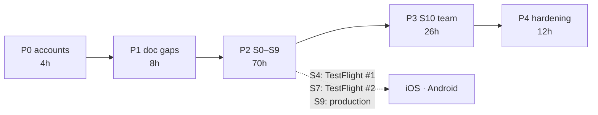

# Roadmap

<dl><dd>

- The plan to turn this repository from docs into the running backend: every call of [01-api](feature-docs/01-api.md) live on staging and production, tested, deployed by CI.
- Work follows the [feature guides](feature-guide/README.md), sprint by sprint, next to the iOS and Android apps (same sprint numbers). This file owns the backend ticks; the app roadmaps keep one backend row per sprint that points here.
- Status 2026-11-21: the code of S0–S10 is in the repository and green locally (format, lint, typecheck, 95+ tests on Postgres 16, build, `cdk synth`). Ticked steps are done in code; what is left needs accounts and AWS: P0, BE.S0.1 sign-ins, BE.S0.3 first staging deploy, BE.S9.1 production, BE.S10.9 migration on real data, P4.
- BE.P1.1 was done differently from the plan: F19 lists its parts and files and points to the code in the repository instead of copying it into the guide.

</dd></dl>

## Contents

<dl><dd>

1. [Phases](#phases)
2. [P0 — Accounts and access](#p0--accounts-and-access--4h)
3. [P1 — Close the doc gaps](#p1--close-the-doc-gaps--8h)
4. [P2 — Build S0–S9](#p2--build-s0s9--70h)
5. [P3 — Build S10 team and roles](#p3--build-s10-team-and-roles--26h)
6. [P4 — Hardening](#p4--hardening--12h)
7. [Done when](#done-when)
8. [Risks](#risks)

</dd></dl>

## Phases

<dl><dd>

| Phase | Hours | Ends with |
|---|---|---|
| P0 Accounts and access | 4 | AWS, domain, Firebase dev + prod, SES, GitHub secrets ready |
| P1 Close the doc gaps | 8 | F19 is a full guide with tested code; hours and boards agree |
| P2 Build S0–S9 | 70 | Production live; both apps ship against it |
| P3 Build S10 | 26 | Shared projects, roles, invites, activity, five push kinds |
| P4 Hardening | 12 | Load, security and restore checks passed; runbook written |
| **Total** | **120** | About 2 sprints of one developer at ~60 h each, spread over the app sprints |

- Step format: `BE.<phase or sprint>.n - [area] - [hours] - description`; tick `[x]` when its check passes.

</dd></dl>

## P0 — Accounts and access · 4h

<dl><dd>

- [ ] **BE.P0.1** - [AWS] - [1h] - Account, MFA on root, an admin user for the CLI, budget alarm at US$20 ([04-aws-operations](feature-docs/04-aws-operations.md))
- [ ] **BE.P0.2** - [DNS] - [0.5h] - Domain with `api-staging.` and `api.` records ready to add ([F00a](feature-guide/S0-foundation/F00a-setup.md))
- [ ] **BE.P0.3** - [Firebase] - [1h] - Projects `sitelog-dev` and `sitelog-prod`: Apple, Google and email sign-in, Cloud Messaging, APNs key, service-account JSON per project
- [ ] **BE.P0.4** - [Email] - [0.5h] - Amazon SES sender identity verified; staging stays in the sandbox (verified recipients only)
- [ ] **BE.P0.5** - [GitHub] - [1h] - Repository variables and the deploy role from F00c, branch protection on `main`

</dd></dl>

## P1 — Close the doc gaps · 8h

<dl><dd>

- [x] **BE.P1.1** - [Guide] - [5h] - F19 from skeleton to a full guide with compiled and tested code, like S0–S9: migration `0012_team.sql` (incl. `devices.kinds`, `issues.assignee_uid`), access, sync scope, keys, the ten team calls, SES mail, push kinds, `due-soon` worker job
- [x] **BE.P1.2** - [Guide] - [1h] - F19 tests table: preview, resend, PATCH projects, activity paging, push per kind and per device `kinds`
- [x] **BE.P1.3** - [Docs] - [1h] - Hours: F19 16h → 26h on the [sprint board](feature-guide/README.md#sprint-board), the S10 README and the app roadmaps' backend rows
- [ ] **BE.P1.4** - [Docs] - [1h] - Re-read 01-api against every guide: each endpoint and error code has a route file and a test row

</dd></dl>

## P2 — Build S0–S9 · 70h

<dl><dd>

- Each sprint runs next to the same app sprint; end every sprint with the check in its README and a green deploy to staging.

**S0 — Setup, skeleton, AWS staging · 11h** · [guides](feature-guide/S0-foundation/README.md)

- [ ] **BE.S0.1** - [Setup] - [2h] - F00a: tools installed and signed in
- [x] **BE.S0.2** - [API] - [5h] - F00b: Fastify + Postgres, config, errors, `/health`, migrations, vitest, Dockerfile, CI
- [ ] **BE.S0.3** - [AWS] - [4h] - F00c: CDK stacks, staging EC2 + RDS + S3, Caddy, DNS, deploy on merge

**S1 — Auth and projects · 7h** · [guides](feature-guide/S1-auth-projects/README.md)

- [x] **BE.S1.1** - [API] - [4h] - F02: token check, S3 adapter, `DELETE /account`, dev token script
- [x] **BE.S1.2** - [Data] - [3h] - F03: `0001_projects.sql`, table registry

**S2 — Sync · 8h** · [guide](feature-guide/S2-sync-engine/F04-sync.md)

- [x] **BE.S2.1** - [Sync] - [8h] - F04: revision counter, pull, push (last write wins, tombstones), routes, tests

**S3 — Captures and upload · 10h** · [guides](feature-guide/S3-capture-upload/README.md)

- [x] **BE.S3.1** - [Data] - [2h] - F05: captures table, frozen evidence columns
- [x] **BE.S3.2** - [Upload] - [8h] - F06: uploads table, keys and codes, presigned PUT, begin / complete / abort, media URLs

**S4 — Multipart · 6h** · [guide](feature-guide/S4-resumable-upload/F07-multipart.md) · TestFlight #1

- [x] **BE.S4.1** - [Upload] - [6h] - F07: 8 MiB parts, refresh part URLs, abort frees every part; a 1 GB video resumes after a kill

**S5 — Issues and markup · 3h** · [guides](feature-guide/S5-issues-markup/README.md)

- [x] **BE.S5.1** - [Data] - [2h] - F08: issues, issue captures, phrases
- [x] **BE.S5.2** - [Data] - [1h] - F09: annotations as JSON

**S6 — Verify and plans · 6h** · [guides](feature-guide/S6-reports-plans/README.md)

- [x] **BE.S6.1** - [API] - [4h] - F10: report branding, `GET /verify/:code`
- [x] **BE.S6.2** - [Data] - [2h] - F11: plan sheets, pins, plan file keys

**S7 — Checklists · 2h** · [guide](feature-guide/S7-checklists/F12-checklists.md) · TestFlight #2

- [x] **BE.S7.1** - [Data] - [2h] - F12: templates, items, runs, one answer per item

**S8 — Realtime and push · 11h** · [guides](feature-guide/S8-realtime-push/README.md)

- [x] **BE.S8.1** - [Realtime] - [8h] - F15: WebSocket hub, verify worker, abandoned uploads
- [x] **BE.S8.2** - [Push] - [3h] - F16: devices, FCM sender, "uploads verified" push

**S9 — Production · 6h** · [guide](feature-guide/S9-release/F18-production.md) · App Store

- [ ] **BE.S9.1** - [Ops] - [6h] - F18: tombstone purge, alarms and uptime, production stack, approved releases, restore test

</dd></dl>

## P3 — Build S10 team and roles · 26h

<dl><dd>

- Follows the full F19 guide from P1; staging first with two phones (Admin and Inspector), then production with a migration window.

- [x] **BE.S10.1** - [Data] - [3h] - `0012_team.sql`: members, invitations, project members, member events, `project_id` and `created_by` everywhere, one rev counter, `devices.kinds`, `issues.assignee_uid`
- [x] **BE.S10.2** - [Access] - [2h] - `reachable()`, `can()`, `403 not_invited`, `seed:admin`
- [x] **BE.S10.3** - [Sync] - [3h] - Pull by reachable projects, push `forbidden:<action>`, `resyncRequired`
- [x] **BE.S10.4** - [Files] - [2h] - `projects/{projectId}/…` keys, upload and media checks, `move-keys.ts` (written; run it in BE.S10.9)
- [x] **BE.S10.5** - [API] - [5h] - The ten team calls: `/me`, members, invitations (create, preview, accept, resend, cancel), `PATCH` / `DELETE /members/:uid`, `PUT /projects/:id/members`, `/member-events`; SES invite mail
- [x] **BE.S10.6** - [Push] - [4h] - `kind` on every push, per-device `kinds`, `issueAssigned` and `issueRechecked` from sync push, `access` from team routes, `due-soon` job at 8:00 site time
- [x] **BE.S10.7** - [Realtime] - [1h] - WebSocket subscribe needs a reachable project (`4003`)
- [x] **BE.S10.8** - [Tests] - [4h] - `access`, `sync-scope`, `team`, push-per-kind tests green
- [ ] **BE.S10.9** - [Ops] - [2h] - Run the migration on a staging copy, then production; move old S3 keys; check row counts

</dd></dl>

## P4 — Hardening · 12h

<dl><dd>

- [ ] **BE.P4.1** - [Security] - [3h] - One test per endpoint and role: no route answers without a token (except `/health`, `/verify/:code`, invite preview); no row leaks across projects
- [ ] **BE.P4.2** - [Load] - [3h] - k6 against staging: 20 devices syncing and uploading at once; p95 pull < 500 ms, no lost revs
- [ ] **BE.P4.3** - [Ops] - [2h] - Restore drill on production data (point-in-time), alarm test, cost check against the 04-aws-operations estimate
- [ ] **BE.P4.4** - [Docs] - [2h] - Runbook: deploy, roll back, rotate Firebase and SES secrets, read logs, restore
- [ ] **BE.P4.5** - [Docs] - [2h] - README Status says "running"; Quick start and Commands match the code; every guide's code still matches the repo

</dd></dl>

## Done when

<dl><dd>

| Check | How |
|---|---|
| Contract | Every row of [01-api §3](feature-docs/01-api.md#3-endpoints) answers on staging and production as documented |
| Tests | `npm test`, `npm run lint`, `npm run typecheck` green in CI on every PR |
| Deploy | Merge to `main` → staging; approved release → production; both through CDK and GitHub Actions |
| Ops | Alarms, uptime check, nightly purge, backups and a tested restore |
| Apps | iOS and Android sign in, sync, upload, verify, get pushes and manage the team against production |
| Docs | README, guides and specs describe the code that runs |

</dd></dl>

## Risks

<dl><dd>

| Risk | Plan |
|---|---|
| First AWS setup takes longer than 4h | Budget a spare evening in S0; keep the staging stack small (one EC2, one RDS) |
| F19 changes every synced table | Run it last, on a staging copy first; app releases that need F19 wait for it |
| SES sandbox blocks real invites | Request production access in P0; staging keeps verified recipients |
| Push to the wrong person | `account` hash check in the apps, per-project reach on the server, tests per kind |
| Guide code drifts from the repo | P4.5 re-reads the guides; a code change updates its guide in the same PR |

</dd></dl>
