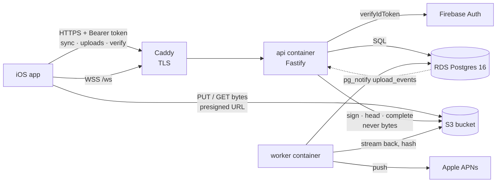

# Backend overview

<dl><dd>

- What the SiteLog backend does, how it is built and why. The app side: [SiteLog iOS](https://github.com/DAMHONGDUC/site_log_swift_ui).
- Contract the app codes against: [01-api](01-api.md). Build order: [feature guides](../feature-guide/README.md).

</dd></dl>

## Contents

<dl><dd>

1. [Role](#1-role)
2. [Architecture](#2-architecture)
3. [Stack](#3-stack)
4. [Decisions](#4-decisions)
5. [Environments](#5-environments)
6. [Cost](#6-cost)
7. [Conventions](#7-conventions)
8. [Beginner terms](#8-beginner-terms)

</dd></dl>

## 1. Role

<dl><dd>

| Does | Does not |
|---|---|
| Checks the Firebase ID token on every request | Sign users in (Firebase does) |
| Stores every metadata row and serves delta sync to every device | Decide business rules — the app decides, the server records |
| Signs S3 upload and download URLs, confirms uploads, issues verification codes | Receive or send file bytes (the app talks to S3 directly) |
| Re-reads stored files and proves their SHA-256 | Render reports |
| Pushes upload state over a WebSocket and APNs | Hold state in memory that matters (any process can die) |
| Deletes an account and everything it owns | |

</dd></dl>

## 2. Architecture

<dl><dd>

- One EC2 server runs three containers from one Docker Compose file: `caddy`, `api`, `worker` ([04-aws-operations](04-aws-operations.md)).
- Control, bytes and state travel separate paths: a slow API never stalls an upload.
- The API and the worker share one image; the worker only differs by its command.

| Folder | Layer | Holds |
|---|---|---|
| `src/routes/` | HTTP | One file per endpoint group; validates the body, calls the logic, logs |
| `src/sync/` | Logic | Table registry, pull, push |
| `src/realtime/` | Logic | WebSocket channel, `pg_notify` fan-out |
| `src/workers/` | Jobs | Verify, abandoned uploads, purge |
| `src/storage.ts`, `src/auth.ts`, `src/push/` | Adapters | S3, Firebase, APNs — the only files that talk to outside services |
| `src/config.ts`, `src/db.ts`, `src/errors.ts`, `src/logger.ts` | Core | Settings, database, error contract, logging |

- `app.ts` receives every adapter as a dependency (`AppDeps`), so tests pass fakes for Firebase and S3 and a real Postgres.

</dd></dl>

## 3. Stack

<dl><dd>

| Concern | Choice | Tested version |
|---|---|---|
| Runtime | Node.js LTS, TypeScript, ES modules | Node 24, TypeScript 6.0 |
| HTTP | Fastify + TypeBox schemas (`@fastify/type-provider-typebox`) | fastify 5.12, typebox 1.4 |
| WebSocket · rate limit | `@fastify/websocket` · `@fastify/rate-limit` | 11.3 · 11.2 |
| Database | PostgreSQL, `pg`, raw parameterized SQL, no ORM | Postgres 16, pg 8.23 |
| Migrations | Numbered `.sql` files, a 60-line runner (`src/migrate.ts`) | — |
| Files | Amazon S3, `@aws-sdk/client-s3` + `s3-request-presigner` | 3.1162 |
| Tokens | `firebase-admin` | 14.5 |
| Push | APNs over HTTP/2 (`node:http2`), JWT with `jose` | jose 6.2 |
| Logs | pino (built into Fastify), JSON | pino 10.4 |
| Tests | vitest, `aws-sdk-client-mock`, a real Postgres | vitest 5.1 |
| Lint · format | ESLint (`typescript-eslint`) · Prettier | 10.14 · 3.9 |
| Infrastructure | AWS CDK v2 in TypeScript | aws-cdk-lib 2.275 |
| Server | EC2 `t4g.small` (ARM) + Docker Compose + Caddy | Compose 2.29, Caddy 2.10 |
| CI · deploy | GitHub Actions, OIDC to AWS, SSM Run Command | — |

</dd></dl>

## 4. Decisions

<dl><dd>

### B01 — Node + PostgreSQL, hand-written sync

<dl><dd>

- **Context:** the backend signs URLs, countersigns hashes, owns all metadata, serves delta sync to several devices, pushes job state.
- **Decision:** Node + TypeScript + Fastify, PostgreSQL, raw SQL. Sync is a per-user revision counter, batched push, tombstones, last write wins in SQL.

| Rejected | Why not |
|---|---|
| Firestore | Vendor-tied model and queries; presigning and countersigning still need a server |
| Supabase | Postgres, but sync and conflict rules would still be ours |
| An ORM (Prisma, TypeORM) | Sync is mostly one `insert … on conflict … where` per row: plain SQL is shorter and visible |

</dd></dl>

### B02 — EC2 + Docker Compose, not ECS Fargate

<dl><dd>

- **Context:** one long-lived process with WebSocket and a `LISTEN` connection; real users from S4 on; one developer new to backends.
- **Decision:** one EC2 `t4g.small` per environment running `caddy`, `api`, `worker` with Docker Compose. CDK creates it; GitHub Actions deploys through SSM.

| Option | For | Against |
|---|---|---|
| **EC2 + Compose (chosen)** | ~$15/month server, one VM to understand, SSH-free shell through Session Manager | You patch the OS, a few seconds of downtime per deploy, scaling is manual |
| ECS Fargate + ALB | No server, rolling deploys, easy 2+ instances | ~$35–50/month per environment, more pieces (ALB, ECR, ECS, task roles) |

- **Consequences:** EC2 auto-recovery and Compose `restart: unless-stopped` cover crashes; `pg_notify` fan-out already works for a second server if scale is ever needed.

</dd></dl>

### B03 — AWS CDK for every AWS resource

<dl><dd>

- **Decision:** `infra/` is a CDK app in TypeScript; nothing is created by clicking in the console except the AWS account, the login and secret values.
- **Why:** staging and production must be identical; a PR shows infrastructure changes; same language as the API. Like `project.yml` for the Xcode project.

</dd></dl>

### B04 — S3 instead of Cloudflare R2

<dl><dd>

- **Decision:** one S3 bucket per environment, private, SSE-S3 encryption, abort unfinished multipart uploads after 7 days.
- **Why:** everything else is in AWS (IAM roles instead of R2 tokens); the S3 API is what the app's `UploadKit` already speaks; the verify worker reads objects inside the region for free.
- **Cost:** downloads to phones cost ~$0.12/GB after 100 GB per month free — R2 would be free here.

</dd></dl>

### B05 — Firebase Auth stays the identity provider

<dl><dd>

- **Decision:** the app signs in with Firebase (Sign in with Apple, email); the backend only verifies ID tokens with `firebase-admin` and `checkRevoked`.
- **Why:** the iOS F02 guide is built on Firebase Auth; free up to 50k monthly users; Cognito would mean rewriting the app's sign-in.

</dd></dl>

### B06 — Caddy in front of the API

<dl><dd>

- **Decision:** Caddy terminates HTTPS with a free Let's Encrypt certificate it renews by itself, and proxies HTTP and WebSocket to the API.
- **Why:** no load balancer to pay for; one 4-line config file. iOS requires HTTPS outside `localhost`.

</dd></dl>

### B07 — One image, API and worker as two containers

<dl><dd>

- **Decision:** `node dist/main.js` serves requests, `node dist/worker.js` runs background jobs, `node dist/migrate.js` runs migrations — all from one image.
- **Why:** hashing a 2 GB video must not slow requests; a worker crash does not drop sockets; one build to ship.

</dd></dl>

### B08 — Own migration runner instead of a library

<dl><dd>

- **Decision:** `src/migrate.ts` runs every new `.sql` file in name order, each in a transaction, under an advisory lock; forward only.
- **Why:** 60 lines that a beginner can read fully; plain SQL files; no down-migrations to maintain.

</dd></dl>

</dd></dl>

## 5. Environments

<dl><dd>

| Env | Runs where | Database | Files | Firebase | Deploys |
|---|---|---|---|---|---|
| `dev` | Your Mac (`npm run dev`) | Docker Postgres | S3 `sitelog-dev-<account>` (stack `SiteLog-Dev`) | `sitelog-dev` project | — |
| `test` | Your Mac and CI (`npm test`) | `sitelog_test`, recreated per run | Mocked | Faked | — |
| `staging` | EC2 `SiteLog-Staging` | RDS | S3 `sitelog-staging-<account>` | `sitelog-dev` project | Every push to `main` |
| `prod` | EC2 `SiteLog-Prod` | RDS, deletion protected | S3 `sitelog-prod-<account>` | `sitelog-prod` project | A `v*` tag, after approval |

- The app's build configurations map to these: Debug → `dev` or `staging`, Release → `prod` (iOS `SiteLog/App/Config/`).

</dd></dl>

## 6. Cost

<dl><dd>

- Region `ap-southeast-1` (Singapore), on-demand prices, rounded; check with the [AWS Pricing Calculator](https://calculator.aws/).

| Item | Per environment | USD / month |
|---|---|---|
| EC2 `t4g.small` | 2 vCPU, 2 GB | ~15 |
| EBS gp3 | 20 GB | ~2 |
| Public IPv4 | 1 Elastic IP | ~3.6 |
| RDS `db.t4g.micro` | 20 GB gp3, 7–14 days backups | ~20 |
| S3 | 100 GB stored | ~2.5 |
| CloudWatch Logs, Secrets Manager, ECR | | ~2–4 |
| **Total** | | **~45** |

| Shared | USD |
|---|---|
| Domain | ~10–15 / year |
| Route 53 health check (prod) | ~0.5–1 / month |
| Firebase Auth, APNs, GitHub Actions (free tiers) | 0 |

- Staging + production: ~$90/month. To save, stop the staging server and database when not testing (`aws ec2 stop-instances`, `aws rds stop-db-instance`).
- What grows with users: S3 storage (~$25 per TB per month) and downloads to phones (~$0.12/GB after the free 100 GB). Uploads into S3 are free.

</dd></dl>

## 7. Conventions

<dl><dd>

| Rule | Detail |
|---|---|
| Naming | Files `kebab-case.ts`; types `PascalCase`; functions `camelCase`; SQL `snake_case`; JSON `camelCase` |
| Errors | Routes throw `AppError` helpers (`badRequest`, `notFound`…); one error handler turns them into the [error contract](01-api.md#2-error-contract) |
| 400 and 404 | Only for permanent problems: the app aborts an upload on them |
| SQL | Parameterized (`$1`) only; every user query filters `uid` |
| Logging | Every action logs one line with ids (`uid`, `uploadId`, counts, `elapsedMs`); every `catch` logs; never tokens, URLs or service-account JSON; never `console` |
| Comments | Only when the code cannot say it, one short line; no file headers beyond one purpose line |
| Dependencies | Well-known, maintained packages only; versions pinned by `package-lock.json` |
| Tests | Written after a feature works end to end; real Postgres, faked Firebase and S3 |
| Docs | Short, bullets and tables, contents at the top; run `python3 Tools/Docs/indent-md.py` after editing |
| Secrets | Never in git: `.env` locally, SSM Parameter Store and Secrets Manager on AWS |

</dd></dl>

## 8. Beginner terms

<dl><dd>

- **Endpoint:** one named server operation, e.g. `POST /uploads`.
- **Middleware / preHandler:** code Fastify runs before a route, e.g. `requireUser` checks the token.
- **Migration:** a numbered SQL file that changes the database once, e.g. `0003_captures.sql` adds a table.
- **Transaction:** several SQL statements that succeed or fail together.
- **Presigned URL:** a temporary address that lets the app upload one file straight to S3.
- **Container:** a packaged process with its own files; **image:** the package it starts from.
- **IaC (infrastructure as code):** AWS resources described in code (CDK) and created by a command.

</dd></dl>
