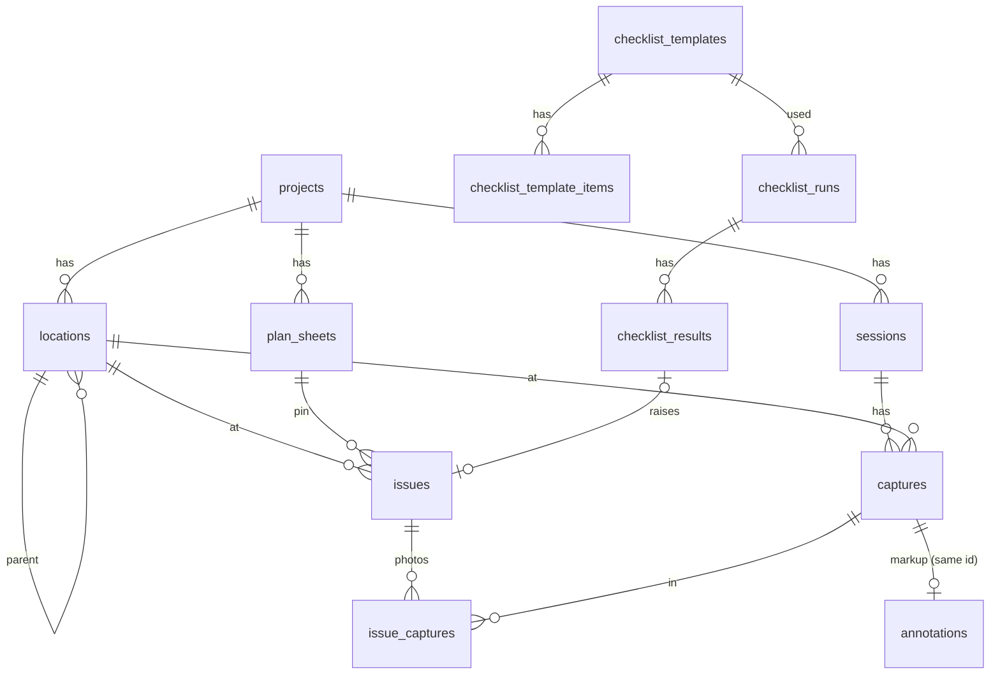

# Database

<dl><dd>

- PostgreSQL 16. Every change is a numbered file in `migrations/`, run once, forward only ([B08](00-overview.md#b08--own-migration-runner-instead-of-a-library)).
- Field-by-field contract of the synced tables: [01-api §6.3](01-api.md#63-synced-tables).

</dd></dl>

## Contents

<dl><dd>

1. [Migrations](#1-migrations)
2. [Synced tables](#2-synced-tables)
3. [Server-only tables](#3-server-only-tables)
4. [Relations](#4-relations)
5. [Rules](#5-rules)

</dd></dl>

## 1. Migrations

<dl><dd>

| File | Feature | Creates |
|---|---|---|
| `0001_projects.sql` | F03 | `session_state` enum, `projects`, `locations`, `sessions` |
| `0002_sync_state.sql` | F04 | `sync_state` |
| `0003_captures.sql` | F05 | `captures` |
| `0004_uploads.sql` | F06 | `upload_mode`, `upload_state`, `verify_state` enums, `uploads` |
| `0005_issues.sql` | F08 | `issues`, `issue_captures`, `phrases` |
| `0006_annotations.sql` | F09 | `annotations` |
| `0007_report_branding.sql` | F10 | `report_branding` |
| `0008_plan_sheets.sql` | F11 | `plan_sheets`; foreign key `issues.plan_sheet_id` |
| `0009_checklists.sql` | F12 | four checklist tables; foreign key `issues.source_checklist_result_id` |
| `0010_verify_worker.sql` | F15 | `uploads.verify_claimed_at` |
| `0011_devices.sql` | F16 | `devices` |

- `schema_migrations (name, run_at)` records what ran. A file that ran is never edited: fix it with a new file.

</dd></dl>

## 2. Synced tables

<dl><dd>

- Every synced table starts with the same five columns:

| Column | Type | Set by | Why |
|---|---|---|---|
| `id` | `uuid` primary key | App | Rows are created offline, so the app makes the id |
| `uid` | `text` | Server, from the token | Owner; every query filters it |
| `rev` | `bigint` | Server | Position in the user's change history; pull reads `rev > since` |
| `client_updated_at` | `timestamptz` | App | Last write wins |
| `deleted_at` | `timestamptz` | App (delete) | Tombstone, purged after 90 days |

- Index `(uid, rev)` on every synced table makes pull fast.
- Business columns: [01-api §6.3](01-api.md#63-synced-tables); exact SQL: the migration files.

</dd></dl>

## 3. Server-only tables

<dl><dd>

| Table | Key | Holds |
|---|---|---|
| `sync_state` | `uid` | `last_rev` (per-user counter), `purged_through_rev` (resync watermark) |
| `uploads` | `id` (server uuid) | One row per upload job: key, size, hash, mode, S3 upload id, state, verification code, verify state |
| `devices` | `token` | APNs token, owner, `sandbox` or `production` |
| `schema_migrations` | `name` | Migrations that ran |

| `uploads.state` | Meaning |
|---|---|
| `created` | Begun; bytes may be on their way |
| `completed` | Object confirmed in S3, code issued |
| `aborted` | Cancelled or abandoned; never completes |

| `uploads.verify_state` | Meaning |
|---|---|
| `registered` | The client's hash is recorded |
| `verified` | The worker re-read the object and the hash matches |
| `mismatch` | The stored bytes hash to something else |

</dd></dl>

## 4. Relations

<dl><dd>

</dd></dl>

## 5. Rules

<dl><dd>

| Rule | How |
|---|---|
| A row points only at rows of the same user | Foreign keys include `uid`: `foreign key (uid, project_id) references projects (uid, id)` |
| A push may insert a child before its parent | Every foreign key is `deferrable initially deferred`: checked at commit |
| A tombstone does not block reuse | Unique indexes are partial: `… where deleted_at is null` |
| No free-text states | `check (kind in (…))` or an enum |
| Sizes over 2 GB | `bigint` |
| Times | `timestamptz`, the session runs in UTC |
| Coordinates come in pairs | `check ((latitude is null) = (longitude is null))` |
| A pin is complete or absent | `check` on `plan_sheet_id`, `pin_x`, `pin_y` |

</dd></dl>
