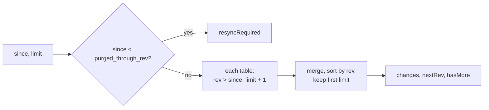
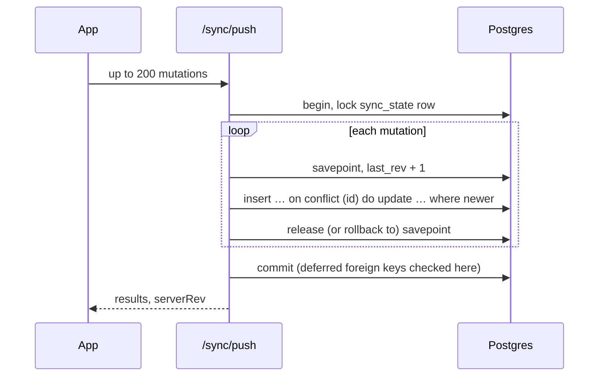
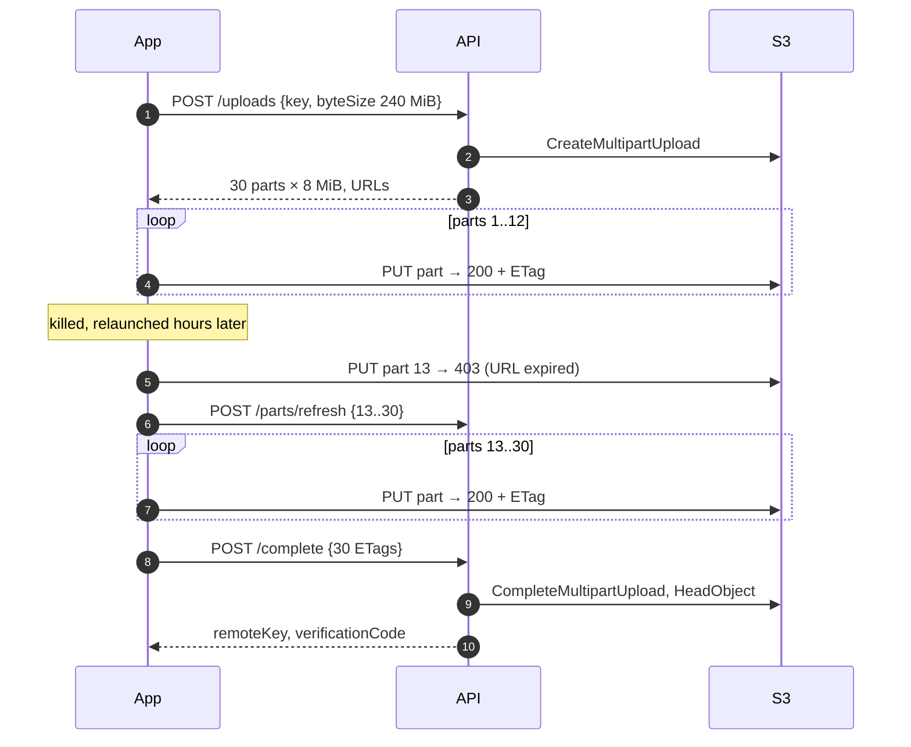
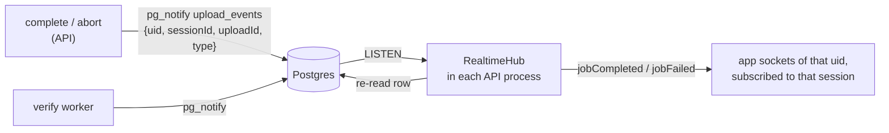

# Sync, uploads, realtime

<dl><dd>

- How the backend keeps devices in step, accepts files and reports their state. Request and response shapes: [01-api](01-api.md).

</dd></dl>

## Contents

<dl><dd>

1. [Sync](#1-sync)
2. [Uploads](#2-uploads)
3. [Integrity](#3-integrity)
4. [Realtime](#4-realtime)
5. [Background jobs](#5-background-jobs)
6. [Security rules](#6-security-rules)

</dd></dl>

## 1. Sync

<dl><dd>

### 1.1 Revisions

<dl><dd>

- Each user has one counter, `sync_state.last_rev`. Every row a push writes gets the next number in `rev`.
- A push first locks the user's `sync_state` row (`select … for update`). A second push of the same user waits, so revs are committed in order.

| Why not a timestamp or a sequence | What goes wrong |
|---|---|
| `updated_at > since` | Two devices' clocks differ; a row written "in the past" is never pulled |
| `nextval()` sequence | Rev 8 can commit before rev 7; a device that pulled up to 8 never sees 7 |

</dd></dl>

### 1.2 Pull

<dl><dd>

- Revs are unique per user, so `limit + 1` rows from each table are enough to find the first `limit` overall.

</dd></dl>

### 1.3 Push

<dl><dd>

| Case | Result |
|---|---|
| New row | `applied` |
| Existing row, mutation newer | `applied` (frozen columns keep their value; `sessions.state` takes the higher state) |
| Existing row, mutation older | `superseded` + stored row (unless `sessions.state` moved forward: then `applied`) |
| Row deleted on the server | `superseded` + tombstone |
| Same natural key as a live row | `superseded` + that row |
| Id owned by another user | `rejected: forbidden` |
| Bad value or broken rule | `rejected: invalid_row:<code>`; the rest of the batch still applies |
| Parent missing at commit | Batch retried one mutation per transaction; only that one `rejected: missing_parent` |

- Last write wins is decided in SQL: `where t.client_updated_at < excluded.client_updated_at`.
- A delete wins a tie with an edit made at the same millisecond.

</dd></dl>

</dd></dl>

## 2. Uploads

<dl><dd>

| Rule | Why |
|---|---|
| The API never sees bytes | A slow server never stalls an upload; no bandwidth bill on the server |
| Mode from size: < 5 MiB single PUT, else 8 MiB parts | Few requests for photos, resumable for video |
| `complete` locks the row, then checks S3 | Two concurrent completes return the same body |
| `HeadObject` before recording | Nobody gets a code for a file they never uploaded |
| Size must equal `byteSize` | A truncated upload is caught at once |
| S3 client with `requestChecksumCalculation: 'WHEN_REQUIRED'` | Otherwise presigned URLs demand a checksum header the app does not send |

</dd></dl>

## 3. Integrity

<dl><dd>

| Step | Who | Claim |
|---|---|---|
| `registered` | `complete` | "This account registered this hash at this time" |
| `verified` | Worker re-reads the object, recomputes SHA-256 | "The stored bytes hash to this value" |
| `mismatch` | Worker hash differs | `jobFailed(integrity)` to the app |

- Recording a hash the app sent proves nothing by itself: the worker's check is what makes a report say "verified".
- Reading objects back from EC2 in the same region costs nothing.

</dd></dl>

## 4. Realtime

<dl><dd>

- The notification carries ids only (Postgres caps payloads at 8000 bytes); the hub reads the row.
- `pg_notify` inside a transaction is delivered at commit and dropped on rollback.
- Delivery is at most once. The `snapshot` after every `subscribe` is how the app catches up.
- Works unchanged with one API process or several.

</dd></dl>

## 5. Background jobs

<dl><dd>

| Job | When | Does |
|---|---|---|
| Verify | Continuously, one upload at a time | Claims the oldest `registered` upload (`for update skip locked`, a 30-minute claim), hashes it, sets `verified` or `mismatch`, notifies; F16: pushes when a session is fully verified |
| Abandoned uploads | Hourly | `created` uploads older than 7 days → abort in S3, `aborted` |
| Tombstone purge | Daily | Deletes rows with `deleted_at` older than 90 days, raises `purged_through_rev` |

- S3 also deletes unfinished multipart parts after 7 days (bucket lifecycle rule).

</dd></dl>

## 6. Security rules

<dl><dd>

| Rule | Where |
|---|---|
| Token checked on every request, with `checkRevoked` | `src/auth.ts` |
| Auth failures are `401`, never `403` | `src/auth.ts` |
| Every user query filters `uid = $n` | All routes, `src/sync/` |
| Keys must match a full pattern starting with the caller's uid | `src/keys.ts` |
| Foreign keys include `uid` | Migrations |
| `/verify` returns facts only, constant delay, rate limited | `src/routes/verify.ts` |
| Token only in the first WebSocket message, never the URL | `src/realtime/ws.ts` |
| Logs never contain tokens, URLs or keys' signatures | `src/logger.ts` redaction, route log fields |
| Bucket private, TLS only, encrypted | `infra/lib/env-stack.ts` |
| Database in isolated subnets, reachable only from the server | `infra/lib/env-stack.ts` |

</dd></dl>
