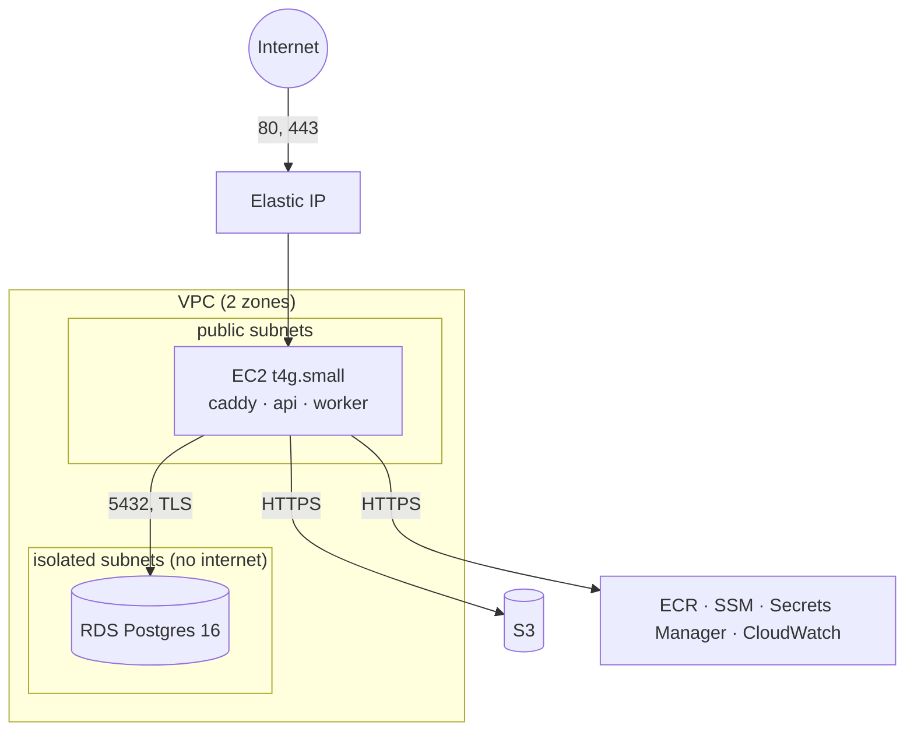
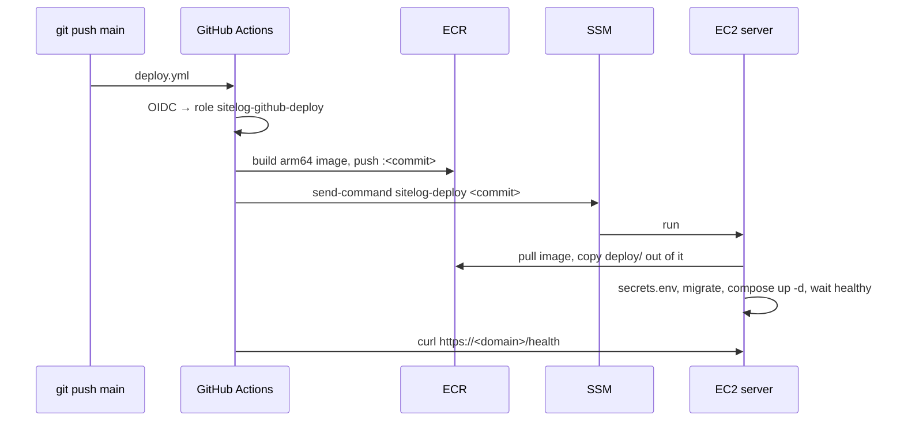

# AWS and operations

<dl><dd>

- Every AWS resource, setting and secret of the backend, how a deploy works, and how to run it day to day.
- All resources come from the CDK app in `infra/` ([B03](00-overview.md#b03--aws-cdk-for-every-aws-resource)). Region: `ap-southeast-1`.

</dd></dl>

## Contents

<dl><dd>

1. [Stacks](#1-stacks)
2. [Network](#2-network)
3. [Configuration](#3-configuration)
4. [Secrets](#4-secrets)
5. [Deploy](#5-deploy)
6. [Logs and alarms](#6-logs-and-alarms)
7. [Backups](#7-backups)
8. [Runbook](#8-runbook)

</dd></dl>

## 1. Stacks

<dl><dd>

| Stack | Created in | Holds |
|---|---|---|
| `SiteLog-Shared` | F00c | ECR repository `sitelog-api`, GitHub OIDC provider, role `sitelog-github-deploy` |
| `SiteLog-Dev` | F00c | S3 bucket `sitelog-dev-<account>` for your laptop |
| `SiteLog-Staging` | F00c | VPC, RDS, S3, EC2 + Elastic IP, IAM role, log groups; alarms from F18 |
| `SiteLog-Prod` | F18 | Same as staging, deletion-protected database, 14-day backups |
| `SiteLog-Prod-Uptime` | F18 | Route 53 health check on `/health` and its alarm (us-east-1) |

</dd></dl>

## 2. Network

<dl><dd>



| Security group | In | From |
|---|---|---|
| Server | 80, 443 | anywhere |
| Database | 5432 | the server group only |

- No SSH port: shell access goes through SSM Session Manager.
- No NAT gateway (~$32/month saved): the server has a public IP; the database needs no internet.

</dd></dl>

## 3. Configuration

<dl><dd>

| Variable | Default | Where it comes from on AWS | Meaning |
|---|---|---|---|
| `DATABASE_URL` | — | Built by `deploy.sh` from the RDS secret | Postgres connection |
| `DATABASE_SSL_CA_PATH` | — | `compose.yml` | RDS certificate bundle in the image; turns on verified TLS |
| `PG_POOL_MAX` | `10` | — | Connections per process (RDS micro allows ~80) |
| `AWS_REGION` | — | `instance.env` | Region for S3 |
| `S3_BUCKET` | — | `instance.env` | The environment's bucket |
| `FIREBASE_SERVICE_ACCOUNT_BASE64` | — | SSM | Firebase service-account JSON, base64 |
| `PORT` · `LOG_LEVEL` | `3000` · `info` | `compose.yml` | |
| `PRESIGN_TTL_SECONDS` | `3600` | — | Presigned URL lifetime |
| `SINGLE_PUT_THRESHOLD_BYTES` | `5242880` | — | Must match the app |
| `PART_SIZE_BYTES` | `8388608` | — | Must match the app |
| `MAX_UPLOAD_BYTES` | 20 GiB | — | Largest file |
| `MAX_REQUEST_BYTES` | 1 MiB | — | Largest JSON body |
| `PULL_PAGE_SIZE_MAX` · `PUSH_BATCH_MAX` | `500` · `200` | — | Sync limits |
| `TOMBSTONE_RETENTION_DAYS` | `90` | — | Purge window |
| `VERIFY_MIN_DELAY_MS` · `VERIFY_RATE_LIMIT_PER_MINUTE` | `300` · `30` | — | `/verify` timing and limit |
| `UPLOAD_RATE_LIMIT_PER_MINUTE` | `600` | — | Begins per user |
| `MAX_SOCKETS_PER_USER` | `5` | — | WebSocket cap |
| `APNS_KEY_P8_BASE64`, `APNS_KEY_ID`, `APNS_TEAM_ID`, `APNS_BUNDLE_ID` | — | SSM | Push (F16) |
| `ENV_NAME`, `API_DOMAIN`, `ECR_REPOSITORY`, `DB_SECRET_ARN` | — | `instance.env` | Used by `deploy.sh` and Caddy |

- `src/config.ts` reads every variable once at start and fails fast on a missing one.

</dd></dl>

## 4. Secrets

<dl><dd>

| Secret | Store | Path or name | Created by |
|---|---|---|---|
| Database password | Secrets Manager | `SiteLog-Staging…DatabaseSecret…` (generated) | CDK |
| Firebase service account | SSM Parameter Store, `SecureString` | `/sitelog/<env>/FIREBASE_SERVICE_ACCOUNT_BASE64` | You, once ([F00c](../feature-guide/S0-foundation/F00c-aws-staging.md)) |
| APNs key | SSM, `SecureString` | `/sitelog/<env>/APNS_KEY_P8_BASE64`, `…/APNS_KEY_ID`, `…/APNS_TEAM_ID`, `…/APNS_BUNDLE_ID` | You, in F16 |

- `deploy.sh` turns every parameter under `/sitelog/<env>/` into `NAME=value` in `/opt/sitelog/secrets.env` (root-only). Adding a secret = one `put-parameter` + a deploy.

</dd></dl>

## 5. Deploy

<dl><dd>



| Trigger | Target |
|---|---|
| Push to `main` | staging |
| Tag `v*` (e.g. `v1.0.0`) | production, after a reviewer approves the `production` environment |

- Rollback: run the `Deploy` workflow's SSM step with an older commit, or on the server `sitelog-deploy <older-commit>`. Migrations are forward only, so a rollback must work with the newer schema (add columns, never rename or drop in the same release).

</dd></dl>

## 6. Logs and alarms

<dl><dd>

| Log group | From |
|---|---|
| `/sitelog/<env>/api` | Fastify JSON logs: one line per request + one per action |
| `/sitelog/<env>/worker` | Verify, abandoned, purge, push |
| `/sitelog/<env>/caddy` | TLS certificate and proxy errors |

| Alarm (F18) | Fires when | Action |
|---|---|---|
| EC2 system check | Host hardware fault, 2 min | Auto-recover the instance, email |
| EC2 instance check | OS not responding, 3 min | Reboot, email |
| RDS free storage | < 2 GB | Email |
| RDS CPU | > 80 % for 15 min | Email |
| API 5xx | ≥ 5 in 5 min (log metric `$.res.statusCode >= 500`) | Email |
| Uptime (prod) | `/health` fails from Route 53 checkers for 2 min | Email |

- CloudWatch Logs Insights, the query you will use most:

```text
fields @timestamp, msg, uid, uploadId, res.statusCode, err.message
| filter level >= 40
| sort @timestamp desc
| limit 50
```

</dd></dl>

## 7. Backups

<dl><dd>

| What | How | Kept |
|---|---|---|
| Database | RDS automated backups + point-in-time restore | 7 days staging, 14 days prod |
| Files | S3 (11 nines durability); no versioning — deletes are user actions | — |
| Infrastructure | `infra/` in git | — |

- Restore test, once per release ([F18](../feature-guide/S9-release/F18-production.md)): restore to a new instance at a point in time, connect, count rows, delete it.

</dd></dl>

## 8. Runbook

<dl><dd>

| Task | Command |
|---|---|
| Shell on the server | `aws ssm start-session --target <instance-id>` (needs the Session Manager plugin) |
| Containers | `cd /opt/sitelog && sudo docker compose ps` |
| Last API logs | `sudo docker compose logs --tail 100 api` |
| Restart the API | `sudo docker compose restart api` |
| Deploy a commit by hand | `sudo /usr/local/bin/sitelog-deploy <commit>` |
| OS updates | `sudo dnf upgrade -y && sudo reboot` (monthly; containers come back by themselves) |
| Psql into RDS | From the server: `sudo docker compose run --rm api node -e "…"`, or a temporary `postgres:16` container with the URL from `secrets.env` |
| Stop staging to save money | `aws ec2 stop-instances --instance-ids <id>` and `aws rds stop-db-instance --db-instance-identifier <id>` (RDS restarts itself after 7 days) |

</dd></dl>
