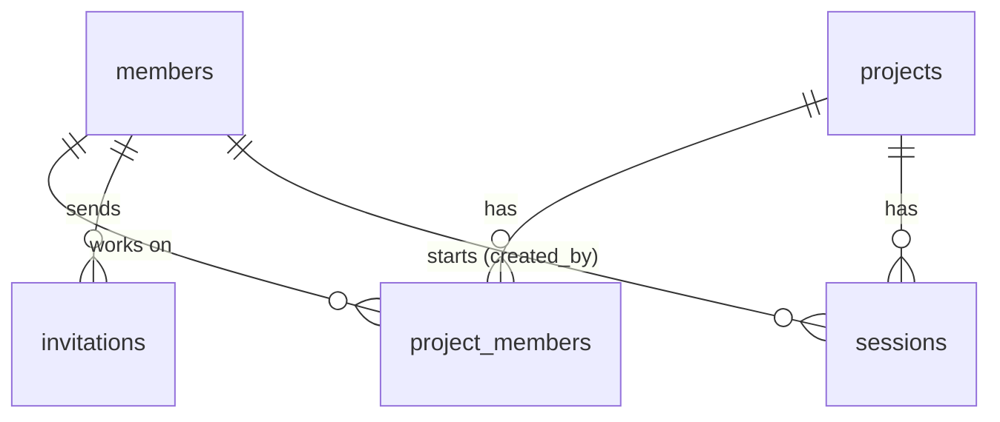
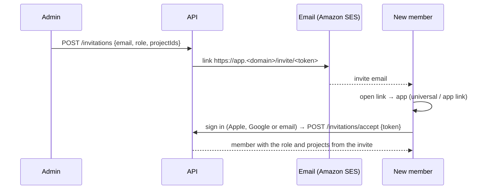

# Team and roles

<dl><dd>

- SiteLog is one company's internal tool: one company, many members, four roles, and projects shared between the members who work on them.
- This page is the source for who can see and do what. API shapes: [01-api §13](01-api.md#13-team); tables: [02-database](02-database.md); sync scope: [03-sync-uploads-realtime §1](03-sync-uploads-realtime.md#1-sync).

</dd></dl>

## Contents

<dl><dd>

1. [Model](#1-model)
2. [Roles](#2-roles)
3. [Permissions](#3-permissions)
4. [Project access](#4-project-access)
5. [Invitations and sign-in](#5-invitations-and-sign-in)
6. [Sync with shared projects](#6-sync-with-shared-projects)
7. [Files](#7-files)
8. [Removing a member, deleting an account](#8-removing-a-member-deleting-an-account)
9. [Audit](#9-audit)

</dd></dl>

## 1. Model

<dl><dd>

| Thing | Meaning |
|---|---|
| Company | Implicit: the whole deployment is one company, so there is no company table |
| Member | A Firebase user the company let in, with one role |
| Project member | A member added to a project; Admins and Managers see every project without being added |
| Invitation | An email, a role and the projects to join, waiting for that person to sign in |
| Issue assignee | A member (`assignee_uid`) or, for a subcontractor without the app, a typed name (`assignee_name`); the apps show the member's photo or initials |

- Every synced row keeps who made it (`created_by`, a member uid) and which project it belongs to (`project_id`); the row belongs to the company, not to the person.

</dd></dl>

## 2. Roles

<dl><dd>

| Role | Who | In short |
|---|---|---|
| **Admin** | Head of site supervision, IT | Everything, plus members and roles |
| **Manager** | Project / site manager | Runs projects: creates them, sets up rooms and plans, closes issues, signs reports |
| **Inspector** | Site supervisor in the field | Walks the site: sessions, photos, issues, checklists, re-checks, reports |
| **Viewer** | Client representative, subcontractor lead | Reads the projects they are added to: photos, issues, plans, reports |

- A member has exactly one role, set by an Admin. There is always at least one Admin.

</dd></dl>

## 3. Permissions

<dl><dd>

| Action | Admin | Manager | Inspector | Viewer |
|---|:-:|:-:|:-:|:-:|
| See projects | All | All | Added to | Added to |
| Create, edit, archive a project | ✓ | ✓ | – | – |
| Delete a project | ✓ | – | – | – |
| Add or remove project members | ✓ | ✓ | – | – |
| Edit rooms (locations), bulk generate | ✓ | ✓ | – | – |
| Upload, rename, remove plans | ✓ | ✓ | – | – |
| Start and end a session, capture, measure | ✓ | ✓ | ✓ | – |
| Log an issue, mark up, pin on a plan | ✓ | ✓ | ✓ | – |
| Re-check an issue, close it | ✓ | ✓ | ✓ | – |
| Delete an issue or a capture | ✓ | ✓ | Own, same day | – |
| Run a checklist | ✓ | ✓ | ✓ | – |
| Edit checklist templates | ✓ | ✓ | – | – |
| Make a report, sign it | ✓ | ✓ | ✓ | – |
| Read photos, issues, plans, reports | ✓ | ✓ | ✓ | ✓ |
| Edit report branding | ✓ | ✓ | – | – |
| Invite members, change roles, remove members | ✓ | – | – | – |

- The server enforces every row of this table; the apps hide what a role cannot do, but never rely on that.
- "Own, same day": the Inspector who created the row (`created_by`), before 23:59 of the day it was made (site time zone); after that only Managers delete, so evidence stays.

</dd></dl>

## 4. Project access

<dl><dd>

| Role | Projects reachable |
|---|---|
| Admin, Manager | Every project of the company |
| Inspector, Viewer | Rows in `project_members` for their uid |

- `reachable(uid)` is the one function every route, the sync pull, the upload signer, the WebSocket and push use. Nothing else decides access.

</dd></dl>

## 5. Invitations and sign-in

<dl><dd>

| Rule | Detail |
|---|---|
| Who may sign in | Only members and people holding a valid invite; anyone else gets `403 not_invited` |
| First Admin | Created once at setup: `npm run seed:admin -- <email>` on the server, never through the app |
| Invite link | Single use, 7 days, token stored only as a SHA-256 hash; the email must match the signed-in account's email |
| Preview | `GET /invitations/:token` shows who invited, the role and the projects before sign-in (T5); masked email, rate limited, never consumes the invite |
| Resend, cancel | Admin: `POST /invitations/:id/resend` makes a new token and voids the old one; `DELETE /invitations/:id` cancels |
| Change a member | Admin: `PATCH /members/:uid` with a role and / or project ids (T3); Admins and Managers also set a project's people with `PUT /projects/:id/members` (T4) |

</dd></dl>

## 6. Sync with shared projects

<dl><dd>

| Before (one user) | Now (one company) |
|---|---|
| A rev counter per user | One company counter (`sync_counter`, one row); every write still takes the next rev under a row lock |
| Pull: rows with `uid = me` | Pull: rows with `project_id in reachable(me)` and `rev > since` |
| Rows point only at the same user's rows | Rows point only at rows of the same project |
| Push: any row of mine | Push: each mutation is checked against §3; a refused one is `rejected` with reason `forbidden:<action>` |

- Phrases stay personal: `phrases` keep `uid` and sync only to their owner.
- Report branding becomes company-wide: one row, edited by Admins and Managers.
- When a member is added to a project, removed from it, or changes role, the server sets `members.resync_required`; their next pull answers `resyncRequired` and the app rebuilds its store from `0`. Rows of a project they lost are wiped from the device.

</dd></dl>

## 7. Files

<dl><dd>

| File | Key (was `{uid}/…`) |
|---|---|
| Capture | `projects/{projectId}/{sessionId}/{captureId}.{ext}` |
| Plan sheet | `projects/{projectId}/plans/{sheetId}.{ext}` |
| Branding logo | `company/branding/{logoId}.{png·jpg}` |

- Begin upload: the caller must be allowed to write that project (§3). Media URLs: the caller must reach the project. Otherwise `403 forbidden`.

</dd></dl>

## 8. Removing a member, deleting an account

<dl><dd>

| Event | What happens |
|---|---|
| Admin removes a member | Firebase tokens revoked, devices deleted, project memberships removed; everything they made stays, shown as made by "former member" |
| A member deletes their account (App Store / Google Play rule) | Same as above, plus the Firebase user and their phrases are deleted; company records stay, because they are the company's evidence |
| The last Admin | Cannot be removed, demoted or deleted (`409 last_admin`) |

</dd></dl>

## 9. Audit

<dl><dd>

- `member_events` records every invite, accept, role change, project add / remove and removal: who, whom, what, when. Admins read it in the app (Team → Activity, T9) through `GET /member-events`, newest first, 50 a page; it is never edited or deleted.

</dd></dl>
