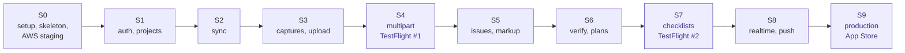
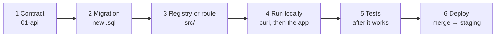

# Backend feature guides

<dl><dd>

- Step-by-step build of the backend, one folder per sprint, one guide per feature. Same sprints and feature numbers as the [iOS guides](https://github.com/DAMHONGDUC/site_log_swift_ui/tree/main/docs/feature-guide): a feature's app and backend work go in the same sprint.
- Specs: [feature-docs](../feature-docs/00-overview.md). The contract the app uses: [01-api](../feature-docs/01-api.md).
- Run the backend next to the app: [local testing with iOS](local-testing-with-ios.md).

</dd></dl>

## Contents

<dl><dd>

1. [Sprint board](#sprint-board)
2. [How a backend feature runs](#how-a-backend-feature-runs)
3. [How to use a guide](#how-to-use-a-guide)
4. [Rules](#rules)
5. [Tested versions](#tested-versions)

</dd></dl>

## Sprint board

<dl><dd>

| Sprint | Guides | Hours | Ends with |
|---|---|---|---|
| [S0](S0-foundation/README.md) | [F00a Setup](S0-foundation/F00a-setup.md) · [F00b API skeleton](S0-foundation/F00b-api-skeleton.md) · [F00c AWS staging](S0-foundation/F00c-aws-staging.md) | 11 | `https://api-staging.<domain>/health` answers; CI green |
| [S1](S1-auth-projects/README.md) | [F02 Auth](S1-auth-projects/F02-auth.md) · [F03 Projects](S1-auth-projects/F03-projects.md) | 7 | A call without a token is `401`; project tables exist |
| [S2](S2-sync-engine/README.md) | [F04 Sync](S2-sync-engine/F04-sync.md) | 8 | Two devices see each other's projects |
| [S3](S3-capture-upload/README.md) | [F05 Captures](S3-capture-upload/F05-captures.md) · [F06 Upload](S3-capture-upload/F06-upload.md) | 10 | A photo goes to S3 and gets a code |
| [S4](S4-resumable-upload/README.md) | [F07 Multipart](S4-resumable-upload/F07-multipart.md) | 6 | A 1 GB video resumes after a kill |
| [S5](S5-issues-markup/README.md) | [F08 Issues](S5-issues-markup/F08-issues.md) · [F09 Annotations](S5-issues-markup/F09-annotations.md) | 3 | Issues and markup sync |
| [S6](S6-reports-plans/README.md) | [F10 Reports, verify](S6-reports-plans/F10-reports-verify.md) · [F11 Plans](S6-reports-plans/F11-plans.md) | 6 | A code from a PDF resolves at `/verify` |
| [S7](S7-checklists/README.md) | [F12 Checklists](S7-checklists/F12-checklists.md) | 2 | Checklist answers sync |
| [S8](S8-realtime-push/README.md) | [F15 Realtime](S8-realtime-push/F15-realtime.md) · [F16 Push](S8-realtime-push/F16-push.md) | 11 | Uploads turn "verified" live; a push arrives |
| [S9](S9-release/README.md) | [F18 Production](S9-release/F18-production.md) | 6 | Production live, alarms, backups tested |

- Hours come from the sprint plan. A first AWS setup (F00c) often takes longer: budget a spare evening.
- Features without backend work: F01 Access, F13 DeviceLink, F14 Diagnostics, F17 Accessibility.

</dd></dl>

## How a backend feature runs

<dl><dd>

| Step | Builds | Done when |
|---|---|---|
| 1 Contract | Read the feature's rows in [01-api](../feature-docs/01-api.md) | You can say what the app sends and gets back |
| 2 Migration | One numbered `.sql` file | `npm run migrate` runs it on your database |
| 3 Registry or route | A table entry in `src/sync/tables.ts`, or a route file | `npm run typecheck` is clean |
| 4 Run locally | `npm run dev`, curl, then the app on the simulator | The app's signed-in path works against your Mac |
| 5 Tests | The guide's test file | `npm test` green |
| 6 Deploy | PR → CI → merge | Staging answers; the app's staging build works |

</dd></dl>

## How to use a guide

<dl><dd>

- Every step opens with an **overview** (goal, files, diagram, check) that alone is enough to build it. Try from the overview first.
- Then, per file: **Explain** (what it is) → **Think** (answer before writing) → **Hint 1 · Idea** → **Hint 2 · APIs** → **Hint 3 · Skeleton** → **Code** (collapsed: open it to check, or when stuck) → **Try** (break it on purpose, predict, observe, undo).
- **File tags:** <b class="tag-new">New</b> create the file · <b class="tag-edit">Edit</b> change the part the diff shows · <b class="tag-replace">Replace</b> overwrite the whole file · <b class="tag-check">Check</b> nothing to write, compare only.
- An **Edit** shows a `diff` (open) and the whole file after the change (collapsed). Lines starting `+` are added, `-` removed.
- Commands to run are open, one per block.

</dd></dl>

## Rules

<dl><dd>

1. **Contract first:** the app and the backend agree on [01-api](../feature-docs/01-api.md) before either is coded; change the doc first.
2. **Tests after the feature works** end to end, never while a step is half built.
3. **Never `400` or `404` for a temporary problem:** the app aborts an upload on them.
4. **Every user query filters `uid`.** Every new table joins the account deletion (`syncTables` or `serverTables`).
5. **A migration that ran is never edited.** Fix it with the next number.
6. **No secret in git.** `.env` locally, SSM on AWS.
7. **Commit when the step's check passes;** tick the sprint's task table in the same commit.

</dd></dl>

## Tested versions

<dl><dd>

- Every code block in these guides was compiled, linted and tested with these versions (`npm install <name>@<major>` gets compatible ones):

| Package | Version | Package | Version |
|---|---|---|---|
| Node.js | 24 | `typescript` | 6.0.3 |
| `fastify` | 5.12.8 | `tsx` | 4.23.15 |
| `@fastify/type-provider-typebox` | 6.3.0 | `vitest` | 5.1.0 |
| `typebox` | 1.4.4 | `eslint` | 10.14.0 |
| `@fastify/rate-limit` | 11.2.2 | `typescript-eslint` | 8.72.1 |
| `@fastify/websocket` | 11.3.7 | `prettier` | 3.9.10 |
| `pg` | 8.23.1 | `aws-sdk-client-mock` | 4.1.0 |
| `pino` | 10.4.0 | `@types/node` | 24.19.2 |
| `firebase-admin` | 14.5.0 | `@types/pg` | 8.23.1 |
| `@aws-sdk/client-s3`, `@aws-sdk/s3-request-presigner` | 3.1162.0 | `aws-cdk-lib` | 2.275.0 |
| `jose` | 6.2.15 | `aws-cdk` (CLI) | 2.1147.0 |
| PostgreSQL | 16 | `constructs` | 10.8.1 |

</dd></dl>
