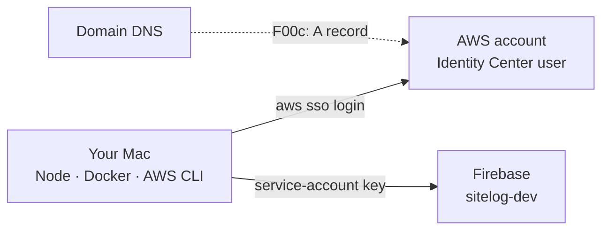
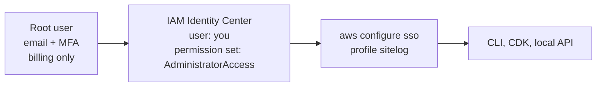

# F00a — Setup: tools and accounts

<dl><dd>

- Sprint [S0](README.md) · 2h · everything installed and signed in before the first line of backend code.
- Next: [F00b API skeleton](F00b-api-skeleton.md).

</dd></dl>

## Contents

<dl><dd>

1. [Overview](#overview)
2. [1. Tools on the Mac](#1-tools-on-the-mac)
3. [2. AWS account and login](#2-aws-account-and-login)
4. [3. Firebase project](#3-firebase-project)
5. [4. Domain](#4-domain)
6. [5. Repository](#5-repository)
7. [Done](#done)

</dd></dl>

## Overview

<dl><dd>

- **Goal:** every tool and account the backend needs, checked once, so later steps only write code.
- **Check:** each step ends with one command whose output you compare.

| Step | You get | Check |
|---|---|---|
| 1 | Node 24, Docker + Compose, AWS CLI, Session Manager plugin, jq | `node -v`, `docker compose version`, `aws --version` |
| 2 | An AWS account with a budget alert and an SSO login profile `sitelog` | `aws sts get-caller-identity --profile sitelog` |
| 3 | Firebase project `sitelog-dev`, its service-account key and Web API key | the JSON file outside the repo |
| 4 | A domain for `api-staging.<domain>` and `api.<domain>` | you can edit its DNS records |
| 5 | The repo open in VS Code with the recommended extensions | `git status` |



</dd></dl>

## 1. Tools on the Mac

<dl><dd>

- [Homebrew](https://brew.sh) first if `brew -v` fails.

| Tool | Install | Check |
|---|---|---|
| Node.js 24 LTS | `brew install node@24`, then follow the "add to PATH" line it prints | `node -v` → `v24.…` |
| Docker engine | Docker Desktop, **or** `brew install colima docker` then `colima start` | `docker info` |
| Docker Compose | Docker Desktop has it; with Colima: `brew install docker-compose` (see below) | `docker compose version` |
| AWS CLI v2 | `brew install awscli` | `aws --version` |
| Session Manager plugin | `brew install --cask session-manager-plugin` | `session-manager-plugin --version` |
| jq | `brew install jq` | `jq --version` |
| VS Code extensions | Open the repo; accept "Install recommended extensions" (`.vscode/extensions.json`) | Prettier formats on save |

- Colima only: Compose installs as a Docker plugin. Tell Docker where Homebrew put it, then check:

```bash
mkdir -p ~/.docker && echo '{ "cliPluginsExtraDirs": ["/opt/homebrew/lib/docker/cli-plugins"] }' > ~/.docker/config.json
```

```bash
docker compose version
```

- If `~/.docker/config.json` already exists, add the `cliPluginsExtraDirs` line to it instead of overwriting.

</dd></dl>

## 2. AWS account and login

<dl><dd>



- **Why SSO:** no long-lived access keys on your Mac; a login lasts up to 12 hours, then `aws sso login` again.

| # | Where | Do |
|---|---|---|
| 1 | [aws.amazon.com](https://aws.amazon.com) → **Create an AWS Account** | Root email, card, support plan **Basic (free)** |
| 2 | Console (top right, account name) → **Security credentials** → **Assign MFA device** | Authenticator app on your phone |
| 3 | Top right region picker | **Asia Pacific (Singapore) ap-southeast-1** |
| 4 | **Billing and Cost Management** → **Budgets** → **Create budget** → *Monthly cost budget* | Amount `60`, your email: a mail when the forecast passes it |
| 5 | **IAM Identity Center** → **Enable** | Organization instance |
| 6 | Identity Center → **Users** → **Add user** | Your email; accept the invite mail, set a password and MFA |
| 7 | Identity Center → **Permission sets** → **Create** → *Predefined* → `AdministratorAccess` | Session duration 12 hours |
| 8 | Identity Center → **AWS accounts** → tick your account → **Assign users or groups** | Your user + `AdministratorAccess` |
| 9 | Identity Center → **Dashboard** | Copy the **AWS access portal URL** |

- On the Mac, answer the prompts with the portal URL, region `ap-southeast-1`, your account, `AdministratorAccess`, profile name `sitelog`:

```bash
aws configure sso
```

```bash
aws sso login --profile sitelog
```

```bash
aws sts get-caller-identity --profile sitelog
```

- Expected: a JSON with your 12-digit `Account` and an `Arn` containing `AWSReservedSSO_AdministratorAccess`.
- So you do not type `--profile` every time, add to `~/.zshrc`: `export AWS_PROFILE=sitelog`.

</dd></dl>

## 3. Firebase project

<dl><dd>

- The app's F02 guide uses the same project; if it already exists, only do rows 4–5.

| # | Where | Do |
|---|---|---|
| 1 | [console.firebase.google.com](https://console.firebase.google.com) → **Add project** | Name `sitelog-dev`; Analytics off |
| 2 | **Build** → **Authentication** → **Get started** → **Sign-in method** | Enable **Email/Password** (Apple: iOS F02) |
| 3 | **Authentication** → **Users** → **Add user** | `test1@example.com` + a password: your test account for curl |
| 4 | ⚙ **Project settings** → **Service accounts** → **Generate new private key** | Save as `~/secrets/sitelog-dev-service-account.json` — **never inside the repo** |
| 5 | ⚙ **Project settings** → **General** | Copy **Web API key** (if missing: add a Web app `</>` first) |

- Turn the key into the one-line value the backend reads (copied to the clipboard):

```bash
base64 -i ~/secrets/sitelog-dev-service-account.json | pbcopy
```

- **Why base64:** the JSON has line breaks; an environment variable must be one line.
- The service-account key can mint admin access to your Firebase project: keep it out of chats, screenshots and git.

</dd></dl>

## 4. Domain

<dl><dd>

| Option | Do | Cost |
|---|---|---|
| Route 53 | Console → **Route 53** → **Registered domains** → **Register domains** | ~$10–15 / year; DNS hosted automatically |
| Any registrar you already use | Keep it there; you only add an `A` record in F00c | — |

- Names used in the guides: `api-staging.<domain>` (S0) and `api.<domain>` (S9).

</dd></dl>

## 5. Repository

<dl><dd>

```bash
git clone https://github.com/DAMHONGDUC/site-log-be.git ~/Documents/GitHub/BE/site-log-be
```

```bash
cd ~/Documents/GitHub/BE/site-log-be && code .
```

- Already in the repo: `docs/`, `Tools/Docs/indent-md.py`, `.vscode/`, `.gitignore`, `README.md`. F00b adds the code.

</dd></dl>

## Done

<dl><dd>

- [ ] `node -v` prints `v24`, `docker compose version` and `aws --version` work
- [ ] `aws sts get-caller-identity --profile sitelog` shows your account
- [ ] A budget alert exists
- [ ] The Firebase service-account JSON is saved outside the repo; you have the Web API key and a test user
- [ ] You can edit your domain's DNS

</dd></dl>
