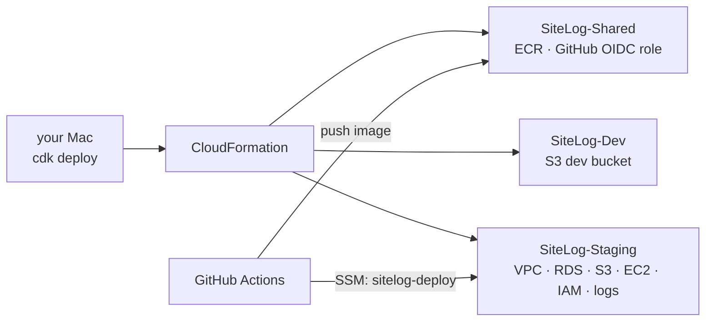
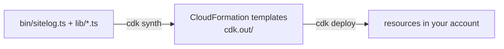
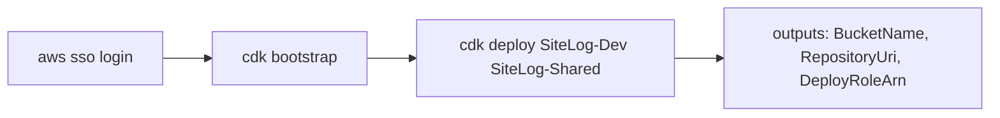
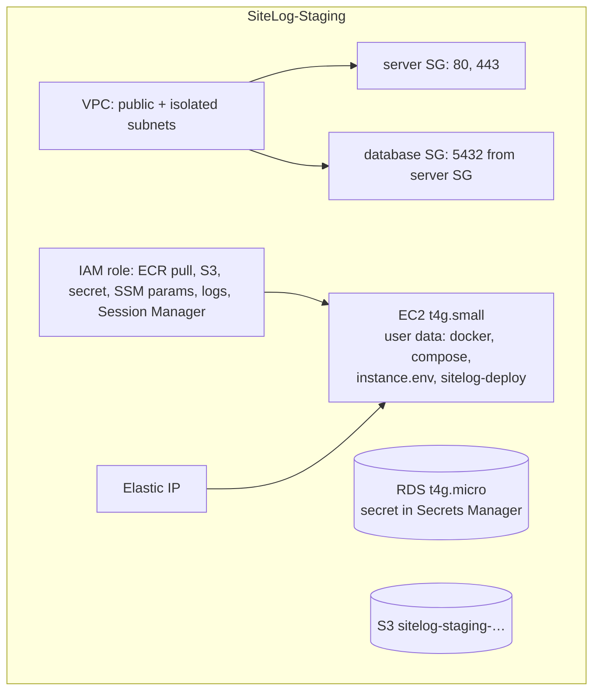
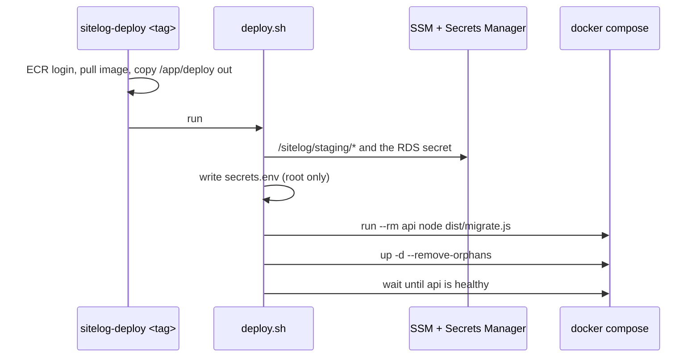
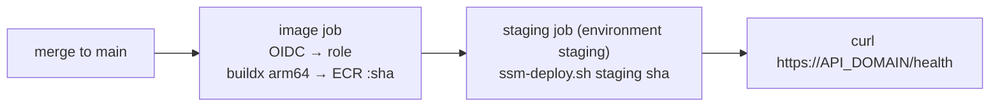

# F00c — AWS staging

<dl><dd>

- Sprint [S0](README.md) · 4h (a first AWS setup often takes longer) · the API runs on AWS at `https://api-staging.<domain>`, deployed by every merge to `main`.
- Before: [F00b API skeleton](F00b-api-skeleton.md). Resources explained: [04-aws-operations](../../feature-docs/04-aws-operations.md).

</dd></dl>

## Contents

<dl><dd>

1. [Overview](#overview)
2. [Target structure](#target-structure)
3. [1. CDK project](#1-cdk-project)
4. [2. Dev bucket and shared stack](#2-dev-bucket-and-shared-stack)
5. [3. Staging stack](#3-staging-stack)
6. [4. Server files](#4-server-files)
7. [5. DNS and secrets](#5-dns-and-secrets)
8. [6. Deploy workflow](#6-deploy-workflow)
9. [Feature done](#feature-done)

</dd></dl>

## Overview

<dl><dd>

- **Goal:** every AWS resource from code, and a deploy that needs only `git push`.
- **Demo:** Safari on the iPhone opens `https://api-staging.<domain>/health` → `{"status":"ok"}`.
- **File tags:** <b class="tag-new">New</b> create · <b class="tag-edit">Edit</b> change the part shown · <b class="tag-replace">Replace</b> overwrite · <b class="tag-check">Check</b> compare only.

| Step | Builds | Check |
|---|---|---|
| [1](#1-cdk-project) | `infra/` CDK app | `npx cdk synth` lists the stacks |
| [2](#2-dev-bucket-and-shared-stack) | Bootstrap, `SiteLog-Dev` bucket, `SiteLog-Shared` (ECR, GitHub role) | `aws s3 ls` shows `sitelog-dev-…` |
| [3](#3-staging-stack) | `SiteLog-Staging`: VPC, RDS, S3, EC2, IAM, logs | `cdk deploy` prints `PublicIpAddress` |
| [4](#4-server-files) | `deploy/compose.yml`, `Caddyfile`, `deploy.sh` | image contains `/app/deploy` |
| [5](#5-dns-and-secrets) | DNS `A` record, Firebase key in SSM | `dig +short api-staging.<domain>` = the IP |
| [6](#6-deploy-workflow) | `deploy.yml`, `ssm-deploy.sh`, GitHub variables | merge → green deploy → health from the iPhone |



</dd></dl>

## Target structure

<dl><dd>

```text
site-log-be/
├── infra/
│   ├── package.json · package-lock.json · tsconfig.json   # 1
│   ├── cdk.json                         # 1: region, repo, domains
│   ├── cdk.context.json                 # 3: written by CDK, commit it
│   ├── bin/sitelog.ts                   # 1: which stacks exist
│   └── lib/
│       ├── dev-stack.ts                 # 1
│       ├── shared-stack.ts              # 1
│       └── env-stack.ts                 # 3
├── deploy/
│   ├── compose.yml · Caddyfile · deploy.sh   # 4
└── .github/
    ├── workflows/deploy.yml             # 6
    └── scripts/ssm-deploy.sh            # 6
```

</dd></dl>

## 1. CDK project

<dl><dd>

#### Overview

<dl><dd>

- **Goal:** a CDK app that describes the stacks; nothing created yet.
- **Check:** `cd infra && npx cdk synth --quiet` → `Successfully synthesized`.

| Action | File | Holds |
|---|---|---|
| <b class="tag-new">New</b> | `infra/package.json`, `infra/tsconfig.json` | CDK libraries and CLI, own `node_modules` |
| <b class="tag-new">New</b> | `infra/cdk.json` | How to run the app, region, GitHub repo, per-environment domain and size |
| <b class="tag-new">New</b> | `infra/bin/sitelog.ts` | The list of stacks |
| <b class="tag-new">New</b> | `infra/lib/dev-stack.ts` | The bucket your laptop uses |
| <b class="tag-new">New</b> | `infra/lib/shared-stack.ts` | Image repository, GitHub login to AWS, deploy role |



</dd></dl>

#### Steps

<dl><dd>

<details open>
<summary><strong>1.1 Project</strong></summary>
<dl><dd>

<b>Explain</b> · `infra/` is its own small Node project, so CDK's large packages never enter the API image.

```bash
mkdir -p infra/bin infra/lib && cd infra && npm init -y
```

```bash
npm install aws-cdk-lib constructs && npm install -D aws-cdk typescript@6 tsx @types/node@24
```

<b>File</b> · <b class="tag-edit">Edit</b> · `infra/package.json`

<b>Explain</b> · Keep the `dependencies` npm wrote; set `type` and `scripts`.

<details>
<summary><b>Code</b></summary>

```json
{
  "name": "site-log-infra",
  "private": true,
  "type": "module",
  "scripts": {
    "cdk": "cdk",
    "synth": "cdk synth --quiet",
    "typecheck": "tsc --noEmit"
  }
}
```

</details>

---

<b>File</b> · <b class="tag-new">New</b> · `infra/tsconfig.json`

<details>
<summary><b>Code</b></summary>

```json
{
  "compilerOptions": {
    "target": "es2023",
    "module": "nodenext",
    "moduleResolution": "nodenext",
    "strict": true,
    "skipLibCheck": true,
    "noEmit": true,
    "types": ["node"]
  },
  "include": ["bin", "lib"]
}
```

</details>

---

<b>File</b> · <b class="tag-new">New</b> · `infra/cdk.json`

<b>Explain</b> · `app` tells the CDK CLI how to run the code. `context` holds the values you edit: put your real domain in `staging.apiDomain` now; `alarmEmail` and `prod` are used in F18.

<details>
<summary><b>Code</b></summary>

```json
{
  "app": "npx tsx bin/sitelog.ts",
  "context": {
    "region": "ap-southeast-1",
    "githubRepo": "DAMHONGDUC/site-log-be",
    "staging": {
      "apiDomain": "api-staging.example.com",
      "instanceType": "t4g.small",
      "alarmEmail": ""
    },
    "prod": {
      "apiDomain": "api.example.com",
      "instanceType": "t4g.small",
      "alarmEmail": ""
    }
  }
}
```

</details>

</dd></dl>
</details>

<details open>
<summary><strong>1.2 Stacks list</strong></summary>
<dl><dd>

<b>File</b> · <b class="tag-new">New</b> · `infra/bin/sitelog.ts`

<b>Explain</b> · One `App`, three stacks for now. The account comes from your login; in CI there is none, and `synth` still works.

<details>
<summary><b>Code</b></summary>

```ts
import { App } from 'aws-cdk-lib';
import { DevStack } from '../lib/dev-stack.js';
import { EnvStack, type EnvSettings } from '../lib/env-stack.js';
import { SharedStack } from '../lib/shared-stack.js';

// Every AWS resource of the backend. Deploy one stack at a time: npx cdk deploy SiteLog-Staging
const app = new App();
// Region from cdk.json; account from your AWS login (unset in CI, where synth needs no login).
const region = app.node.getContext('region') as string;
const account = process.env.CDK_DEFAULT_ACCOUNT;
const env = { account, region };

const githubRepo = app.node.getContext('githubRepo') as string;
const staging = app.node.getContext('staging') as EnvSettings;

// Container registry and the role GitHub Actions deploys with: shared by staging and prod.
new SharedStack(app, 'SiteLog-Shared', { env, githubRepo });

// Only an S3 bucket: your laptop runs the API and Postgres, files go to real S3.
new DevStack(app, 'SiteLog-Dev', { env });

new EnvStack(app, 'SiteLog-Staging', { env, envName: 'staging', settings: staging });
```

</details>

</dd></dl>
</details>

<details open>
<summary><strong>1.3 Dev bucket</strong></summary>
<dl><dd>

<b>File</b> · <b class="tag-new">New</b> · `infra/lib/dev-stack.ts`

<b>Explain</b> · The bucket `npm run dev` signs URLs for (F06 on). Your SSO admin login already has access, so no extra IAM.

<b>Think</b>

- Why `BLOCK_ALL` public access when the app must read photos? (How does the app read them? See [01-api §8](../../feature-docs/01-api.md#8-media-urls).)

<details open>
<summary><b>Hint 2 · APIs</b></summary>

- `new s3.Bucket(this, 'Media', { bucketName, blockPublicAccess, encryption, enforceSSL, lifecycleRules, removalPolicy, autoDeleteObjects })`, `Aws.ACCOUNT_ID`, `new CfnOutput(...)`.

</details>

<details>
<summary><b>Code</b></summary>

```ts
import { Aws, CfnOutput, Duration, RemovalPolicy, Stack, type StackProps } from 'aws-cdk-lib';
import * as s3 from 'aws-cdk-lib/aws-s3';
import type { Construct } from 'constructs';

// The bucket your local API signs URLs for. Your own AWS login (SSO) has access.
export class DevStack extends Stack {
  constructor(scope: Construct, id: string, props: StackProps) {
    super(scope, id, props);
    const bucket = new s3.Bucket(this, 'Media', {
      bucketName: `sitelog-dev-${Aws.ACCOUNT_ID}`,
      blockPublicAccess: s3.BlockPublicAccess.BLOCK_ALL,
      encryption: s3.BucketEncryption.S3_MANAGED,
      enforceSSL: true,
      lifecycleRules: [{ abortIncompleteMultipartUploadAfter: Duration.days(7) }],
      // Dev files are test data: deleting the stack deletes them.
      removalPolicy: RemovalPolicy.DESTROY,
      autoDeleteObjects: true,
    });
    new CfnOutput(this, 'BucketName', { value: bucket.bucketName });
  }
}
```

</details>

</dd></dl>
</details>

<details open>
<summary><strong>1.4 Shared stack</strong></summary>
<dl><dd>

<b>File</b> · <b class="tag-new">New</b> · `infra/lib/shared-stack.ts`

<b>Explain</b> · The image repository both environments pull from, and the role GitHub Actions assumes with an OIDC token: no AWS keys stored in GitHub.

<b>Think</b>

- The trust policy lists `sub` values. What could anyone with write access to *another* repository do if the condition only checked the audience?

<details open>
<summary><b>Hint 1 · Idea</b></summary>

- `ecr.Repository` named `sitelog-api`, keep 30 images.
- `iam.OidcProviderNative` for `token.actions.githubusercontent.com`.
- `iam.Role` assumed by `WebIdentityPrincipal` with `aud` = `sts.amazonaws.com` and `sub` limited to this repo's `main`, `v*` tags and the two environments.
- Permissions: push to the repository; `ssm:SendCommand` on the `AWS-RunShellScript` document and on instances tagged `sitelog:env`.

</details>

<details>
<summary><b>Code</b></summary>

```ts
import { CfnOutput, RemovalPolicy, Stack, type StackProps } from 'aws-cdk-lib';
import * as ecr from 'aws-cdk-lib/aws-ecr';
import * as iam from 'aws-cdk-lib/aws-iam';
import type { Construct } from 'constructs';

interface SharedStackProps extends StackProps {
  githubRepo: string;
}

export class SharedStack extends Stack {
  readonly repository: ecr.Repository;

  constructor(scope: Construct, id: string, props: SharedStackProps) {
    super(scope, id, props);

    // One image repository; staging and prod run the same image, tagged with the git commit.
    this.repository = new ecr.Repository(this, 'Api', {
      repositoryName: 'sitelog-api',
      imageScanOnPush: true,
      lifecycleRules: [{ maxImageCount: 30 }],
      removalPolicy: RemovalPolicy.RETAIN,
    });

    // GitHub Actions logs in with a short-lived token instead of stored AWS keys.
    const github = new iam.OidcProviderNative(this, 'GitHubOidc', {
      url: 'https://token.actions.githubusercontent.com',
      clientIds: ['sts.amazonaws.com'],
    });

    const deployRole = new iam.Role(this, 'GitHubDeploy', {
      roleName: 'sitelog-github-deploy',
      assumedBy: new iam.WebIdentityPrincipal(github.oidcProviderArn, {
        StringEquals: { 'token.actions.githubusercontent.com:aud': 'sts.amazonaws.com' },
        // Only this repository: the image job on main or a v* tag, and the two deploy
        // environments (a job with `environment:` gets an environment subject instead of a ref).
        StringLike: {
          'token.actions.githubusercontent.com:sub': [
            `repo:${props.githubRepo}:ref:refs/heads/main`,
            `repo:${props.githubRepo}:ref:refs/tags/v*`,
            `repo:${props.githubRepo}:environment:staging`,
            `repo:${props.githubRepo}:environment:production`,
          ],
        },
      }),
    });
    this.repository.grantPullPush(deployRole);
    deployRole.addToPolicy(
      new iam.PolicyStatement({
        actions: ['ssm:SendCommand'],
        resources: [`arn:aws:ssm:${this.region}::document/AWS-RunShellScript`],
      }),
    );
    deployRole.addToPolicy(
      new iam.PolicyStatement({
        actions: ['ssm:SendCommand'],
        resources: [`arn:aws:ec2:${this.region}:${this.account}:instance/*`],
        // Only the SiteLog servers.
        conditions: { StringLike: { 'ssm:resourceTag/sitelog:env': ['staging', 'prod'] } },
      }),
    );
    deployRole.addToPolicy(
      new iam.PolicyStatement({
        actions: ['ssm:GetCommandInvocation', 'ec2:DescribeInstances'],
        resources: ['*'],
      }),
    );

    new CfnOutput(this, 'RepositoryUri', { value: this.repository.repositoryUri });
    new CfnOutput(this, 'DeployRoleArn', { value: deployRole.roleArn });
  }
}
```

</details>

```bash
npx cdk synth --quiet
```

<b>Try</b>

- `npx cdk synth SiteLog-Dev` prints the CloudFormation template: find the lifecycle rule in it.

</dd></dl>
</details>

</dd></dl>

</dd></dl>

## 2. Dev bucket and shared stack

<dl><dd>

#### Overview

<dl><dd>

- **Goal:** CDK can deploy into your account; the dev bucket and the shared stack exist.
- **Check:** `aws s3 ls | grep sitelog-dev` and `aws ecr describe-repositories --repository-names sitelog-api`.

| Action | What | Why |
|---|---|---|
| Run | `cdk bootstrap` | Once per account and region: a bucket and roles CDK uses to deploy |
| Run | `cdk deploy SiteLog-Dev SiteLog-Shared` | Creates the dev bucket, ECR, OIDC provider, deploy role |
| <b class="tag-edit">Edit</b> | `.env` | `S3_BUCKET=` the output `BucketName` |



</dd></dl>

#### Steps

<dl><dd>

<details open>
<summary><strong>2.1 Deploy</strong></summary>
<dl><dd>

```bash
aws sso login --profile sitelog
```

```bash
cd infra && npx cdk bootstrap
```

```bash
npx cdk deploy SiteLog-Dev SiteLog-Shared
```

- CDK shows the IAM changes and asks `Do you wish to deploy these changes (y/n)?` → `y`.
- Write down the outputs: `SiteLog-Dev.BucketName`, `SiteLog-Shared.RepositoryUri`, `SiteLog-Shared.DeployRoleArn`.
- In `.env`, set `S3_BUCKET` to the bucket name and `AWS_PROFILE=sitelog`.

<b>Try</b>

- Console → **CloudFormation** → `SiteLog-Shared` → **Resources**: every resource CDK made, with its real name.

</dd></dl>
</details>

</dd></dl>

</dd></dl>

## 3. Staging stack

<dl><dd>

#### Overview

<dl><dd>

- **Goal:** the whole staging environment: network, database, bucket, server, permissions, logs.
- **Check:** `npx cdk deploy SiteLog-Staging` ends with `PublicIpAddress`, `InstanceId`, `DatabaseEndpoint`.

| Action | File | Holds |
|---|---|---|
| <b class="tag-new">New</b> | `infra/lib/env-stack.ts` | `EnvStack`: VPC (no NAT), security groups, RDS Postgres 16, S3, IAM role, log groups, user data, EC2 + Elastic IP |
| <b class="tag-new">New</b> | `infra/cdk.context.json` | Written by CDK on the first deploy (availability zones); commit it |



</dd></dl>

#### Steps

<dl><dd>

<details open>
<summary><strong>3.1 Environment stack</strong></summary>
<dl><dd>

<b>File</b> · <b class="tag-new">New</b> · `infra/lib/env-stack.ts`

<b>Explain</b> · One class used for staging now and production in F18. The server's **user data** runs once at first boot: installs Docker and Compose, writes `/opt/sitelog/instance.env` (non-secret settings) and the `sitelog-deploy` command.

<b>Think</b>

- The database sits in subnets with no route to the internet. How does the API still reach it, and why can nobody else?
- `sitelog-deploy` copies `deploy/` out of the image instead of keeping it in user data. What would changing `compose.yml` cost otherwise?

<details open>
<summary><b>Hint 1 · Idea</b></summary>

- Build in this order: VPC → bucket → two security groups → `rds.DatabaseInstance` → log groups → role + grants → `instance.env` text → user data → `ec2.Instance` (tag `sitelog:env`) → `CfnEIP` + association → outputs.
- Production differences come from `isProd`: deletion protection, snapshot on delete, 14-day backups.

</details>

<details open>
<summary><b>Hint 2 · APIs</b></summary>

- `ec2.Vpc({ availabilityZones, natGateways: 0, subnetConfiguration })`, `ec2.SecurityGroup` + `addIngressRule`.
- `rds.DatabaseInstance({ engine: postgres VER_16, credentials: Credentials.fromGeneratedSecret('sitelog'), vpcSubnets: PRIVATE_ISOLATED, … })`.
- `bucket.grantReadWrite(role)`, `database.secret!.grantRead(role)`, `repository.grantPull(role)`, `logGroup.grantWrite(role)`.
- `ec2.UserData.forLinux()` + `addCommands(...)`, `MachineImage.latestAmazonLinux2023({ cpuType: ARM_64 })`.

</details>

<details>
<summary><b>Code</b></summary>

```ts
import { Aws, CfnOutput, Duration, RemovalPolicy, Stack, type StackProps, Tags } from 'aws-cdk-lib';
import * as ec2 from 'aws-cdk-lib/aws-ec2';
import * as ecr from 'aws-cdk-lib/aws-ecr';
import * as iam from 'aws-cdk-lib/aws-iam';
import * as logs from 'aws-cdk-lib/aws-logs';
import * as rds from 'aws-cdk-lib/aws-rds';
import * as s3 from 'aws-cdk-lib/aws-s3';
import type { Construct } from 'constructs';

export interface EnvSettings {
  apiDomain: string;
  instanceType: string;
  alarmEmail: string;
}

interface EnvStackProps extends StackProps {
  envName: 'staging' | 'prod';
  settings: EnvSettings;
}

// One environment: network, database, bucket, one EC2 server running Docker Compose.
export class EnvStack extends Stack {
  constructor(scope: Construct, id: string, props: EnvStackProps) {
    super(scope, id, props);
    const { envName, settings } = props;
    const isProd = envName === 'prod';

    // Public subnets for the server, isolated subnets (no internet at all) for the database.
    // No NAT gateway: it would cost more than the server.
    const vpc = new ec2.Vpc(this, 'Vpc', {
      // Two zones named up front, so `cdk synth` needs no AWS login (RDS needs two zones).
      availabilityZones: [`${this.region}a`, `${this.region}b`],
      natGateways: 0,
      subnetConfiguration: [
        { name: 'public', subnetType: ec2.SubnetType.PUBLIC, cidrMask: 24 },
        { name: 'database', subnetType: ec2.SubnetType.PRIVATE_ISOLATED, cidrMask: 24 },
      ],
    });

    const bucket = new s3.Bucket(this, 'Media', {
      bucketName: `sitelog-${envName}-${Aws.ACCOUNT_ID}`,
      blockPublicAccess: s3.BlockPublicAccess.BLOCK_ALL,
      encryption: s3.BucketEncryption.S3_MANAGED,
      enforceSSL: true,
      // Parts of uploads nobody completed are removed after a week.
      lifecycleRules: [{ abortIncompleteMultipartUploadAfter: Duration.days(7) }],
      removalPolicy: RemovalPolicy.RETAIN,
    });

    const serverSecurityGroup = new ec2.SecurityGroup(this, 'ServerSg', {
      vpc,
      description: 'SiteLog API server: HTTP and HTTPS from anywhere, nothing else',
    });
    serverSecurityGroup.addIngressRule(
      ec2.Peer.anyIpv4(),
      ec2.Port.tcp(80),
      'HTTP for the certificate check',
    );
    serverSecurityGroup.addIngressRule(ec2.Peer.anyIpv4(), ec2.Port.tcp(443), 'HTTPS');

    const databaseSecurityGroup = new ec2.SecurityGroup(this, 'DatabaseSg', {
      vpc,
      description: 'SiteLog Postgres: only from the API server',
    });
    databaseSecurityGroup.addIngressRule(
      serverSecurityGroup,
      ec2.Port.tcp(5432),
      'Postgres from the server',
    );

    // Username sitelog, a generated password kept in Secrets Manager.
    const database = new rds.DatabaseInstance(this, 'Database', {
      engine: rds.DatabaseInstanceEngine.postgres({ version: rds.PostgresEngineVersion.VER_16 }),
      instanceType: ec2.InstanceType.of(ec2.InstanceClass.T4G, ec2.InstanceSize.MICRO),
      vpc,
      vpcSubnets: { subnetType: ec2.SubnetType.PRIVATE_ISOLATED },
      securityGroups: [databaseSecurityGroup],
      credentials: rds.Credentials.fromGeneratedSecret('sitelog'),
      databaseName: 'sitelog',
      allocatedStorage: 20,
      maxAllocatedStorage: 100,
      storageType: rds.StorageType.GP3,
      storageEncrypted: true,
      multiAz: false,
      publiclyAccessible: false,
      backupRetention: Duration.days(isProd ? 14 : 7),
      deletionProtection: isProd,
      removalPolicy: isProd ? RemovalPolicy.SNAPSHOT : RemovalPolicy.DESTROY,
    });

    const logGroups: logs.LogGroup[] = [];
    for (const service of ['api', 'worker', 'caddy']) {
      logGroups.push(
        new logs.LogGroup(this, `Logs-${service}`, {
          logGroupName: `/sitelog/${envName}/${service}`,
          retention: logs.RetentionDays.ONE_MONTH,
          removalPolicy: RemovalPolicy.DESTROY,
        }),
      );
    }

    // Created by SiteLog-Shared; found by name so the stacks stay independent.
    const repository = ecr.Repository.fromRepositoryName(this, 'Api', 'sitelog-api');

    // What the server may do: pull the image, read its secrets, use its bucket, write logs.
    const role = new iam.Role(this, 'ServerRole', {
      assumedBy: new iam.ServicePrincipal('ec2.amazonaws.com'),
      managedPolicies: [
        // Session Manager: shell access and deploy commands without SSH or open port 22.
        iam.ManagedPolicy.fromAwsManagedPolicyName('AmazonSSMManagedInstanceCore'),
      ],
    });
    repository.grantPull(role);
    bucket.grantReadWrite(role);
    database.secret!.grantRead(role);
    for (const group of logGroups) {
      group.grantWrite(role);
    }
    role.addToPolicy(
      new iam.PolicyStatement({
        actions: ['ssm:GetParametersByPath'],
        resources: [`arn:aws:ssm:${this.region}:${this.account}:parameter/sitelog/${envName}`],
      }),
    );

    // Settings that are not secret, written once on the server; the deploy script reads them.
    const instanceEnv = [
      `ENV_NAME=${envName}`,
      `AWS_REGION=${this.region}`,
      `S3_BUCKET=${bucket.bucketName}`,
      `API_DOMAIN=${settings.apiDomain}`,
      `ECR_REPOSITORY=${repository.repositoryUri}`,
      `DB_SECRET_ARN=${database.secret!.secretArn}`,
    ].join('\n');

    const userData = ec2.UserData.forLinux();
    userData.addCommands(
      'set -euo pipefail',
      'dnf install -y docker jq',
      'systemctl enable --now docker',
      // Docker Compose v2 as a docker plugin (Amazon Linux has no package for it).
      'mkdir -p /usr/local/lib/docker/cli-plugins',
      'curl -fsSL https://github.com/docker/compose/releases/download/v2.29.7/docker-compose-linux-aarch64 -o /usr/local/lib/docker/cli-plugins/docker-compose',
      'chmod +x /usr/local/lib/docker/cli-plugins/docker-compose',
      'mkdir -p /opt/sitelog',
      `cat > /opt/sitelog/instance.env <<'ENVEOF'\n${instanceEnv}\nENVEOF`,
      // sitelog-deploy <tag>: pull the image, copy deploy/ out of it, run its deploy.sh.
      `cat > /usr/local/bin/sitelog-deploy <<'SCRIPTEOF'
#!/usr/bin/env bash
set -euo pipefail
TAG="$1"
source /opt/sitelog/instance.env
REGISTRY="\${ECR_REPOSITORY%%/*}"
aws ecr get-login-password --region "$AWS_REGION" | docker login --username AWS --password-stdin "$REGISTRY"
docker pull "$ECR_REPOSITORY:$TAG"
CONTAINER=$(docker create "$ECR_REPOSITORY:$TAG")
docker cp "$CONTAINER:/app/deploy/." /opt/sitelog/
docker rm "$CONTAINER" > /dev/null
exec bash /opt/sitelog/deploy.sh "$TAG"
SCRIPTEOF`,
      'chmod +x /usr/local/bin/sitelog-deploy',
    );

    const server = new ec2.Instance(this, 'Server', {
      vpc,
      vpcSubnets: { subnetType: ec2.SubnetType.PUBLIC },
      instanceType: new ec2.InstanceType(settings.instanceType),
      machineImage: ec2.MachineImage.latestAmazonLinux2023({
        cpuType: ec2.AmazonLinuxCpuType.ARM_64,
      }),
      securityGroup: serverSecurityGroup,
      role,
      userData,
      requireImdsv2: true,
      blockDevices: [
        {
          deviceName: '/dev/xvda',
          volume: ec2.BlockDeviceVolume.ebs(20, {
            volumeType: ec2.EbsDeviceVolumeType.GP3,
            encrypted: true,
          }),
        },
      ],
    });
    Tags.of(server).add('sitelog:env', envName);

    // A fixed public IP for the DNS record.
    const ip = new ec2.CfnEIP(this, 'PublicIp', { domain: 'vpc' });
    new ec2.CfnEIPAssociation(this, 'PublicIpAssociation', {
      allocationId: ip.attrAllocationId,
      instanceId: server.instanceId,
    });

    new CfnOutput(this, 'PublicIpAddress', {
      value: ip.ref,
      description: `A record for ${settings.apiDomain}`,
    });
    new CfnOutput(this, 'InstanceId', { value: server.instanceId });
    new CfnOutput(this, 'BucketName', { value: bucket.bucketName });
    new CfnOutput(this, 'DatabaseEndpoint', { value: database.dbInstanceEndpointAddress });
    new CfnOutput(this, 'DatabaseSecretArn', { value: database.secret!.secretArn });
  }
}
```

</details>

```bash
npx cdk deploy SiteLog-Staging
```

- About 15 minutes (the database is the slow part). Write down `PublicIpAddress` and `InstanceId`.
- Commit `infra/cdk.context.json` (CDK wrote the availability zones there).

<b>Try</b>

- Console → **EC2** → the instance → **Connect** → **Session Manager** → **Connect**: a shell with no SSH key. Run `cat /opt/sitelog/instance.env` and `docker --version`.

</dd></dl>
</details>

</dd></dl>

</dd></dl>

## 4. Server files

<dl><dd>

#### Overview

<dl><dd>

- **Goal:** what the server runs: Caddy in front of the API, secrets written at deploy, migrations before the new code serves.
- **Check:** `docker build -t sitelog-api . && docker run --rm sitelog-api ls /app/deploy` → `Caddyfile compose.yml deploy.sh`.

| Action | File | Holds |
|---|---|---|
| <b class="tag-new">New</b> | `deploy/compose.yml` | `api` (health check, CloudWatch logs) and `caddy` (ports 80/443, certificate volume); F15 adds `worker` |
| <b class="tag-new">New</b> | `deploy/Caddyfile` | HTTPS for `API_DOMAIN`, proxy to `api:3000` |
| <b class="tag-new">New</b> | `deploy/deploy.sh` | Secrets → `secrets.env`, migrate, `compose up -d`, wait healthy |



</dd></dl>

#### Steps

<dl><dd>

<details open>
<summary><strong>4.1 Compose and Caddy</strong></summary>
<dl><dd>

<b>File</b> · <b class="tag-new">New</b> · `deploy/compose.yml`

<b>Explain</b> · The server's Compose file (the root `docker-compose.yml` is only for your Mac). `IMAGE`, `AWS_REGION`, `ENV_NAME`, `API_DOMAIN` come from `deploy.sh`.

<b>Think</b>

- The `node` image has no `curl`. How does the health check test the API?

<details>
<summary><b>Code</b></summary>

```yaml
# Runs on the EC2 server. deploy.sh sets IMAGE and writes secrets.env before `up`.
services:
  api:
    image: ${IMAGE}
    env_file: [instance.env, secrets.env]
    environment:
      PORT: '3000'
      DATABASE_SSL_CA_PATH: /app/certs/rds-global-bundle.pem
    restart: unless-stopped
    healthcheck:
      test:
        [
          'CMD',
          'node',
          '-e',
          "fetch('http://localhost:3000/health').then(r=>process.exit(r.ok?0:1)).catch(()=>process.exit(1))",
        ]
      interval: 10s
      timeout: 5s
      retries: 3
    logging:
      driver: awslogs
      options:
        awslogs-region: ${AWS_REGION}
        awslogs-group: /sitelog/${ENV_NAME}/api

  # HTTPS in front of the API: gets and renews a Let's Encrypt certificate for API_DOMAIN.
  caddy:
    image: caddy:2.10
    ports: ['80:80', '443:443']
    environment:
      API_DOMAIN: ${API_DOMAIN}
    volumes:
      - ./Caddyfile:/etc/caddy/Caddyfile:ro
      - caddy-data:/data
      - caddy-config:/config
    depends_on: [api]
    restart: unless-stopped
    logging:
      driver: awslogs
      options:
        awslogs-region: ${AWS_REGION}
        awslogs-group: /sitelog/${ENV_NAME}/caddy

volumes:
  caddy-data:
  caddy-config:
```

</details>

---

<b>File</b> · <b class="tag-new">New</b> · `deploy/Caddyfile`

<b>Explain</b> · Caddy asks Let's Encrypt for a certificate for the domain over port 80, renews it alone, and proxies HTTP and WebSocket to the API container.

<details>
<summary><b>Code</b></summary>

```text
# HTTPS for the API domain; WebSocket upgrades pass through as they are.
{$API_DOMAIN} {
	encode zstd gzip
	reverse_proxy api:3000
}
```

</details>

</dd></dl>
</details>

<details open>
<summary><strong>4.2 Deploy script</strong></summary>
<dl><dd>

<b>File</b> · <b class="tag-new">New</b> · `deploy/deploy.sh`

<b>Explain</b> · Runs on the server as root. Every SSM parameter under `/sitelog/<env>/` becomes a line in `secrets.env`; the RDS secret becomes `DATABASE_URL` (password URL-encoded by `jq @uri`).

<b>Think</b>

- Why run migrations **before** `up -d`, and with `--no-deps`?
- `umask 077`: who can read `secrets.env` after it is written?

<details>
<summary><b>Code</b></summary>

```bash
#!/usr/bin/env bash
# Runs on the EC2 server (through sitelog-deploy <tag>): secrets, migrations, then the new containers.
set -euo pipefail
TAG="$1"
cd /opt/sitelog
source instance.env

# 1. Secrets → secrets.env (readable by root only). Never in the image, never in git.
umask 077
{
  # Every parameter under /sitelog/<env>/ becomes NAME=value.
  aws ssm get-parameters-by-path --region "$AWS_REGION" --path "/sitelog/$ENV_NAME" --with-decryption \
    --query 'Parameters[].[Name,Value]' --output text |
    while IFS=$'\t' read -r name value; do
      echo "${name##*/}=$value"
    done
  # The database password RDS generated, turned into one connection URL.
  aws secretsmanager get-secret-value --region "$AWS_REGION" --secret-id "$DB_SECRET_ARN" \
    --query SecretString --output text |
    jq -r '"DATABASE_URL=postgres://\(.username):\(.password | @uri)@\(.host):\(.port)/\(.dbname)"'
} > secrets.env

# 2. Migrations with the new image, before any new code serves requests.
export IMAGE="$ECR_REPOSITORY:$TAG"
export AWS_REGION ENV_NAME API_DOMAIN
docker compose run --rm --no-deps api node dist/migrate.js

# 3. Replace the containers (a few seconds of downtime) and wait until the API is healthy.
docker compose up -d --remove-orphans
for attempt in $(seq 1 30); do
  status=$(docker inspect --format '{{.State.Health.Status}}' "$(docker compose ps -q api)")
  if [ "$status" = "healthy" ]; then
    echo "deployed $TAG"
    docker image prune -af --filter "until=168h" > /dev/null
    exit 0
  fi
  sleep 2
done
echo "api did not become healthy" >&2
docker compose logs --tail 50 api >&2
exit 1
```

</details>

```bash
rm -f deploy/.gitkeep && chmod +x deploy/deploy.sh
```

```bash
docker build -t sitelog-api . && docker run --rm sitelog-api ls /app/deploy
```

</dd></dl>
</details>

</dd></dl>

</dd></dl>

## 5. DNS and secrets

<dl><dd>

#### Overview

<dl><dd>

- **Goal:** the domain points at the server; the server can read the Firebase key.
- **Check:** `dig +short api-staging.<domain>` prints the Elastic IP; `aws ssm get-parameters-by-path --path /sitelog/staging` lists one name.

| Action | What |
|---|---|
| DNS | `A` record `api-staging` → `PublicIpAddress`, TTL 300 |
| SSM | `SecureString` `/sitelog/staging/FIREBASE_SERVICE_ACCOUNT_BASE64` |

</dd></dl>

#### Steps

<dl><dd>

<details open>
<summary><strong>5.1 DNS record</strong></summary>
<dl><dd>

| Registrar | Do |
|---|---|
| Route 53 | **Hosted zones** → your domain → **Create record** → name `api-staging`, type `A`, value the IP |
| Other | DNS settings → add `A` record, host `api-staging`, value the IP |

```bash
dig +short api-staging.<domain>
```

</dd></dl>
</details>

<details open>
<summary><strong>5.2 Firebase key</strong></summary>
<dl><dd>

- The staging backend uses the `sitelog-dev` Firebase project, like your Mac.

```bash
aws ssm put-parameter --name /sitelog/staging/FIREBASE_SERVICE_ACCOUNT_BASE64 --type SecureString --value "$(base64 -i ~/secrets/sitelog-dev-service-account.json)"
```

```bash
aws ssm get-parameters-by-path --path /sitelog/staging --query 'Parameters[].Name'
```

- To change it later: the same command with `--overwrite`, then deploy.

</dd></dl>
</details>

</dd></dl>

</dd></dl>

## 6. Deploy workflow

<dl><dd>

#### Overview

<dl><dd>

- **Goal:** a merge to `main` builds an ARM image, pushes it, deploys it to staging, checks `/health`.
- **Check:** the `Deploy` workflow is green; the iPhone opens `https://api-staging.<domain>/health`.

| Action | File / place | Holds |
|---|---|---|
| <b class="tag-new">New</b> | `.github/workflows/deploy.yml` | Jobs `image` (build + push) and `staging` (SSM deploy + health) |
| <b class="tag-new">New</b> | `.github/scripts/ssm-deploy.sh` | Finds the server by tag, sends `sitelog-deploy <commit>`, waits, prints the output |
| GitHub | Repo **Settings** → **Secrets and variables** → **Actions** → **Variables** | `AWS_DEPLOY_ROLE_ARN`, `AWS_REGION` = `ap-southeast-1` |
| GitHub | **Settings** → **Environments** → **New environment** `staging` → variable | `API_DOMAIN` = `api-staging.<domain>` |



</dd></dl>

#### Steps

<dl><dd>

<details open>
<summary><strong>6.1 Workflow and script</strong></summary>
<dl><dd>

<b>File</b> · <b class="tag-new">New</b> · `.github/workflows/deploy.yml`

<b>Explain</b> · `id-token: write` lets each job get an OIDC token; `configure-aws-credentials` trades it for the deploy role. QEMU lets the x86 runner build the ARM image the `t4g` server needs.

<b>Think</b>

- The `staging` job declares `environment: staging`. Which `sub` does its token carry, and where did you allow it?

<details>
<summary><b>Code</b></summary>

```yaml
# main → staging (production joins in F18).
name: Deploy

on:
  push:
    branches: [main]

permissions:
  id-token: write # lets the job log in to AWS with a short-lived OIDC token
  contents: read

concurrency:
  group: deploy-${{ github.ref }}
  cancel-in-progress: false

jobs:
  image:
    runs-on: ubuntu-24.04
    steps:
      - uses: actions/checkout@v5
      - uses: aws-actions/configure-aws-credentials@v5
        with:
          role-to-assume: ${{ vars.AWS_DEPLOY_ROLE_ARN }}
          aws-region: ${{ vars.AWS_REGION }}
      - id: ecr
        uses: aws-actions/amazon-ecr-login@v2
      # The server is ARM (t4g): build an arm64 image on the x86 runner.
      - uses: docker/setup-qemu-action@v3
      - uses: docker/setup-buildx-action@v3
      - uses: docker/build-push-action@v6
        with:
          context: .
          platforms: linux/arm64
          push: true
          tags: ${{ steps.ecr.outputs.registry }}/sitelog-api:${{ github.sha }}
          cache-from: type=gha
          cache-to: type=gha,mode=max

  staging:
    needs: image
    if: github.ref == 'refs/heads/main'
    runs-on: ubuntu-24.04
    environment: staging
    steps:
      - uses: actions/checkout@v5
      - uses: aws-actions/configure-aws-credentials@v5
        with:
          role-to-assume: ${{ vars.AWS_DEPLOY_ROLE_ARN }}
          aws-region: ${{ vars.AWS_REGION }}
      - run: bash .github/scripts/ssm-deploy.sh staging "${{ github.sha }}"
      - run: curl --fail --silent --show-error "https://${{ vars.API_DOMAIN }}/health"
```

</details>

---

<b>File</b> · <b class="tag-new">New</b> · `.github/scripts/ssm-deploy.sh`

<b>Explain</b> · SSM Run Command executes a shell command on the server without SSH. The script polls until the command ends and prints its output into the workflow log.

<details>
<summary><b>Code</b></summary>

```bash
#!/usr/bin/env bash
# Runs `sitelog-deploy <tag>` on the server of one environment through SSM, and waits for it.
set -euo pipefail
ENV_NAME="$1"
TAG="$2"

INSTANCE_ID=$(aws ec2 describe-instances \
  --filters "Name=tag:sitelog:env,Values=$ENV_NAME" "Name=instance-state-name,Values=running" \
  --query 'Reservations[0].Instances[0].InstanceId' --output text)
if [ "$INSTANCE_ID" = "None" ]; then
  echo "No running server tagged sitelog:env=$ENV_NAME" >&2
  exit 1
fi

COMMAND_ID=$(aws ssm send-command \
  --instance-ids "$INSTANCE_ID" \
  --document-name AWS-RunShellScript \
  --comment "deploy $TAG" \
  --parameters "{\"commands\":[\"/usr/local/bin/sitelog-deploy $TAG\"]}" \
  --query Command.CommandId --output text)
echo "Deploying $TAG to $INSTANCE_ID (command $COMMAND_ID)"

# Up to 10 minutes.
for attempt in $(seq 1 120); do
  STATUS=$(aws ssm get-command-invocation --command-id "$COMMAND_ID" --instance-id "$INSTANCE_ID" \
    --query Status --output text 2>/dev/null || echo Pending)
  if [ "$STATUS" = "Success" ]; then
    break
  fi
  if [ "$STATUS" = "Failed" ] || [ "$STATUS" = "Cancelled" ] || [ "$STATUS" = "TimedOut" ]; then
    break
  fi
  sleep 5
done

aws ssm get-command-invocation --command-id "$COMMAND_ID" --instance-id "$INSTANCE_ID" \
  --query '[StandardOutputContent, StandardErrorContent]' --output text
if [ "$STATUS" != "Success" ]; then
  echo "Deploy ended with status $STATUS" >&2
  exit 1
fi
```

</details>

</dd></dl>
</details>

<details open>
<summary><strong>6.2 First deploy</strong></summary>
<dl><dd>

1. Set the GitHub variables and the `staging` environment (table above).
2. Commit `infra/`, `deploy/`, `.github/`; open a PR; CI (`api` + `infra`) green; merge.
3. **Actions** → `Deploy` → watch `image`, then `staging`. The first run takes ~10 minutes (QEMU build); later runs use the cache.
4. The first HTTPS request may take ~30 s while Caddy gets the certificate.

```bash
curl -i https://api-staging.<domain>/health
```

- On the iPhone, Safari: `https://api-staging.<domain>/health`.

| Failure | Look at |
|---|---|
| `image` job: `Not authorized to perform sts:AssumeRoleWithWebIdentity` | `githubRepo` in `cdk.json`, the `sub` list, the variable `AWS_DEPLOY_ROLE_ARN` |
| `staging` job: `No running server tagged …` | `InstanceId` running? the tag `sitelog:env` |
| Command output `api did not become healthy` | Session Manager shell → `cd /opt/sitelog && sudo docker compose logs api` |
| `curl` TLS error | DNS not pointing at the IP yet, or port 80 closed: `sudo docker compose logs caddy` |

<b>Try</b>

- Merge a change to `README.md` only: both jobs run; find `deployed <commit>` in the `staging` job log. On the server, `sudo docker compose ps` shows the new image tag.

</dd></dl>
</details>

</dd></dl>

</dd></dl>

## Feature done

<dl><dd>

- [ ] `npx cdk synth` passes in CI (`infra` job)
- [ ] `SiteLog-Dev`, `SiteLog-Shared`, `SiteLog-Staging` deployed; `cdk.context.json` committed
- [ ] `https://api-staging.<domain>/health` → `{"status":"ok"}` from the iPhone
- [ ] A merge to `main` deploys by itself
- [ ] You can open a Session Manager shell and read `docker compose logs api`

</dd></dl>
