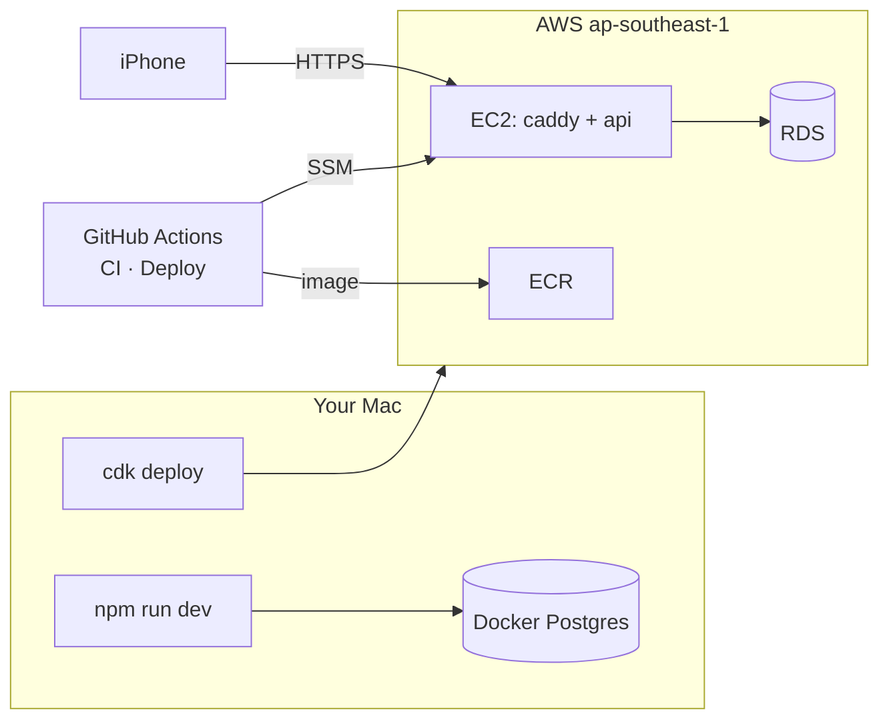

# S0 — Foundation

<dl><dd>

- Sprint 0 · 2 weeks · backend 11h of the sprint's 54h · [all sprints](../README.md) · iOS side: [S0 iOS](https://github.com/DAMHONGDUC/site_log_swift_ui/blob/main/docs/feature-guide/S0-foundation-access/README.md)

</dd></dl>

## Contents

<dl><dd>

1. [Overview](#overview)
2. [Tasks](#tasks)
3. [Done](#done)
4. [Self-check](#self-check)

</dd></dl>

## Overview

<dl><dd>

- **Goal:** a backend that builds, tests and deploys itself before any feature needs it.
- **Demo — local:** `npm run dev` → `curl localhost:3000/health` → `{"status":"ok"}`; `npm test` green.
- **Demo — staging:** Safari on the iPhone → `https://api-staging.<domain>/health` → `{"status":"ok"}`; a merge to `main` redeploys.

| Guide | Builds | Hours |
|---|---|---|
| [F00a Setup](F00a-setup.md) | Tools, AWS account + SSO, Firebase project, domain | 2 |
| [F00b API skeleton](F00b-api-skeleton.md) | Fastify, config, Postgres, error contract, migrations, tests, Docker image, CI | 5 |
| [F00c AWS staging](F00c-aws-staging.md) | CDK stacks, EC2 + RDS + S3, Caddy, deploy workflow | 4 |

</dd></dl>

## Tasks

<dl><dd>

| Task | What | Guide | Hours | Status |
|---|---|---|---|---|
| F00a.1 | Node, Docker, AWS CLI, Session Manager plugin | [F00a §1](F00a-setup.md#1-tools-on-the-mac) | 0.5 | not start |
| F00a.2 | AWS account, budget, Identity Center, `aws configure sso` | [F00a §2](F00a-setup.md#2-aws-account-and-login) | 1 | not start |
| F00a.3 | Firebase `sitelog-dev`, key, domain | [F00a §3–4](F00a-setup.md#3-firebase-project) | 0.5 | not start |
| F00b.1 | Project files, local Postgres | [F00b §1–2](F00b-api-skeleton.md#1-project-files) | 1 | not start |
| F00b.2 | Config, logger, database | [F00b §3](F00b-api-skeleton.md#3-config-logger-database) | 1 | not start |
| F00b.3 | Error contract, app, health, main | [F00b §4](F00b-api-skeleton.md#4-error-contract-app-health) | 1 | not start |
| F00b.4 | Migration runner, tests | [F00b §5–6](F00b-api-skeleton.md#5-migration-runner) | 1.5 | not start |
| F00b.5 | Docker image, CI | [F00b §7–8](F00b-api-skeleton.md#7-docker-image) | 0.5 | not start |
| F00c.1 | CDK project, dev bucket, shared stack | [F00c §1–2](F00c-aws-staging.md#1-cdk-project) | 1 | not start |
| F00c.2 | Staging stack | [F00c §3](F00c-aws-staging.md#3-staging-stack) | 1 | not start |
| F00c.3 | Server files, DNS, secrets | [F00c §4–5](F00c-aws-staging.md#4-server-files) | 1 | not start |
| F00c.4 | Deploy workflow, first deploy | [F00c §6](F00c-aws-staging.md#6-deploy-workflow) | 1 | not start |

</dd></dl>

## Done

<dl><dd>

- [ ] `npm test` green locally and in CI
- [ ] `https://api-staging.<domain>/health` answers from the iPhone
- [ ] A merge to `main` deploys to staging
- [ ] No secret in git: `git grep -i "private_key"` finds nothing

</dd></dl>

## Self-check

<dl><dd>

- Why does the server answer `401`, never `403`, for a bad token? (Read [01-api §2](../../feature-docs/01-api.md#2-error-contract).)
- Where does the database password live, and who can read it?
- A deploy fails halfway, after migrations ran. What runs now: the old code or the new one, and against which schema?

</dd></dl>
