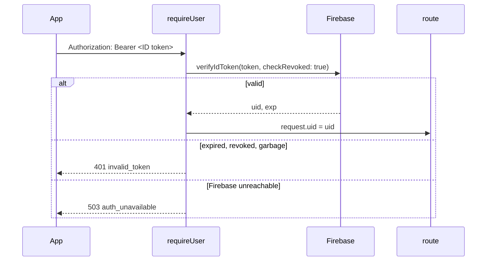
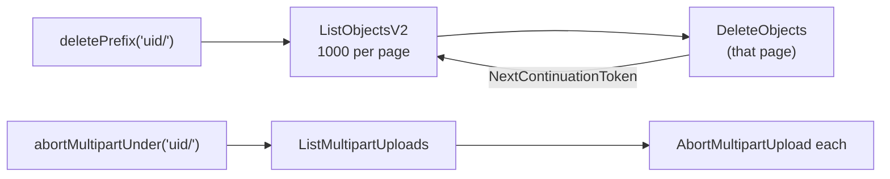
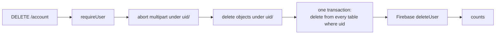

# F02 — Auth (backend)

<dl><dd>

- Sprint [S1](README.md) · 4h · every route knows who is calling; an account can be deleted completely.
- iOS side: [F02 Auth](https://github.com/DAMHONGDUC/site_log_swift_ui/blob/main/docs/feature-guide/S1-auth-projects/F02-auth.md). Contract: [01-api §2, §5](../../feature-docs/01-api.md#5-account).

</dd></dl>

## Contents

<dl><dd>

1. [Overview](#overview)
2. [1. Token check](#1-token-check)
3. [2. S3 storage](#2-s3-storage)
4. [3. Account deletion](#3-account-deletion)
5. [4. Run it with real Firebase](#4-run-it-with-real-firebase)
6. [Tests](#tests)
7. [Feature done](#feature-done)

</dd></dl>

## Overview

<dl><dd>

- **Goal:** `requireUser` turns a Firebase ID token into `request.uid` or a `401`; `DELETE /account` removes the user's files, rows and Firebase user.
- **Demo:** no token → `401 missing_token`; a real token from `npm run token` → `DELETE /account` → `200`, and the user is gone from Firebase.
- **File tags:** <b class="tag-new">New</b> · <b class="tag-edit">Edit</b> · <b class="tag-replace">Replace</b> · <b class="tag-check">Check</b>.

| Step | Hours | Files |
|---|---|---|
| [1](#1-token-check) | 1 | `src/auth.ts` |
| [2](#2-s3-storage) | 1 | `src/storage.ts` |
| [3](#3-account-deletion) | 1 | `src/sync/tables.ts`, `src/routes/account.ts`, `src/app.ts` |
| [4](#4-run-it-with-real-firebase) | 0.5 | `src/main.ts`, `scripts/dev-token.ts` |
| [Tests](#tests) | 0.5 | `test/helpers.ts`, `test/auth.test.ts`, `test/account.test.ts` |



```bash
npm install firebase-admin @aws-sdk/client-s3 && npm install -D aws-sdk-client-mock
```

</dd></dl>

## 1. Token check

<dl><dd>

#### Overview

<dl><dd>

- **Goal:** one preHandler every signed-in route uses.
- **Check:** `npm run typecheck`.

| Action | File | Holds |
|---|---|---|
| <b class="tag-new">New</b> | `src/auth.ts` | `TokenVerifier` (interface), `createFirebaseVerifier`, `TokenRejectedError`, `makeRequireUser` |

</dd></dl>

#### Steps

<dl><dd>

<details open>
<summary><strong>1.1 Auth</strong></summary>
<dl><dd>

<b>File</b> · <b class="tag-new">New</b> · `src/auth.ts`

<b>Explain</b> · Routes depend on the `TokenVerifier` interface, not on Firebase: tests pass a fake that understands `uid:alice`. `declare module 'fastify'` adds `uid` to every request's type.

<b>Think</b>

- `verifyIdToken` can fail because the token is bad, or because Google's servers cannot be reached. Which one should make the app refresh its token (`401`), and which one should make it retry later (`503`)?
- Why `checkRevoked: true`, although it costs one extra call to Firebase per request?

<details open>
<summary><b>Hint 1 · Idea</b></summary>

- `createFirebaseVerifier(base64)`: decode the JSON, `initializeApp({ credential: cert(json) })`, `getAuth(app)`.
- `verify` returns `{ uid, expiresAt }`; errors whose `code` starts with `auth/` become `TokenRejectedError`; other errors pass through.
- `deleteUser` ignores `auth/user-not-found` (deleting twice is fine).
- `makeRequireUser(tokens)` returns an async function: read the header, check `Bearer `, verify, set `request.uid`.

</details>

<details open>
<summary><b>Hint 2 · APIs</b></summary>

- `import { cert, initializeApp } from 'firebase-admin/app'`, `import { getAuth } from 'firebase-admin/auth'`.
- `auth.verifyIdToken(token, true)` → `decoded.uid`, `decoded.exp` (seconds).
- `request.headers.authorization`, `header.startsWith('Bearer ')`, `header.slice(7)`.

</details>

<details open>
<summary><b>Hint 3 · Skeleton</b></summary>

```ts
export function makeRequireUser(tokens: TokenVerifier) {
  return async function requireUser(request: FastifyRequest): Promise<void> {
    const header = request.headers.authorization;
    // 1. no header or no "Bearer " → throw unauthorized('missing_token')
    // 2. token = text after "Bearer "
    try {
      // 3. verified = await tokens.verify(token); request.uid = verified.uid
    } catch (error) {
      // 4. TokenRejectedError → log warn, throw unauthorized('invalid_token')
      // 5. anything else → log error, throw serviceUnavailable('auth_unavailable')
    }
  };
}
```

</details>

<details>
<summary><b>Code</b></summary>

```ts
import { cert, initializeApp } from 'firebase-admin/app';
import { getAuth } from 'firebase-admin/auth';
import type { FastifyRequest } from 'fastify';
import { serviceUnavailable, unauthorized } from './errors.js';

declare module 'fastify' {
  interface FastifyRequest {
    // Set by requireUser on every authenticated route.
    uid: string;
  }
}

export interface VerifiedToken {
  uid: string;
  expiresAt: Date;
}

// Checks a Firebase ID token. Tests pass a fake; production uses Firebase.
export interface TokenVerifier {
  verify(token: string): Promise<VerifiedToken>;
  deleteUser(uid: string): Promise<void>;
}

// The token itself is bad (expired, revoked, malformed): the app should refresh and retry.
export class TokenRejectedError extends Error {}

function isTokenProblem(error: unknown): boolean {
  if (typeof error !== 'object' || error === null || !('code' in error)) {
    return false;
  }
  const code = String(error.code);
  return code.startsWith('auth/') && code !== 'auth/internal-error';
}

export function createFirebaseVerifier(serviceAccountBase64: string): TokenVerifier {
  const json = Buffer.from(serviceAccountBase64, 'base64').toString('utf8');
  const serviceAccount = JSON.parse(json);
  const firebaseApp = initializeApp({ credential: cert(serviceAccount) });
  const auth = getAuth(firebaseApp);

  return {
    async verify(token: string): Promise<VerifiedToken> {
      try {
        // true = also check that the token was not revoked (sign out everywhere, deleted user)
        const decoded = await auth.verifyIdToken(token, true);
        return { uid: decoded.uid, expiresAt: new Date(decoded.exp * 1000) };
      } catch (error) {
        if (isTokenProblem(error)) {
          throw new TokenRejectedError(String((error as { code: string }).code));
        }
        throw error;
      }
    },

    async deleteUser(uid: string): Promise<void> {
      try {
        await auth.deleteUser(uid);
      } catch (error) {
        const code = (error as { code?: string }).code;
        if (code === 'auth/user-not-found') {
          // Already gone: deleting the account is idempotent.
          return;
        }
        throw error;
      }
    },
  };
}

// preHandler for every route that needs a signed-in user. Failures are 401, never 403:
// the app reads 403 as "the presigned URL expired".
export function makeRequireUser(tokens: TokenVerifier) {
  return async function requireUser(request: FastifyRequest): Promise<void> {
    const header = request.headers.authorization;
    if (header === undefined || !header.startsWith('Bearer ')) {
      throw unauthorized('missing_token');
    }
    const token = header.slice('Bearer '.length);
    try {
      const verified = await tokens.verify(token);
      request.uid = verified.uid;
    } catch (error) {
      if (error instanceof TokenRejectedError) {
        request.log.warn({ reason: error.message }, 'token rejected');
        throw unauthorized('invalid_token');
      }
      request.log.error({ err: error }, 'token check failed');
      throw serviceUnavailable('auth_unavailable');
    }
  };
}
```

</details>

<b>Try</b>

- After step 4: `curl -i -X DELETE localhost:3000/account -H 'Authorization: Bearer abc'` → `401 invalid_token`. Turn Wi-Fi off and use a real token → `503`.

</dd></dl>
</details>

</dd></dl>

</dd></dl>

## 2. S3 storage

<dl><dd>

#### Overview

<dl><dd>

- **Goal:** the one file that talks to S3. F02 needs only "delete everything under a prefix"; F06 and F07 add signing and multipart.
- **Check:** `npm run typecheck`.

| Action | File | Holds |
|---|---|---|
| <b class="tag-new">New</b> | `src/storage.ts` | `createS3Client`, `Storage` with `deletePrefix`, `abortMultipart`, `abortMultipartUnder` |



</dd></dl>

#### Steps

<dl><dd>

<details open>
<summary><strong>2.1 Storage</strong></summary>
<dl><dd>

<b>File</b> · <b class="tag-new">New</b> · `src/storage.ts`

<b>Explain</b> · The S3 client is created with checksum calculation `WHEN_REQUIRED`; without it, presigned URLs (F06) demand a checksum header the app never sends. Credentials come from the environment: your SSO profile locally, the server's IAM role on AWS.

<b>Think</b>

- A user has 2,500 files. How many `ListObjectsV2` and `DeleteObjects` calls does `deletePrefix` make?
- Why also abort unfinished multipart uploads, when they are not listed as objects?

<details open>
<summary><b>Hint 2 · APIs</b></summary>

- `new S3Client({ region, requestChecksumCalculation: 'WHEN_REQUIRED', responseChecksumValidation: 'WHEN_REQUIRED' })`, `s3.send(new ListObjectsV2Command({ Bucket, Prefix, ContinuationToken }))`, `DeleteObjectsCommand({ Bucket, Delete: { Objects, Quiet: true } })`, `ListMultipartUploadsCommand`, `AbortMultipartUploadCommand`, `S3ServiceException`.

</details>

<details>
<summary><b>Code</b></summary>

```ts
import {
  AbortMultipartUploadCommand,
  DeleteObjectsCommand,
  ListMultipartUploadsCommand,
  ListObjectsV2Command,
  S3Client,
  S3ServiceException,
} from '@aws-sdk/client-s3';

export function createS3Client(region: string): S3Client {
  return new S3Client({
    region,
    // Without these, the SDK adds checksum parameters to presigned URLs that the iOS
    // upload does not send, and S3 rejects every PUT.
    requestChecksumCalculation: 'WHEN_REQUIRED',
    responseChecksumValidation: 'WHEN_REQUIRED',
  });
}

// S3 says "not there" in three ways depending on the call.
function isMissing(error: unknown): boolean {
  if (!(error instanceof S3ServiceException)) {
    return false;
  }
  if (error.name === 'NotFound' || error.name === 'NoSuchKey' || error.name === 'NoSuchUpload') {
    return true;
  }
  return error.$metadata.httpStatusCode === 404;
}

// Every S3 call the backend makes. The backend never reads or writes file bytes itself,
// except the verify worker, which streams an object back to hash it.
export class Storage {
  private readonly s3: S3Client;
  private readonly bucket: string;
  private readonly ttlSeconds: number;

  constructor(s3: S3Client, bucket: string, ttlSeconds: number) {
    this.s3 = s3;
    this.bucket = bucket;
    this.ttlSeconds = ttlSeconds;
  }

  // Returns false when there was nothing to abort (already aborted or completed).
  async abortMultipart(key: string, s3UploadId: string): Promise<boolean> {
    try {
      const command = new AbortMultipartUploadCommand({
        Bucket: this.bucket,
        Key: key,
        UploadId: s3UploadId,
      });
      await this.s3.send(command);
      return true;
    } catch (error) {
      if (isMissing(error)) {
        return false;
      }
      throw error;
    }
  }

  // Deletes every object under a prefix, 1000 at a time (the S3 limit per request).
  async deletePrefix(prefix: string): Promise<number> {
    let deleted = 0;
    let token: string | undefined = undefined;
    do {
      const listCommand: ListObjectsV2Command = new ListObjectsV2Command({
        Bucket: this.bucket,
        Prefix: prefix,
        ContinuationToken: token,
      });
      const page = await this.s3.send(listCommand);
      const keys = (page.Contents ?? []).map((object) => ({ Key: object.Key }));
      if (keys.length > 0) {
        await this.s3.send(
          new DeleteObjectsCommand({ Bucket: this.bucket, Delete: { Objects: keys, Quiet: true } }),
        );
        deleted += keys.length;
      }
      token = page.NextContinuationToken;
    } while (token !== undefined);
    return deleted;
  }

  // Aborts unfinished multipart uploads under a prefix so no hidden parts are left behind.
  async abortMultipartUnder(prefix: string): Promise<number> {
    let aborted = 0;
    let keyMarker: string | undefined = undefined;
    let uploadIdMarker: string | undefined = undefined;
    let more = true;
    while (more) {
      const listCommand: ListMultipartUploadsCommand = new ListMultipartUploadsCommand({
        Bucket: this.bucket,
        Prefix: prefix,
        KeyMarker: keyMarker,
        UploadIdMarker: uploadIdMarker,
      });
      const page = await this.s3.send(listCommand);
      for (const upload of page.Uploads ?? []) {
        if (upload.Key !== undefined && upload.UploadId !== undefined) {
          const didAbort = await this.abortMultipart(upload.Key, upload.UploadId);
          if (didAbort) {
            aborted += 1;
          }
        }
      }
      more = page.IsTruncated === true;
      keyMarker = page.NextKeyMarker;
      uploadIdMarker = page.NextUploadIdMarker;
    }
    return aborted;
  }
}
```

</details>

</dd></dl>
</details>

</dd></dl>

</dd></dl>

## 3. Account deletion

<dl><dd>

#### Overview

<dl><dd>

- **Goal:** `DELETE /account`: files first, then rows, then the Firebase user — safe to call again after a failure.
- **Check:** `npm run typecheck`; step 4 runs it for real.

| Action | File | Holds |
|---|---|---|
| <b class="tag-new">New</b> | `src/sync/tables.ts` | The registry of synced tables, empty until F03; F04 sync reads it too |
| <b class="tag-new">New</b> | `src/routes/account.ts` | `DELETE /account`, `serverTables` (empty until F04) |
| <b class="tag-edit">Edit</b> | `src/app.ts` | `tokens` and `storage` in `AppDeps`, `uid` on requests, `requireUser`, the account route |



</dd></dl>

#### Steps

<dl><dd>

<details open>
<summary><strong>3.1 Table registry</strong></summary>
<dl><dd>

<b>File</b> · <b class="tag-new">New</b> · `src/sync/tables.ts`

<b>Explain</b> · Every synced table is listed once, here. Account deletion, pull, push and the purge all loop over this list, so a new table cannot be forgotten by one of them.

<b>Think</b>

- Read the `SyncTable` fields now; F03 fills the list. Which of the fields will `projects` need?

<details>
<summary><b>Code</b></summary>

```ts
// Every table the app may pull and push. A feature that adds a synced table adds it here.

export interface SyncTable {
  // SQL table name, also the `table` value in a mutation.
  name: string;
  // Business columns (snake_case) the app sends on every upsert, as a full row.
  columns: string[];
  // Kept from the first insert; later values are ignored (evidence must not change).
  immutable: string[];
  // Enum columns that only move forward, whatever the timestamps say.
  monotonic: string[];
  // A second unique key besides id (uid is always part of it). A new row that collides
  // with a live row on it loses: the app adopts the stored row. null = no such key.
  naturalKey: string[] | null;
}

export const syncTables: SyncTable[] = [];

export function findSyncTable(name: string): SyncTable | undefined {
  return syncTables.find((candidate) => candidate.name === name);
}
```

</details>

</dd></dl>
</details>

<details open>
<summary><strong>3.2 Account route</strong></summary>
<dl><dd>

<b>File</b> · <b class="tag-new">New</b> · `src/routes/account.ts`

<b>Explain</b> · Order matters: if row deletion ran first and S3 failed, nothing would remember which files to delete. Files are found by prefix, so a retry always finds what is left.

<b>Think</b>

- Why delete the Firebase user **last**? What could the user no longer do if it went first and a later step failed?

<details open>
<summary><b>Hint 3 · Skeleton</b></summary>

```ts
export const serverTables: string[] = [];

export function accountRoutes(app: FastifyInstance, deps: AppDeps, requireUser: preHandlerAsyncHookHandler): void {
  app.delete('/account', { preHandler: requireUser }, async (request) => {
    const prefix = `${request.uid}/`;
    // 1. abortedUploads = await deps.storage.abortMultipartUnder(prefix)
    // 2. deletedObjects = await deps.storage.deletePrefix(prefix)
    // 3. deletedRows = withTransaction: set constraints all deferred; delete from each table where uid = $1
    // 4. await deps.tokens.deleteUser(uid); log; return the three counts
  });
}
```

</details>

<details>
<summary><b>Code</b></summary>

```ts
import type { FastifyInstance, preHandlerAsyncHookHandler } from 'fastify';
import type { AppDeps } from '../app.js';
import { withTransaction } from '../db.js';
import { syncTables } from '../sync/tables.js';

// Server-only tables that also hold the user's rows. A feature that adds one adds it here.
export const serverTables: string[] = [];

// Deletes everything the user owns: files first, then rows, then the Firebase user.
// Files go first because the rows are the only record of what still exists.
// Safe to call again after a partial failure: each step skips what is already gone.
export function accountRoutes(
  app: FastifyInstance,
  deps: AppDeps,
  requireUser: preHandlerAsyncHookHandler,
): void {
  app.delete('/account', { preHandler: requireUser }, async (request) => {
    const uid = request.uid;
    const prefix = `${uid}/`;

    const abortedUploads = await deps.storage.abortMultipartUnder(prefix);
    const deletedObjects = await deps.storage.deletePrefix(prefix);

    const tables = [...syncTables.map((table) => table.name), ...serverTables];
    const deletedRows = await withTransaction(deps.pool, async (client) => {
      // Foreign keys are checked at commit, when every row of this user is gone.
      await client.query('set constraints all deferred');
      let count = 0;
      for (const table of tables) {
        const result = await client.query(`delete from ${table} where uid = $1`, [uid]);
        count += result.rowCount ?? 0;
      }
      return count;
    });

    await deps.tokens.deleteUser(uid);
    request.log.info({ uid, deletedObjects, abortedUploads, deletedRows }, 'account deleted');
    return { deletedObjects, abortedUploads, deletedRows };
  });
}
```

</details>

</dd></dl>
</details>

<details open>
<summary><strong>3.3 App</strong></summary>
<dl><dd>

<b>File</b> · <b class="tag-edit">Edit</b> · `src/app.ts`

<b>Explain</b> · `AppDeps` gains `tokens` and `storage`; `decorateRequest('uid', '')` tells Fastify every request has a `uid` field.

```diff
@@ -2,2 +2,3 @@
 import type pg from 'pg';
+import { makeRequireUser, type TokenVerifier } from './auth.js';
 import type { Config } from './config.js';
@@ -5,5 +6,7 @@
 import { loggerOptions } from './logger.js';
+import { accountRoutes } from './routes/account.js';
 import { healthRoutes } from './routes/health.js';
+import type { Storage } from './storage.js';
 
-// Everything a route needs, passed in so tests can swap real services for fakes.
+// Everything a route needs, passed in so tests can swap Firebase and S3 for fakes.
 export interface AppDeps {
@@ -11,2 +14,4 @@
   pool: pg.Pool;
+  tokens: TokenVerifier;
+  storage: Storage;
 }
@@ -22,4 +27,8 @@
   registerErrorHandler(app);
+  app.decorateRequest('uid', '');
+
+  const requireUser = makeRequireUser(deps.tokens);
 
   healthRoutes(app, deps);
+  accountRoutes(app, deps, requireUser);
 
```

<details>
<summary><b>Code</b></summary>

```ts
import Fastify, { type FastifyInstance } from 'fastify';
import type pg from 'pg';
import { makeRequireUser, type TokenVerifier } from './auth.js';
import type { Config } from './config.js';
import { registerErrorHandler } from './errors.js';
import { loggerOptions } from './logger.js';
import { accountRoutes } from './routes/account.js';
import { healthRoutes } from './routes/health.js';
import type { Storage } from './storage.js';

// Everything a route needs, passed in so tests can swap Firebase and S3 for fakes.
export interface AppDeps {
  config: Config;
  pool: pg.Pool;
  tokens: TokenVerifier;
  storage: Storage;
}

export async function buildApp(deps: AppDeps): Promise<FastifyInstance> {
  const app = Fastify({
    logger: loggerOptions(deps.config.logLevel),
    bodyLimit: deps.config.maxRequestBytes,
    // Caddy sits in front: read the client IP from X-Forwarded-For.
    trustProxy: true,
  });

  registerErrorHandler(app);
  app.decorateRequest('uid', '');

  const requireUser = makeRequireUser(deps.tokens);

  healthRoutes(app, deps);
  accountRoutes(app, deps, requireUser);

  return app;
}
```

</details>

</dd></dl>
</details>

</dd></dl>

</dd></dl>

## 4. Run it with real Firebase

<dl><dd>

#### Overview

<dl><dd>

- **Goal:** the server checks real tokens; you can get one from the terminal.
- **Check:** the demo in [Overview](#overview).

| Action | File | Holds |
|---|---|---|
| <b class="tag-edit">Edit</b> | `src/main.ts` | Requires the Firebase key, builds the verifier and the S3 storage |
| <b class="tag-new">New</b> | `scripts/dev-token.ts` | Signs in a test user with the Firebase REST API, prints the ID token |
| <b class="tag-edit">Edit</b> | `.env` | `FIREBASE_SERVICE_ACCOUNT_BASE64`, `FIREBASE_WEB_API_KEY` (from F00a) |

</dd></dl>

#### Steps

<dl><dd>

<details open>
<summary><strong>4.1 Main and token script</strong></summary>
<dl><dd>

<b>File</b> · <b class="tag-edit">Edit</b> · `src/main.ts`

```diff
@@ -1,4 +1,6 @@
 import { buildApp } from './app.js';
+import { createFirebaseVerifier } from './auth.js';
 import { loadConfig } from './config.js';
 import { createPool } from './db.js';
+import { Storage, createS3Client } from './storage.js';
 
@@ -6,5 +8,14 @@
 const config = loadConfig();
+if (config.firebaseServiceAccountBase64 === undefined) {
+  throw new Error('Missing environment variable FIREBASE_SERVICE_ACCOUNT_BASE64');
+}
 
 const pool = createPool(config);
-const app = await buildApp({ config, pool });
+const tokens = createFirebaseVerifier(config.firebaseServiceAccountBase64);
+const storage = new Storage(
+  createS3Client(config.awsRegion),
+  config.s3Bucket,
+  config.presignTtlSeconds,
+);
+const app = await buildApp({ config, pool, tokens, storage });
 
```

<details>
<summary><b>Code</b></summary>

```ts
import { buildApp } from './app.js';
import { createFirebaseVerifier } from './auth.js';
import { loadConfig } from './config.js';
import { createPool } from './db.js';
import { Storage, createS3Client } from './storage.js';

// Starts the HTTP server.
const config = loadConfig();
if (config.firebaseServiceAccountBase64 === undefined) {
  throw new Error('Missing environment variable FIREBASE_SERVICE_ACCOUNT_BASE64');
}

const pool = createPool(config);
const tokens = createFirebaseVerifier(config.firebaseServiceAccountBase64);
const storage = new Storage(
  createS3Client(config.awsRegion),
  config.s3Bucket,
  config.presignTtlSeconds,
);
const app = await buildApp({ config, pool, tokens, storage });

await app.listen({ host: '0.0.0.0', port: config.port });

// docker stop sends SIGTERM: finish open requests, then close the database pool.
async function shutdown(signal: string): Promise<void> {
  app.log.info({ signal }, 'shutting down');
  await app.close();
  await pool.end();
}

process.once('SIGTERM', () => void shutdown('SIGTERM'));
process.once('SIGINT', () => void shutdown('SIGINT'));
```

</details>

---

<b>File</b> · <b class="tag-new">New</b> · `scripts/dev-token.ts`

<b>Explain</b> · The same sign-in the app does, from the terminal, for curl. The Web API key is not a secret (it ships inside every app), but keep it in `.env` anyway.

<details>
<summary><b>Code</b></summary>

```ts
// Prints a Firebase ID token for a test user, for curl: npm run token -- you@example.com password
// Uses the dev Firebase project's Web API key (Firebase console → Project settings → General).
const apiKey = process.env.FIREBASE_WEB_API_KEY;
const email = process.argv[2];
const password = process.argv[3];

if (apiKey === undefined || email === undefined || password === undefined) {
  process.stderr.write('Usage: FIREBASE_WEB_API_KEY=… npm run token -- <email> <password>\n');
  process.exit(1);
}

const response = await fetch(
  `https://identitytoolkit.googleapis.com/v1/accounts:signInWithPassword?key=${apiKey}`,
  {
    method: 'POST',
    headers: { 'content-type': 'application/json' },
    body: JSON.stringify({ email, password, returnSecureToken: true }),
  },
);
const body = (await response.json()) as { idToken?: string; error?: { message: string } };
if (body.idToken === undefined) {
  process.stderr.write(`Sign-in failed: ${body.error?.message ?? response.status}\n`);
  process.exit(1);
}
process.stdout.write(`${body.idToken}\n`);
```

</details>

```bash
npm run dev
```

```bash
curl -i -X DELETE localhost:3000/account
```

```bash
TOKEN=$(npm run -s token -- test1@example.com '<password>')
```

```bash
curl -s -X DELETE localhost:3000/account -H "Authorization: Bearer $TOKEN"
```

- Expected: `{"deletedObjects":0,"abortedUploads":0,"deletedRows":0}`, and `test1@example.com` is gone from Firebase → Authentication → Users. Add it again for later steps.

<b>Try</b>

- Run the last curl again with the same token → `401`: the user was deleted, so the token is revoked.

</dd></dl>
</details>

</dd></dl>

</dd></dl>

## Tests

<dl><dd>

| Action | File | Covers |
|---|---|---|
| <b class="tag-replace">Replace</b> | `test/helpers.ts` | `FakeTokens`, a mocked S3 client, `resetDatabase`, `auth(uid)`, ids |
| <b class="tag-new">New</b> | `test/auth.test.ts` | No token, revoked, Firebase down, valid |
| <b class="tag-new">New</b> | `test/account.test.ts` | 1001 objects in two pages, own prefix only, second call finds nothing |

<details open>
<summary><strong>Test files</strong></summary>
<dl><dd>

<b>File</b> · <b class="tag-replace">Replace</b> · `test/helpers.ts`

<b>Explain</b> · `mockClient(s3)` answers every S3 command from the test; a real `S3Client` with fake keys still signs URLs offline (F06).

<details>
<summary><b>Code</b></summary>

```ts
import { S3Client } from '@aws-sdk/client-s3';
import { mockClient } from 'aws-sdk-client-mock';
import type { FastifyInstance } from 'fastify';
import pg from 'pg';
import { buildApp } from '../src/app.js';
import { TokenRejectedError, type TokenVerifier } from '../src/auth.js';
import { loadConfig, type Config } from '../src/config.js';
import { serverTables } from '../src/routes/account.js';
import { Storage } from '../src/storage.js';
import { syncTables } from '../src/sync/tables.js';
import { testDatabaseUrl } from './global-setup.js';

export function testConfig(overrides: Record<string, string> = {}): Config {
  return loadConfig({
    DATABASE_URL: testDatabaseUrl,
    AWS_REGION: 'ap-southeast-1',
    S3_BUCKET: 'sitelog-test',
    LOG_LEVEL: 'silent',
    VERIFY_MIN_DELAY_MS: '50',
    ...overrides,
  });
}

// Fake Firebase. Tokens are plain text: "uid:alice" is alice, "revoked:alice" is rejected,
// "down" means Firebase is unreachable.
export class FakeTokens implements TokenVerifier {
  deletedUsers: string[] = [];

  async verify(token: string) {
    if (token === 'down') {
      throw new Error('firebase unreachable');
    }
    if (token.startsWith('uid:')) {
      return { uid: token.slice(4), expiresAt: new Date(Date.now() + 3600_000) };
    }
    throw new TokenRejectedError('auth/id-token-revoked');
  }

  async deleteUser(uid: string) {
    this.deletedUsers.push(uid);
  }
}

export interface TestContext {
  app: FastifyInstance;
  pool: pg.Pool;
  s3: ReturnType<typeof mockClient>;
  tokens: FakeTokens;
  storage: Storage;
  config: Config;
}

export async function createTestContext(
  overrides: Record<string, string> = {},
): Promise<TestContext> {
  const config = testConfig(overrides);
  const pool = new pg.Pool({ connectionString: config.databaseUrl, options: '-c TimeZone=UTC' });
  // A real S3 client with fake keys: presigning works offline, every call is mocked.
  const client = new S3Client({
    region: config.awsRegion,
    credentials: { accessKeyId: 'test', secretAccessKey: 'test' },
    requestChecksumCalculation: 'WHEN_REQUIRED',
  });
  const s3 = mockClient(client);
  const storage = new Storage(client, config.s3Bucket, config.presignTtlSeconds);
  const tokens = new FakeTokens();
  const app = await buildApp({ config, pool, tokens, storage });
  await app.ready();
  return { app, pool, s3, tokens, storage, config };
}

export async function closeTestContext(context: TestContext): Promise<void> {
  await context.app.close();
  await context.pool.end();
}

// Empties every table the app writes, so each test starts clean.
export async function resetDatabase(pool: pg.Pool): Promise<void> {
  const tables = [...syncTables.map((table) => table.name), ...serverTables];
  if (tables.length === 0) {
    return;
  }
  await pool.query(`truncate ${tables.join(', ')}`);
}

export function auth(uid: string): Record<string, string> {
  return { authorization: `Bearer uid:${uid}` };
}

export const ids = {
  project: '11111111-1111-4111-8111-111111111111',
  location: '22222222-2222-4222-8222-222222222222',
  session: '33333333-3333-4333-8333-333333333333',
  capture: '44444444-4444-4444-8444-444444444444',
};

export const sha = 'a'.repeat(64);
```

</details>

---

<b>File</b> · <b class="tag-new">New</b> · `test/auth.test.ts`

<details>
<summary><b>Code</b></summary>

```ts
import { ListMultipartUploadsCommand, ListObjectsV2Command } from '@aws-sdk/client-s3';
import { afterAll, beforeAll, describe, expect, it } from 'vitest';
import { closeTestContext, createTestContext, type TestContext } from './helpers.js';

describe('requireUser', () => {
  let context: TestContext;
  beforeAll(async () => {
    context = await createTestContext();
    context.s3.on(ListObjectsV2Command).resolves({ Contents: [] });
    context.s3.on(ListMultipartUploadsCommand).resolves({ Uploads: [] });
  });
  afterAll(async () => {
    await closeTestContext(context);
  });

  // Any signed-in route works; DELETE /account is the first one (F02).
  async function call(headers: Record<string, string>) {
    return context.app.inject({ method: 'DELETE', url: '/account', headers });
  }

  it('rejects a missing token with 401', async () => {
    const response = await call({});
    expect(response.statusCode).toBe(401);
    expect(response.json().error.code).toBe('missing_token');
  });

  it('rejects a revoked token with 401, never 403', async () => {
    const response = await call({ authorization: 'Bearer revoked:alice' });
    expect(response.statusCode).toBe(401);
  });

  it('answers 503 when Firebase cannot be reached', async () => {
    const response = await call({ authorization: 'Bearer down' });
    expect(response.statusCode).toBe(503);
  });

  it('lets a valid token through', async () => {
    const response = await call({ authorization: 'Bearer uid:alice' });
    expect(response.statusCode).toBe(200);
  });
});
```

</details>

---

<b>File</b> · <b class="tag-new">New</b> · `test/account.test.ts`

<details>
<summary><b>Code</b></summary>

```ts
import {
  DeleteObjectsCommand,
  ListMultipartUploadsCommand,
  ListObjectsV2Command,
} from '@aws-sdk/client-s3';
import { afterAll, beforeAll, beforeEach, describe, expect, it } from 'vitest';
import {
  auth,
  closeTestContext,
  createTestContext,
  resetDatabase,
  type TestContext,
} from './helpers.js';

describe('DELETE /account', () => {
  let context: TestContext;
  beforeAll(async () => {
    context = await createTestContext();
  });
  afterAll(async () => {
    await closeTestContext(context);
  });
  beforeEach(async () => {
    await resetDatabase(context.pool);
    context.s3.reset();
    context.tokens.deletedUsers = [];
  });

  it('deletes every object past 1000, then the Firebase user', async () => {
    const page1 = Array.from({ length: 1000 }, (_value, index) => ({
      Key: `alice/a/${index}.jpg`,
    }));
    context.s3
      .on(ListObjectsV2Command)
      .resolvesOnce({ Contents: page1, NextContinuationToken: 'next' })
      .resolvesOnce({ Contents: [{ Key: 'alice/b/last.jpg' }] });
    context.s3.on(DeleteObjectsCommand).resolves({});
    context.s3.on(ListMultipartUploadsCommand).resolves({ Uploads: [] });

    const response = await context.app.inject({
      method: 'DELETE',
      url: '/account',
      headers: auth('alice'),
    });
    expect(response.statusCode).toBe(200);
    expect(response.json().deletedObjects).toBe(1001);
    expect(context.s3.commandCalls(DeleteObjectsCommand)).toHaveLength(2);
    expect(context.tokens.deletedUsers).toEqual(['alice']);
  });

  it('only lists objects under the caller’s own prefix', async () => {
    context.s3.on(ListObjectsV2Command).resolves({ Contents: [] });
    context.s3.on(ListMultipartUploadsCommand).resolves({ Uploads: [] });
    await context.app.inject({ method: 'DELETE', url: '/account', headers: auth('alice') });
    const listed = context.s3.commandCalls(ListObjectsV2Command)[0]!.args[0].input;
    expect(listed.Prefix).toBe('alice/');
  });

  it('can be called again and finds nothing left', async () => {
    context.s3.on(ListObjectsV2Command).resolves({ Contents: [] });
    context.s3.on(ListMultipartUploadsCommand).resolves({ Uploads: [] });
    const response = await context.app.inject({
      method: 'DELETE',
      url: '/account',
      headers: auth('alice'),
    });
    expect(response.statusCode).toBe(200);
    expect(response.json()).toEqual({ deletedObjects: 0, abortedUploads: 0, deletedRows: 0 });
  });
});
```

</details>

```bash
npm test
```

</dd></dl>
</details>

</dd></dl>

## Feature done

<dl><dd>

- [ ] No token → `401 missing_token`; bad token → `401 invalid_token`; Firebase down → `503`
- [ ] `DELETE /account` with a real token deletes the Firebase user; a repeat answers `401`
- [ ] `npm test` green (10 tests); merged; staging deployed
- [ ] The iOS app's signed-in path gets `401` without a token from staging

</dd></dl>
