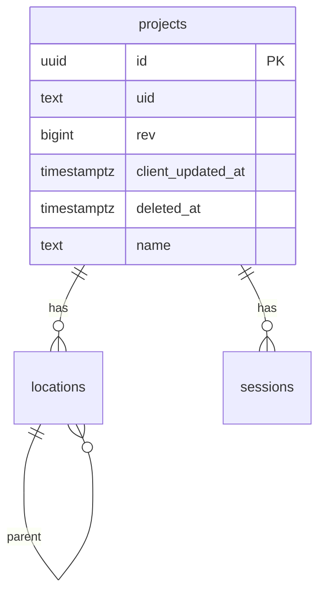

# F03 — Projects (backend)

<dl><dd>

- Sprint [S1](README.md) · 3h · the server tables for projects, locations and sessions, ready for F04 sync.
- iOS side: [F03 Projects](https://github.com/DAMHONGDUC/site_log_swift_ui/blob/main/docs/feature-guide/S1-auth-projects/F03-projects.md). Contract: [01-api §6.3](../../feature-docs/01-api.md#63-synced-tables). Rules: [02-database §5](../../feature-docs/02-database.md#5-rules).

</dd></dl>

## Contents

<dl><dd>

1. [Overview](#overview)
2. [1. Migration](#1-migration)
3. [2. Registry](#2-registry)
4. [Tests](#tests)
5. [Feature done](#feature-done)

</dd></dl>

## Overview

<dl><dd>

- **Goal:** three tables with the five sync columns, foreign keys that include `uid`, and their entries in the registry.
- **Demo:** `npm run migrate` → `applied: ["0001_projects.sql"]`; `\d locations` in psql shows the keys; `DELETE /account` now counts rows.

| Step | Hours | Files |
|---|---|---|
| [1](#1-migration) | 2 | `migrations/0001_projects.sql` |
| [2](#2-registry) | 0.5 | `src/sync/tables.ts` |
| [Tests](#tests) | 0.5 | `test/projects.test.ts` |



</dd></dl>

## 1. Migration

<dl><dd>

#### Overview

<dl><dd>

- **Goal:** the first real migration.
- **Check:** `npm run migrate`, then `docker compose exec postgres psql -U sitelog -c '\d locations'`.

| Action | File | Holds |
|---|---|---|
| <b class="tag-new">New</b> | `migrations/0001_projects.sql` | `session_state` enum, `projects`, `locations`, `sessions`, indexes |

</dd></dl>

#### Steps

<dl><dd>

<details open>
<summary><strong>1.1 SQL</strong></summary>
<dl><dd>

<b>File</b> · <b class="tag-new">New</b> · `migrations/0001_projects.sql`

<b>Explain</b> · `unique (uid, id)` on a parent lets a child reference `(uid, project_id)`: a row can only point at a parent of the same user. `deferrable initially deferred` waits until commit, so one push may insert a location before its project.

<b>Think</b>

- `unique (project_id, code) where deleted_at is null`: why the `where`? What would happen when a user deletes location `L1` and creates a new `L1`?
- Why is `session_state` an enum and not text with a check? (Hint: F04 uses `greatest(…)` on it.)

<details open>
<summary><b>Hint 1 · Idea</b></summary>

- Each table: the five sync columns, its business columns ([01-api §6.3](../../feature-docs/01-api.md#63-synced-tables) in `snake_case`), `unique (uid, id)`, foreign keys with `uid`, index `(uid, rev)`.

</details>

<details open>
<summary><b>Hint 3 · Skeleton</b></summary>

```sql
create type session_state as enum ('draft', 'active', 'closed', 'exported');

create table projects (
    id                uuid primary key,
    uid               text not null,
    rev               bigint not null,
    client_updated_at timestamptz not null,
    deleted_at        timestamptz,
    -- name, address, client_name, created_at
    unique (uid, id)
);
create index projects_uid_rev on projects (uid, rev);

create table locations (
    -- the five sync columns
    -- project_id, parent_id, code, kind (check), sort_index
    unique (uid, id),
    foreign key (uid, project_id) references projects (uid, id) deferrable initially deferred
    -- and the parent_id one
);
-- index, partial unique on (project_id, code)

-- sessions: same pattern, state session_state
```

</details>

<details>
<summary><b>Code</b></summary>

```sql
-- F03: the first synced tables. Every synced table has the same five sync columns.
-- Foreign keys include uid, so a row can only point at a parent of the same user,
-- and are deferred, so one push batch may insert a child before its parent.

create type session_state as enum ('draft', 'active', 'closed', 'exported');

create table projects (
    id                uuid primary key,
    uid               text not null,
    rev               bigint not null,
    client_updated_at timestamptz not null,
    deleted_at        timestamptz,
    name              text not null,
    address           text,
    client_name       text,
    created_at        timestamptz not null,
    unique (uid, id)
);
create index projects_uid_rev on projects (uid, rev);

create table locations (
    id                uuid primary key,
    uid               text not null,
    rev               bigint not null,
    client_updated_at timestamptz not null,
    deleted_at        timestamptz,
    project_id        uuid not null,
    parent_id         uuid,
    code              text not null,
    kind              text not null check (kind in ('floor', 'unit', 'room')),
    sort_index        integer not null,
    unique (uid, id),
    foreign key (uid, project_id) references projects (uid, id) deferrable initially deferred,
    foreign key (uid, parent_id) references locations (uid, id) deferrable initially deferred
);
create index locations_uid_rev on locations (uid, rev);
create unique index locations_code_live on locations (project_id, code) where deleted_at is null;

create table sessions (
    id                uuid primary key,
    uid               text not null,
    rev               bigint not null,
    client_updated_at timestamptz not null,
    deleted_at        timestamptz,
    project_id        uuid not null,
    started_at        timestamptz not null,
    ended_at          timestamptz,
    surveyor_name     text not null,
    note              text not null,
    state             session_state not null,
    unique (uid, id),
    foreign key (uid, project_id) references projects (uid, id) deferrable initially deferred
);
create index sessions_uid_rev on sessions (uid, rev);
```

</details>

```bash
npm run migrate
```

<b>Try</b>

- In psql: `insert into projects (id, uid, rev, client_updated_at, name, created_at) values (gen_random_uuid(), 'me', 1, now(), 'x', now());` then insert a location for uid `you` pointing at it → foreign key error. Clean up with `truncate projects cascade;`.

</dd></dl>
</details>

</dd></dl>

</dd></dl>

## 2. Registry

<dl><dd>

#### Overview

<dl><dd>

- **Goal:** the three tables join the account deletion now and sync in F04.
- **Check:** `DELETE /account` returns `deletedRows` > 0 after you insert a row by hand.

| Action | File | Holds |
|---|---|---|
| <b class="tag-edit">Edit</b> | `src/sync/tables.ts` | The `table()` helper, three entries with their frozen and monotonic columns |

</dd></dl>

#### Steps

<dl><dd>

<details open>
<summary><strong>2.1 Entries</strong></summary>
<dl><dd>

<b>File</b> · <b class="tag-edit">Edit</b> · `src/sync/tables.ts`

<b>Explain</b> · `columns` is the full row the app sends; `immutable` columns keep their first value; `monotonic` columns only move forward.

<b>Think</b>

- Why is `projects.created_at` frozen, but `name` is not?

```diff
@@ -16,3 +16,29 @@
 
-export const syncTables: SyncTable[] = [];
+function table(
+  name: string,
+  columns: string[],
+  options: { immutable?: string[]; monotonic?: string[]; naturalKey?: string[] | null } = {},
+): SyncTable {
+  return {
+    name,
+    columns,
+    immutable: options.immutable ?? [],
+    monotonic: options.monotonic ?? [],
+    naturalKey: options.naturalKey ?? null,
+  };
+}
+
+export const syncTables: SyncTable[] = [
+  // F03
+  table('projects', ['name', 'address', 'client_name', 'created_at'], {
+    immutable: ['created_at'],
+  }),
+  table('locations', ['project_id', 'parent_id', 'code', 'kind', 'sort_index'], {
+    immutable: ['project_id'],
+  }),
+  table('sessions', ['project_id', 'started_at', 'ended_at', 'surveyor_name', 'note', 'state'], {
+    immutable: ['project_id', 'started_at'],
+    monotonic: ['state'],
+  }),
+];
 
```

<details>
<summary><b>Code</b></summary>

```ts
// Every table the app may pull and push. A feature that adds a synced table adds it here.

export interface SyncTable {
  // SQL table name, also the `table` value in a mutation.
  name: string;
  // Business columns (snake_case) the app sends on every upsert, as a full row.
  columns: string[];
  // Kept from the first insert; later values are ignored (evidence must not change).
  immutable: string[];
  // Enum columns that only move forward, whatever the timestamps say.
  monotonic: string[];
  // A second unique key besides id (uid is always part of it). A new row that collides
  // with a live row on it loses: the app adopts the stored row. null = no such key.
  naturalKey: string[] | null;
}

function table(
  name: string,
  columns: string[],
  options: { immutable?: string[]; monotonic?: string[]; naturalKey?: string[] | null } = {},
): SyncTable {
  return {
    name,
    columns,
    immutable: options.immutable ?? [],
    monotonic: options.monotonic ?? [],
    naturalKey: options.naturalKey ?? null,
  };
}

export const syncTables: SyncTable[] = [
  // F03
  table('projects', ['name', 'address', 'client_name', 'created_at'], {
    immutable: ['created_at'],
  }),
  table('locations', ['project_id', 'parent_id', 'code', 'kind', 'sort_index'], {
    immutable: ['project_id'],
  }),
  table('sessions', ['project_id', 'started_at', 'ended_at', 'surveyor_name', 'note', 'state'], {
    immutable: ['project_id', 'started_at'],
    monotonic: ['state'],
  }),
];

export function findSyncTable(name: string): SyncTable | undefined {
  return syncTables.find((candidate) => candidate.name === name);
}
```

</details>

</dd></dl>
</details>

</dd></dl>

</dd></dl>

## Tests

<dl><dd>

<details open>
<summary><strong>Test file</strong></summary>
<dl><dd>

<b>File</b> · <b class="tag-new">New</b> · `test/projects.test.ts`

<b>Explain</b> · No sync yet, so rows go in with SQL; F04 tests the same rules through `/sync/push`.

<details>
<summary><b>Code</b></summary>

```ts
import { ListMultipartUploadsCommand, ListObjectsV2Command } from '@aws-sdk/client-s3';
import { afterAll, beforeAll, beforeEach, describe, expect, it } from 'vitest';
import {
  auth,
  closeTestContext,
  createTestContext,
  ids,
  resetDatabase,
  type TestContext,
} from './helpers.js';

// F03 has no sync yet: rows are inserted with SQL, as the push will do in F04.
describe('project tables', () => {
  let context: TestContext;
  beforeAll(async () => {
    context = await createTestContext();
  });
  afterAll(async () => {
    await closeTestContext(context);
  });
  beforeEach(async () => {
    await resetDatabase(context.pool);
  });

  async function insertProject(uid: string, id: string = ids.project) {
    await context.pool.query(
      `insert into projects (id, uid, rev, client_updated_at, name, created_at)
       values ($1, $2, 1, now(), 'Tower A', now())`,
      [id, uid],
    );
  }

  async function insertLocation(uid: string, id: string, code: string) {
    await context.pool.query(
      `insert into locations (id, uid, rev, client_updated_at, project_id, code, kind, sort_index)
       values ($1, $2, 1, now(), $3, $4, 'floor', 0)`,
      [id, uid, ids.project, code],
    );
  }

  it('rejects a second live location with the same code in a project', async () => {
    await insertProject('alice');
    await insertLocation('alice', ids.location, 'L1');
    await expect(
      insertLocation('alice', '88888888-8888-4888-8888-888888888888', 'L1'),
    ).rejects.toThrow('locations_code_live');
  });

  it('allows the code again once the first location is deleted', async () => {
    await insertProject('alice');
    await insertLocation('alice', ids.location, 'L1');
    await context.pool.query('update locations set deleted_at = now()');
    await insertLocation('alice', '88888888-8888-4888-8888-888888888888', 'L1');
  });

  it("rejects a location that points at another user's project", async () => {
    await insertProject('alice');
    await expect(insertLocation('bob', ids.location, 'L1')).rejects.toThrow('foreign key');
  });

  it('deletes project rows with the account', async () => {
    context.s3.on(ListObjectsV2Command).resolves({ Contents: [] });
    context.s3.on(ListMultipartUploadsCommand).resolves({ Uploads: [] });
    await insertProject('alice');
    await insertLocation('alice', ids.location, 'L1');
    const response = await context.app.inject({
      method: 'DELETE',
      url: '/account',
      headers: auth('alice'),
    });
    expect(response.json().deletedRows).toBe(2);
  });
});
```

</details>

```bash
npm test
```

</dd></dl>
</details>

</dd></dl>

## Feature done

<dl><dd>

- [ ] `0001_projects.sql` runs on an empty database and on staging (the deploy runs it)
- [ ] A second live location with the same code is rejected; after a delete it is allowed
- [ ] A location of another user's project is rejected
- [ ] `npm test` green (14 tests)

</dd></dl>
