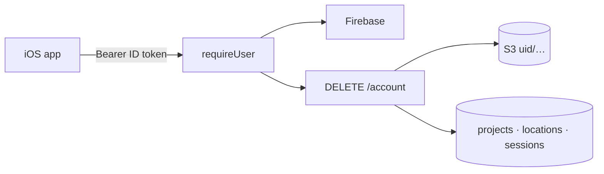

# S1 — Auth and projects

<dl><dd>

- Sprint 1 · 2 weeks · backend 7h of the sprint's 56h · [all sprints](../README.md) · iOS side: [S1 iOS](https://github.com/DAMHONGDUC/site_log_swift_ui/blob/main/docs/feature-guide/S1-auth-projects/README.md)

</dd></dl>

## Contents

<dl><dd>

1. [Overview](#overview)
2. [Tasks](#tasks)
3. [Done](#done)
4. [Self-check](#self-check)

</dd></dl>

## Overview

<dl><dd>

- **Goal:** the backend knows the caller; the project tables exist for F04.
- **Demo:** the app signed in against staging: a call without a token gets `401`; `DELETE /account` from the app deletes the Firebase user.

| Guide | Builds | Hours |
|---|---|---|
| [F02 Auth](F02-auth.md) | `requireUser`, S3 storage, `DELETE /account`, dev token script | 4 |
| [F03 Projects](F03-projects.md) | `0001_projects.sql`, registry entries | 3 |

</dd></dl>

## Tasks

<dl><dd>

| Task | What | Guide | Hours | Status |
|---|---|---|---|---|
| F02.1 | `requireUser` | [F02 §1](F02-auth.md#1-token-check) | 1 | not start |
| F02.2 | S3 storage | [F02 §2](F02-auth.md#2-s3-storage) | 1 | not start |
| F02.3 | `DELETE /account` | [F02 §3](F02-auth.md#3-account-deletion) | 1 | not start |
| F02.4 | Real Firebase, token script, tests | [F02 §4](F02-auth.md#4-run-it-with-real-firebase) | 1 | not start |
| F03.1 | `0001_projects.sql` | [F03 §1](F03-projects.md#1-migration) | 2 | not start |
| F03.2 | Registry entries, tests | [F03 §2](F03-projects.md#2-registry) | 1 | not start |

</dd></dl>

## Done

<dl><dd>

- [ ] `npm test` green; staging deployed and migrated
- [ ] The app's sign-in works against staging; a request without a token is `401`

</dd></dl>

## Self-check

<dl><dd>

- Why is a revoked token caught on the next request, not when it expires an hour later?
- Two users both have a project with the same id. Why can that never happen, and what stops a location pointing at the wrong one?

</dd></dl>
