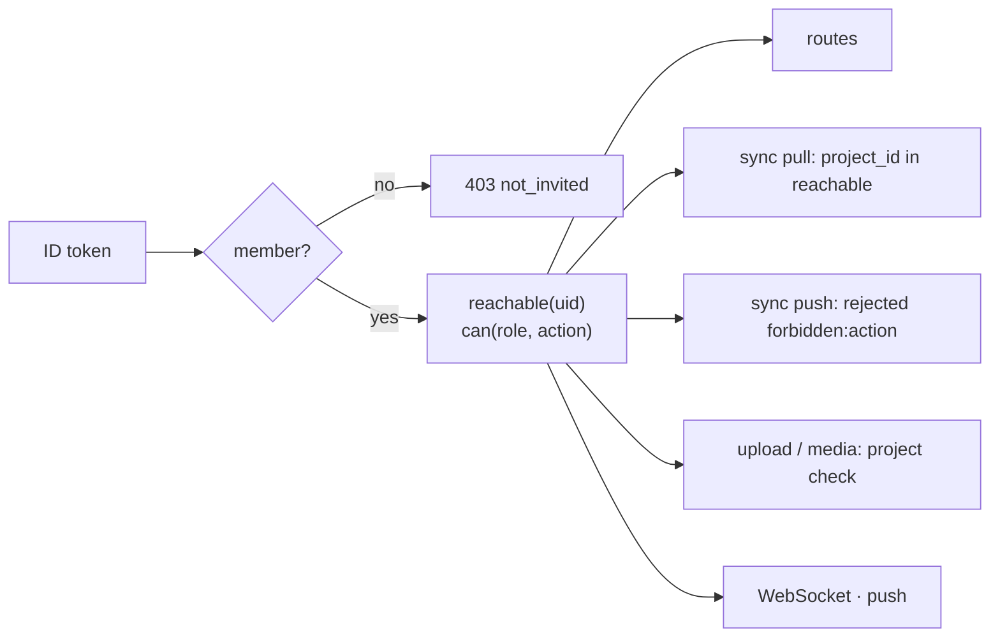

# F19 — Team and roles (backend)

<dl><dd>

- Sprint [S10](README.md) · 26h · built: the code is in the repository (files below), checked by `test/team.test.ts` and the updated S1–S8 tests. This guide lists the parts, files and order; read the files for the code.
- Rules: [05-team-and-roles](../../feature-docs/05-team-and-roles.md) · contract: [01-api §13](../../feature-docs/01-api.md#13-team) · tables: [02-database](../../feature-docs/02-database.md) · why: [B10](../../feature-docs/00-overview.md#b10--one-company-four-roles-shared-projects).
- App side: [iOS F19](https://github.com/DAMHONGDUC/site_log_swift_ui/blob/main/docs/feature-guide/S10-team-roles/F19-team-roles.md) · [Android F19](https://github.com/DAMHONGDUC/site-log-android/blob/main/docs/feature-guide/S10-team-roles/F19-team-roles.md).

</dd></dl>

## Contents

<dl><dd>

1. [Overview](#overview)
2. [1. Migration](#1-migration)
3. [2. Access](#2-access)
4. [3. Sync scope](#3-sync-scope)
5. [4. Files](#4-files)
6. [5. Team API and invites](#5-team-api-and-invites)
7. [6. Realtime and push](#6-realtime-and-push)
8. [Tests](#tests)
9. [Feature done](#feature-done)

</dd></dl>

## Overview

<dl><dd>

- **Goal:** one company, four roles, shared projects. Every route, the sync pull and push, the upload signer, the WebSocket and push ask one function who can reach what.
- **Demo:** the Admin invites an Inspector to Riverside Tower B; the Inspector signs in from the email, sees only that project, logs an issue the Admin then sees; a Viewer's push of an issue is `rejected` with `forbidden:issue.write`.

| Step | Hours | Files |
|---|---|---|
| [1](#1-migration) | 3 | `migrations/0012_team.sql` |
| [2](#2-access) | 2 | `src/constants/roles.ts`, `src/modules/team/permissions.ts`, `src/modules/team/member.ts`, `src/modules/team/access-service.ts`, `src/core/auth.ts`, `src/core/http/guards.ts`, `scripts/seed-admin.ts` |
| [3](#3-sync-scope) | 3 | `src/modules/sync/tables.ts`, `src/modules/sync/pull.ts`, `src/modules/sync/push/` (`sql`, `placement`, `authorization`, `apply`) |
| [4](#4-files) | 2 | `src/modules/uploads/object-keys.ts`, `src/modules/uploads/file-access-service.ts`, `src/modules/uploads/upload-service.ts`, `src/modules/uploads/key-migration-service.ts`, `scripts/move-keys.ts` |
| [5](#5-team-api-and-invites) | 5 | `src/modules/team/members-routes.ts`, `src/modules/team/invitations-routes.ts`, `src/modules/team/team-service.ts`, `src/modules/team/invitation-service.ts`, `src/modules/account/account-service.ts`, `src/modules/team/*-repository.ts`, `src/integrations/mailer.ts`, `src/modules/team/invitation-mail.ts` |
| [6](#6-realtime-and-push) | 5 | `src/constants/push.ts`, `src/modules/notifications/push-templates.ts`, `src/modules/notifications/notification-service.ts`, `src/modules/notifications/issue-notifier.ts`, `src/modules/notifications/due-soon-service.ts`, `src/modules/realtime/websocket-routes.ts`, `src/workers/verify.ts` |
| [Tests](#tests) | 6 | `test/team.test.ts`; S1–S8 tests updated to the project keys, roles and `ApiRoutes` |

</dd></dl>

## 1. Migration

<dl><dd>

- **Goal:** rows belong to a project and keep who made them; the company has one rev counter.

| Change | Detail |
|---|---|
| New | `member_role` enum; `members`, `invitations`, `project_members`, `member_events` |
| Every synced table | Add `project_id` (fill child tables from their parent: captures → session, annotations → capture, issue_captures → issue, checklist rows → run / session); rename `uid` → `created_by`; index `(project_id, rev)` |
| `issues` | Add `assignee_uid text null` (a member); keep `assignee_name` for subcontractors without the app |
| `devices` | Add `kinds text[]` (null = every kind), set by `POST /devices` |
| `phrases` | Keep `uid`: personal |
| `report_branding` | Keep one row, the company's |
| `sync_state` → `sync_counter` | One row; every old row gets a new, company-unique rev (old per-user revs overlapped); every member starts with `resync_required = true` |
| Foreign keys | `(project_id, …)` instead of `(uid, …)` |

- **Check:** the migration runs on a copy of staging; row counts per table are unchanged; every row has a `project_id`.

</dd></dl>

## 2. Access

<dl><dd>

- **Goal:** one place decides membership, reach and permission.

| File | Holds |
|---|---|
| `src/modules/team/access-service.ts` | `lookup(uid)`, `reach(member)` (all for `ROLES_REACHING_ALL`, `project_members` otherwise), `membersReaching(projectId)` |
| `src/constants/roles.ts` | The table of [05 §3](../../feature-docs/05-team-and-roles.md#3-permissions) as data: `ROLE_PERMISSIONS`, `OWN_SAME_DAY_ONLY` |
| `src/modules/team/permissions.ts` | `can(role, action, { ownSameDay })` over that table |
| `src/core/auth.ts`, `src/core/http/guards.ts` | After the token: no member → `403 not_invited`; removed member → `401`; `requireAction(action)` for team routes |
| `scripts/seed-admin.ts` | `npm run seed:admin -- <email> <firebase-uid>`: the first Admin, once |

- **Check:** a token of a stranger gets `403 not_invited`; the seeded Admin gets `200` on `GET /me`.

</dd></dl>

## 3. Sync scope

<dl><dd>

- **Goal:** pull returns reachable projects only; push refuses what the role may not do.

| Part | Rule |
|---|---|
| Pull | Every table query adds `project_id = any($reachable)`; `phrases` keep `uid = $me` |
| Push | Before applying a mutation: `can(role, action, existing row)`; refused → `rejected` with `forbidden:<action>` (e.g. `forbidden:plan_sheet.upsert`) |
| Resync | `members.resync_required` → pull answers `resyncRequired`, then clears the flag |
| Rev | Lock the single `sync_counter` row instead of the user's |

- **Check:** two Inspectors on different projects never see each other's rows; a Viewer's push is rejected row by row, the rest of the batch applies.

</dd></dl>

## 4. Files

<dl><dd>

- **Goal:** file keys follow the project, not the person.

| Part | Rule |
|---|---|
| Keys | `projects/{projectId}/…`, `company/branding/…` ([01-api §7.1](../../feature-docs/01-api.md#71-keys)) |
| Begin upload | The caller may write that project, else `403 forbidden` |
| Media URLs | Every key in a reachable project |
| Old objects | `scripts/move-keys.ts`: copy `{uid}/{projectId}/…` → `projects/{projectId}/…`, update `remote_key`, delete the old object after a check; resumable, logs counts |

- **Check:** a Viewer gets GET URLs for their project's photos and `403` on begin upload.

</dd></dl>

## 5. Team API and invites

<dl><dd>

- **Goal:** the ten calls of [01-api §13](../../feature-docs/01-api.md#13-team) and the invite email.

| Part | Rule |
|---|---|
| Invite | Random 32-byte token, store its SHA-256, 7 days; email from `INVITE_FROM_EMAIL` through Amazon SES with `INVITE_BASE_URL/invite/<token>` |
| Preview | `GET /invitations/preview/:token` without auth: look up by SHA-256 of the token; inviter name, role, project names, masked email; rate limit per IP; nothing written |
| Accept | Token valid, unused, email equals the signed-in email → member row, project rows, `member_events` |
| Resend | New token, old hash replaced, new 7 days, email again; `member_events` `invite_resent` |
| Role change, project change, removal | `PATCH /members/:uid` (role and / or `projectIds`) and removal: Admin; `PUT /projects/:id/members`: Admin, Manager; write `member_events`; set `resync_required`; removal revokes Firebase tokens and deletes devices |
| Activity | `GET /member-events`: Admin, newest first, cursor `before`, `limit` ≤ 100, names joined from `members` |
| Last Admin | `409 last_admin` |
| `DELETE /account` | Identity, phrases and devices only; company rows stay |

- AWS: verify the sender identity in SES (staging: sandbox, verified recipients only).
- **Check:** invite → email → accept works on staging with a verified recipient.

</dd></dl>

## 6. Realtime and push

<dl><dd>

- **Goal:** live events and pushes reach the project's members, nobody else.
- WebSocket `subscribe`: the session's project must be reachable, else close `4003`.
- Push "uploads verified": every member who reaches the project and has a device; every push now carries `kind`, skips devices whose `kinds` leave it out, and uses the titles of [01-api §10](../../feature-docs/01-api.md#10-devices) (F16 sent "Uploads verified").
- New push kinds ([01-api §10](../../feature-docs/01-api.md#10-devices)), each sent only to devices whose `kinds` include it, never to the member who caused it:

| Kind | Sent from |
|---|---|
| `issueAssigned` | `src/modules/sync/push/index.ts` after commit, when an issue row's `assignee_uid` changed |
| `issueRechecked` | `src/modules/sync/push/index.ts` after commit, when a re-check row is inserted |
| `dueSoon` | `src/workers/due-soon.ts`: worker job at 8:00 site time, one push per assignee per project |
| `access` | `src/modules/team/team-service.ts` after a project or role change |

</dd></dl>

## Tests

<dl><dd>

| Test | Proves |
|---|---|
| `team.test.ts` | Permission table; `/me`; invite → preview (masked email) → accept (email must match); Admin-only invites; resend voids the old link, cancel; PATCH role + projects asks for a resync and pushes `access`; last Admin; removal revokes tokens; project members keep Inspectors apart; Inspector vs Viewer writes; "own, same day" deletes; `issueAssigned`, `issueRechecked`, per-device `kinds`, `dueSoon`; activity paging; move-keys mapping |
| `auth.test.ts` | `403 not_invited` for a stranger, `401 member_removed` for a removed member |
| `sync.test.ts`, `projects.test.ts` | A role that may not edit gets `forbidden:<action>`; rows stay when their maker leaves |
| `uploads.test.ts`, `plans.test.ts`, `ws.test.ts` | Project keys; `403 forbidden` outside the reach or the role; WebSocket `4003` on an unreachable session |
| `account.test.ts` | Leaving keeps company rows, aborts open uploads, deletes phrases and devices; `409 last_admin` |

- Test team (`test/helpers.ts`): alice is Admin; bob and carol are Inspectors on no project until a test adds them.

</dd></dl>

## Feature done

<dl><dd>

| Check | How |
|---|---|
| Tests | `npm test` green |
| Staging | The demo above, with two phones signed in as Admin and Inspector |
| Data | Old objects moved; no key starts with a uid |
| Roadmap | F19 steps ticked |

</dd></dl>
