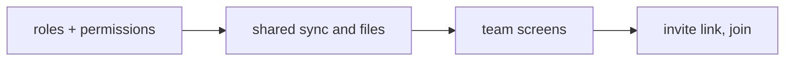

# S10 — Team and roles

<dl><dd>

- Sprint 10 · 2 weeks · 26h · [all sprints](../README.md) · app side: [S10 iOS](https://github.com/DAMHONGDUC/site_log_swift_ui/blob/main/docs/feature-guide/S10-team-roles/README.md) · [S10 Android](https://github.com/DAMHONGDUC/site-log-android/blob/main/docs/feature-guide/S10-team-roles/README.md)

</dd></dl>

## Contents

<dl><dd>

1. [Overview](#overview)
2. [Tasks](#tasks)
3. [Done](#done)
4. [Self-check](#self-check)

</dd></dl>

## Overview

<dl><dd>

- **Goal:** SiteLog becomes a team tool: one company, four roles (Admin, Manager, Inspector, Viewer), projects shared by their members.
- **Demo:** an Admin invites an Inspector by email; the Inspector joins from the link and sees only the projects they were added to; a Viewer reads but cannot change anything.

| F | Feature | Guide | Hours |
|---|---|---|---|
| F19 | Team and roles | [F19-team-roles.md](F19-team-roles.md) | 26 |

</dd></dl>

## Tasks

<dl><dd>

| Task | Step | Layer | Hours | Status |
|---|---|---|---|---|
| F19.1 | Migration: project_id, created_by, team tables, one rev counter | Data | 3 | not start |
| F19.2 | Access: members, reachable, permissions, seed Admin | API | 2 | not start |
| F19.3 | Sync scope: pull filter, push refusal, resync | Sync | 3 | not start |
| F19.4 | Files: project keys, upload and media checks, move old keys | Files | 2 | not start |
| F19.5 | Team API, invitations, SES email, account deletion | API | 3 | not start |
| F19.6 | Realtime and push to project members | Realtime | 1 | not start |
| F19.7 | Tests | Tests | 2 | not start |

</dd></dl>

## Done

<dl><dd>

- [ ] Two members on two phones see the same project; a third member on another project sees nothing of it
- [ ] Every role tried on every screen: nothing it may not do is offered, and the server refuses it anyway
- [ ] An invite email signs a new member in and lands on their project

</dd></dl>

## Self-check

<dl><dd>

- Why does the server check every permission again when the app already hides the button?
- What happens to a member's photos and issues when they leave the company, and why?

</dd></dl>
