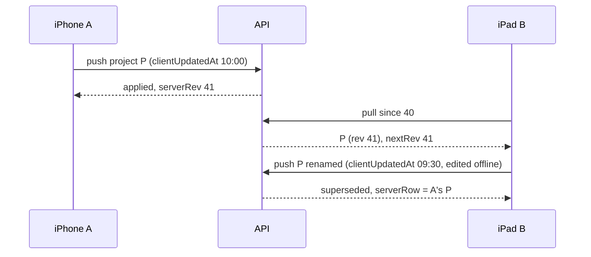
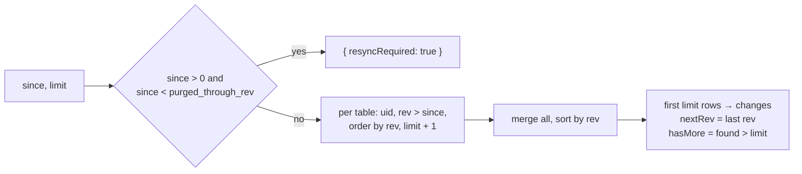
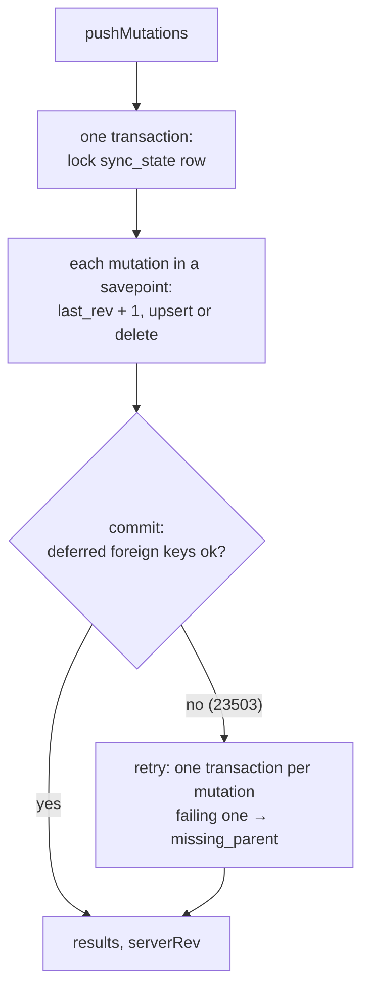

# F04 — Sync (backend)

<dl><dd>

- Sprint [S2](README.md) · 8h · `/sync/pull` and `/sync/push`: gap-free per-user revisions, last write wins in SQL, tombstones, monotonic session state.
- iOS side: [F04 Sync engine](https://github.com/DAMHONGDUC/site_log_swift_ui/blob/main/docs/feature-guide/S2-sync-engine/F04-sync-engine.md). Contract: [01-api §6](../../feature-docs/01-api.md#6-sync). Inside: [03 §1](../../feature-docs/03-sync-uploads-realtime.md#1-sync).

</dd></dl>

## Contents

<dl><dd>

1. [Overview](#overview)
2. [1. Revision counter](#1-revision-counter)
3. [2. Pull](#2-pull)
4. [3. Push](#3-push)
5. [4. Routes](#4-routes)
6. [Tests](#tests)
7. [Feature done](#feature-done)

</dd></dl>

## Overview

<dl><dd>

- **Goal:** two devices of the same user converge, whatever order their offline edits arrive in.
- **Demo:** push a project with curl, pull it back; push an older edit → `superseded` with the stored row; the app on two simulators sees each other's projects.

| Step | Hours | Files |
|---|---|---|
| [1](#1-revision-counter) | 0.5 | `migrations/0002_sync_state.sql`, `src/routes/account.ts` |
| [2](#2-pull) | 2 | `src/sync/case.ts`, `src/sync/pull.ts` |
| [3](#3-push) | 3.5 | `src/sync/push.ts` |
| [4](#4-routes) | 1 | `src/routes/sync.ts`, `src/app.ts` |
| [Tests](#tests) | 1 | `test/sync-helpers.ts`, `test/sync.test.ts` |



</dd></dl>

## 1. Revision counter

<dl><dd>

#### Overview

<dl><dd>

- **Goal:** one counter row per user; locking it serializes that user's pushes.
- **Check:** `npm run migrate` applies `0002_sync_state.sql`.

| Action | File | Holds |
|---|---|---|
| <b class="tag-new">New</b> | `migrations/0002_sync_state.sql` | `sync_state (uid, last_rev, purged_through_rev, created_at)` |
| <b class="tag-edit">Edit</b> | `src/routes/account.ts` | `sync_state` joins `serverTables` |

</dd></dl>

#### Steps

<dl><dd>

<details open>
<summary><strong>1.1 Table</strong></summary>
<dl><dd>

<b>File</b> · <b class="tag-new">New</b> · `migrations/0002_sync_state.sql`

<b>Explain</b> · `last_rev` is the last revision number given to this user's rows. `purged_through_rev` is raised by the nightly purge (F18): a device whose cursor is older must start again.

<b>Think</b>

- Read [03 §1.1](../../feature-docs/03-sync-uploads-realtime.md#11-revisions). In your own words: why would a `nextval()` sequence lose a row for a device that pulls often?

<details>
<summary><b>Code</b></summary>

```sql
-- F04: one row per user. Locking it serializes that user's writes, so revs are commit-ordered.
create table sync_state (
    uid                text primary key,
    last_rev           bigint not null default 0,
    -- highest rev removed by the tombstone purge; an older cursor must resync from 0
    purged_through_rev bigint not null default 0,
    created_at         timestamptz not null default now()
);
```

</details>

---

<b>File</b> · <b class="tag-edit">Edit</b> · `src/routes/account.ts`

```diff
@@ -6,3 +6,3 @@
 // Server-only tables that also hold the user's rows. A feature that adds one adds it here.
-export const serverTables: string[] = [];
+export const serverTables: string[] = ['sync_state'];
 
```

</dd></dl>
</details>

</dd></dl>

</dd></dl>

## 2. Pull

<dl><dd>

#### Overview

<dl><dd>

- **Goal:** everything changed after `since`, oldest first, at most `limit` rows, without `uid`.
- **Check:** `npm run typecheck`.

| Action | File | Holds |
|---|---|---|
| <b class="tag-new">New</b> | `src/sync/case.ts` | `snakeToCamel`, `camelToSnake`, `rowToJson` (drops `uid`) |
| <b class="tag-new">New</b> | `src/sync/pull.ts` | `pullChanges(pool, uid, since, limit)` |



</dd></dl>

#### Steps

<dl><dd>

<details open>
<summary><strong>2.1 Names</strong></summary>
<dl><dd>

<b>File</b> · <b class="tag-new">New</b> · `src/sync/case.ts`

<b>Explain</b> · The app speaks `camelCase` JSON, SQL uses `snake_case`. These three small functions are the only place that converts.

<details>
<summary><b>Code</b></summary>

```ts
// JSON uses camelCase (clientUpdatedAt), SQL uses snake_case (client_updated_at).

export function snakeToCamel(name: string): string {
  return name.replace(/_([a-z0-9])/g, (_match, letter: string) => letter.toUpperCase());
}

export function camelToSnake(name: string): string {
  return name.replace(/[A-Z]/g, (letter) => `_${letter.toLowerCase()}`);
}

// A database row → the JSON the app receives. uid is never sent back.
export function rowToJson(row: Record<string, unknown>): Record<string, unknown> {
  const json: Record<string, unknown> = {};
  for (const [column, value] of Object.entries(row)) {
    if (column === 'uid') {
      continue;
    }
    json[snakeToCamel(column)] = value;
  }
  return json;
}
```

</details>

</dd></dl>
</details>

<details open>
<summary><strong>2.2 Pull</strong></summary>
<dl><dd>

<b>File</b> · <b class="tag-new">New</b> · `src/sync/pull.ts`

<b>Explain</b> · Every row a push writes gets its own rev, so revs are unique per user: taking `limit + 1` from each table is enough to know the first `limit` overall and whether more exist.

<b>Think</b>

- Why `select *` per table instead of one big `union`? (Each table has different columns, and `pg` turns `timestamptz` into `Date` objects that print as `…000Z`.)
- A device pulls with `since = 0` after a fresh install. What is `resyncRequired` then, and why?

<details open>
<summary><b>Hint 3 · Skeleton</b></summary>

```ts
export async function pullChanges(pool: pg.Pool, uid: string, since: number, limit: number): Promise<PullResult> {
  // 1. purgedThrough = sync_state.purged_through_rev for uid (0 if no row)
  // 2. since > 0 and since < purgedThrough → return { resyncRequired: true }
  const found: ChangedRow[] = [];
  for (const table of syncTables) {
    // 3. select * … where uid = $1 and rev > $2 order by rev limit $3  (limit + 1)
    // 4. push { table, rev, row } into found
  }
  // 5. sort found by rev; page = first limit; hasMore = found.length > limit
  // 6. group page by table with rowToJson; nextRev = last rev in page (or since)
}
```

</details>

<details>
<summary><b>Code</b></summary>

```ts
import type pg from 'pg';
import { rowToJson } from './case.js';
import { syncTables } from './tables.js';

export type PullResult =
  | { resyncRequired: true }
  | {
      resyncRequired: false;
      changes: Record<string, Record<string, unknown>[]>;
      nextRev: number;
      hasMore: boolean;
    };

interface ChangedRow {
  table: string;
  rev: number;
  row: Record<string, unknown>;
}

// Everything this user changed after `since`, oldest first, at most `limit` rows.
// Tombstones (deleted_at set) are included so other devices delete them too.
export async function pullChanges(
  pool: pg.Pool,
  uid: string,
  since: number,
  limit: number,
): Promise<PullResult> {
  const state = await pool.query<{ purged_through_rev: number }>(
    'select purged_through_rev from sync_state where uid = $1',
    [uid],
  );
  const purgedThrough = state.rows[0]?.purged_through_rev ?? 0;
  if (since > 0 && since < purgedThrough) {
    // Tombstones this device never saw are gone: it must start again from 0.
    return { resyncRequired: true };
  }

  // Revs are unique per user, so the first `limit` rows across all tables are found by
  // taking limit + 1 from each table and merging.
  const found: ChangedRow[] = [];
  for (const table of syncTables) {
    const result = await pool.query(
      `select * from ${table.name} where uid = $1 and rev > $2 order by rev limit $3`,
      [uid, since, limit + 1],
    );
    for (const row of result.rows) {
      found.push({ table: table.name, rev: row.rev as number, row });
    }
  }
  found.sort((a, b) => a.rev - b.rev);

  const page = found.slice(0, limit);
  const hasMore = found.length > limit;

  const changes: Record<string, Record<string, unknown>[]> = {};
  let nextRev = since;
  for (const item of page) {
    if (changes[item.table] === undefined) {
      changes[item.table] = [];
    }
    changes[item.table]!.push(rowToJson(item.row));
    nextRev = item.rev;
  }
  return { resyncRequired: false, changes, nextRev, hasMore };
}
```

</details>

</dd></dl>
</details>

</dd></dl>

</dd></dl>

## 3. Push

<dl><dd>

#### Overview

<dl><dd>

- **Goal:** apply up to 200 mutations in one transaction; each one `applied`, `superseded` or `rejected`, never failing the others.
- **Check:** `npm run typecheck`; the tests pin every case.

| Action | File | Holds |
|---|---|---|
| <b class="tag-new">New</b> | `src/sync/push.ts` | SQL builders, `applyUpsert`, `applyDelete`, savepoints, `pushMutations` with the foreign-key fallback |



</dd></dl>

#### Steps

<dl><dd>

<details open>
<summary><strong>3.1 Push</strong></summary>
<dl><dd>

<b>File</b> · <b class="tag-new">New</b> · `src/sync/push.ts`

<b>Explain</b> · The upsert is generated from the registry: `insert … select from jsonb_populate_record(…)` lets Postgres convert the JSON values to column types (and reject wrong ones). `on conflict (id) do update … where` decides the winner in SQL.

<b>Think</b>

- The `where` clause has three parts: `t.uid = excluded.uid`, `t.deleted_at is null`, and "newer". What attack does the first one stop?
- When the update writes nothing, how does the code tell "a newer row exists" from "the id belongs to another user"?
- Why does a failing statement need `rollback to savepoint`, not just a `catch`?

<details open>
<summary><b>Hint 1 · Idea</b></summary>

- `upsertSql(table)`: columns = sync columns + business columns; `set` skips frozen ones, uses `greatest` for monotonic ones, `case when newer then excluded.x else t.x end` for the rest; `rev = excluded.rev`.
- `applyUpsert`: camel → snake, reject unknown fields, add `id`, `uid`, `rev`, `client_updated_at`, `deleted_at: null`; run inside `savepoint upsert`.
  - On a unique violation of the natural key → `superseded` with the row that owns the key.
  - No row written → stored row for this uid? `superseded` : `rejected: forbidden`.
- `applyDelete`: `update … set deleted_at … where … client_updated_at <= $3`.
- `applyMutation`: savepoint, `nextRev`, upsert or delete; a `22…`/`23…` error → `rejected: invalid_row:<code>`.

</details>

<details open>
<summary><b>Hint 2 · APIs</b></summary>

- `jsonb_populate_record(null::<table>, $1::jsonb)`, `insert into t as t (…) select … on conflict (id) do update set … where … returning *`.
- `savepoint mutation`, `release savepoint mutation`, `rollback to savepoint mutation`.
- Postgres error fields: `error.code` (`23505`, `23503`, `23514`), `error.constraint`.

</details>

<details open>
<summary><b>Hint 3 · Skeleton</b></summary>

```ts
async function applyMutation(client: pg.PoolClient, uid: string, mutation: Mutation): Promise<MutationResult> {
  const table = findSyncTable(mutation.table);
  // unknown table → rejected
  await client.query('savepoint mutation');
  try {
    const rev = await nextRev(client, uid);
    // delete → applyDelete, else applyUpsert
    await client.query('release savepoint mutation');
    return result;
  } catch (error) {
    await client.query('rollback to savepoint mutation');
    // code starts with 22 or 23 → rejected invalid_row:<code>; else throw
  }
}

export async function pushMutations(pool: pg.Pool, uid: string, mutations: Mutation[]): Promise<PushResult> {
  try {
    // fast path: withTransaction(… applyBatch(client, uid, mutations))
  } catch (error) {
    // not 23503 → throw
  }
  // slow path: each mutation in its own withTransaction; 23503 → rejected missing_parent
}
```

</details>

<details>
<summary><b>Code</b></summary>

```ts
import type pg from 'pg';
import { withTransaction } from '../db.js';
import { camelToSnake, rowToJson } from './case.js';
import { findSyncTable, type SyncTable } from './tables.js';

export interface Mutation {
  table: string;
  id: string;
  op: 'upsert' | 'delete';
  clientUpdatedAt: string;
  fields: Record<string, unknown>;
}

export type MutationResult =
  | { id: string; status: 'applied' }
  | { id: string; status: 'superseded'; serverRow: Record<string, unknown> }
  | { id: string; status: 'rejected'; reason: string };

export interface PushResult {
  results: MutationResult[];
  serverRev: number;
}

const SYNC_COLUMNS = ['id', 'uid', 'rev', 'client_updated_at', 'deleted_at'];

// insert … on conflict (id) do update: last write wins on client_updated_at, decided in SQL.
function upsertSql(table: SyncTable): string {
  const allColumns = [...SYNC_COLUMNS, ...table.columns];
  const columnList = allColumns.join(', ');
  const selectList = allColumns.map((column) => `r.${column}`).join(', ');
  const newer = 't.client_updated_at < excluded.client_updated_at';

  const sets: string[] = [];
  for (const column of table.columns) {
    if (table.immutable.includes(column)) {
      continue;
    }
    if (table.monotonic.includes(column)) {
      // Enums compare in declaration order: draft < active < closed < exported.
      sets.push(`${column} = greatest(t.${column}, excluded.${column})`);
    } else {
      sets.push(`${column} = case when ${newer} then excluded.${column} else t.${column} end`);
    }
  }
  sets.push('client_updated_at = greatest(t.client_updated_at, excluded.client_updated_at)');
  sets.push('rev = excluded.rev');

  let changed = newer;
  for (const column of table.monotonic) {
    changed += ` or excluded.${column} > t.${column}`;
  }

  // jsonb_populate_record lets Postgres turn JSON values into the column types (and reject bad ones).
  // The where clause: only the owner may update, a tombstone never comes back, and only a newer write wins.
  return `insert into ${table.name} as t (${columnList})
select ${selectList} from jsonb_populate_record(null::${table.name}, $1::jsonb) as r
on conflict (id) do update set ${sets.join(', ')}
where t.uid = excluded.uid and t.deleted_at is null and (${changed})
returning *`;
}

function deleteSql(table: SyncTable): string {
  // A delete wins a tie with an edit made at the same instant.
  return `update ${table.name}
set deleted_at = $3, client_updated_at = $3, rev = $4
where id = $1 and uid = $2 and deleted_at is null and client_updated_at <= $3
returning *`;
}

async function storedRow(
  client: pg.PoolClient,
  table: SyncTable,
  uid: string,
  id: string,
): Promise<Record<string, unknown> | undefined> {
  const result = await client.query(`select * from ${table.name} where id = $1 and uid = $2`, [
    id,
    uid,
  ]);
  return result.rows[0];
}

// The live row that already owns this natural key (for example the same phrase text).
async function rowWithSameNaturalKey(
  client: pg.PoolClient,
  table: SyncTable,
  uid: string,
  record: Record<string, unknown>,
): Promise<Record<string, unknown> | undefined> {
  const naturalKey = table.naturalKey ?? [];
  const conditions = ['uid = $1', 'deleted_at is null'];
  const values: unknown[] = [uid];
  for (const column of naturalKey) {
    values.push(record[column]);
    conditions.push(`${column} = $${values.length}`);
  }
  const result = await client.query(
    `select * from ${table.name} where ${conditions.join(' and ')} limit 1`,
    values,
  );
  return result.rows[0];
}

// Postgres error codes: 23505 unique, 23503 foreign key, 22xxx bad value, 23xxx other rules.
function pgCode(error: unknown): string {
  if (typeof error === 'object' && error !== null && 'code' in error) {
    return String(error.code);
  }
  return '';
}

function isPrimaryKeyViolation(error: unknown): boolean {
  const constraint = (error as { constraint?: string }).constraint ?? '';
  return constraint.endsWith('_pkey');
}

async function nextRev(client: pg.PoolClient, uid: string): Promise<number> {
  const result = await client.query<{ last_rev: number }>(
    'update sync_state set last_rev = last_rev + 1 where uid = $1 returning last_rev',
    [uid],
  );
  return result.rows[0]!.last_rev;
}

async function applyUpsert(
  client: pg.PoolClient,
  table: SyncTable,
  uid: string,
  mutation: Mutation,
  rev: number,
): Promise<MutationResult> {
  const record: Record<string, unknown> = {};
  for (const [field, value] of Object.entries(mutation.fields)) {
    const column = camelToSnake(field);
    if (!table.columns.includes(column)) {
      return { id: mutation.id, status: 'rejected', reason: `unknown_field:${field}` };
    }
    record[column] = value;
  }
  record.id = mutation.id;
  record.uid = uid;
  record.rev = rev;
  record.client_updated_at = mutation.clientUpdatedAt;
  record.deleted_at = null;

  // A failed statement poisons the transaction, so the insert gets its own savepoint:
  // after a unique violation we still need to read the row that won.
  await client.query('savepoint upsert');
  try {
    const written = await client.query(upsertSql(table), [JSON.stringify(record)]);
    await client.query('release savepoint upsert');
    if (written.rows.length > 0) {
      return { id: mutation.id, status: 'applied' };
    }
  } catch (error) {
    await client.query('rollback to savepoint upsert');
    if (pgCode(error) === '23505' && table.naturalKey !== null && !isPrimaryKeyViolation(error)) {
      const owner = await rowWithSameNaturalKey(client, table, uid, record);
      if (owner !== undefined) {
        return { id: mutation.id, status: 'superseded', serverRow: rowToJson(owner) };
      }
    }
    throw error;
  }

  // Nothing written: a newer write, a tombstone, or a row owned by someone else.
  const stored = await storedRow(client, table, uid, mutation.id);
  if (stored === undefined) {
    return { id: mutation.id, status: 'rejected', reason: 'forbidden' };
  }
  return { id: mutation.id, status: 'superseded', serverRow: rowToJson(stored) };
}

async function applyDelete(
  client: pg.PoolClient,
  table: SyncTable,
  uid: string,
  mutation: Mutation,
  rev: number,
): Promise<MutationResult> {
  const written = await client.query(deleteSql(table), [
    mutation.id,
    uid,
    mutation.clientUpdatedAt,
    rev,
  ]);
  if (written.rows.length > 0) {
    return { id: mutation.id, status: 'applied' };
  }
  const stored = await storedRow(client, table, uid, mutation.id);
  if (stored === undefined || stored.deleted_at !== null) {
    // Never reached the server, or already deleted: nothing left to do.
    return { id: mutation.id, status: 'applied' };
  }
  return { id: mutation.id, status: 'superseded', serverRow: rowToJson(stored) };
}

// One mutation inside a savepoint: a bad row is rejected without losing the rest of the batch.
async function applyMutation(
  client: pg.PoolClient,
  uid: string,
  mutation: Mutation,
): Promise<MutationResult> {
  const table = findSyncTable(mutation.table);
  if (table === undefined) {
    return { id: mutation.id, status: 'rejected', reason: 'unknown_table' };
  }
  await client.query('savepoint mutation');
  try {
    const rev = await nextRev(client, uid);
    let result: MutationResult;
    if (mutation.op === 'delete') {
      result = await applyDelete(client, table, uid, mutation, rev);
    } else {
      result = await applyUpsert(client, table, uid, mutation, rev);
    }
    await client.query('release savepoint mutation');
    return result;
  } catch (error) {
    await client.query('rollback to savepoint mutation');
    const code = pgCode(error);
    if (code.startsWith('22') || code.startsWith('23')) {
      return { id: mutation.id, status: 'rejected', reason: `invalid_row:${code}` };
    }
    throw error;
  }
}

async function applyBatch(
  client: pg.PoolClient,
  uid: string,
  mutations: Mutation[],
): Promise<PushResult> {
  await client.query('insert into sync_state (uid) values ($1) on conflict (uid) do nothing', [
    uid,
  ]);
  // The row lock: this user's other pushes wait here, so revs commit in order.
  await client.query('select last_rev from sync_state where uid = $1 for update', [uid]);

  const results: MutationResult[] = [];
  for (const mutation of mutations) {
    results.push(await applyMutation(client, uid, mutation));
  }
  const state = await client.query<{ last_rev: number }>(
    'select last_rev from sync_state where uid = $1',
    [uid],
  );
  return { results, serverRev: state.rows[0]!.last_rev };
}

function isForeignKeyViolation(error: unknown): boolean {
  return pgCode(error) === '23503';
}

// Fast path: the whole batch in one transaction. Foreign keys are checked at commit; if one
// fails we cannot tell which row, so the slow path retries one mutation per transaction.
export async function pushMutations(
  pool: pg.Pool,
  uid: string,
  mutations: Mutation[],
): Promise<PushResult> {
  try {
    return await withTransaction(pool, (client) => applyBatch(client, uid, mutations));
  } catch (error) {
    if (!isForeignKeyViolation(error)) {
      throw error;
    }
  }

  const results: MutationResult[] = [];
  let serverRev = 0;
  for (const mutation of mutations) {
    try {
      const single = await withTransaction(pool, (client) => applyBatch(client, uid, [mutation]));
      results.push(single.results[0]!);
      serverRev = single.serverRev;
    } catch (error) {
      if (!isForeignKeyViolation(error)) {
        throw error;
      }
      results.push({ id: mutation.id, status: 'rejected', reason: 'missing_parent' });
    }
  }
  const state = await pool.query<{ last_rev: number }>(
    'select last_rev from sync_state where uid = $1',
    [uid],
  );
  serverRev = state.rows[0]?.last_rev ?? serverRev;
  return { results, serverRev };
}
```

</details>

<b>Try</b>

- Temporarily remove `t.uid = excluded.uid and` from `upsertSql` and run the test "refuses to touch a row owned by someone else": watch it fail. Put it back.

</dd></dl>
</details>

</dd></dl>

</dd></dl>

## 4. Routes

<dl><dd>

#### Overview

<dl><dd>

- **Goal:** the two endpoints with validated bodies and one log line each.
- **Check:** the curl demo below.

| Action | File | Holds |
|---|---|---|
| <b class="tag-new">New</b> | `src/routes/sync.ts` | TypeBox schemas, `POST /sync/pull`, `POST /sync/push` |
| <b class="tag-edit">Edit</b> | `src/app.ts` | Registers the sync routes |

</dd></dl>

#### Steps

<dl><dd>

<details open>
<summary><strong>4.1 Routes</strong></summary>
<dl><dd>

<b>File</b> · <b class="tag-new">New</b> · `src/routes/sync.ts`

<b>Explain</b> · `withTypeProvider<TypeBoxTypeProvider>()` makes `request.body` typed from the schema. A body that breaks the schema never reaches the handler: the error handler answers `400 invalid_body`.

<details open>
<summary><b>Hint 2 · APIs</b></summary>

- `Type.Object`, `Type.Integer({ minimum, maximum })`, `Type.String({ format: 'uuid' })`, `Type.Union([Type.Literal('upsert'), …])`, `Type.Record(Type.String(), Type.Unknown())`, `Type.Array(x, { minItems, maxItems })`.

</details>

<details>
<summary><b>Code</b></summary>

```ts
import { Type, type TypeBoxTypeProvider } from '@fastify/type-provider-typebox';
import type { FastifyInstance, preHandlerAsyncHookHandler } from 'fastify';
import type { AppDeps } from '../app.js';
import { pullChanges } from '../sync/pull.js';
import { pushMutations } from '../sync/push.js';

export function syncRoutes(
  app: FastifyInstance,
  deps: AppDeps,
  requireUser: preHandlerAsyncHookHandler,
): void {
  const typed = app.withTypeProvider<TypeBoxTypeProvider>();

  const PullBody = Type.Object({
    since: Type.Integer({ minimum: 0 }),
    limit: Type.Integer({ minimum: 1, maximum: deps.config.pullPageSizeMax }),
  });

  typed.post(
    '/sync/pull',
    { preHandler: requireUser, schema: { body: PullBody } },
    async (request) => {
      const started = Date.now();
      const result = await pullChanges(
        deps.pool,
        request.uid,
        request.body.since,
        request.body.limit,
      );
      if (result.resyncRequired) {
        request.log.info(
          { uid: request.uid, since: request.body.since },
          'sync pull: resync required',
        );
        return { resyncRequired: true };
      }
      let pulled = 0;
      for (const rows of Object.values(result.changes)) {
        pulled += rows.length;
      }
      request.log.info(
        {
          uid: request.uid,
          since: request.body.since,
          pulled,
          nextRev: result.nextRev,
          elapsedMs: Date.now() - started,
        },
        'sync pull',
      );
      return { changes: result.changes, nextRev: result.nextRev, hasMore: result.hasMore };
    },
  );

  const Mutation = Type.Object({
    table: Type.String({ minLength: 1, maxLength: 64 }),
    id: Type.String({ format: 'uuid' }),
    op: Type.Union([Type.Literal('upsert'), Type.Literal('delete')]),
    clientUpdatedAt: Type.String({ format: 'date-time' }),
    fields: Type.Record(Type.String(), Type.Unknown()),
  });
  const PushBody = Type.Object({
    mutations: Type.Array(Mutation, { minItems: 1, maxItems: deps.config.pushBatchMax }),
  });

  typed.post(
    '/sync/push',
    { preHandler: requireUser, schema: { body: PushBody } },
    async (request) => {
      const started = Date.now();
      const result = await pushMutations(deps.pool, request.uid, request.body.mutations);
      let superseded = 0;
      let rejected = 0;
      for (const item of result.results) {
        if (item.status === 'superseded') {
          superseded += 1;
        }
        if (item.status === 'rejected') {
          rejected += 1;
        }
      }
      request.log.info(
        {
          uid: request.uid,
          pushed: result.results.length,
          superseded,
          rejected,
          serverRev: result.serverRev,
          elapsedMs: Date.now() - started,
        },
        'sync push',
      );
      return result;
    },
  );
}
```

</details>

---

<b>File</b> · <b class="tag-edit">Edit</b> · `src/app.ts`

```diff
@@ -8,2 +8,3 @@
 import { healthRoutes } from './routes/health.js';
+import { syncRoutes } from './routes/sync.js';
 import type { Storage } from './storage.js';
@@ -33,2 +34,3 @@
   accountRoutes(app, deps, requireUser);
+  syncRoutes(app, deps, requireUser);
 
```

```bash
npm run migrate && npm run dev
```

```bash
TOKEN=$(npm run -s token -- test1@example.com '<password>')
```

```bash
curl -s localhost:3000/sync/push -H "Authorization: Bearer $TOKEN" -H 'content-type: application/json' -d '{"mutations":[{"table":"projects","id":"11111111-1111-4111-8111-111111111111","op":"upsert","clientUpdatedAt":"2026-11-01T08:00:00.000Z","fields":{"name":"Tower A","address":null,"clientName":null,"createdAt":"2026-11-01T08:00:00.000Z"}}]}'
```

```bash
curl -s localhost:3000/sync/pull -H "Authorization: Bearer $TOKEN" -H 'content-type: application/json' -d '{"since":0,"limit":500}'
```

<b>Try</b>

- Push the same project again with `clientUpdatedAt` one hour **earlier** and another name → `superseded` with the stored row.

</dd></dl>
</details>

</dd></dl>

</dd></dl>

## Tests

<dl><dd>

<details open>
<summary><strong>Test files</strong></summary>
<dl><dd>

<b>File</b> · <b class="tag-new">New</b> · `test/sync-helpers.ts`

<b>Explain</b> · `pushAs`, `pullAs` and full-row mutation builders, reused by every later feature's tests.

<details>
<summary><b>Code</b></summary>

```ts
import { expect } from 'vitest';
import { auth, ids, type TestContext } from './helpers.js';

// Push and pull as a user, as the app does. Both must answer 200.
export async function pushAs(context: TestContext, uid: string, mutations: object[]) {
  const response = await context.app.inject({
    method: 'POST',
    url: '/sync/push',
    headers: auth(uid),
    payload: { mutations },
  });
  expect(response.statusCode).toBe(200);
  return response.json();
}

export async function pullAs(context: TestContext, uid: string, since: number, limit = 500) {
  const response = await context.app.inject({
    method: 'POST',
    url: '/sync/pull',
    headers: auth(uid),
    payload: { since, limit },
  });
  expect(response.statusCode).toBe(200);
  return response.json();
}

// Full-row upserts for the F03 tables.
export function projectMutation(id: string, clientUpdatedAt: string, name: string) {
  return {
    table: 'projects',
    id,
    op: 'upsert',
    clientUpdatedAt,
    fields: { name, address: null, clientName: null, createdAt: '2026-11-01T08:00:00.000Z' },
  };
}

export function locationMutation(clientUpdatedAt: string, code: string, id: string = ids.location) {
  return {
    table: 'locations',
    id,
    op: 'upsert',
    clientUpdatedAt,
    fields: { projectId: ids.project, parentId: null, code, kind: 'floor', sortIndex: 0 },
  };
}

export function sessionMutation(clientUpdatedAt: string, state: string) {
  return {
    table: 'sessions',
    id: ids.session,
    op: 'upsert',
    clientUpdatedAt,
    fields: {
      projectId: ids.project,
      startedAt: '2026-11-01T08:00:00.000Z',
      endedAt: null,
      surveyorName: 'An',
      note: '',
      state,
    },
  };
}

// Project, location and session in one batch: the parents most tests need.
export async function seedProject(context: TestContext, uid: string = 'alice') {
  await pushAs(context, uid, [
    projectMutation(ids.project, '2026-11-01T08:00:00.000Z', 'Tower A'),
    locationMutation('2026-11-01T08:00:00.000Z', 'L1'),
    sessionMutation('2026-11-01T08:00:00.000Z', 'active'),
  ]);
}

export function captureMutation(clientUpdatedAt: string, sha256: string, id: string = ids.capture) {
  return {
    table: 'captures',
    id,
    op: 'upsert',
    clientUpdatedAt,
    fields: {
      projectId: ids.project,
      sessionId: ids.session,
      locationId: ids.location,
      kind: 'photo',
      sha256,
      byteSize: 1000,
      capturedAt: '2026-11-01T08:05:00.000Z',
      timeConfidence: 'server',
      latitude: null,
      longitude: null,
      horizontalAccuracy: null,
      deviceModel: 'iPhone17,1',
      durationSeconds: null,
      deviceReading: null,
      remoteKey: null,
      verificationCode: null,
      excludedFromReport: false,
    },
  };
}
```

</details>

---

<b>File</b> · <b class="tag-new">New</b> · `test/sync.test.ts`

<details>
<summary><b>Code</b></summary>

```ts
import { afterAll, beforeAll, beforeEach, describe, expect, it } from 'vitest';
import {
  auth,
  closeTestContext,
  createTestContext,
  ids,
  resetDatabase,
  type TestContext,
} from './helpers.js';
import {
  locationMutation,
  projectMutation,
  pullAs,
  pushAs,
  sessionMutation,
} from './sync-helpers.js';

describe('sync', () => {
  let context: TestContext;
  beforeAll(async () => {
    context = await createTestContext();
  });
  afterAll(async () => {
    await closeTestContext(context);
  });
  beforeEach(async () => {
    await resetDatabase(context.pool);
  });

  const push = (uid: string, mutations: object[]) => pushAs(context, uid, mutations);
  const pull = (uid: string, since: number, limit = 500) => pullAs(context, uid, since, limit);

  it('applies a push and returns it on pull, without uid', async () => {
    const result = await push('alice', [
      projectMutation(ids.project, '2026-11-01T08:00:00.000Z', 'Tower A'),
    ]);
    expect(result.results).toEqual([{ id: ids.project, status: 'applied' }]);

    const pulled = await pull('alice', 0);
    expect(pulled.changes.projects).toHaveLength(1);
    expect(pulled.changes.projects[0].name).toBe('Tower A');
    expect(pulled.changes.projects[0].uid).toBeUndefined();
    expect(pulled.changes.projects[0].clientUpdatedAt).toBe('2026-11-01T08:00:00.000Z');
    expect(pulled.nextRev).toBe(result.serverRev);
    expect(pulled.hasMore).toBe(false);
  });

  it('never shows one user the rows of another', async () => {
    await push('alice', [projectMutation(ids.project, '2026-11-01T08:00:00.000Z', 'Tower A')]);
    const pulled = await pull('bob', 0);
    expect(pulled.changes).toEqual({});
  });

  it('accepts a child before its parent in one batch', async () => {
    const result = await push('alice', [
      locationMutation('2026-11-01T08:00:00.000Z', 'L1'),
      projectMutation(ids.project, '2026-11-01T08:00:00.000Z', 'Tower A'),
    ]);
    expect(result.results.map((item: { status: string }) => item.status)).toEqual([
      'applied',
      'applied',
    ]);
  });

  it('rejects only the row whose parent never arrives', async () => {
    const orphan = locationMutation(
      '2026-11-01T08:00:00.000Z',
      'L9',
      '55555555-5555-4555-8555-555555555555',
    );
    orphan.fields = { ...orphan.fields, projectId: '66666666-6666-4666-8666-666666666666' };
    const result = await push('alice', [
      projectMutation(ids.project, '2026-11-01T08:00:00.000Z', 'Tower A'),
      orphan,
    ]);
    expect(result.results[0].status).toBe('applied');
    expect(result.results[1]).toEqual({
      id: orphan.id,
      status: 'rejected',
      reason: 'missing_parent',
    });
  });

  it('lets the newer write win and returns the stored row to the loser', async () => {
    await push('alice', [projectMutation(ids.project, '2026-11-01T10:00:00.000Z', 'New name')]);
    const result = await push('alice', [
      projectMutation(ids.project, '2026-11-01T09:00:00.000Z', 'Old name'),
    ]);
    expect(result.results[0].status).toBe('superseded');
    expect(result.results[0].serverRow.name).toBe('New name');
  });

  it('keeps a tombstone deleted', async () => {
    await push('alice', [projectMutation(ids.project, '2026-11-01T08:00:00.000Z', 'Tower A')]);
    await push('alice', [
      {
        table: 'projects',
        id: ids.project,
        op: 'delete',
        clientUpdatedAt: '2026-11-01T09:00:00.000Z',
        fields: {},
      },
    ]);
    const result = await push('alice', [
      projectMutation(ids.project, '2026-11-01T10:00:00.000Z', 'Back?'),
    ]);
    expect(result.results[0].status).toBe('superseded');
    expect(result.results[0].serverRow.deletedAt).not.toBeNull();

    const pulled = await pull('alice', 0);
    expect(pulled.changes.projects[0].deletedAt).not.toBeNull();
  });

  it('never moves a session state backwards', async () => {
    await push('alice', [projectMutation(ids.project, '2026-11-01T08:00:00.000Z', 'Tower A')]);
    await push('alice', [sessionMutation('2026-11-01T08:00:00.000Z', 'exported')]);
    // a newer edit from an offline device that still thinks the session is active
    const result = await push('alice', [sessionMutation('2026-11-01T12:00:00.000Z', 'active')]);
    expect(result.results[0].status).toBe('applied');
    const pulled = await pull('alice', 0);
    expect(pulled.changes.sessions[0].state).toBe('exported');
  });

  it('moves a session state forward even from an older write', async () => {
    await push('alice', [projectMutation(ids.project, '2026-11-01T08:00:00.000Z', 'Tower A')]);
    await push('alice', [sessionMutation('2026-11-01T12:00:00.000Z', 'active')]);
    const result = await push('alice', [sessionMutation('2026-11-01T09:00:00.000Z', 'closed')]);
    expect(result.results[0].status).toBe('applied');
    const pulled = await pull('alice', 0);
    expect(pulled.changes.sessions[0].state).toBe('closed');
  });

  it('refuses to touch a row owned by someone else', async () => {
    await push('alice', [projectMutation(ids.project, '2026-11-01T08:00:00.000Z', 'Tower A')]);
    const result = await push('bob', [
      projectMutation(ids.project, '2026-11-01T09:00:00.000Z', 'Mine now'),
    ]);
    expect(result.results[0]).toEqual({ id: ids.project, status: 'rejected', reason: 'forbidden' });
  });

  it('rejects an unknown field without failing the batch', async () => {
    const unknown = projectMutation(ids.project, '2026-11-01T08:00:00.000Z', 'Tower A');
    unknown.fields = { ...unknown.fields, color: 'red' } as typeof unknown.fields;
    const second = projectMutation(
      '77777777-7777-4777-8777-777777777777',
      '2026-11-01T08:00:00.000Z',
      'Ok',
    );
    const result = await push('alice', [unknown, second]);
    expect(result.results[0]).toEqual({
      id: ids.project,
      status: 'rejected',
      reason: 'unknown_field:color',
    });
    expect(result.results[1].status).toBe('applied');
  });

  it('rejects a row that breaks a table rule', async () => {
    await push('alice', [
      projectMutation(ids.project, '2026-11-01T08:00:00.000Z', 'Tower A'),
      locationMutation('2026-11-01T08:00:00.000Z', 'L1'),
    ]);
    const result = await push('alice', [
      locationMutation('2026-11-01T08:00:00.000Z', 'L1', '88888888-8888-4888-8888-888888888888'),
    ]);
    expect(result.results[0]).toEqual({
      id: '88888888-8888-4888-8888-888888888888',
      status: 'rejected',
      reason: 'invalid_row:23505',
    });
  });

  it('pages by rev and says when there is more', async () => {
    const mutations = [];
    for (let index = 0; index < 5; index += 1) {
      const id = `10000000-0000-4000-8000-00000000000${index}`;
      mutations.push(projectMutation(id, '2026-11-01T08:00:00.000Z', `P${index}`));
    }
    await push('alice', mutations);
    const first = await pull('alice', 0, 3);
    expect(first.changes.projects).toHaveLength(3);
    expect(first.hasMore).toBe(true);
    const second = await pull('alice', first.nextRev, 3);
    expect(second.changes.projects).toHaveLength(2);
    expect(second.hasMore).toBe(false);
  });

  it('asks for a full resync when the cursor is older than the purge', async () => {
    await push('alice', [projectMutation(ids.project, '2026-11-01T08:00:00.000Z', 'Tower A')]);
    await context.pool.query(`update sync_state set purged_through_rev = 10 where uid = 'alice'`);
    const pulled = await pull('alice', 3);
    expect(pulled).toEqual({ resyncRequired: true });
  });

  it('answers a batch over the limit and malformed JSON with 400', async () => {
    const mutations = [];
    for (let index = 0; index < 201; index += 1) {
      mutations.push(projectMutation(ids.project, '2026-11-01T08:00:00.000Z', 'x'));
    }
    const tooMany = await context.app.inject({
      method: 'POST',
      url: '/sync/push',
      headers: auth('alice'),
      payload: { mutations },
    });
    expect(tooMany.statusCode).toBe(400);

    const broken = await context.app.inject({
      method: 'POST',
      url: '/sync/pull',
      headers: { ...auth('alice'), 'content-type': 'application/json' },
      payload: '{not json',
    });
    expect(broken.statusCode).toBe(400);
    expect(broken.json().error).toBeDefined();
  });
});
```

</details>

```bash
npm test
```

</dd></dl>
</details>

</dd></dl>

## Feature done

<dl><dd>

- [ ] Push then pull returns the row without `uid`, timestamps as `…000Z`
- [ ] Older write → `superseded`; tombstone never resurrects; session state never goes back
- [ ] Child before parent in one batch works; a missing parent rejects only that row
- [ ] `npm test` green (28 tests); staging migrated
- [ ] Two simulators signed in as the same user see each other's projects (iOS F04 demo)

</dd></dl>
