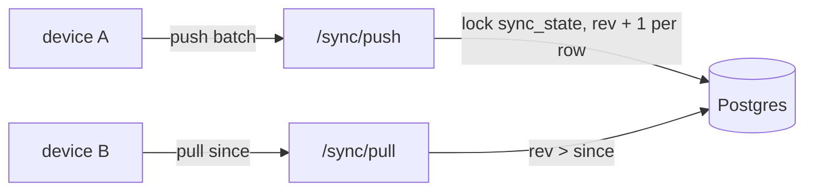

# S2 — Sync engine

<dl><dd>

- Sprint 2 · 2 weeks · backend 8h of the sprint's 45h · [all sprints](../README.md) · iOS side: [S2 iOS](https://github.com/DAMHONGDUC/site_log_swift_ui/blob/main/docs/feature-guide/S2-sync-engine/README.md)

</dd></dl>

## Contents

<dl><dd>

1. [Overview](#overview)
2. [Tasks](#tasks)
3. [Done](#done)
4. [Self-check](#self-check)

</dd></dl>

## Overview

<dl><dd>

- **Goal:** the delta sync every later table joins by adding one registry entry.
- **Demo:** two simulators, one account: a project made offline on one appears on the other after sync; a delete stays deleted.

| Guide | Builds | Hours |
|---|---|---|
| [F04 Sync](F04-sync.md) | `sync_state`, pull, push, routes | 8 |

</dd></dl>

## Tasks

<dl><dd>

| Task | What | Guide | Hours | Status |
|---|---|---|---|---|
| F04.1 | `0002_sync_state.sql` | [F04 §1](F04-sync.md#1-revision-counter) | 0.5 | not start |
| F04.2 | Pull | [F04 §2](F04-sync.md#2-pull) | 2 | not start |
| F04.3 | Push (split: SQL builders · upsert/delete · batch + fallback) | [F04 §3](F04-sync.md#3-push) | 3.5 | not start |
| F04.4 | Routes, curl demo | [F04 §4](F04-sync.md#4-routes) | 1 | not start |
| F04.5 | Tests | [F04 Tests](F04-sync.md#tests) | 1 | not start |

</dd></dl>

## Done

<dl><dd>

- [ ] `npm test` green; staging migrated
- [ ] The iOS two-device demo passes against staging

</dd></dl>

## Self-check

<dl><dd>

- A push of 200 mutations: how many revs does it use if 10 are superseded?
- Why can an offline device never reopen an exported session, even with a newer `clientUpdatedAt`?

</dd></dl>
