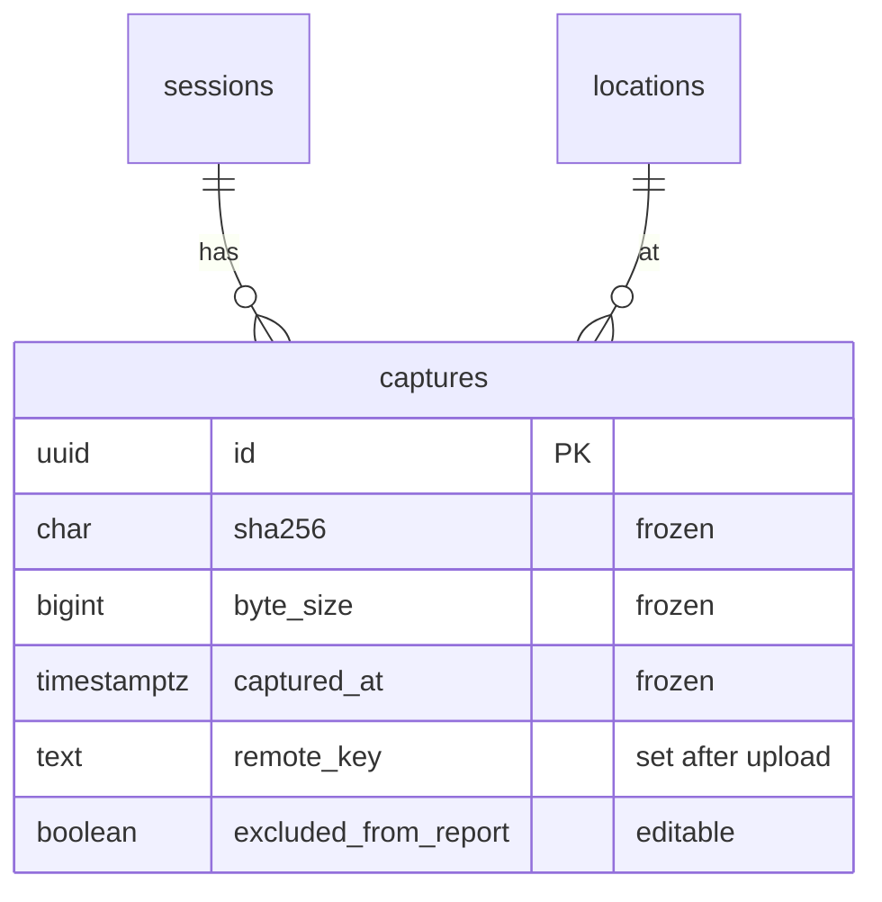

# F05 — Captures (backend)

<dl><dd>

- Sprint [S3](README.md) · 2h · the server table for photo, video and voice-note rows; evidence columns frozen.
- iOS side: [F05 Capture](https://github.com/DAMHONGDUC/site_log_swift_ui/blob/main/docs/feature-guide/S3-capture-upload/F05-capture.md). Contract: [01-api §6.3](../../feature-docs/01-api.md#63-synced-tables).

</dd></dl>

## Contents

<dl><dd>

1. [Overview](#overview)
2. [1. Migration and registry](#1-migration-and-registry)
3. [Tests](#tests)
4. [Feature done](#feature-done)

</dd></dl>

## Overview

<dl><dd>

- **Goal:** captures sync like every other table, but what proves the evidence (hash, size, time, place, device) can never change.
- **Demo:** push a capture, push it again with another `sha256` and `excludedFromReport: true` → the hash stays, the flag changes.

| Action | File | Holds |
|---|---|---|
| <b class="tag-new">New</b> | `migrations/0003_captures.sql` | `captures`, coordinates pair check, one live row per hash per project |
| <b class="tag-edit">Edit</b> | `src/sync/tables.ts` | `captures` entry with its frozen columns |
| <b class="tag-new">New</b> | `test/captures.test.ts` | Frozen columns, half coordinates, duplicate file |



</dd></dl>

## 1. Migration and registry

<dl><dd>

<details open>
<summary><strong>1.1 Migration</strong></summary>
<dl><dd>

<b>File</b> · <b class="tag-new">New</b> · `migrations/0003_captures.sql`

<b>Explain</b> · `sha256` is checked as 64 lowercase hex characters. A basement has no GPS, so coordinates are optional, but only as a pair.

<b>Think</b>

- Why `unique (project_id, sha256) where deleted_at is null` and not per session? (The app skips uploading a file it already has.)

<details>
<summary><b>Code</b></summary>

```sql
-- F05: one row per photo, video or voice note. Evidence columns never change after insert.
create table captures (
    id                   uuid primary key,
    uid                  text not null,
    rev                  bigint not null,
    client_updated_at    timestamptz not null,
    deleted_at           timestamptz,
    project_id           uuid not null,
    session_id           uuid not null,
    location_id          uuid,
    kind                 text not null check (kind in ('photo', 'video', 'audio')),
    sha256               char(64) not null check (sha256 ~ '^[0-9a-f]{64}$'),
    byte_size            bigint not null check (byte_size > 0),
    captured_at          timestamptz not null,
    time_confidence      text not null,
    latitude             double precision,
    longitude            double precision,
    horizontal_accuracy  double precision,
    device_model         text not null,
    duration_seconds     double precision,
    device_reading       jsonb,
    remote_key           text,
    verification_code    text,
    excluded_from_report boolean not null,
    unique (uid, id),
    -- a basement has no GPS: both coordinates or neither
    check ((latitude is null) = (longitude is null)),
    foreign key (uid, project_id) references projects (uid, id) deferrable initially deferred,
    foreign key (uid, session_id) references sessions (uid, id) deferrable initially deferred,
    foreign key (uid, location_id) references locations (uid, id) deferrable initially deferred
);
create index captures_uid_rev on captures (uid, rev);
create unique index captures_sha_live on captures (project_id, sha256) where deleted_at is null;
```

</details>

</dd></dl>
</details>

<details open>
<summary><strong>1.2 Registry</strong></summary>
<dl><dd>

<b>File</b> · <b class="tag-edit">Edit</b> · `src/sync/tables.ts`

<b>Explain</b> · Only `location_id` (moved), `remote_key` and `verification_code` (set after upload) and `excluded_from_report` (hidden from a report) may change.

```diff
@@ -42,2 +42,42 @@
   }),
+  // F05: evidence columns never change after the first insert.
+  table(
+    'captures',
+    [
+      'project_id',
+      'session_id',
+      'location_id',
+      'kind',
+      'sha256',
+      'byte_size',
+      'captured_at',
+      'time_confidence',
+      'latitude',
+      'longitude',
+      'horizontal_accuracy',
+      'device_model',
+      'duration_seconds',
+      'device_reading',
+      'remote_key',
+      'verification_code',
+      'excluded_from_report',
+    ],
+    {
+      immutable: [
+        'project_id',
+        'session_id',
+        'kind',
+        'sha256',
+        'byte_size',
+        'captured_at',
+        'time_confidence',
+        'latitude',
+        'longitude',
+        'horizontal_accuracy',
+        'device_model',
+        'duration_seconds',
+        'device_reading',
+      ],
+    },
+  ),
 ];
```

<details>
<summary><b>Code</b></summary>

```ts
// Every table the app may pull and push. A feature that adds a synced table adds it here.

export interface SyncTable {
  // SQL table name, also the `table` value in a mutation.
  name: string;
  // Business columns (snake_case) the app sends on every upsert, as a full row.
  columns: string[];
  // Kept from the first insert; later values are ignored (evidence must not change).
  immutable: string[];
  // Enum columns that only move forward, whatever the timestamps say.
  monotonic: string[];
  // A second unique key besides id (uid is always part of it). A new row that collides
  // with a live row on it loses: the app adopts the stored row. null = no such key.
  naturalKey: string[] | null;
}

function table(
  name: string,
  columns: string[],
  options: { immutable?: string[]; monotonic?: string[]; naturalKey?: string[] | null } = {},
): SyncTable {
  return {
    name,
    columns,
    immutable: options.immutable ?? [],
    monotonic: options.monotonic ?? [],
    naturalKey: options.naturalKey ?? null,
  };
}

export const syncTables: SyncTable[] = [
  // F03
  table('projects', ['name', 'address', 'client_name', 'created_at'], {
    immutable: ['created_at'],
  }),
  table('locations', ['project_id', 'parent_id', 'code', 'kind', 'sort_index'], {
    immutable: ['project_id'],
  }),
  table('sessions', ['project_id', 'started_at', 'ended_at', 'surveyor_name', 'note', 'state'], {
    immutable: ['project_id', 'started_at'],
    monotonic: ['state'],
  }),
  // F05: evidence columns never change after the first insert.
  table(
    'captures',
    [
      'project_id',
      'session_id',
      'location_id',
      'kind',
      'sha256',
      'byte_size',
      'captured_at',
      'time_confidence',
      'latitude',
      'longitude',
      'horizontal_accuracy',
      'device_model',
      'duration_seconds',
      'device_reading',
      'remote_key',
      'verification_code',
      'excluded_from_report',
    ],
    {
      immutable: [
        'project_id',
        'session_id',
        'kind',
        'sha256',
        'byte_size',
        'captured_at',
        'time_confidence',
        'latitude',
        'longitude',
        'horizontal_accuracy',
        'device_model',
        'duration_seconds',
        'device_reading',
      ],
    },
  ),
];

export function findSyncTable(name: string): SyncTable | undefined {
  return syncTables.find((candidate) => candidate.name === name);
}
```

</details>

```bash
npm run migrate
```

</dd></dl>
</details>

</dd></dl>

## Tests

<dl><dd>

<details open>
<summary><strong>Test file</strong></summary>
<dl><dd>

<b>File</b> · <b class="tag-new">New</b> · `test/captures.test.ts`

<details>
<summary><b>Code</b></summary>

```ts
import { afterAll, beforeAll, beforeEach, describe, expect, it } from 'vitest';
import {
  closeTestContext,
  createTestContext,
  ids,
  resetDatabase,
  sha,
  type TestContext,
} from './helpers.js';
import { captureMutation, pullAs, pushAs, seedProject } from './sync-helpers.js';

describe('captures', () => {
  let context: TestContext;
  beforeAll(async () => {
    context = await createTestContext();
  });
  afterAll(async () => {
    await closeTestContext(context);
  });
  beforeEach(async () => {
    await resetDatabase(context.pool);
    await seedProject(context);
  });

  it('keeps the evidence columns of the first insert', async () => {
    await pushAs(context, 'alice', [captureMutation('2026-11-01T08:05:00.000Z', sha)]);
    const changed = captureMutation('2026-11-01T09:00:00.000Z', 'b'.repeat(64));
    changed.fields.excludedFromReport = true;
    const result = await pushAs(context, 'alice', [changed]);
    expect(result.results[0].status).toBe('applied');

    const pulled = await pullAs(context, 'alice', 0);
    expect(pulled.changes.captures[0].sha256).toBe(sha);
    expect(pulled.changes.captures[0].excludedFromReport).toBe(true);
  });

  it('rejects a latitude without a longitude', async () => {
    const mutation = captureMutation('2026-11-01T08:05:00.000Z', sha);
    mutation.fields.latitude = 10.77 as never;
    const result = await pushAs(context, 'alice', [mutation]);
    expect(result.results[0]).toEqual({
      id: ids.capture,
      status: 'rejected',
      reason: 'invalid_row:23514',
    });
  });

  it('rejects the same file twice in one project', async () => {
    await pushAs(context, 'alice', [captureMutation('2026-11-01T08:05:00.000Z', sha)]);
    const copy = captureMutation(
      '2026-11-01T08:06:00.000Z',
      sha,
      '99999999-0000-4000-8000-000000000001',
    );
    const result = await pushAs(context, 'alice', [copy]);
    expect(result.results[0].reason).toBe('invalid_row:23505');
  });
});
```

</details>

```bash
npm test
```

</dd></dl>
</details>

</dd></dl>

## Feature done

<dl><dd>

- [ ] A changed `sha256` is ignored; `excludedFromReport` changes
- [ ] Latitude without longitude → `rejected: invalid_row:23514`
- [ ] `npm test` green (31 tests)

</dd></dl>
