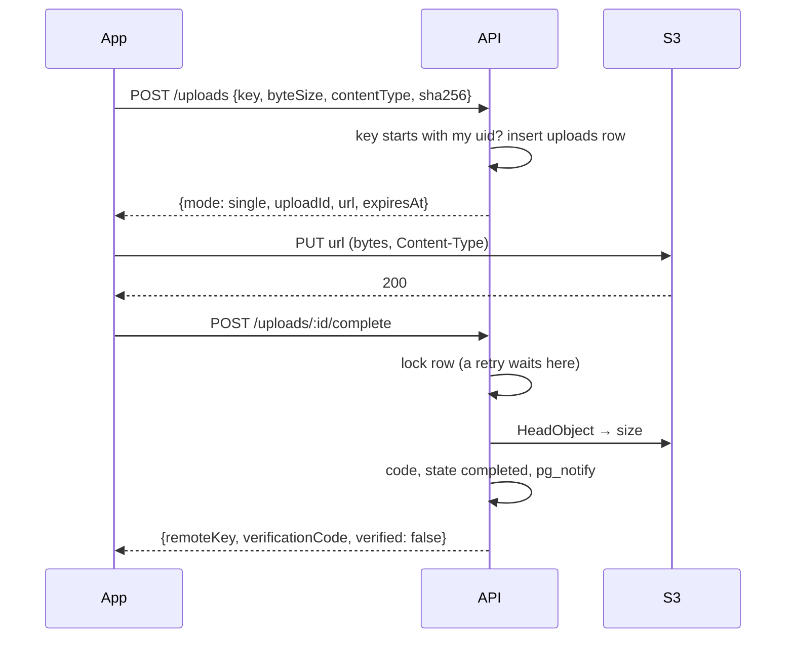
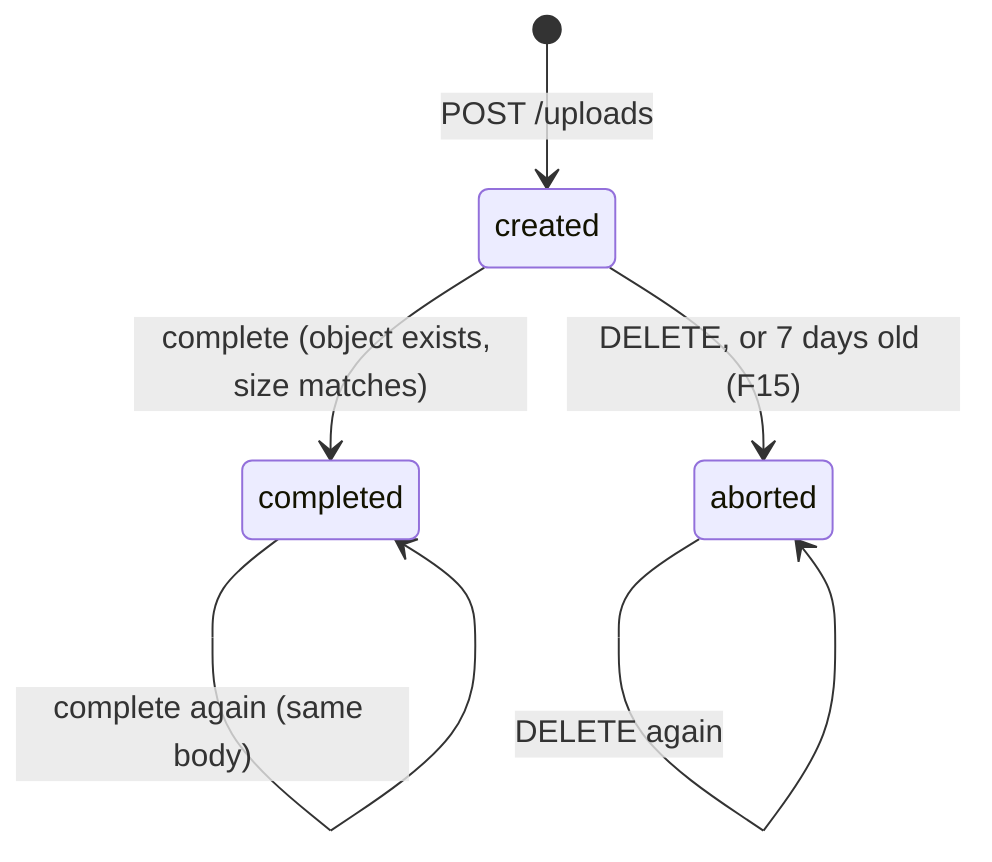

# F06 — Upload (backend)

<dl><dd>

- Sprint [S3](README.md) · 8h · the app uploads a file straight to S3 with a presigned URL; `complete` confirms it and issues a verification code — any number of times, same answer.
- iOS side: [F06 Upload](https://github.com/DAMHONGDUC/site_log_swift_ui/blob/main/docs/feature-guide/S3-capture-upload/F06-upload.md). Contract: [01-api §7–8](../../feature-docs/01-api.md#7-uploads). Inside: [03 §2](../../feature-docs/03-sync-uploads-realtime.md#2-uploads).

</dd></dl>

## Contents

<dl><dd>

1. [Overview](#overview)
2. [1. Uploads table](#1-uploads-table)
3. [2. Keys and codes](#2-keys-and-codes)
4. [3. Signing](#3-signing)
5. [4. Begin, complete, abort](#4-begin-complete-abort)
6. [5. Media URLs](#5-media-urls)
7. [6. Try it with a real file](#6-try-it-with-a-real-file)
8. [Tests](#tests)
9. [Feature done](#feature-done)

</dd></dl>

## Overview

<dl><dd>

- **Goal:** single-PUT uploads for every file size (F07 adds multipart from 5 MiB), confirmed with `HeadObject`, idempotent `complete`, abort, and GET URLs for other devices.
- **Demo:** curl begins an upload, `curl --upload-file` PUTs a photo to S3, `complete` returns a code; a second `complete` returns the same body.

| Step | Hours | Files |
|---|---|---|
| [1](#1-uploads-table) | 1 | `migrations/0004_uploads.sql`, `src/routes/account.ts` |
| [2](#2-keys-and-codes) | 1 | `src/keys.ts`, `src/codes.ts` |
| [3](#3-signing) | 1 | `src/storage.ts` |
| [4](#4-begin-complete-abort) | 3 | `src/realtime/events.ts`, `src/routes/uploads.ts`, `src/app.ts` |
| [5](#5-media-urls) | 0.5 | `src/routes/media.ts` |
| [6](#6-try-it-with-a-real-file) | 0.5 | — |
| [Tests](#tests) | 1 | `test/upload-helpers.ts`, `test/uploads.test.ts` |



```bash
npm install @aws-sdk/s3-request-presigner @fastify/rate-limit
```

</dd></dl>

## 1. Uploads table

<dl><dd>

#### Overview

<dl><dd>

- **Goal:** one server-only row per upload job.
- **Check:** `npm run migrate` applies `0004_uploads.sql`.

| Action | File | Holds |
|---|---|---|
| <b class="tag-new">New</b> | `migrations/0004_uploads.sql` | Three enums, `uploads`, partial unique index on completed keys |
| <b class="tag-edit">Edit</b> | `src/routes/account.ts` | `uploads` joins `serverTables` |

</dd></dl>

#### Steps

<dl><dd>

<details open>
<summary><strong>1.1 Table</strong></summary>
<dl><dd>

<b>File</b> · <b class="tag-new">New</b> · `migrations/0004_uploads.sql`

<b>Explain</b> · Not synced: the app keeps its own job records. `check` constraints make impossible states impossible: a completed upload always has a code, a multipart upload always has an S3 upload id.

<b>Think</b>

- `unique (uid, object_key) where state = 'completed'`: why may two `created` rows share a key, but not two `completed` ones?

<details>
<summary><b>Code</b></summary>

```sql
-- F06: server-only (not synced). One row per upload job; the backend never stores the bytes.
create type upload_mode  as enum ('single', 'multipart');
create type upload_state as enum ('created', 'completed', 'aborted');
create type verify_state as enum ('registered', 'verified', 'mismatch');

create table uploads (
    id                uuid primary key default gen_random_uuid(),
    uid               text not null,
    object_key        text not null,
    project_id        uuid,
    session_id        uuid,
    sha256            char(64) not null check (sha256 ~ '^[0-9a-f]{64}$'),
    byte_size         bigint not null check (byte_size > 0),
    content_type      text not null,
    mode              upload_mode not null,
    s3_upload_id      text,
    part_count        integer,
    state             upload_state not null default 'created',
    verification_code text unique,
    verify_state      verify_state,
    verified_at       timestamptz,
    created_at        timestamptz not null default now(),
    completed_at      timestamptz,
    constraint multipart_needs_s3_id check (mode <> 'multipart' or s3_upload_id is not null),
    constraint completed_needs_code check (state <> 'completed' or verification_code is not null)
);
create unique index uploads_completed_key on uploads (uid, object_key) where state = 'completed';
create index uploads_snapshot on uploads (uid, session_id, state);
create index uploads_abandoned on uploads (created_at) where state = 'created';
```

</details>

---

<b>File</b> · <b class="tag-edit">Edit</b> · `src/routes/account.ts`

```diff
@@ -6,3 +6,3 @@
 // Server-only tables that also hold the user's rows. A feature that adds one adds it here.
-export const serverTables: string[] = ['sync_state'];
+export const serverTables: string[] = ['uploads', 'sync_state'];
 
```

</dd></dl>
</details>

</dd></dl>

</dd></dl>

## 2. Keys and codes

<dl><dd>

#### Overview

<dl><dd>

- **Goal:** only well-formed keys under the caller's uid are ever signed; codes are random and easy to type.
- **Check:** `npm run typecheck`.

| Action | File | Holds |
|---|---|---|
| <b class="tag-new">New</b> | `src/keys.ts` | Three full-key patterns (capture, plan F11, branding logo F10), `parseKey`, `ownedKey` |
| <b class="tag-new">New</b> | `src/codes.ts` | `newVerificationCode()`: 10 characters, no `0 O 1 I L` |

</dd></dl>

#### Steps

<dl><dd>

<details open>
<summary><strong>2.1 Keys</strong></summary>
<dl><dd>

<b>File</b> · <b class="tag-new">New</b> · `src/keys.ts`

<b>Explain</b> · The signer would otherwise be an open door into the bucket: a key like `bob/…` or `../x` must never be signed for `alice`.

<b>Think</b>

- Why match the **whole** key with `^…$` instead of checking `key.startsWith(uid + '/')`? Try `alice/../bob/x.jpg` in your head.
- Swift's `UUID().uuidString` is upper case. What does the pattern do about it?

<details open>
<summary><b>Hint 2 · APIs</b></summary>

- ``new RegExp(`^(${UID})/(${UUID})/…$`)``, `pattern.exec(key)` → groups or `null`.

</details>

<details>
<summary><b>Code</b></summary>

```ts
// Object keys always start with the owner's uid. Checking the full shape stops a caller
// from signing URLs for someone else's files or for paths like "../".

const UUID = '[0-9A-Fa-f]{8}-[0-9A-Fa-f]{4}-[0-9A-Fa-f]{4}-[0-9A-Fa-f]{4}-[0-9A-Fa-f]{12}';
// Firebase uids are letters and digits, at most 128 characters.
const UID = '[A-Za-z0-9]{1,128}';

const capturePattern = new RegExp(
  `^(${UID})/(${UUID})/(${UUID})/(${UUID})\\.(jpg|heic|png|mov|mp4|m4a)$`,
);
const planPattern = new RegExp(`^(${UID})/(${UUID})/plans/(${UUID})\\.(pdf|jpg|png|heic)$`);
const brandingPattern = new RegExp(`^(${UID})/branding/(${UUID})\\.(png|jpg)$`);

export type ParsedKey =
  | { kind: 'capture'; uid: string; projectId: string; sessionId: string; captureId: string }
  | { kind: 'plan'; uid: string; projectId: string; sheetId: string }
  | { kind: 'branding'; uid: string; logoId: string };

export function parseKey(key: string): ParsedKey | undefined {
  const capture = capturePattern.exec(key);
  if (capture !== null) {
    return {
      kind: 'capture',
      uid: capture[1]!,
      projectId: capture[2]!.toLowerCase(),
      sessionId: capture[3]!.toLowerCase(),
      captureId: capture[4]!.toLowerCase(),
    };
  }
  const plan = planPattern.exec(key);
  if (plan !== null) {
    return {
      kind: 'plan',
      uid: plan[1]!,
      projectId: plan[2]!.toLowerCase(),
      sheetId: plan[3]!.toLowerCase(),
    };
  }
  const branding = brandingPattern.exec(key);
  if (branding !== null) {
    return { kind: 'branding', uid: branding[1]!, logoId: branding[2]!.toLowerCase() };
  }
  return undefined;
}

// A key is usable only if it has a known shape and starts with the caller's uid.
export function ownedKey(key: string, uid: string): ParsedKey | undefined {
  const parsed = parseKey(key);
  if (parsed === undefined) {
    return undefined;
  }
  if (parsed.uid !== uid) {
    return undefined;
  }
  return parsed;
}
```

</details>

---

<b>File</b> · <b class="tag-new">New</b> · `src/codes.ts`

<b>Explain</b> · `randomInt` comes from the operating system's secure random source; 31¹⁰ codes are far too many to guess with 30 tries a minute.

<details>
<summary><b>Code</b></summary>

```ts
import { randomInt } from 'node:crypto';

// No 0/O, 1/I/L: a code printed in a PDF must be easy to type.
const ALPHABET = '23456789ABCDEFGHJKMNPQRSTUVWXYZ';

export function newVerificationCode(length: number = 10): string {
  let code = '';
  for (let index = 0; index < length; index += 1) {
    const position = randomInt(ALPHABET.length);
    code += ALPHABET[position];
  }
  return code;
}
```

</details>

</dd></dl>
</details>

</dd></dl>

</dd></dl>

## 3. Signing

<dl><dd>

#### Overview

<dl><dd>

- **Goal:** sign PUT and GET URLs, check that an object exists, delete one, read one back (F15).
- **Check:** `npm run typecheck`.

| Action | File | Holds |
|---|---|---|
| <b class="tag-edit">Edit</b> | `src/storage.ts` | `expiresAt`, `presignPut`, `presignGet`, `head`, `deleteObject`, `readStream` |

</dd></dl>

#### Steps

<dl><dd>

<details open>
<summary><strong>3.1 Storage</strong></summary>
<dl><dd>

<b>File</b> · <b class="tag-edit">Edit</b> · `src/storage.ts`

<b>Explain</b> · Presigning is local cryptography with your credentials: no call to S3. The signature covers `Content-Type`, so the app must send the same header.

<b>Think</b>

- `head` returns `undefined` when S3 answers "not found". Why is that better than letting the error escape to the route?

```diff
@@ -2,5 +2,9 @@
   AbortMultipartUploadCommand,
+  DeleteObjectCommand,
   DeleteObjectsCommand,
+  GetObjectCommand,
+  HeadObjectCommand,
   ListMultipartUploadsCommand,
   ListObjectsV2Command,
+  PutObjectCommand,
   S3Client,
@@ -8,2 +12,4 @@
 } from '@aws-sdk/client-s3';
+import { getSignedUrl } from '@aws-sdk/s3-request-presigner';
+import type { Readable } from 'node:stream';
 
@@ -43,2 +49,20 @@
 
+  expiresAt(now: Date): Date {
+    return new Date(now.getTime() + this.ttlSeconds * 1000);
+  }
+
+  async presignPut(key: string, contentType: string): Promise<string> {
+    const command = new PutObjectCommand({
+      Bucket: this.bucket,
+      Key: key,
+      ContentType: contentType,
+    });
+    return getSignedUrl(this.s3, command, { expiresIn: this.ttlSeconds });
+  }
+
+  async presignGet(key: string): Promise<string> {
+    const command = new GetObjectCommand({ Bucket: this.bucket, Key: key });
+    return getSignedUrl(this.s3, command, { expiresIn: this.ttlSeconds });
+  }
+
   // Returns false when there was nothing to abort (already aborted or completed).
@@ -59,2 +83,24 @@
     }
+  }
+
+  // Size of a stored object, or undefined when it does not exist.
+  async head(key: string): Promise<number | undefined> {
+    try {
+      const result = await this.s3.send(new HeadObjectCommand({ Bucket: this.bucket, Key: key }));
+      return result.ContentLength;
+    } catch (error) {
+      if (isMissing(error)) {
+        return undefined;
+      }
+      throw error;
+    }
+  }
+
+  async deleteObject(key: string): Promise<void> {
+    await this.s3.send(new DeleteObjectCommand({ Bucket: this.bucket, Key: key }));
+  }
+
+  async readStream(key: string): Promise<Readable> {
+    const result = await this.s3.send(new GetObjectCommand({ Bucket: this.bucket, Key: key }));
+    return result.Body as Readable;
   }
```

<details>
<summary><b>Code</b></summary>

```ts
import {
  AbortMultipartUploadCommand,
  DeleteObjectCommand,
  DeleteObjectsCommand,
  GetObjectCommand,
  HeadObjectCommand,
  ListMultipartUploadsCommand,
  ListObjectsV2Command,
  PutObjectCommand,
  S3Client,
  S3ServiceException,
} from '@aws-sdk/client-s3';
import { getSignedUrl } from '@aws-sdk/s3-request-presigner';
import type { Readable } from 'node:stream';

export function createS3Client(region: string): S3Client {
  return new S3Client({
    region,
    // Without these, the SDK adds checksum parameters to presigned URLs that the iOS
    // upload does not send, and S3 rejects every PUT.
    requestChecksumCalculation: 'WHEN_REQUIRED',
    responseChecksumValidation: 'WHEN_REQUIRED',
  });
}

// S3 says "not there" in three ways depending on the call.
function isMissing(error: unknown): boolean {
  if (!(error instanceof S3ServiceException)) {
    return false;
  }
  if (error.name === 'NotFound' || error.name === 'NoSuchKey' || error.name === 'NoSuchUpload') {
    return true;
  }
  return error.$metadata.httpStatusCode === 404;
}

// Every S3 call the backend makes. The backend never reads or writes file bytes itself,
// except the verify worker, which streams an object back to hash it.
export class Storage {
  private readonly s3: S3Client;
  private readonly bucket: string;
  private readonly ttlSeconds: number;

  constructor(s3: S3Client, bucket: string, ttlSeconds: number) {
    this.s3 = s3;
    this.bucket = bucket;
    this.ttlSeconds = ttlSeconds;
  }

  expiresAt(now: Date): Date {
    return new Date(now.getTime() + this.ttlSeconds * 1000);
  }

  async presignPut(key: string, contentType: string): Promise<string> {
    const command = new PutObjectCommand({
      Bucket: this.bucket,
      Key: key,
      ContentType: contentType,
    });
    return getSignedUrl(this.s3, command, { expiresIn: this.ttlSeconds });
  }

  async presignGet(key: string): Promise<string> {
    const command = new GetObjectCommand({ Bucket: this.bucket, Key: key });
    return getSignedUrl(this.s3, command, { expiresIn: this.ttlSeconds });
  }

  // Returns false when there was nothing to abort (already aborted or completed).
  async abortMultipart(key: string, s3UploadId: string): Promise<boolean> {
    try {
      const command = new AbortMultipartUploadCommand({
        Bucket: this.bucket,
        Key: key,
        UploadId: s3UploadId,
      });
      await this.s3.send(command);
      return true;
    } catch (error) {
      if (isMissing(error)) {
        return false;
      }
      throw error;
    }
  }

  // Size of a stored object, or undefined when it does not exist.
  async head(key: string): Promise<number | undefined> {
    try {
      const result = await this.s3.send(new HeadObjectCommand({ Bucket: this.bucket, Key: key }));
      return result.ContentLength;
    } catch (error) {
      if (isMissing(error)) {
        return undefined;
      }
      throw error;
    }
  }

  async deleteObject(key: string): Promise<void> {
    await this.s3.send(new DeleteObjectCommand({ Bucket: this.bucket, Key: key }));
  }

  async readStream(key: string): Promise<Readable> {
    const result = await this.s3.send(new GetObjectCommand({ Bucket: this.bucket, Key: key }));
    return result.Body as Readable;
  }

  // Deletes every object under a prefix, 1000 at a time (the S3 limit per request).
  async deletePrefix(prefix: string): Promise<number> {
    let deleted = 0;
    let token: string | undefined = undefined;
    do {
      const listCommand: ListObjectsV2Command = new ListObjectsV2Command({
        Bucket: this.bucket,
        Prefix: prefix,
        ContinuationToken: token,
      });
      const page = await this.s3.send(listCommand);
      const keys = (page.Contents ?? []).map((object) => ({ Key: object.Key }));
      if (keys.length > 0) {
        await this.s3.send(
          new DeleteObjectsCommand({ Bucket: this.bucket, Delete: { Objects: keys, Quiet: true } }),
        );
        deleted += keys.length;
      }
      token = page.NextContinuationToken;
    } while (token !== undefined);
    return deleted;
  }

  // Aborts unfinished multipart uploads under a prefix so no hidden parts are left behind.
  async abortMultipartUnder(prefix: string): Promise<number> {
    let aborted = 0;
    let keyMarker: string | undefined = undefined;
    let uploadIdMarker: string | undefined = undefined;
    let more = true;
    while (more) {
      const listCommand: ListMultipartUploadsCommand = new ListMultipartUploadsCommand({
        Bucket: this.bucket,
        Prefix: prefix,
        KeyMarker: keyMarker,
        UploadIdMarker: uploadIdMarker,
      });
      const page = await this.s3.send(listCommand);
      for (const upload of page.Uploads ?? []) {
        if (upload.Key !== undefined && upload.UploadId !== undefined) {
          const didAbort = await this.abortMultipart(upload.Key, upload.UploadId);
          if (didAbort) {
            aborted += 1;
          }
        }
      }
      more = page.IsTruncated === true;
      keyMarker = page.NextKeyMarker;
      uploadIdMarker = page.NextUploadIdMarker;
    }
    return aborted;
  }
}
```

</details>

</dd></dl>
</details>

</dd></dl>

</dd></dl>

## 4. Begin, complete, abort

<dl><dd>

#### Overview

<dl><dd>

- **Goal:** the three upload endpoints.
- **Check:** [step 6](#6-try-it-with-a-real-file).

| Action | File | Holds |
|---|---|---|
| <b class="tag-new">New</b> | `src/realtime/events.ts` | `notifyUploadEvent`: `pg_notify('upload_events', …)` — nobody listens until F15 |
| <b class="tag-new">New</b> | `src/routes/uploads.ts` | `POST /uploads` (rate limited), `POST /uploads/:id/complete`, `DELETE /uploads/:id` |
| <b class="tag-edit">Edit</b> | `src/app.ts` | Rate-limit plugin, upload and media routes |



</dd></dl>

#### Steps

<dl><dd>

<details open>
<summary><strong>4.1 Events</strong></summary>
<dl><dd>

<b>File</b> · <b class="tag-new">New</b> · `src/realtime/events.ts`

<b>Explain</b> · Sent inside the `complete` transaction: Postgres delivers it at commit and drops it on rollback. F15 adds the listener.

<details>
<summary><b>Code</b></summary>

```ts
import type pg from 'pg';

export type UploadEventType = 'completed' | 'aborted' | 'verified' | 'mismatch';

export interface UploadEvent {
  uid: string;
  sessionId: string | null;
  uploadId: string;
  type: UploadEventType;
}

// Tells every API process (through Postgres) that an upload changed. Only ids travel:
// pg_notify payloads are capped at 8000 bytes. Sent at commit, dropped on rollback.
export async function notifyUploadEvent(
  client: pg.PoolClient | pg.Pool,
  event: UploadEvent,
): Promise<void> {
  await client.query(`select pg_notify('upload_events', $1)`, [JSON.stringify(event)]);
}
```

</details>

</dd></dl>
</details>

<details open>
<summary><strong>4.2 Upload routes</strong></summary>
<dl><dd>

<b>File</b> · <b class="tag-new">New</b> · `src/routes/uploads.ts`

<b>Explain</b> · `complete` locks the row with `select … for update`: a second `complete` waits, then finds `completed` and returns the stored body. That is what makes it idempotent.

<b>Think</b>

- The app retries `complete` after a timeout. List what happens on the server for the retry, line by line.
- Nothing was uploaded and the app calls `complete`. Why `404` and not `409`? (Read the error contract: what does the app do with `409` on `complete`?)
- The rate limit is keyed by the `Authorization` header, not by `uid`. Why can the key not be `uid`? (When does the rate-limit hook run compared with `requireUser`?)

<details open>
<summary><b>Hint 1 · Idea</b></summary>

- **Begin:** `ownedKey` or `400 invalid_key`; size limit → `413`; project and session ids from the parsed key; insert the row; presign; log.
- **Complete:** in `withTransaction`: lock → none or aborted `404` → completed: return stored body → `head` → missing `404 object_not_found`, wrong size `400 size_mismatch` → unique code → update → notify → body. A `23505` from the completed-key index → `409 already_completed` with the winner's body.
- **Abort:** lock → none `404` → completed `409` → created: delete the object, `aborted`, notify → `{ aborted: true }`.

</details>

<details open>
<summary><b>Hint 2 · APIs</b></summary>

- `config: { rateLimit: { max, timeWindow, keyGenerator } }` on the route.
- `select * from uploads where id = $1 and uid = $2 for update`.
- `conflict(code, message, extra)` puts `extra` fields next to `code` in the error body.

</details>

<details open>
<summary><b>Hint 3 · Skeleton</b></summary>

```ts
typed.post('/uploads/:id/complete', { preHandler: requireUser, schema: { params: IdParams, body: CompleteBody } }, async (request) => {
  const uid = request.uid;
  try {
    return await withTransaction(pool, async (client) => {
      const upload = await lockUpload(client, request.params.id, uid);
      // missing or aborted → notFound
      // completed → return completedBody(upload)
      // size = await storage.head(upload.object_key): undefined → notFound; ≠ byte_size → badRequest
      // code = await uniqueCode(client); update … returning *; notifyUploadEvent; log; return completedBody(row)
    });
  } catch (error) {
    // 23505 → look up the completed upload of the same key → throw conflict('already_completed', …, body)
    throw error;
  }
});
```

</details>

<details>
<summary><b>Code</b></summary>

```ts
import { Type, type TypeBoxTypeProvider } from '@fastify/type-provider-typebox';
import type { FastifyInstance, FastifyRequest, preHandlerAsyncHookHandler } from 'fastify';
import type pg from 'pg';
import type { AppDeps } from '../app.js';
import { newVerificationCode } from '../codes.js';
import { withTransaction } from '../db.js';
import { AppError, badRequest, conflict, notFound } from '../errors.js';
import { ownedKey } from '../keys.js';
import { notifyUploadEvent } from '../realtime/events.js';

interface UploadRow {
  id: string;
  uid: string;
  object_key: string;
  project_id: string | null;
  session_id: string | null;
  sha256: string;
  byte_size: number;
  content_type: string;
  mode: 'single' | 'multipart';
  s3_upload_id: string | null;
  part_count: number | null;
  state: 'created' | 'completed' | 'aborted';
  verification_code: string | null;
  verify_state: 'registered' | 'verified' | 'mismatch' | null;
  completed_at: Date | null;
}

// The body `complete` returns. A repeated `complete` returns the same body again.
function completedBody(row: UploadRow) {
  return {
    uploadId: row.id,
    remoteKey: row.object_key,
    sha256: row.sha256,
    verificationCode: row.verification_code,
    verified: row.verify_state === 'verified',
    receivedAt: row.completed_at,
  };
}

async function lockUpload(
  client: pg.PoolClient,
  id: string,
  uid: string,
): Promise<UploadRow | undefined> {
  const result = await client.query<UploadRow>(
    'select * from uploads where id = $1 and uid = $2 for update',
    [id, uid],
  );
  return result.rows[0];
}

async function uniqueCode(client: pg.PoolClient): Promise<string> {
  for (let attempt = 0; attempt < 5; attempt += 1) {
    const code = newVerificationCode();
    const taken = await client.query('select 1 from uploads where verification_code = $1', [code]);
    if (taken.rows.length === 0) {
      return code;
    }
  }
  throw new Error('Could not find a free verification code');
}

export function uploadRoutes(
  app: FastifyInstance,
  deps: AppDeps,
  requireUser: preHandlerAsyncHookHandler,
): void {
  const typed = app.withTypeProvider<TypeBoxTypeProvider>();
  const { config, pool, storage } = deps;

  const BeginBody = Type.Object({
    key: Type.String({ minLength: 1, maxLength: 300 }),
    byteSize: Type.Integer({ minimum: 1 }),
    contentType: Type.String({ pattern: '^[a-z]+/[a-z0-9.+-]+$' }),
    sha256: Type.String({ pattern: '^[0-9a-f]{64}$' }),
  });

  // Per signed-in user (the token), so one runaway device cannot flood S3 with uploads.
  const beginLimit = {
    max: config.uploadRateLimitPerMinute,
    timeWindow: '1 minute',
    keyGenerator: (request: FastifyRequest) => request.headers.authorization ?? request.ip,
  };

  // 1. Begin: one presigned PUT for the whole file (F07 adds multipart for big files).
  typed.post(
    '/uploads',
    { preHandler: requireUser, schema: { body: BeginBody }, config: { rateLimit: beginLimit } },
    async (request) => {
      const { key, byteSize, contentType, sha256 } = request.body;
      const parsed = ownedKey(key, request.uid);
      if (parsed === undefined) {
        throw badRequest('invalid_key', 'Key has the wrong shape or another owner');
      }
      if (byteSize > config.maxUploadBytes) {
        throw new AppError(413, 'file_too_large', 'File is larger than the upload limit');
      }

      let projectId: string | null = null;
      let sessionId: string | null = null;
      if (parsed.kind === 'capture') {
        projectId = parsed.projectId;
        sessionId = parsed.sessionId;
      } else if (parsed.kind === 'plan') {
        projectId = parsed.projectId;
      }
      const expiresAt = storage.expiresAt(new Date());

      const inserted = await pool.query<{ id: string }>(
        `insert into uploads (uid, object_key, project_id, session_id, sha256, byte_size, content_type, mode)
       values ($1, $2, $3, $4, $5, $6, $7, 'single') returning id`,
        [request.uid, key, projectId, sessionId, sha256, byteSize, contentType],
      );
      const uploadId = inserted.rows[0]!.id;
      const url = await storage.presignPut(key, contentType);
      request.log.info(
        { uid: request.uid, uploadId, key, byteSize, mode: 'single' },
        'upload begun',
      );
      return { mode: 'single', uploadId, url, expiresAt };
    },
  );

  const IdParams = Type.Object({ id: Type.String({ format: 'uuid' }) });
  // F07 adds the list of uploaded parts here.
  const CompleteBody = Type.Object({});

  // 2. Complete: confirm the object exists, record it, issue a verification code. Idempotent.
  typed.post(
    '/uploads/:id/complete',
    { preHandler: requireUser, schema: { params: IdParams, body: CompleteBody } },
    async (request) => {
      const uid = request.uid;
      try {
        return await withTransaction(pool, async (client) => {
          const upload = await lockUpload(client, request.params.id, uid);
          if (upload === undefined || upload.state === 'aborted') {
            throw notFound('upload_not_found', 'No such upload, or it was aborted');
          }
          if (upload.state === 'completed') {
            // A retry after a lost response: same answer as the first time.
            return completedBody(upload);
          }

          const size = await storage.head(upload.object_key);
          if (size === undefined) {
            throw notFound('object_not_found', 'Nothing was uploaded for this key');
          }
          if (size !== upload.byte_size) {
            throw badRequest('size_mismatch', `Stored ${size} bytes, expected ${upload.byte_size}`);
          }

          const code = await uniqueCode(client);
          const updated = await client.query<UploadRow>(
            `update uploads
                set state = 'completed', completed_at = now(),
                    verification_code = $2, verify_state = 'registered'
              where id = $1
          returning *`,
            [upload.id, code],
          );
          const row = updated.rows[0]!;
          await notifyUploadEvent(client, {
            uid,
            sessionId: row.session_id,
            uploadId: row.id,
            type: 'completed',
          });
          request.log.info(
            { uid, uploadId: row.id, key: row.object_key, byteSize: row.byte_size },
            'upload completed',
          );
          return completedBody(row);
        });
      } catch (error) {
        if ((error as { code?: string }).code === '23505') {
          // Another upload of the same key completed first.
          const existing = await pool.query<UploadRow>(
            `select u.* from uploads u
               join uploads mine on mine.object_key = u.object_key and mine.uid = u.uid
              where mine.id = $1 and u.uid = $2 and u.state = 'completed'`,
            [request.params.id, uid],
          );
          if (existing.rows[0] !== undefined) {
            throw conflict(
              'already_completed',
              'This key was already uploaded',
              completedBody(existing.rows[0]),
            );
          }
        }
        throw error;
      }
    },
  );

  // 3. Abort: the user cancelled, or the app gave up. Idempotent.
  typed.delete(
    '/uploads/:id',
    { preHandler: requireUser, schema: { params: IdParams } },
    async (request) => {
      const uid = request.uid;
      return withTransaction(pool, async (client) => {
        const upload = await lockUpload(client, request.params.id, uid);
        if (upload === undefined) {
          throw notFound('upload_not_found', 'No such upload');
        }
        if (upload.state === 'completed') {
          throw conflict('already_completed', 'A completed upload cannot be aborted');
        }
        if (upload.state === 'created') {
          await storage.deleteObject(upload.object_key);
          await client.query(`update uploads set state = 'aborted' where id = $1`, [upload.id]);
          await notifyUploadEvent(client, {
            uid,
            sessionId: upload.session_id,
            uploadId: upload.id,
            type: 'aborted',
          });
          request.log.info({ uid, uploadId: upload.id }, 'upload aborted');
        }
        return { uploadId: upload.id, aborted: true };
      });
    },
  );
}
```

</details>

---

<b>File</b> · <b class="tag-edit">Edit</b> · `src/app.ts`

<b>Explain</b> · `global: false`: only routes with `config.rateLimit` are limited.

```diff
@@ -1 +1,2 @@
+import rateLimit from '@fastify/rate-limit';
 import Fastify, { type FastifyInstance } from 'fastify';
@@ -8,3 +9,5 @@
 import { healthRoutes } from './routes/health.js';
+import { mediaRoutes } from './routes/media.js';
 import { syncRoutes } from './routes/sync.js';
+import { uploadRoutes } from './routes/uploads.js';
 import type { Storage } from './storage.js';
@@ -30,2 +33,5 @@
 
+  // Off by default: a route opts in with config.rateLimit (POST /uploads, GET /verify).
+  await app.register(rateLimit, { global: false });
+
   const requireUser = makeRequireUser(deps.tokens);
@@ -35,2 +41,4 @@
   syncRoutes(app, deps, requireUser);
+  uploadRoutes(app, deps, requireUser);
+  mediaRoutes(app, deps, requireUser);
 
```

<details>
<summary><b>Code</b></summary>

```ts
import rateLimit from '@fastify/rate-limit';
import Fastify, { type FastifyInstance } from 'fastify';
import type pg from 'pg';
import { makeRequireUser, type TokenVerifier } from './auth.js';
import type { Config } from './config.js';
import { registerErrorHandler } from './errors.js';
import { loggerOptions } from './logger.js';
import { accountRoutes } from './routes/account.js';
import { healthRoutes } from './routes/health.js';
import { mediaRoutes } from './routes/media.js';
import { syncRoutes } from './routes/sync.js';
import { uploadRoutes } from './routes/uploads.js';
import type { Storage } from './storage.js';

// Everything a route needs, passed in so tests can swap Firebase and S3 for fakes.
export interface AppDeps {
  config: Config;
  pool: pg.Pool;
  tokens: TokenVerifier;
  storage: Storage;
}

export async function buildApp(deps: AppDeps): Promise<FastifyInstance> {
  const app = Fastify({
    logger: loggerOptions(deps.config.logLevel),
    bodyLimit: deps.config.maxRequestBytes,
    // Caddy sits in front: read the client IP from X-Forwarded-For.
    trustProxy: true,
  });

  registerErrorHandler(app);
  app.decorateRequest('uid', '');

  // Off by default: a route opts in with config.rateLimit (POST /uploads, GET /verify).
  await app.register(rateLimit, { global: false });

  const requireUser = makeRequireUser(deps.tokens);

  healthRoutes(app, deps);
  accountRoutes(app, deps, requireUser);
  syncRoutes(app, deps, requireUser);
  uploadRoutes(app, deps, requireUser);
  mediaRoutes(app, deps, requireUser);

  return app;
}
```

</details>

</dd></dl>
</details>

</dd></dl>

</dd></dl>

## 5. Media URLs

<dl><dd>

<details open>
<summary><strong>5.1 Route</strong></summary>
<dl><dd>

<b>File</b> · <b class="tag-new">New</b> · `src/routes/media.ts`

<b>Explain</b> · A second device pulled a capture with `remoteKey`; it asks for short-lived GET URLs to show the photo. Same key check as begin.

<details>
<summary><b>Code</b></summary>

```ts
import { Type, type TypeBoxTypeProvider } from '@fastify/type-provider-typebox';
import type { FastifyInstance, preHandlerAsyncHookHandler } from 'fastify';
import type { AppDeps } from '../app.js';
import { badRequest } from '../errors.js';
import { ownedKey } from '../keys.js';

// A second device shows a photo it pulled: it asks for short-lived GET URLs for the keys.
export function mediaRoutes(
  app: FastifyInstance,
  deps: AppDeps,
  requireUser: preHandlerAsyncHookHandler,
): void {
  const typed = app.withTypeProvider<TypeBoxTypeProvider>();

  const Body = Type.Object({
    keys: Type.Array(Type.String({ minLength: 1, maxLength: 300 }), { minItems: 1, maxItems: 200 }),
  });

  typed.post(
    '/media/urls',
    { preHandler: requireUser, schema: { body: Body } },
    async (request) => {
      const urls: { key: string; url: string }[] = [];
      for (const key of request.body.keys) {
        if (ownedKey(key, request.uid) === undefined) {
          throw badRequest('invalid_key', 'Key has the wrong shape or another owner');
        }
        urls.push({ key, url: await deps.storage.presignGet(key) });
      }
      request.log.info({ uid: request.uid, count: urls.length }, 'media urls signed');
      return { urls, expiresAt: deps.storage.expiresAt(new Date()) };
    },
  );
}
```

</details>

</dd></dl>
</details>

</dd></dl>

## 6. Try it with a real file

<dl><dd>

- `.env` needs `S3_BUCKET` (the dev bucket), `AWS_PROFILE=sitelog` and a fresh `aws sso login`.
- `FUID` is your test user's Firebase uid (Firebase → Authentication → Users → User UID). Not `UID`: zsh reserves that name.

```bash
npm run migrate && npm run dev
```

```bash
TOKEN=$(npm run -s token -- test1@example.com '<password>') && FUID=<your uid> && FILE=~/Desktop/test.jpg
```

```bash
KEY="$FUID/11111111-1111-4111-8111-111111111111/33333333-3333-4333-8333-333333333333/44444444-4444-4444-8444-444444444444.jpg"
```

```bash
BEGIN=$(curl -s localhost:3000/uploads -H "Authorization: Bearer $TOKEN" -H 'content-type: application/json' -d "{\"key\":\"$KEY\",\"byteSize\":$(stat -f%z $FILE),\"contentType\":\"image/jpeg\",\"sha256\":\"$(shasum -a 256 $FILE | cut -d' ' -f1)\"}") && echo $BEGIN | jq '{mode, uploadId}'
```

```bash
curl -s -o /dev/null -w '%{http_code}\n' -X PUT -H 'Content-Type: image/jpeg' --upload-file $FILE "$(echo $BEGIN | jq -r .url)"
```

```bash
curl -s -X POST localhost:3000/uploads/$(echo $BEGIN | jq -r .uploadId)/complete -H "Authorization: Bearer $TOKEN" -H 'content-type: application/json' -d '{}' | jq
```

- Expected: PUT `200`, then a body with a 10-character `verificationCode`. Run the last command again: the same body.

<b>Try</b>

- PUT with `-H 'Content-Type: image/png'` → S3 answers `403 SignatureDoesNotMatch`: the header is part of the signature.
- Begin a new upload, skip the PUT, call `complete` → `404 object_not_found`.

</dd></dl>

## Tests

<dl><dd>

<details open>
<summary><strong>Test files</strong></summary>
<dl><dd>

<b>File</b> · <b class="tag-new">New</b> · `test/upload-helpers.ts`

<details>
<summary><b>Code</b></summary>

```ts
import { S3ServiceException } from '@aws-sdk/client-s3';
import { auth, ids, sha, type TestContext } from './helpers.js';

export const MiB = 1024 * 1024;
export const captureKey = `alice/${ids.project}/${ids.session}/${ids.capture}.jpg`;

// What the real S3 client throws for a missing object.
export function notFoundError() {
  return new S3ServiceException({
    name: 'NotFound',
    $fault: 'client',
    $metadata: { httpStatusCode: 404 },
  });
}

export async function beginUpload(
  context: TestContext,
  byteSize: number,
  key: string = captureKey,
  uid = 'alice',
) {
  return context.app.inject({
    method: 'POST',
    url: '/uploads',
    headers: auth(uid),
    payload: { key, byteSize, contentType: 'image/jpeg', sha256: sha },
  });
}

export async function completeUpload(
  context: TestContext,
  uploadId: string,
  parts?: object[],
  uid = 'alice',
) {
  let payload: object = {};
  if (parts !== undefined) {
    payload = { parts };
  }
  return context.app.inject({
    method: 'POST',
    url: `/uploads/${uploadId}/complete`,
    headers: auth(uid),
    payload,
  });
}
```

</details>

---

<b>File</b> · <b class="tag-new">New</b> · `test/uploads.test.ts`

<b>Explain</b> · S3 is mocked: `HeadObjectCommand` answers what each test needs. The concurrent test fires two completes at once.

<details>
<summary><b>Code</b></summary>

```ts
import { DeleteObjectCommand, HeadObjectCommand } from '@aws-sdk/client-s3';
import { afterAll, beforeAll, beforeEach, describe, expect, it } from 'vitest';
import {
  auth,
  closeTestContext,
  createTestContext,
  ids,
  resetDatabase,
  type TestContext,
} from './helpers.js';
import { beginUpload, captureKey, completeUpload, notFoundError } from './upload-helpers.js';

describe('uploads: single PUT', () => {
  let context: TestContext;
  beforeAll(async () => {
    context = await createTestContext();
  });
  afterAll(async () => {
    await closeTestContext(context);
  });
  beforeEach(async () => {
    await resetDatabase(context.pool);
    context.s3.reset();
  });

  it.each([
    `bob/${ids.project}/${ids.session}/${ids.capture}.jpg`,
    `alice/../bob/${ids.capture}.jpg`,
    `/alice/${ids.project}/${ids.session}/${ids.capture}.jpg`,
    `alice/${ids.project}/${ids.session}/${ids.capture}.exe`,
  ])('rejects the key %s', async (badKey) => {
    const response = await beginUpload(context, 1000, badKey);
    expect(response.statusCode).toBe(400);
    expect(response.json().error.code).toBe('invalid_key');
  });

  it('signs a PUT URL without checksum parameters', async () => {
    const response = await beginUpload(context, 1000);
    expect(response.statusCode).toBe(200);
    expect(response.json().mode).toBe('single');
    expect(response.json().url).toContain('X-Amz-Signature');
    expect(response.json().url).not.toContain('x-amz-checksum');
    expect(response.json().url).not.toContain('x-amz-sdk-checksum');
  });

  it('completes once and answers a retry with the same body', async () => {
    context.s3.on(HeadObjectCommand).resolves({ ContentLength: 1000 });
    const begun = await beginUpload(context, 1000);
    const first = await completeUpload(context, begun.json().uploadId);
    expect(first.statusCode).toBe(200);
    expect(first.json().verificationCode).toMatch(/^[2-9A-HJKMNP-Z]{10}$/);
    expect(first.json().verified).toBe(false);

    const again = await completeUpload(context, begun.json().uploadId);
    expect(again.statusCode).toBe(200);
    expect(again.body).toBe(first.body);
  });

  it('gives two concurrent completes the same answer', async () => {
    context.s3.on(HeadObjectCommand).resolves({ ContentLength: 1000 });
    const begun = await beginUpload(context, 1000);
    const uploadId = begun.json().uploadId;
    const [a, b] = await Promise.all([
      completeUpload(context, uploadId),
      completeUpload(context, uploadId),
    ]);
    expect(a.statusCode).toBe(200);
    expect(b.statusCode).toBe(200);
    expect(a.body).toBe(b.body);
  });

  it('answers 404 when nothing was uploaded and 400 when the size is wrong', async () => {
    context.s3.on(HeadObjectCommand).rejects(notFoundError());
    const begun = await beginUpload(context, 1000);
    const missing = await completeUpload(context, begun.json().uploadId);
    expect(missing.statusCode).toBe(404);

    context.s3.on(HeadObjectCommand).resolves({ ContentLength: 999 });
    const wrong = await completeUpload(context, begun.json().uploadId);
    expect(wrong.statusCode).toBe(400);
    expect(wrong.json().error.code).toBe('size_mismatch');
  });

  it('does not let another user complete my upload', async () => {
    const begun = await beginUpload(context, 1000);
    const response = await completeUpload(context, begun.json().uploadId, undefined, 'bob');
    expect(response.statusCode).toBe(404);
  });

  it('deletes the object when the upload is aborted, and an aborted upload never completes', async () => {
    context.s3.on(DeleteObjectCommand).resolves({});
    context.s3.on(HeadObjectCommand).resolves({ ContentLength: 1000 });
    const begun = await beginUpload(context, 1000);
    const uploadId = begun.json().uploadId;
    const aborted = await context.app.inject({
      method: 'DELETE',
      url: `/uploads/${uploadId}`,
      headers: auth('alice'),
    });
    expect(aborted.statusCode).toBe(200);
    expect(context.s3.commandCalls(DeleteObjectCommand)).toHaveLength(1);

    const late = await completeUpload(context, uploadId);
    expect(late.statusCode).toBe(404);
  });

  it('signs GET URLs only for my own keys', async () => {
    const mine = await context.app.inject({
      method: 'POST',
      url: '/media/urls',
      headers: auth('alice'),
      payload: { keys: [captureKey] },
    });
    expect(mine.statusCode).toBe(200);
    expect(mine.json().urls[0].url).toContain('X-Amz-Signature');

    const theirs = await context.app.inject({
      method: 'POST',
      url: '/media/urls',
      headers: auth('bob'),
      payload: { keys: [captureKey] },
    });
    expect(theirs.statusCode).toBe(400);
  });

  it('rate limits begin per user', async () => {
    const limited = await createTestContext({ UPLOAD_RATE_LIMIT_PER_MINUTE: '2' });
    const statuses: number[] = [];
    for (let index = 0; index < 3; index += 1) {
      const response = await beginUpload(
        limited,
        10,
        captureKey.replace('alice', 'carol'),
        'carol',
      );
      statuses.push(response.statusCode);
    }
    await closeTestContext(limited);
    expect(statuses).toEqual([200, 200, 429]);
  });
});
```

</details>

```bash
npm test
```

</dd></dl>
</details>

</dd></dl>

## Feature done

<dl><dd>

- [ ] The real-file demo works against the dev bucket
- [ ] Bad keys, another uid, `..`, a leading `/` → `400 invalid_key`
- [ ] `complete` twice and two at once → the same `200` body
- [ ] `npm test` green (43 tests); staging migrated
- [ ] The iOS F06 demo uploads a photo to staging and shows "registered {code}"

</dd></dl>
