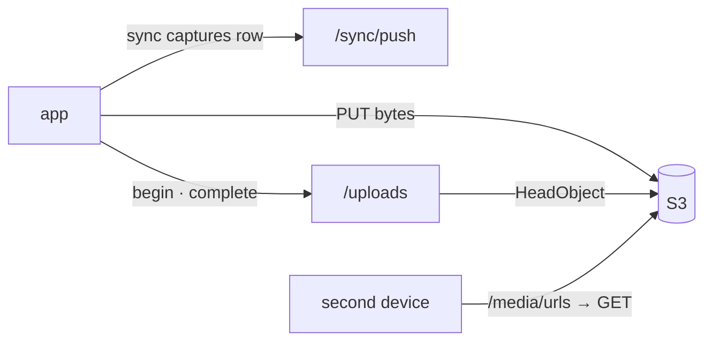

# S3 — Capture and upload

<dl><dd>

- Sprint 3 · 2 weeks · backend 10h of the sprint's 60h · [all sprints](../README.md) · iOS side: [S3 iOS](https://github.com/DAMHONGDUC/site_log_swift_ui/blob/main/docs/feature-guide/S3-capture-upload/README.md)

</dd></dl>

## Contents

<dl><dd>

1. [Overview](#overview)
2. [Tasks](#tasks)
3. [Done](#done)
4. [Self-check](#self-check)

</dd></dl>

## Overview

<dl><dd>

- **Goal:** capture rows sync; files go to S3 and come back with a verification code.
- **Demo:** the app takes a photo on a phone signed in to staging: the row syncs, the file uploads, the code appears; a second device shows the photo through `/media/urls`.

| Guide | Builds | Hours |
|---|---|---|
| [F05 Captures](F05-captures.md) | `0003_captures.sql`, registry entry | 2 |
| [F06 Upload](F06-upload.md) | `0004_uploads.sql`, keys, codes, signing, begin / complete / abort, media URLs | 8 |

</dd></dl>

## Tasks

<dl><dd>

| Task | What | Guide | Hours | Status |
|---|---|---|---|---|
| F05.1 | `0003_captures.sql`, registry, tests | [F05](F05-captures.md) | 2 | not start |
| F06.1 | `0004_uploads.sql`, keys, codes | [F06 §1–2](F06-upload.md#1-uploads-table) | 2 | not start |
| F06.2 | Signing in `storage.ts` | [F06 §3](F06-upload.md#3-signing) | 1 | not start |
| F06.3 | Begin, complete, abort (split: begin · complete · abort) | [F06 §4](F06-upload.md#4-begin-complete-abort) | 3 | not start |
| F06.4 | Media URLs, real-file demo, tests | [F06 §5–6](F06-upload.md#5-media-urls) | 2 | not start |

</dd></dl>

## Done

<dl><dd>

- [ ] `npm test` green; staging migrated
- [ ] A photo from the app reaches the staging bucket and gets a code

</dd></dl>

## Self-check

<dl><dd>

- Who can read a file in the bucket, and for how long?
- The app's `complete` response is lost. What does the app see on its retry, and why is it safe?

</dd></dl>
