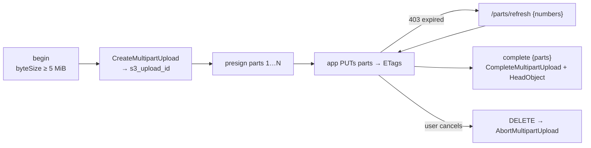

# F07 — Multipart upload (backend)

<dl><dd>

- Sprint [S4](README.md) · 6h · files from 5 MiB upload in 8 MiB parts; expired part URLs are refreshed; an abort frees every part.
- iOS side: [F07 Resumable upload](https://github.com/DAMHONGDUC/site_log_swift_ui/blob/main/docs/feature-guide/S4-resumable-upload/F07-resumable-upload.md). Contract: [01-api §7.2–7.5](../../feature-docs/01-api.md#72-begin). Flow: [03 §2](../../feature-docs/03-sync-uploads-realtime.md#2-uploads).

</dd></dl>

## Contents

<dl><dd>

1. [Overview](#overview)
2. [1. Multipart calls](#1-multipart-calls)
3. [2. Routes](#2-routes)
4. [3. Try it with a big file](#3-try-it-with-a-big-file)
5. [Tests](#tests)
6. [Feature done](#feature-done)

</dd></dl>

## Overview

<dl><dd>

- **Goal:** a 1 GB video survives a kill: parts already sent stay sent, the rest get fresh URLs.
- **Demo:** a 20 MB file in 3 parts with curl; `complete` with the ETags; a refresh returns exactly the parts asked for.

| Step | Hours | Files |
|---|---|---|
| [1](#1-multipart-calls) | 1.5 | `src/storage.ts` |
| [2](#2-routes) | 3 | `src/routes/uploads.ts` |
| [3](#3-try-it-with-a-big-file) | 0.5 | — |
| [Tests](#tests) | 1 | `test/multipart.test.ts` |



</dd></dl>

## 1. Multipart calls

<dl><dd>

<details open>
<summary><strong>1.1 Storage</strong></summary>
<dl><dd>

<b>File</b> · <b class="tag-edit">Edit</b> · `src/storage.ts`

<b>Explain</b> · S3 keeps uploaded parts out of sight until `CompleteMultipartUpload` joins them; the parts must be listed in order with their ETags.

<b>Think</b>

- Why does `completeMultipart` sort the parts? The app may send them in the order they finished.
- Parts of an aborted or never-completed upload cost storage. Which two things remove them? (One is here, one is in the bucket settings.)

```diff
@@ -2,2 +2,4 @@
   AbortMultipartUploadCommand,
+  CompleteMultipartUploadCommand,
+  CreateMultipartUploadCommand,
   DeleteObjectCommand,
@@ -11,2 +13,3 @@
   S3ServiceException,
+  UploadPartCommand,
 } from '@aws-sdk/client-s3';
@@ -25,2 +28,7 @@
 
+export interface CompletedPart {
+  number: number;
+  etag: string;
+}
+
 // S3 says "not there" in three ways depending on the call.
@@ -65,2 +73,38 @@
     return getSignedUrl(this.s3, command, { expiresIn: this.ttlSeconds });
+  }
+
+  async createMultipart(key: string, contentType: string): Promise<string> {
+    const command = new CreateMultipartUploadCommand({
+      Bucket: this.bucket,
+      Key: key,
+      ContentType: contentType,
+    });
+    const result = await this.s3.send(command);
+    if (result.UploadId === undefined) {
+      throw new Error('S3 returned no UploadId');
+    }
+    return result.UploadId;
+  }
+
+  async presignPart(key: string, s3UploadId: string, partNumber: number): Promise<string> {
+    const command = new UploadPartCommand({
+      Bucket: this.bucket,
+      Key: key,
+      UploadId: s3UploadId,
+      PartNumber: partNumber,
+    });
+    return getSignedUrl(this.s3, command, { expiresIn: this.ttlSeconds });
+  }
+
+  async completeMultipart(key: string, s3UploadId: string, parts: CompletedPart[]): Promise<void> {
+    const sorted = [...parts].sort((a, b) => a.number - b.number);
+    const command = new CompleteMultipartUploadCommand({
+      Bucket: this.bucket,
+      Key: key,
+      UploadId: s3UploadId,
+      MultipartUpload: {
+        Parts: sorted.map((part) => ({ PartNumber: part.number, ETag: part.etag })),
+      },
+    });
+    await this.s3.send(command);
   }
```

<details>
<summary><b>Code</b></summary>

```ts
import {
  AbortMultipartUploadCommand,
  CompleteMultipartUploadCommand,
  CreateMultipartUploadCommand,
  DeleteObjectCommand,
  DeleteObjectsCommand,
  GetObjectCommand,
  HeadObjectCommand,
  ListMultipartUploadsCommand,
  ListObjectsV2Command,
  PutObjectCommand,
  S3Client,
  S3ServiceException,
  UploadPartCommand,
} from '@aws-sdk/client-s3';
import { getSignedUrl } from '@aws-sdk/s3-request-presigner';
import type { Readable } from 'node:stream';

export function createS3Client(region: string): S3Client {
  return new S3Client({
    region,
    // Without these, the SDK adds checksum parameters to presigned URLs that the iOS
    // upload does not send, and S3 rejects every PUT.
    requestChecksumCalculation: 'WHEN_REQUIRED',
    responseChecksumValidation: 'WHEN_REQUIRED',
  });
}

export interface CompletedPart {
  number: number;
  etag: string;
}

// S3 says "not there" in three ways depending on the call.
function isMissing(error: unknown): boolean {
  if (!(error instanceof S3ServiceException)) {
    return false;
  }
  if (error.name === 'NotFound' || error.name === 'NoSuchKey' || error.name === 'NoSuchUpload') {
    return true;
  }
  return error.$metadata.httpStatusCode === 404;
}

// Every S3 call the backend makes. The backend never reads or writes file bytes itself,
// except the verify worker, which streams an object back to hash it.
export class Storage {
  private readonly s3: S3Client;
  private readonly bucket: string;
  private readonly ttlSeconds: number;

  constructor(s3: S3Client, bucket: string, ttlSeconds: number) {
    this.s3 = s3;
    this.bucket = bucket;
    this.ttlSeconds = ttlSeconds;
  }

  expiresAt(now: Date): Date {
    return new Date(now.getTime() + this.ttlSeconds * 1000);
  }

  async presignPut(key: string, contentType: string): Promise<string> {
    const command = new PutObjectCommand({
      Bucket: this.bucket,
      Key: key,
      ContentType: contentType,
    });
    return getSignedUrl(this.s3, command, { expiresIn: this.ttlSeconds });
  }

  async presignGet(key: string): Promise<string> {
    const command = new GetObjectCommand({ Bucket: this.bucket, Key: key });
    return getSignedUrl(this.s3, command, { expiresIn: this.ttlSeconds });
  }

  async createMultipart(key: string, contentType: string): Promise<string> {
    const command = new CreateMultipartUploadCommand({
      Bucket: this.bucket,
      Key: key,
      ContentType: contentType,
    });
    const result = await this.s3.send(command);
    if (result.UploadId === undefined) {
      throw new Error('S3 returned no UploadId');
    }
    return result.UploadId;
  }

  async presignPart(key: string, s3UploadId: string, partNumber: number): Promise<string> {
    const command = new UploadPartCommand({
      Bucket: this.bucket,
      Key: key,
      UploadId: s3UploadId,
      PartNumber: partNumber,
    });
    return getSignedUrl(this.s3, command, { expiresIn: this.ttlSeconds });
  }

  async completeMultipart(key: string, s3UploadId: string, parts: CompletedPart[]): Promise<void> {
    const sorted = [...parts].sort((a, b) => a.number - b.number);
    const command = new CompleteMultipartUploadCommand({
      Bucket: this.bucket,
      Key: key,
      UploadId: s3UploadId,
      MultipartUpload: {
        Parts: sorted.map((part) => ({ PartNumber: part.number, ETag: part.etag })),
      },
    });
    await this.s3.send(command);
  }

  // Returns false when there was nothing to abort (already aborted or completed).
  async abortMultipart(key: string, s3UploadId: string): Promise<boolean> {
    try {
      const command = new AbortMultipartUploadCommand({
        Bucket: this.bucket,
        Key: key,
        UploadId: s3UploadId,
      });
      await this.s3.send(command);
      return true;
    } catch (error) {
      if (isMissing(error)) {
        return false;
      }
      throw error;
    }
  }

  // Size of a stored object, or undefined when it does not exist.
  async head(key: string): Promise<number | undefined> {
    try {
      const result = await this.s3.send(new HeadObjectCommand({ Bucket: this.bucket, Key: key }));
      return result.ContentLength;
    } catch (error) {
      if (isMissing(error)) {
        return undefined;
      }
      throw error;
    }
  }

  async deleteObject(key: string): Promise<void> {
    await this.s3.send(new DeleteObjectCommand({ Bucket: this.bucket, Key: key }));
  }

  async readStream(key: string): Promise<Readable> {
    const result = await this.s3.send(new GetObjectCommand({ Bucket: this.bucket, Key: key }));
    return result.Body as Readable;
  }

  // Deletes every object under a prefix, 1000 at a time (the S3 limit per request).
  async deletePrefix(prefix: string): Promise<number> {
    let deleted = 0;
    let token: string | undefined = undefined;
    do {
      const listCommand: ListObjectsV2Command = new ListObjectsV2Command({
        Bucket: this.bucket,
        Prefix: prefix,
        ContinuationToken: token,
      });
      const page = await this.s3.send(listCommand);
      const keys = (page.Contents ?? []).map((object) => ({ Key: object.Key }));
      if (keys.length > 0) {
        await this.s3.send(
          new DeleteObjectsCommand({ Bucket: this.bucket, Delete: { Objects: keys, Quiet: true } }),
        );
        deleted += keys.length;
      }
      token = page.NextContinuationToken;
    } while (token !== undefined);
    return deleted;
  }

  // Aborts unfinished multipart uploads under a prefix so no hidden parts are left behind.
  async abortMultipartUnder(prefix: string): Promise<number> {
    let aborted = 0;
    let keyMarker: string | undefined = undefined;
    let uploadIdMarker: string | undefined = undefined;
    let more = true;
    while (more) {
      const listCommand: ListMultipartUploadsCommand = new ListMultipartUploadsCommand({
        Bucket: this.bucket,
        Prefix: prefix,
        KeyMarker: keyMarker,
        UploadIdMarker: uploadIdMarker,
      });
      const page = await this.s3.send(listCommand);
      for (const upload of page.Uploads ?? []) {
        if (upload.Key !== undefined && upload.UploadId !== undefined) {
          const didAbort = await this.abortMultipart(upload.Key, upload.UploadId);
          if (didAbort) {
            aborted += 1;
          }
        }
      }
      more = page.IsTruncated === true;
      keyMarker = page.NextKeyMarker;
      uploadIdMarker = page.NextUploadIdMarker;
    }
    return aborted;
  }
}
```

</details>

</dd></dl>
</details>

</dd></dl>

## 2. Routes

<dl><dd>

#### Overview

<dl><dd>

| Action | File | Changes |
|---|---|---|
| <b class="tag-edit">Edit</b> | `src/routes/uploads.ts` | Begin picks the mode by size; `POST /uploads/:id/parts/refresh`; `complete` checks and completes the parts; abort calls `AbortMultipartUpload` |

</dd></dl>

#### Steps

<dl><dd>

<details open>
<summary><strong>2.1 Upload routes</strong></summary>
<dl><dd>

<b>File</b> · <b class="tag-edit">Edit</b> · `src/routes/uploads.ts`

<b>Explain</b> · S3 allows 10,000 parts: at 8 MiB that is 78 GiB, above the 20 GiB limit. If `CompleteMultipartUpload` fails because it already succeeded on an earlier try (whose database write failed), `head` finds the object and the route carries on.

<b>Think</b>

- `checkParts` demands every number from 1 to N exactly once. What would S3 do with a missing part number in the middle?
- Why does refresh answer `404`, not `400`, for a completed upload? (What should the app do then?)

<details open>
<summary><b>Hint 1 · Idea</b></summary>

- Begin: `byteSize < threshold` → the F06 single path; else `partCount = ceil(byteSize / partSize)`, `createMultipart`, insert with `s3_upload_id` and `part_count`, presign every part.
- Refresh: the row must be `created` + `multipart` and the caller's; presign each requested number.
- Complete: before `head`, for multipart: `checkParts`, then `completeMultipart`.

</details>

```diff
@@ -9,2 +9,6 @@
 import { notifyUploadEvent } from '../realtime/events.js';
+import type { CompletedPart } from '../storage.js';
+
+// S3 allows at most 10,000 parts per upload.
+const MAX_PARTS = 10_000;
 
@@ -63,2 +67,16 @@
 
+// Every part number from 1 to partCount exactly once.
+function checkParts(parts: CompletedPart[], partCount: number): void {
+  if (parts.length !== partCount) {
+    throw badRequest('invalid_parts', `Expected ${partCount} parts, got ${parts.length}`);
+  }
+  const seen = new Set<number>();
+  for (const part of parts) {
+    if (part.number < 1 || part.number > partCount || seen.has(part.number)) {
+      throw badRequest('invalid_parts', `Bad or repeated part number ${part.number}`);
+    }
+    seen.add(part.number);
+  }
+}
+
 export function uploadRoutes(
@@ -85,3 +103,3 @@
 
-  // 1. Begin: one presigned PUT for the whole file (F07 adds multipart for big files).
+  // 1. Begin: the backend picks single PUT or multipart from the size.
   typed.post(
@@ -109,14 +127,48 @@
 
+      if (byteSize < config.singlePutThresholdBytes) {
+        const inserted = await pool.query<{ id: string }>(
+          `insert into uploads (uid, object_key, project_id, session_id, sha256, byte_size, content_type, mode)
+         values ($1, $2, $3, $4, $5, $6, $7, 'single') returning id`,
+          [request.uid, key, projectId, sessionId, sha256, byteSize, contentType],
+        );
+        const uploadId = inserted.rows[0]!.id;
+        const url = await storage.presignPut(key, contentType);
+        request.log.info(
+          { uid: request.uid, uploadId, key, byteSize, mode: 'single' },
+          'upload begun',
+        );
+        return { mode: 'single', uploadId, url, expiresAt };
+      }
+
+      const partCount = Math.ceil(byteSize / config.partSizeBytes);
+      if (partCount > MAX_PARTS) {
+        throw new AppError(413, 'file_too_large', 'File needs more than 10,000 parts');
+      }
+      const s3UploadId = await storage.createMultipart(key, contentType);
       const inserted = await pool.query<{ id: string }>(
-        `insert into uploads (uid, object_key, project_id, session_id, sha256, byte_size, content_type, mode)
-       values ($1, $2, $3, $4, $5, $6, $7, 'single') returning id`,
-        [request.uid, key, projectId, sessionId, sha256, byteSize, contentType],
+        `insert into uploads
+         (uid, object_key, project_id, session_id, sha256, byte_size, content_type, mode, s3_upload_id, part_count)
+       values ($1, $2, $3, $4, $5, $6, $7, 'multipart', $8, $9) returning id`,
+        [
+          request.uid,
+          key,
+          projectId,
+          sessionId,
+          sha256,
+          byteSize,
+          contentType,
+          s3UploadId,
+          partCount,
+        ],
       );
       const uploadId = inserted.rows[0]!.id;
-      const url = await storage.presignPut(key, contentType);
+      const parts: { number: number; url: string }[] = [];
+      for (let number = 1; number <= partCount; number += 1) {
+        parts.push({ number, url: await storage.presignPart(key, s3UploadId, number) });
+      }
       request.log.info(
-        { uid: request.uid, uploadId, key, byteSize, mode: 'single' },
+        { uid: request.uid, uploadId, key, byteSize, partCount, mode: 'multipart' },
         'upload begun',
       );
-      return { mode: 'single', uploadId, url, expiresAt };
+      return { mode: 'multipart', uploadId, partSizeBytes: config.partSizeBytes, parts, expiresAt };
     },
@@ -125,6 +177,52 @@
   const IdParams = Type.Object({ id: Type.String({ format: 'uuid' }) });
-  // F07 adds the list of uploaded parts here.
-  const CompleteBody = Type.Object({});
-
-  // 2. Complete: confirm the object exists, record it, issue a verification code. Idempotent.
+  const RefreshBody = Type.Object({
+    numbers: Type.Array(Type.Integer({ minimum: 1, maximum: MAX_PARTS }), {
+      minItems: 1,
+      maxItems: 1000,
+    }),
+  });
+
+  // 2. Fresh URLs for parts whose URLs expired (the app was killed for hours).
+  typed.post(
+    '/uploads/:id/parts/refresh',
+    { preHandler: requireUser, schema: { params: IdParams, body: RefreshBody } },
+    async (request) => {
+      const result = await pool.query<UploadRow>(
+        `select * from uploads where id = $1 and uid = $2 and state = 'created' and mode = 'multipart'`,
+        [request.params.id, request.uid],
+      );
+      const upload = result.rows[0];
+      if (upload === undefined) {
+        throw notFound('upload_not_found', 'No open multipart upload with this id');
+      }
+      const parts: { number: number; url: string }[] = [];
+      for (const number of request.body.numbers) {
+        if (number > upload.part_count!) {
+          throw badRequest('invalid_parts', `Part ${number} is past the last part`);
+        }
+        parts.push({
+          number,
+          url: await storage.presignPart(upload.object_key, upload.s3_upload_id!, number),
+        });
+      }
+      request.log.info(
+        { uid: request.uid, uploadId: upload.id, count: parts.length },
+        'upload parts refreshed',
+      );
+      return { parts, expiresAt: storage.expiresAt(new Date()) };
+    },
+  );
+
+  const CompleteBody = Type.Object({
+    parts: Type.Optional(
+      Type.Array(
+        Type.Object({ number: Type.Integer({ minimum: 1 }), etag: Type.String({ minLength: 1 }) }),
+        {
+          maxItems: MAX_PARTS,
+        },
+      ),
+    ),
+  });
+
+  // 3. Complete: confirm the object exists, record it, issue a verification code. Idempotent.
   typed.post(
@@ -143,2 +241,16 @@
             return completedBody(upload);
+          }
+
+          if (upload.mode === 'multipart') {
+            const parts = request.body.parts ?? [];
+            checkParts(parts, upload.part_count!);
+            try {
+              await storage.completeMultipart(upload.object_key, upload.s3_upload_id!, parts);
+            } catch (error) {
+              // S3 may have completed it already on an earlier try whose database write failed.
+              const size = await storage.head(upload.object_key);
+              if (size === undefined) {
+                throw error;
+              }
+            }
           }
@@ -197,3 +309,3 @@
 
-  // 3. Abort: the user cancelled, or the app gave up. Idempotent.
+  // 4. Abort: the user cancelled, or the app gave up. Idempotent.
   typed.delete(
@@ -212,3 +324,7 @@
         if (upload.state === 'created') {
-          await storage.deleteObject(upload.object_key);
+          if (upload.mode === 'multipart') {
+            await storage.abortMultipart(upload.object_key, upload.s3_upload_id!);
+          } else {
+            await storage.deleteObject(upload.object_key);
+          }
           await client.query(`update uploads set state = 'aborted' where id = $1`, [upload.id]);
```

<details>
<summary><b>Code</b></summary>

```ts
import { Type, type TypeBoxTypeProvider } from '@fastify/type-provider-typebox';
import type { FastifyInstance, FastifyRequest, preHandlerAsyncHookHandler } from 'fastify';
import type pg from 'pg';
import type { AppDeps } from '../app.js';
import { newVerificationCode } from '../codes.js';
import { withTransaction } from '../db.js';
import { AppError, badRequest, conflict, notFound } from '../errors.js';
import { ownedKey } from '../keys.js';
import { notifyUploadEvent } from '../realtime/events.js';
import type { CompletedPart } from '../storage.js';

// S3 allows at most 10,000 parts per upload.
const MAX_PARTS = 10_000;

interface UploadRow {
  id: string;
  uid: string;
  object_key: string;
  project_id: string | null;
  session_id: string | null;
  sha256: string;
  byte_size: number;
  content_type: string;
  mode: 'single' | 'multipart';
  s3_upload_id: string | null;
  part_count: number | null;
  state: 'created' | 'completed' | 'aborted';
  verification_code: string | null;
  verify_state: 'registered' | 'verified' | 'mismatch' | null;
  completed_at: Date | null;
}

// The body `complete` returns. A repeated `complete` returns the same body again.
function completedBody(row: UploadRow) {
  return {
    uploadId: row.id,
    remoteKey: row.object_key,
    sha256: row.sha256,
    verificationCode: row.verification_code,
    verified: row.verify_state === 'verified',
    receivedAt: row.completed_at,
  };
}

async function lockUpload(
  client: pg.PoolClient,
  id: string,
  uid: string,
): Promise<UploadRow | undefined> {
  const result = await client.query<UploadRow>(
    'select * from uploads where id = $1 and uid = $2 for update',
    [id, uid],
  );
  return result.rows[0];
}

async function uniqueCode(client: pg.PoolClient): Promise<string> {
  for (let attempt = 0; attempt < 5; attempt += 1) {
    const code = newVerificationCode();
    const taken = await client.query('select 1 from uploads where verification_code = $1', [code]);
    if (taken.rows.length === 0) {
      return code;
    }
  }
  throw new Error('Could not find a free verification code');
}

// Every part number from 1 to partCount exactly once.
function checkParts(parts: CompletedPart[], partCount: number): void {
  if (parts.length !== partCount) {
    throw badRequest('invalid_parts', `Expected ${partCount} parts, got ${parts.length}`);
  }
  const seen = new Set<number>();
  for (const part of parts) {
    if (part.number < 1 || part.number > partCount || seen.has(part.number)) {
      throw badRequest('invalid_parts', `Bad or repeated part number ${part.number}`);
    }
    seen.add(part.number);
  }
}

export function uploadRoutes(
  app: FastifyInstance,
  deps: AppDeps,
  requireUser: preHandlerAsyncHookHandler,
): void {
  const typed = app.withTypeProvider<TypeBoxTypeProvider>();
  const { config, pool, storage } = deps;

  const BeginBody = Type.Object({
    key: Type.String({ minLength: 1, maxLength: 300 }),
    byteSize: Type.Integer({ minimum: 1 }),
    contentType: Type.String({ pattern: '^[a-z]+/[a-z0-9.+-]+$' }),
    sha256: Type.String({ pattern: '^[0-9a-f]{64}$' }),
  });

  // Per signed-in user (the token), so one runaway device cannot flood S3 with uploads.
  const beginLimit = {
    max: config.uploadRateLimitPerMinute,
    timeWindow: '1 minute',
    keyGenerator: (request: FastifyRequest) => request.headers.authorization ?? request.ip,
  };

  // 1. Begin: the backend picks single PUT or multipart from the size.
  typed.post(
    '/uploads',
    { preHandler: requireUser, schema: { body: BeginBody }, config: { rateLimit: beginLimit } },
    async (request) => {
      const { key, byteSize, contentType, sha256 } = request.body;
      const parsed = ownedKey(key, request.uid);
      if (parsed === undefined) {
        throw badRequest('invalid_key', 'Key has the wrong shape or another owner');
      }
      if (byteSize > config.maxUploadBytes) {
        throw new AppError(413, 'file_too_large', 'File is larger than the upload limit');
      }

      let projectId: string | null = null;
      let sessionId: string | null = null;
      if (parsed.kind === 'capture') {
        projectId = parsed.projectId;
        sessionId = parsed.sessionId;
      } else if (parsed.kind === 'plan') {
        projectId = parsed.projectId;
      }
      const expiresAt = storage.expiresAt(new Date());

      if (byteSize < config.singlePutThresholdBytes) {
        const inserted = await pool.query<{ id: string }>(
          `insert into uploads (uid, object_key, project_id, session_id, sha256, byte_size, content_type, mode)
         values ($1, $2, $3, $4, $5, $6, $7, 'single') returning id`,
          [request.uid, key, projectId, sessionId, sha256, byteSize, contentType],
        );
        const uploadId = inserted.rows[0]!.id;
        const url = await storage.presignPut(key, contentType);
        request.log.info(
          { uid: request.uid, uploadId, key, byteSize, mode: 'single' },
          'upload begun',
        );
        return { mode: 'single', uploadId, url, expiresAt };
      }

      const partCount = Math.ceil(byteSize / config.partSizeBytes);
      if (partCount > MAX_PARTS) {
        throw new AppError(413, 'file_too_large', 'File needs more than 10,000 parts');
      }
      const s3UploadId = await storage.createMultipart(key, contentType);
      const inserted = await pool.query<{ id: string }>(
        `insert into uploads
         (uid, object_key, project_id, session_id, sha256, byte_size, content_type, mode, s3_upload_id, part_count)
       values ($1, $2, $3, $4, $5, $6, $7, 'multipart', $8, $9) returning id`,
        [
          request.uid,
          key,
          projectId,
          sessionId,
          sha256,
          byteSize,
          contentType,
          s3UploadId,
          partCount,
        ],
      );
      const uploadId = inserted.rows[0]!.id;
      const parts: { number: number; url: string }[] = [];
      for (let number = 1; number <= partCount; number += 1) {
        parts.push({ number, url: await storage.presignPart(key, s3UploadId, number) });
      }
      request.log.info(
        { uid: request.uid, uploadId, key, byteSize, partCount, mode: 'multipart' },
        'upload begun',
      );
      return { mode: 'multipart', uploadId, partSizeBytes: config.partSizeBytes, parts, expiresAt };
    },
  );

  const IdParams = Type.Object({ id: Type.String({ format: 'uuid' }) });
  const RefreshBody = Type.Object({
    numbers: Type.Array(Type.Integer({ minimum: 1, maximum: MAX_PARTS }), {
      minItems: 1,
      maxItems: 1000,
    }),
  });

  // 2. Fresh URLs for parts whose URLs expired (the app was killed for hours).
  typed.post(
    '/uploads/:id/parts/refresh',
    { preHandler: requireUser, schema: { params: IdParams, body: RefreshBody } },
    async (request) => {
      const result = await pool.query<UploadRow>(
        `select * from uploads where id = $1 and uid = $2 and state = 'created' and mode = 'multipart'`,
        [request.params.id, request.uid],
      );
      const upload = result.rows[0];
      if (upload === undefined) {
        throw notFound('upload_not_found', 'No open multipart upload with this id');
      }
      const parts: { number: number; url: string }[] = [];
      for (const number of request.body.numbers) {
        if (number > upload.part_count!) {
          throw badRequest('invalid_parts', `Part ${number} is past the last part`);
        }
        parts.push({
          number,
          url: await storage.presignPart(upload.object_key, upload.s3_upload_id!, number),
        });
      }
      request.log.info(
        { uid: request.uid, uploadId: upload.id, count: parts.length },
        'upload parts refreshed',
      );
      return { parts, expiresAt: storage.expiresAt(new Date()) };
    },
  );

  const CompleteBody = Type.Object({
    parts: Type.Optional(
      Type.Array(
        Type.Object({ number: Type.Integer({ minimum: 1 }), etag: Type.String({ minLength: 1 }) }),
        {
          maxItems: MAX_PARTS,
        },
      ),
    ),
  });

  // 3. Complete: confirm the object exists, record it, issue a verification code. Idempotent.
  typed.post(
    '/uploads/:id/complete',
    { preHandler: requireUser, schema: { params: IdParams, body: CompleteBody } },
    async (request) => {
      const uid = request.uid;
      try {
        return await withTransaction(pool, async (client) => {
          const upload = await lockUpload(client, request.params.id, uid);
          if (upload === undefined || upload.state === 'aborted') {
            throw notFound('upload_not_found', 'No such upload, or it was aborted');
          }
          if (upload.state === 'completed') {
            // A retry after a lost response: same answer as the first time.
            return completedBody(upload);
          }

          if (upload.mode === 'multipart') {
            const parts = request.body.parts ?? [];
            checkParts(parts, upload.part_count!);
            try {
              await storage.completeMultipart(upload.object_key, upload.s3_upload_id!, parts);
            } catch (error) {
              // S3 may have completed it already on an earlier try whose database write failed.
              const size = await storage.head(upload.object_key);
              if (size === undefined) {
                throw error;
              }
            }
          }

          const size = await storage.head(upload.object_key);
          if (size === undefined) {
            throw notFound('object_not_found', 'Nothing was uploaded for this key');
          }
          if (size !== upload.byte_size) {
            throw badRequest('size_mismatch', `Stored ${size} bytes, expected ${upload.byte_size}`);
          }

          const code = await uniqueCode(client);
          const updated = await client.query<UploadRow>(
            `update uploads
                set state = 'completed', completed_at = now(),
                    verification_code = $2, verify_state = 'registered'
              where id = $1
          returning *`,
            [upload.id, code],
          );
          const row = updated.rows[0]!;
          await notifyUploadEvent(client, {
            uid,
            sessionId: row.session_id,
            uploadId: row.id,
            type: 'completed',
          });
          request.log.info(
            { uid, uploadId: row.id, key: row.object_key, byteSize: row.byte_size },
            'upload completed',
          );
          return completedBody(row);
        });
      } catch (error) {
        if ((error as { code?: string }).code === '23505') {
          // Another upload of the same key completed first.
          const existing = await pool.query<UploadRow>(
            `select u.* from uploads u
               join uploads mine on mine.object_key = u.object_key and mine.uid = u.uid
              where mine.id = $1 and u.uid = $2 and u.state = 'completed'`,
            [request.params.id, uid],
          );
          if (existing.rows[0] !== undefined) {
            throw conflict(
              'already_completed',
              'This key was already uploaded',
              completedBody(existing.rows[0]),
            );
          }
        }
        throw error;
      }
    },
  );

  // 4. Abort: the user cancelled, or the app gave up. Idempotent.
  typed.delete(
    '/uploads/:id',
    { preHandler: requireUser, schema: { params: IdParams } },
    async (request) => {
      const uid = request.uid;
      return withTransaction(pool, async (client) => {
        const upload = await lockUpload(client, request.params.id, uid);
        if (upload === undefined) {
          throw notFound('upload_not_found', 'No such upload');
        }
        if (upload.state === 'completed') {
          throw conflict('already_completed', 'A completed upload cannot be aborted');
        }
        if (upload.state === 'created') {
          if (upload.mode === 'multipart') {
            await storage.abortMultipart(upload.object_key, upload.s3_upload_id!);
          } else {
            await storage.deleteObject(upload.object_key);
          }
          await client.query(`update uploads set state = 'aborted' where id = $1`, [upload.id]);
          await notifyUploadEvent(client, {
            uid,
            sessionId: upload.session_id,
            uploadId: upload.id,
            type: 'aborted',
          });
          request.log.info({ uid, uploadId: upload.id }, 'upload aborted');
        }
        return { uploadId: upload.id, aborted: true };
      });
    },
  );
}
```

</details>

</dd></dl>
</details>

</dd></dl>

</dd></dl>

## 3. Try it with a big file

<dl><dd>

- Make a 20 MB test file, split it into 8 MiB parts, PUT each part, collect the ETags.

```bash
FILE=/tmp/big.mov && mkfile -n 20m $FILE && rm -f /tmp/part-* && split -b 8388608 $FILE /tmp/part-
```

```bash
KEY="$FUID/11111111-1111-4111-8111-111111111111/33333333-3333-4333-8333-333333333333/55555555-5555-4555-8555-555555555555.mov"
```

```bash
BEGIN=$(curl -s localhost:3000/uploads -H "Authorization: Bearer $TOKEN" -H 'content-type: application/json' -d "{\"key\":\"$KEY\",\"byteSize\":$(stat -f%z $FILE),\"contentType\":\"video/quicktime\",\"sha256\":\"$(shasum -a 256 $FILE | cut -d' ' -f1)\"}") && echo $BEGIN | jq '{mode, uploadId, parts: (.parts | length)}'
```

```bash
PARTS='[]'; n=1; for f in /tmp/part-*; do URL=$(echo $BEGIN | jq -r ".parts[$((n-1))].url"); ETAG=$(curl -s -D - -o /dev/null -X PUT --upload-file $f "$URL" | grep -i '^etag' | cut -d' ' -f2 | tr -d '\r'); PARTS=$(echo $PARTS | jq ". + [{number: $n, etag: $ETAG}]"); n=$((n+1)); done; echo $PARTS
```

```bash
curl -s -X POST localhost:3000/uploads/$(echo $BEGIN | jq -r .uploadId)/complete -H "Authorization: Bearer $TOKEN" -H 'content-type: application/json' -d "{\"parts\": $PARTS}" | jq
```

- Parts carry no `Content-Type`: the signature of a part URL does not include it.

<b>Try</b>

- Before `complete`, ask for new URLs for parts 2 and 3 with `/parts/refresh`; PUT part 2 again with its new URL: S3 accepts it and its ETag is the same (same bytes).

</dd></dl>

## Tests

<dl><dd>

<details open>
<summary><strong>Test file</strong></summary>
<dl><dd>

<b>File</b> · <b class="tag-new">New</b> · `test/multipart.test.ts`

<details>
<summary><b>Code</b></summary>

```ts
import {
  AbortMultipartUploadCommand,
  CompleteMultipartUploadCommand,
  CreateMultipartUploadCommand,
  HeadObjectCommand,
} from '@aws-sdk/client-s3';
import { afterAll, beforeAll, beforeEach, describe, expect, it } from 'vitest';
import {
  auth,
  closeTestContext,
  createTestContext,
  resetDatabase,
  type TestContext,
} from './helpers.js';
import { MiB, beginUpload, completeUpload } from './upload-helpers.js';

describe('uploads: multipart', () => {
  let context: TestContext;
  beforeAll(async () => {
    context = await createTestContext();
  });
  afterAll(async () => {
    await closeTestContext(context);
  });
  beforeEach(async () => {
    await resetDatabase(context.pool);
    context.s3.reset();
    context.s3.on(CreateMultipartUploadCommand).resolves({ UploadId: 's3-upload-1' });
  });

  it('picks single PUT below 5 MiB and 8 MiB parts from 5 MiB', async () => {
    const below = await beginUpload(context, 5 * MiB - 1);
    expect(below.json().mode).toBe('single');

    const at = await beginUpload(context, 5 * MiB);
    expect(at.json().mode).toBe('multipart');
    expect(at.json().partSizeBytes).toBe(8 * MiB);
    expect(at.json().parts).toHaveLength(1);

    const big = await beginUpload(context, 240 * MiB);
    expect(big.json().parts).toHaveLength(30);
  });

  it('completes only with every part, and passes the ETags to S3', async () => {
    context.s3.on(CompleteMultipartUploadCommand).resolves({});
    context.s3.on(HeadObjectCommand).resolves({ ContentLength: 20 * MiB });
    const begun = await beginUpload(context, 20 * MiB);
    const uploadId = begun.json().uploadId;

    const missingPart = await completeUpload(context, uploadId, [{ number: 1, etag: '"a"' }]);
    expect(missingPart.statusCode).toBe(400);

    const done = await completeUpload(context, uploadId, [
      { number: 3, etag: '"c"' },
      { number: 1, etag: '"a"' },
      { number: 2, etag: '"b"' },
    ]);
    expect(done.statusCode).toBe(200);
    const sent = context.s3.commandCalls(CompleteMultipartUploadCommand)[0]!.args[0].input;
    expect(sent.UploadId).toBe('s3-upload-1');
    expect(sent.MultipartUpload!.Parts!.map((part) => part.PartNumber)).toEqual([1, 2, 3]);
  });

  it('refreshes exactly the requested parts, for the owner only', async () => {
    const begun = await beginUpload(context, 40 * MiB);
    const url = `/uploads/${begun.json().uploadId}/parts/refresh`;
    const response = await context.app.inject({
      method: 'POST',
      url,
      headers: auth('alice'),
      payload: { numbers: [2, 5] },
    });
    expect(response.statusCode).toBe(200);
    expect(response.json().parts.map((part: { number: number }) => part.number)).toEqual([2, 5]);
    expect(response.json().parts[0].url).toContain('partNumber=2');

    const past = await context.app.inject({
      method: 'POST',
      url,
      headers: auth('alice'),
      payload: { numbers: [6] },
    });
    expect(past.statusCode).toBe(400);

    const theirs = await context.app.inject({
      method: 'POST',
      url,
      headers: auth('bob'),
      payload: { numbers: [1] },
    });
    expect(theirs.statusCode).toBe(404);
  });

  it('aborts in S3, stays aborted, and never completes', async () => {
    context.s3.on(AbortMultipartUploadCommand).resolves({});
    const begun = await beginUpload(context, 40 * MiB);
    const uploadId = begun.json().uploadId;
    const aborted = await context.app.inject({
      method: 'DELETE',
      url: `/uploads/${uploadId}`,
      headers: auth('alice'),
    });
    expect(aborted.statusCode).toBe(200);
    expect(context.s3.commandCalls(AbortMultipartUploadCommand)).toHaveLength(1);

    const again = await context.app.inject({
      method: 'DELETE',
      url: `/uploads/${uploadId}`,
      headers: auth('alice'),
    });
    expect(again.statusCode).toBe(200);

    const late = await completeUpload(context, uploadId, []);
    expect(late.statusCode).toBe(404);
  });
});
```

</details>

```bash
npm test
```

</dd></dl>
</details>

</dd></dl>

## Feature done

<dl><dd>

- [ ] 5 MiB − 1 → single; 5 MiB → multipart with 1 part; 240 MiB → 30 parts
- [ ] The 20 MB curl demo completes; `aws s3 ls s3://<dev bucket>/<uid>/ --recursive` shows the file
- [ ] An aborted upload never completes; refresh is only for the owner
- [ ] `npm test` green (47 tests)
- [ ] iOS F07 demo: kill the app mid-video, relaunch hours later, it finishes without re-sending done parts

</dd></dl>
