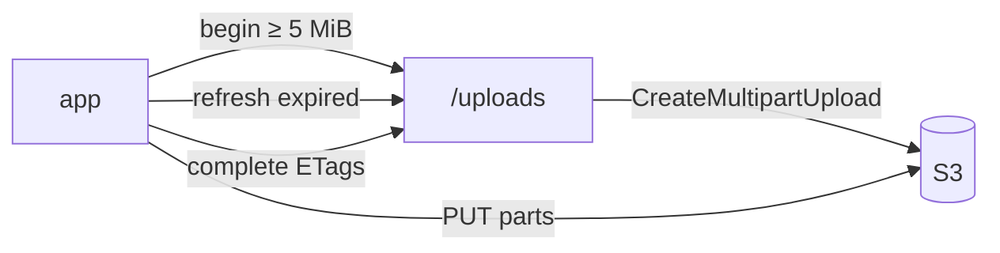

# S4 — Resumable upload · TestFlight #1

<dl><dd>

- Sprint 4 · 2 weeks · backend 6h of the sprint's 47h · [all sprints](../README.md) · iOS side: [S4 iOS](https://github.com/DAMHONGDUC/site_log_swift_ui/blob/main/docs/feature-guide/S4-resumable-upload/README.md)

</dd></dl>

## Contents

<dl><dd>

1. [Overview](#overview)
2. [Tasks](#tasks)
3. [Done](#done)
4. [Self-check](#self-check)

</dd></dl>

## Overview

<dl><dd>

- **Goal:** big files upload in parts and resume after a kill; staging is ready for the first TestFlight testers.
- **Demo:** a 1 GB video from the app, killed at 40 %, relaunched later, finishes against staging.

| Guide | Builds | Hours |
|---|---|---|
| [F07 Multipart](F07-multipart.md) | Multipart begin, refresh, complete, abort | 6 |

</dd></dl>

## Tasks

<dl><dd>

| Task | What | Guide | Hours | Status |
|---|---|---|---|---|
| F07.1 | Multipart calls in `storage.ts` | [F07 §1](F07-multipart.md#1-multipart-calls) | 1.5 | not start |
| F07.2 | Begin by size, refresh, complete parts, abort | [F07 §2](F07-multipart.md#2-routes) | 3 | not start |
| F07.3 | Big-file demo, tests | [F07 §3](F07-multipart.md#3-try-it-with-a-big-file) | 1.5 | not start |

</dd></dl>

## Done

<dl><dd>

- [ ] `npm test` green; staging deployed
- [ ] The kill-and-resume demo passes on a real iPhone against staging
- [ ] Testers' uploads appear in the staging bucket under their uid

</dd></dl>

## Self-check

<dl><dd>

- The app was killed for 3 hours. Which calls does it make, in order, to finish a 30-part upload with 12 parts done?
- Why does the backend never need a `parts` table?

</dd></dl>
