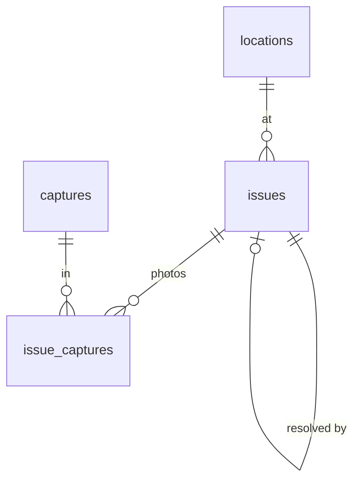

# F08 — Issues (backend)

<dl><dd>

- Sprint [S5](README.md) · 2h · issues, the photos attached to them, and saved phrases sync.
- iOS side: [F08 Issues](https://github.com/DAMHONGDUC/site_log_swift_ui/blob/main/docs/feature-guide/S5-issues-markup/F08-issues.md). Contract: [01-api §6.3](../../feature-docs/01-api.md#63-synced-tables).

</dd></dl>

## Contents

<dl><dd>

1. [Overview](#overview)
2. [1. Migration and registry](#1-migration-and-registry)
3. [Tests](#tests)
4. [Feature done](#feature-done)

</dd></dl>

## Overview

<dl><dd>

- **Goal:** three tables; a pin is all-or-nothing; the same phrase typed on two devices becomes one row.
- **Demo:** push an issue with a due date → pull returns `"dueDate":"2026-11-20"` (no time, no zone).

| Action | File | Holds |
|---|---|---|
| <b class="tag-new">New</b> | `migrations/0005_issues.sql` | `issues` (severity, status and pin checks), `issue_captures`, `phrases` |
| <b class="tag-edit">Edit</b> | `src/sync/tables.ts` | Three entries; `issue_captures` and `phrases` have a natural key |
| <b class="tag-new">New</b> | `test/issues.test.ts` | Date, bad severity, half pin, phrase merge |



- `plan_sheet_id` and `source_checklist_result_id` exist now; their foreign keys arrive with their tables (F11, F12).

</dd></dl>

## 1. Migration and registry

<dl><dd>

<details open>
<summary><strong>1.1 Migration</strong></summary>
<dl><dd>

<b>File</b> · <b class="tag-new">New</b> · `migrations/0005_issues.sql`

<b>Think</b>

- `issues.status` uses `inProgress` (camelCase) inside SQL. Why keep the app's spelling instead of `in_progress`?
- Why can `phrases` not use `(uid, text)` as its primary key, although that is what makes a phrase unique?

<details>
<summary><b>Code</b></summary>

```sql
-- F08: issues, the photos attached to them, and saved phrases for quick typing.
create table issues (
    id                         uuid primary key,
    uid                        text not null,
    rev                        bigint not null,
    client_updated_at          timestamptz not null,
    deleted_at                 timestamptz,
    project_id                 uuid not null,
    location_id                uuid not null,
    title                      text not null,
    detail                     text not null,
    severity                   text not null check (severity in ('critical', 'major', 'minor')),
    status                     text not null check (status in ('open', 'inProgress', 'resolved', 'verified')),
    due_date                   date,
    assignee_name              text,
    trade                      text,
    plan_sheet_id              uuid,
    pin_x                      double precision,
    pin_y                      double precision,
    resolved_by_issue_id       uuid,
    source_checklist_result_id uuid,
    unique (uid, id),
    -- a pin is a sheet plus a point inside it (0…1), or nothing at all
    check (
        (plan_sheet_id is null and pin_x is null and pin_y is null)
        or (plan_sheet_id is not null and pin_x between 0 and 1 and pin_y between 0 and 1)
    ),
    foreign key (uid, project_id) references projects (uid, id) deferrable initially deferred,
    foreign key (uid, location_id) references locations (uid, id) deferrable initially deferred,
    foreign key (uid, resolved_by_issue_id) references issues (uid, id) deferrable initially deferred
);
create index issues_uid_rev on issues (uid, rev);

create table issue_captures (
    id                uuid primary key,
    uid               text not null,
    rev               bigint not null,
    client_updated_at timestamptz not null,
    deleted_at        timestamptz,
    issue_id          uuid not null,
    capture_id        uuid not null,
    foreign key (uid, issue_id) references issues (uid, id) deferrable initially deferred,
    foreign key (uid, capture_id) references captures (uid, id) deferrable initially deferred
);
create index issue_captures_uid_rev on issue_captures (uid, rev);
create unique index issue_captures_pair_live on issue_captures (issue_id, capture_id)
    where deleted_at is null;

create table phrases (
    id                uuid primary key,
    uid               text not null,
    rev               bigint not null,
    client_updated_at timestamptz not null,
    deleted_at        timestamptz,
    text              text not null,
    usage_count       integer not null
);
create index phrases_uid_rev on phrases (uid, rev);
create unique index phrases_text_live on phrases (uid, text) where deleted_at is null;
```

</details>

</dd></dl>
</details>

<details open>
<summary><strong>1.2 Registry</strong></summary>
<dl><dd>

<b>File</b> · <b class="tag-edit">Edit</b> · `src/sync/tables.ts`

<b>Explain</b> · `naturalKey: ['text']` tells push: when a new phrase id collides with a live phrase of the same text, answer `superseded` with the stored row, so the device adopts it.

```diff
@@ -82,2 +82,24 @@
   ),
+  // F08
+  table('issues', [
+    'project_id',
+    'location_id',
+    'title',
+    'detail',
+    'severity',
+    'status',
+    'due_date',
+    'assignee_name',
+    'trade',
+    'plan_sheet_id',
+    'pin_x',
+    'pin_y',
+    'resolved_by_issue_id',
+    'source_checklist_result_id',
+  ]),
+  table('issue_captures', ['issue_id', 'capture_id'], {
+    immutable: ['issue_id', 'capture_id'],
+    naturalKey: ['issue_id', 'capture_id'],
+  }),
+  table('phrases', ['text', 'usage_count'], { immutable: ['text'], naturalKey: ['text'] }),
 ];
```

<details>
<summary><b>Code</b></summary>

```ts
// Every table the app may pull and push. A feature that adds a synced table adds it here.

export interface SyncTable {
  // SQL table name, also the `table` value in a mutation.
  name: string;
  // Business columns (snake_case) the app sends on every upsert, as a full row.
  columns: string[];
  // Kept from the first insert; later values are ignored (evidence must not change).
  immutable: string[];
  // Enum columns that only move forward, whatever the timestamps say.
  monotonic: string[];
  // A second unique key besides id (uid is always part of it). A new row that collides
  // with a live row on it loses: the app adopts the stored row. null = no such key.
  naturalKey: string[] | null;
}

function table(
  name: string,
  columns: string[],
  options: { immutable?: string[]; monotonic?: string[]; naturalKey?: string[] | null } = {},
): SyncTable {
  return {
    name,
    columns,
    immutable: options.immutable ?? [],
    monotonic: options.monotonic ?? [],
    naturalKey: options.naturalKey ?? null,
  };
}

export const syncTables: SyncTable[] = [
  // F03
  table('projects', ['name', 'address', 'client_name', 'created_at'], {
    immutable: ['created_at'],
  }),
  table('locations', ['project_id', 'parent_id', 'code', 'kind', 'sort_index'], {
    immutable: ['project_id'],
  }),
  table('sessions', ['project_id', 'started_at', 'ended_at', 'surveyor_name', 'note', 'state'], {
    immutable: ['project_id', 'started_at'],
    monotonic: ['state'],
  }),
  // F05: evidence columns never change after the first insert.
  table(
    'captures',
    [
      'project_id',
      'session_id',
      'location_id',
      'kind',
      'sha256',
      'byte_size',
      'captured_at',
      'time_confidence',
      'latitude',
      'longitude',
      'horizontal_accuracy',
      'device_model',
      'duration_seconds',
      'device_reading',
      'remote_key',
      'verification_code',
      'excluded_from_report',
    ],
    {
      immutable: [
        'project_id',
        'session_id',
        'kind',
        'sha256',
        'byte_size',
        'captured_at',
        'time_confidence',
        'latitude',
        'longitude',
        'horizontal_accuracy',
        'device_model',
        'duration_seconds',
        'device_reading',
      ],
    },
  ),
  // F08
  table('issues', [
    'project_id',
    'location_id',
    'title',
    'detail',
    'severity',
    'status',
    'due_date',
    'assignee_name',
    'trade',
    'plan_sheet_id',
    'pin_x',
    'pin_y',
    'resolved_by_issue_id',
    'source_checklist_result_id',
  ]),
  table('issue_captures', ['issue_id', 'capture_id'], {
    immutable: ['issue_id', 'capture_id'],
    naturalKey: ['issue_id', 'capture_id'],
  }),
  table('phrases', ['text', 'usage_count'], { immutable: ['text'], naturalKey: ['text'] }),
];

export function findSyncTable(name: string): SyncTable | undefined {
  return syncTables.find((candidate) => candidate.name === name);
}
```

</details>

```bash
npm run migrate
```

</dd></dl>
</details>

</dd></dl>

## Tests

<dl><dd>

<details open>
<summary><strong>Test file</strong></summary>
<dl><dd>

<b>File</b> · <b class="tag-new">New</b> · `test/issues.test.ts`

<details>
<summary><b>Code</b></summary>

```ts
import { afterAll, beforeAll, beforeEach, describe, expect, it } from 'vitest';
import {
  closeTestContext,
  createTestContext,
  ids,
  resetDatabase,
  type TestContext,
} from './helpers.js';
import { pushAs, seedProject } from './sync-helpers.js';

const issueId = '12121212-1212-4212-8212-121212121212';

function issueMutation(fields: Record<string, unknown> = {}) {
  return {
    table: 'issues',
    id: issueId,
    op: 'upsert',
    clientUpdatedAt: '2026-11-01T09:00:00.000Z',
    fields: {
      projectId: ids.project,
      locationId: ids.location,
      title: 'Crack in slab',
      detail: '',
      severity: 'major',
      status: 'open',
      dueDate: '2026-11-20',
      assigneeName: null,
      trade: null,
      planSheetId: null,
      pinX: null,
      pinY: null,
      resolvedByIssueId: null,
      sourceChecklistResultId: null,
      ...fields,
    },
  };
}

function phraseMutation(id: string) {
  return {
    table: 'phrases',
    id,
    op: 'upsert',
    clientUpdatedAt: '2026-11-01T08:00:00.000Z',
    fields: { text: 'Crack in slab', usageCount: 1 },
  };
}

describe('issues and phrases', () => {
  let context: TestContext;
  beforeAll(async () => {
    context = await createTestContext();
  });
  afterAll(async () => {
    await closeTestContext(context);
  });
  beforeEach(async () => {
    await resetDatabase(context.pool);
    await seedProject(context);
  });

  it('stores an issue with a plain date', async () => {
    const result = await pushAs(context, 'alice', [issueMutation()]);
    expect(result.results[0].status).toBe('applied');
    const row = await context.pool.query('select due_date from issues');
    expect(row.rows[0].due_date).toBe('2026-11-20');
  });

  it('rejects an unknown severity and a half pin', async () => {
    const badSeverity = await pushAs(context, 'alice', [issueMutation({ severity: 'huge' })]);
    expect(badSeverity.results[0].reason).toBe('invalid_row:23514');
    const halfPin = await pushAs(context, 'alice', [issueMutation({ pinX: 0.5 })]);
    expect(halfPin.results[0].reason).toBe('invalid_row:23514');
  });

  it('merges a phrase typed on two devices into one row', async () => {
    await pushAs(context, 'alice', [phraseMutation('99999999-9999-4999-8999-999999999991')]);
    const result = await pushAs(context, 'alice', [
      phraseMutation('99999999-9999-4999-8999-999999999992'),
    ]);
    expect(result.results[0].status).toBe('superseded');
    expect(result.results[0].serverRow.id).toBe('99999999-9999-4999-8999-999999999991');
  });
});
```

</details>

```bash
npm test
```

</dd></dl>
</details>

</dd></dl>

## Feature done

<dl><dd>

- [ ] A half pin and an unknown severity are rejected with `invalid_row:23514`
- [ ] A phrase typed on two devices ends as one row
- [ ] `npm test` green (50 tests)

</dd></dl>
