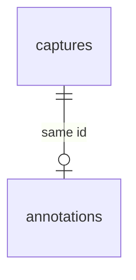

# F09 — Annotations (backend)

<dl><dd>

- Sprint [S5](README.md) · 1h · the vector markup layer of a photo syncs as JSON.
- iOS side: [F09 Markup](https://github.com/DAMHONGDUC/site_log_swift_ui/blob/main/docs/feature-guide/S5-issues-markup/F09-markup.md). Contract: [01-api §6.3](../../feature-docs/01-api.md#63-synced-tables).

</dd></dl>

## Contents

<dl><dd>

1. [Overview](#overview)
2. [1. Migration and registry](#1-migration-and-registry)
3. [Tests](#tests)
4. [Feature done](#feature-done)

</dd></dl>

## Overview

<dl><dd>

- **Goal:** one `annotations` row per capture, its id **is** the capture id; `shapes` is stored as `jsonb`, returned as sent.
- **Demo:** push a capture and its annotation in one batch; pull returns the same `shapes` array.

| Action | File | Holds |
|---|---|---|
| <b class="tag-new">New</b> | `migrations/0006_annotations.sql` | `annotations (id = capture id, shapes jsonb)` |
| <b class="tag-edit">Edit</b> | `src/sync/tables.ts` | `annotations` entry |
| <b class="tag-new">New</b> | `test/annotations.test.ts` | Round trip, layer without a photo |



</dd></dl>

## 1. Migration and registry

<dl><dd>

<details open>
<summary><strong>1.1 Migration</strong></summary>
<dl><dd>

<b>File</b> · <b class="tag-new">New</b> · `migrations/0006_annotations.sql`

<b>Think</b>

- The foreign key is `(uid, id) → captures (uid, id)`. What does that give for free, compared with a separate `capture_id` column?
- The server never reads inside `shapes`. Why is `jsonb` still better than `text`?

<details>
<summary><b>Code</b></summary>

```sql
-- F09: the vector markup drawn on a capture. One row per capture: id is the capture id.
create table annotations (
    id                uuid primary key,
    uid               text not null,
    rev               bigint not null,
    client_updated_at timestamptz not null,
    deleted_at        timestamptz,
    shapes            jsonb not null,
    foreign key (uid, id) references captures (uid, id) deferrable initially deferred
);
create index annotations_uid_rev on annotations (uid, rev);
```

</details>

</dd></dl>
</details>

<details open>
<summary><strong>1.2 Registry</strong></summary>
<dl><dd>

<b>File</b> · <b class="tag-edit">Edit</b> · `src/sync/tables.ts`

```diff
@@ -104,2 +104,4 @@
   table('phrases', ['text', 'usage_count'], { immutable: ['text'], naturalKey: ['text'] }),
+  // F09
+  table('annotations', ['shapes']),
 ];
```

<details>
<summary><b>Code</b></summary>

```ts
// Every table the app may pull and push. A feature that adds a synced table adds it here.

export interface SyncTable {
  // SQL table name, also the `table` value in a mutation.
  name: string;
  // Business columns (snake_case) the app sends on every upsert, as a full row.
  columns: string[];
  // Kept from the first insert; later values are ignored (evidence must not change).
  immutable: string[];
  // Enum columns that only move forward, whatever the timestamps say.
  monotonic: string[];
  // A second unique key besides id (uid is always part of it). A new row that collides
  // with a live row on it loses: the app adopts the stored row. null = no such key.
  naturalKey: string[] | null;
}

function table(
  name: string,
  columns: string[],
  options: { immutable?: string[]; monotonic?: string[]; naturalKey?: string[] | null } = {},
): SyncTable {
  return {
    name,
    columns,
    immutable: options.immutable ?? [],
    monotonic: options.monotonic ?? [],
    naturalKey: options.naturalKey ?? null,
  };
}

export const syncTables: SyncTable[] = [
  // F03
  table('projects', ['name', 'address', 'client_name', 'created_at'], {
    immutable: ['created_at'],
  }),
  table('locations', ['project_id', 'parent_id', 'code', 'kind', 'sort_index'], {
    immutable: ['project_id'],
  }),
  table('sessions', ['project_id', 'started_at', 'ended_at', 'surveyor_name', 'note', 'state'], {
    immutable: ['project_id', 'started_at'],
    monotonic: ['state'],
  }),
  // F05: evidence columns never change after the first insert.
  table(
    'captures',
    [
      'project_id',
      'session_id',
      'location_id',
      'kind',
      'sha256',
      'byte_size',
      'captured_at',
      'time_confidence',
      'latitude',
      'longitude',
      'horizontal_accuracy',
      'device_model',
      'duration_seconds',
      'device_reading',
      'remote_key',
      'verification_code',
      'excluded_from_report',
    ],
    {
      immutable: [
        'project_id',
        'session_id',
        'kind',
        'sha256',
        'byte_size',
        'captured_at',
        'time_confidence',
        'latitude',
        'longitude',
        'horizontal_accuracy',
        'device_model',
        'duration_seconds',
        'device_reading',
      ],
    },
  ),
  // F08
  table('issues', [
    'project_id',
    'location_id',
    'title',
    'detail',
    'severity',
    'status',
    'due_date',
    'assignee_name',
    'trade',
    'plan_sheet_id',
    'pin_x',
    'pin_y',
    'resolved_by_issue_id',
    'source_checklist_result_id',
  ]),
  table('issue_captures', ['issue_id', 'capture_id'], {
    immutable: ['issue_id', 'capture_id'],
    naturalKey: ['issue_id', 'capture_id'],
  }),
  table('phrases', ['text', 'usage_count'], { immutable: ['text'], naturalKey: ['text'] }),
  // F09
  table('annotations', ['shapes']),
];

export function findSyncTable(name: string): SyncTable | undefined {
  return syncTables.find((candidate) => candidate.name === name);
}
```

</details>

```bash
npm run migrate
```

</dd></dl>
</details>

</dd></dl>

## Tests

<dl><dd>

<details open>
<summary><strong>Test file</strong></summary>
<dl><dd>

<b>File</b> · <b class="tag-new">New</b> · `test/annotations.test.ts`

<details>
<summary><b>Code</b></summary>

```ts
import { afterAll, beforeAll, beforeEach, describe, expect, it } from 'vitest';
import {
  closeTestContext,
  createTestContext,
  ids,
  resetDatabase,
  sha,
  type TestContext,
} from './helpers.js';
import { captureMutation, pullAs, pushAs, seedProject } from './sync-helpers.js';

function annotationMutation(clientUpdatedAt: string, shapes: object[]) {
  // The annotation id is the capture id: one layer per photo.
  return {
    table: 'annotations',
    id: ids.capture,
    op: 'upsert',
    clientUpdatedAt,
    fields: { shapes },
  };
}

describe('annotations', () => {
  let context: TestContext;
  beforeAll(async () => {
    context = await createTestContext();
  });
  afterAll(async () => {
    await closeTestContext(context);
  });
  beforeEach(async () => {
    await resetDatabase(context.pool);
    await seedProject(context);
  });

  it('stores shapes as JSON and returns them as sent', async () => {
    const shapes = [{ kind: 'arrow', from: [0.1, 0.2], to: [0.4, 0.5], color: '#FF3B30' }];
    await pushAs(context, 'alice', [
      captureMutation('2026-11-01T08:05:00.000Z', sha),
      annotationMutation('2026-11-01T08:06:00.000Z', shapes),
    ]);
    const pulled = await pullAs(context, 'alice', 0);
    expect(pulled.changes.annotations[0].shapes).toEqual(shapes);
  });

  it('rejects a layer for a photo that does not exist', async () => {
    const result = await pushAs(context, 'alice', [
      annotationMutation('2026-11-01T08:06:00.000Z', []),
    ]);
    expect(result.results[0]).toEqual({
      id: ids.capture,
      status: 'rejected',
      reason: 'missing_parent',
    });
  });
});
```

</details>

```bash
npm test
```

</dd></dl>
</details>

</dd></dl>

## Feature done

<dl><dd>

- [ ] `shapes` round-trips unchanged
- [ ] A layer for a photo that is not on the server → `missing_parent`
- [ ] `npm test` green (52 tests)

</dd></dl>
