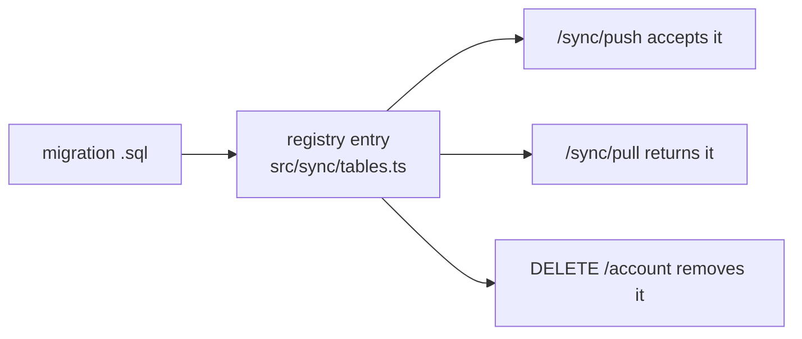

# S5 — Issues and markup

<dl><dd>

- Sprint 5 · 2 weeks · backend 3h of the sprint's 48h · [all sprints](../README.md) · iOS side: [S5 iOS](https://github.com/DAMHONGDUC/site_log_swift_ui/blob/main/docs/feature-guide/S5-issues-markup/README.md)

</dd></dl>

## Contents

<dl><dd>

1. [Overview](#overview)
2. [Tasks](#tasks)
3. [Done](#done)
4. [Self-check](#self-check)

</dd></dl>

## Overview

<dl><dd>

- **Goal:** issues, their photos, phrases and markup sync; adding a table is now one migration and one registry entry.
- **Demo:** an issue with two photos and an arrow drawn on one, made on the iPhone, appears on the iPad.

| Guide | Builds | Hours |
|---|---|---|
| [F08 Issues](F08-issues.md) | `0005_issues.sql`, three entries | 2 |
| [F09 Annotations](F09-annotations.md) | `0006_annotations.sql`, one entry | 1 |

</dd></dl>

## Tasks

<dl><dd>

| Task | What | Guide | Hours | Status |
|---|---|---|---|---|
| F08.1 | `0005_issues.sql`, registry, tests | [F08](F08-issues.md) | 2 | not start |
| F09.1 | `0006_annotations.sql`, registry, tests | [F09](F09-annotations.md) | 1 | not start |

</dd></dl>

## Done

<dl><dd>

- [ ] `npm test` green; staging migrated
- [ ] The iOS demo passes between two devices

</dd></dl>

## Self-check

<dl><dd>

- Which four places use a new registry entry without any other code change?
- An issue references a plan sheet id in S5, before `plan_sheets` exists. What stops a wrong id, and when?

</dd></dl>
