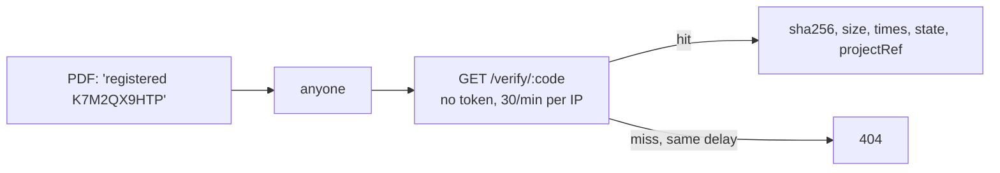

# F10 — Reports and verify (backend)

<dl><dd>

- Sprint [S6](README.md) · 4h · report branding syncs (one row per user); anyone holding a PDF can check a printed code at `GET /verify/:code`.
- iOS side: [F10 Reports](https://github.com/DAMHONGDUC/site_log_swift_ui/blob/main/docs/feature-guide/S6-reports-plans/F10-reports.md). Contract: [01-api §9](../../feature-docs/01-api.md#9-verify).

</dd></dl>

## Contents

<dl><dd>

1. [Overview](#overview)
2. [1. Branding table](#1-branding-table)
3. [2. Verify endpoint](#2-verify-endpoint)
4. [Tests](#tests)
5. [Feature done](#feature-done)

</dd></dl>

## Overview

<dl><dd>

- **Goal:** branding shared by all of a user's devices; a public lookup that tells only facts about a file and leaks nothing else.
- **Demo:** `curl https://api-staging.<domain>/verify/<code from F06>` → `verifyState: "registered"`; a made-up code → `404` after the same delay.

| Step | Hours | Files |
|---|---|---|
| [1](#1-branding-table) | 1 | `migrations/0007_report_branding.sql`, `src/sync/tables.ts` |
| [2](#2-verify-endpoint) | 2 | `src/routes/verify.ts`, `src/app.ts` |
| [Tests](#tests) | 1 | `test/fixtures.ts`, `test/verify.test.ts`, `test/branding.test.ts` |



</dd></dl>

## 1. Branding table

<dl><dd>

<details open>
<summary><strong>1.1 Migration</strong></summary>
<dl><dd>

<b>File</b> · <b class="tag-new">New</b> · `migrations/0007_report_branding.sql`

<b>Explain</b> · One live row per user: `unique (uid) where deleted_at is null`. A second device's first branding row loses and adopts the stored one.

<details>
<summary><b>Code</b></summary>

```sql
-- F10: one branding row per user, shared by all their devices.
create table report_branding (
    id                uuid primary key,
    uid               text not null,
    rev               bigint not null,
    client_updated_at timestamptz not null,
    deleted_at        timestamptz,
    company_name      text not null,
    logo_key          text,
    accent_hex        text not null check (accent_hex ~ '^#[0-9A-Fa-f]{6}$'),
    client_block      text not null,
    footer_text       text not null
);
create index report_branding_uid_rev on report_branding (uid, rev);
create unique index report_branding_one_live on report_branding (uid) where deleted_at is null;
```

</details>

</dd></dl>
</details>

<details open>
<summary><strong>1.2 Registry</strong></summary>
<dl><dd>

<b>File</b> · <b class="tag-edit">Edit</b> · `src/sync/tables.ts`

<b>Explain</b> · `naturalKey: []` means "uid alone": the lookup finds the user's live branding row.

```diff
@@ -106,2 +106,10 @@
   table('annotations', ['shapes']),
+  // F10: one live row per user, so the natural key is uid alone.
+  table(
+    'report_branding',
+    ['company_name', 'logo_key', 'accent_hex', 'client_block', 'footer_text'],
+    {
+      naturalKey: [],
+    },
+  ),
 ];
```

<details>
<summary><b>Code</b></summary>

```ts
// Every table the app may pull and push. A feature that adds a synced table adds it here.

export interface SyncTable {
  // SQL table name, also the `table` value in a mutation.
  name: string;
  // Business columns (snake_case) the app sends on every upsert, as a full row.
  columns: string[];
  // Kept from the first insert; later values are ignored (evidence must not change).
  immutable: string[];
  // Enum columns that only move forward, whatever the timestamps say.
  monotonic: string[];
  // A second unique key besides id (uid is always part of it). A new row that collides
  // with a live row on it loses: the app adopts the stored row. null = no such key.
  naturalKey: string[] | null;
}

function table(
  name: string,
  columns: string[],
  options: { immutable?: string[]; monotonic?: string[]; naturalKey?: string[] | null } = {},
): SyncTable {
  return {
    name,
    columns,
    immutable: options.immutable ?? [],
    monotonic: options.monotonic ?? [],
    naturalKey: options.naturalKey ?? null,
  };
}

export const syncTables: SyncTable[] = [
  // F03
  table('projects', ['name', 'address', 'client_name', 'created_at'], {
    immutable: ['created_at'],
  }),
  table('locations', ['project_id', 'parent_id', 'code', 'kind', 'sort_index'], {
    immutable: ['project_id'],
  }),
  table('sessions', ['project_id', 'started_at', 'ended_at', 'surveyor_name', 'note', 'state'], {
    immutable: ['project_id', 'started_at'],
    monotonic: ['state'],
  }),
  // F05: evidence columns never change after the first insert.
  table(
    'captures',
    [
      'project_id',
      'session_id',
      'location_id',
      'kind',
      'sha256',
      'byte_size',
      'captured_at',
      'time_confidence',
      'latitude',
      'longitude',
      'horizontal_accuracy',
      'device_model',
      'duration_seconds',
      'device_reading',
      'remote_key',
      'verification_code',
      'excluded_from_report',
    ],
    {
      immutable: [
        'project_id',
        'session_id',
        'kind',
        'sha256',
        'byte_size',
        'captured_at',
        'time_confidence',
        'latitude',
        'longitude',
        'horizontal_accuracy',
        'device_model',
        'duration_seconds',
        'device_reading',
      ],
    },
  ),
  // F08
  table('issues', [
    'project_id',
    'location_id',
    'title',
    'detail',
    'severity',
    'status',
    'due_date',
    'assignee_name',
    'trade',
    'plan_sheet_id',
    'pin_x',
    'pin_y',
    'resolved_by_issue_id',
    'source_checklist_result_id',
  ]),
  table('issue_captures', ['issue_id', 'capture_id'], {
    immutable: ['issue_id', 'capture_id'],
    naturalKey: ['issue_id', 'capture_id'],
  }),
  table('phrases', ['text', 'usage_count'], { immutable: ['text'], naturalKey: ['text'] }),
  // F09
  table('annotations', ['shapes']),
  // F10: one live row per user, so the natural key is uid alone.
  table(
    'report_branding',
    ['company_name', 'logo_key', 'accent_hex', 'client_block', 'footer_text'],
    {
      naturalKey: [],
    },
  ),
];

export function findSyncTable(name: string): SyncTable | undefined {
  return syncTables.find((candidate) => candidate.name === name);
}
```

</details>

</dd></dl>
</details>

</dd></dl>

## 2. Verify endpoint

<dl><dd>

#### Overview

<dl><dd>

| Action | File | Holds |
|---|---|---|
| <b class="tag-new">New</b> | `src/routes/verify.ts` | `GET /verify/:code`: case-insensitive, rate limited per IP, constant minimum delay, facts only |
| <b class="tag-edit">Edit</b> | `src/app.ts` | Registers it (no `requireUser`) |

</dd></dl>

#### Steps

<dl><dd>

<details open>
<summary><strong>2.1 Route</strong></summary>
<dl><dd>

<b>File</b> · <b class="tag-new">New</b> · `src/routes/verify.ts`

<b>Explain</b> · A hit and a miss both wait until `VERIFY_MIN_DELAY_MS` has passed, so response time does not reveal which codes exist. The IP comes from `X-Forwarded-For` because Caddy is in front (`trustProxy`).

<b>Think</b>

- List every column of `uploads` and say why each is or is not returned.
- Without `trustProxy`, which IP would the rate limiter see for every visitor, and what would happen?

<details open>
<summary><b>Hint 3 · Skeleton</b></summary>

```ts
typed.get('/verify/:code', { schema: { params: Params }, config: { rateLimit: { max, timeWindow: '1 minute' } } }, async (request, reply) => {
  const started = Date.now();
  const code = request.params.code.toUpperCase();
  // 1. select sha256, byte_size, completed_at, verify_state, verified_at, project_id … where code and completed
  // 2. wait until VERIFY_MIN_DELAY_MS has passed since started
  // 3. cache-control: no-store
  // 4. no row → notFound('code_not_found', …)
  // 5. return the facts; projectRef = first 8 of project_id, upper case
});
```

</details>

<details>
<summary><b>Code</b></summary>

```ts
import { Type, type TypeBoxTypeProvider } from '@fastify/type-provider-typebox';
import type { FastifyInstance } from 'fastify';
import { setTimeout as sleep } from 'node:timers/promises';
import type { AppDeps } from '../app.js';
import { notFound } from '../errors.js';

interface VerifyRow {
  sha256: string;
  byte_size: number;
  completed_at: Date;
  verify_state: 'registered' | 'verified' | 'mismatch';
  verified_at: Date | null;
  project_id: string | null;
}

// Public: anyone holding a report can check a code printed under a photo.
// It returns facts about the file only: never the image, a URL, the uid or the location.
export function verifyRoutes(app: FastifyInstance, deps: AppDeps): void {
  const typed = app.withTypeProvider<TypeBoxTypeProvider>();

  const Params = Type.Object({ code: Type.String({ minLength: 10, maxLength: 16 }) });

  typed.get(
    '/verify/:code',
    {
      schema: { params: Params },
      config: { rateLimit: { max: deps.config.verifyRateLimitPerMinute, timeWindow: '1 minute' } },
    },
    async (request, reply) => {
      const started = Date.now();
      const code = request.params.code.toUpperCase();
      const result = await deps.pool.query<VerifyRow>(
        `select sha256, byte_size, completed_at, verify_state, verified_at, project_id
           from uploads where verification_code = $1 and state = 'completed'`,
        [code],
      );

      // Hits and misses take the same time, so timing does not reveal which codes exist.
      const elapsed = Date.now() - started;
      if (elapsed < deps.config.verifyMinDelayMs) {
        await sleep(deps.config.verifyMinDelayMs - elapsed);
      }
      reply.header('cache-control', 'no-store');

      const row = result.rows[0];
      if (row === undefined) {
        request.log.info({ found: false }, 'verify lookup');
        throw notFound('code_not_found', 'Unknown verification code');
      }
      request.log.info({ found: true, verifyState: row.verify_state }, 'verify lookup');
      let projectRef: string | null = null;
      if (row.project_id !== null) {
        projectRef = row.project_id.slice(0, 8).toUpperCase();
      }
      return {
        code,
        sha256: row.sha256,
        byteSize: row.byte_size,
        receivedAt: row.completed_at,
        verifyState: row.verify_state,
        verified: row.verify_state === 'verified',
        verifiedAt: row.verified_at,
        projectRef,
      };
    },
  );
}
```

</details>

---

<b>File</b> · <b class="tag-edit">Edit</b> · `src/app.ts`

```diff
@@ -12,2 +12,3 @@
 import { uploadRoutes } from './routes/uploads.js';
+import { verifyRoutes } from './routes/verify.js';
 import type { Storage } from './storage.js';
@@ -43,2 +44,3 @@
   mediaRoutes(app, deps, requireUser);
+  verifyRoutes(app, deps);
 
```

```bash
npm run migrate && npm run dev
```

```bash
curl -s localhost:3000/verify/<code from F06> | jq
```

<b>Try</b>

- `for i in $(seq 1 35); do curl -s -o /dev/null -w '%{http_code} ' localhost:3000/verify/ZZZZZZZZZZ; done` → `404`s, then `429`s.

</dd></dl>
</details>

</dd></dl>

</dd></dl>

## Tests

<dl><dd>

<details open>
<summary><strong>Test files</strong></summary>
<dl><dd>

<b>File</b> · <b class="tag-new">New</b> · `test/fixtures.ts`

<b>Explain</b> · Inserts a completed upload row directly, for tests that need one without the whole upload flow.

<details>
<summary><b>Code</b></summary>

```ts
import type pg from 'pg';
import { ids, sha } from './helpers.js';

// A completed upload row, as `complete` leaves it.
export async function insertCompletedUpload(
  pool: pg.Pool,
  options: { uid?: string; code?: string; sessionId?: string; sha256?: string } = {},
): Promise<string> {
  const uid = options.uid ?? 'alice';
  const sessionId = options.sessionId ?? ids.session;
  const result = await pool.query<{ id: string }>(
    `insert into uploads (uid, object_key, project_id, session_id, sha256, byte_size, content_type, mode,
                          state, verification_code, verify_state, completed_at)
     values ($1, $2, $3, $4, $5, 1000, 'image/jpeg', 'single', 'completed', $6, 'registered', now())
     returning id`,
    [
      uid,
      `${uid}/${ids.project}/${sessionId}/${crypto.randomUUID()}.jpg`,
      ids.project,
      sessionId,
      options.sha256 ?? sha,
      options.code ?? 'ABCDEFGH23',
    ],
  );
  return result.rows[0]!.id;
}
```

</details>

---

<b>File</b> · <b class="tag-new">New</b> · `test/verify.test.ts`

<details>
<summary><b>Code</b></summary>

```ts
import { afterAll, beforeAll, beforeEach, describe, expect, it } from 'vitest';
import { insertCompletedUpload } from './fixtures.js';
import { closeTestContext, createTestContext, resetDatabase, type TestContext } from './helpers.js';

describe('GET /verify/:code', () => {
  let context: TestContext;
  beforeAll(async () => {
    context = await createTestContext({ VERIFY_RATE_LIMIT_PER_MINUTE: '5' });
  });
  afterAll(async () => {
    await closeTestContext(context);
  });
  beforeEach(async () => {
    await resetDatabase(context.pool);
  });

  it('returns facts about the file and nothing that identifies the user', async () => {
    await insertCompletedUpload(context.pool, { code: 'ABCDEFGH23' });
    const response = await context.app.inject({
      method: 'GET',
      url: '/verify/abcdefgh23',
      remoteAddress: '10.0.0.1',
    });
    expect(response.statusCode).toBe(200);
    const body = response.json();
    expect(Object.keys(body).sort()).toEqual(
      [
        'byteSize',
        'code',
        'projectRef',
        'receivedAt',
        'sha256',
        'verified',
        'verifiedAt',
        'verifyState',
      ].sort(),
    );
    expect(response.body).not.toContain('alice');
    expect(response.body).not.toContain('https://');
  });

  it('answers an unknown code with 404 after the same minimum delay', async () => {
    const started = Date.now();
    const response = await context.app.inject({
      method: 'GET',
      url: '/verify/ZZZZZZZZZZ',
      remoteAddress: '10.0.0.2',
    });
    expect(response.statusCode).toBe(404);
    expect(Date.now() - started).toBeGreaterThanOrEqual(45);
  });

  it('rate limits one IP', async () => {
    let last = 0;
    for (let index = 0; index < 6; index += 1) {
      const response = await context.app.inject({
        method: 'GET',
        url: '/verify/ZZZZZZZZZZ',
        remoteAddress: '10.0.0.3',
      });
      last = response.statusCode;
    }
    expect(last).toBe(429);
  });
});
```

</details>

---

<b>File</b> · <b class="tag-new">New</b> · `test/branding.test.ts`

<details>
<summary><b>Code</b></summary>

```ts
import { afterAll, beforeAll, beforeEach, describe, expect, it } from 'vitest';
import { closeTestContext, createTestContext, resetDatabase, type TestContext } from './helpers.js';
import { pushAs } from './sync-helpers.js';

function brandingMutation(id: string, companyName: string) {
  return {
    table: 'report_branding',
    id,
    op: 'upsert',
    clientUpdatedAt: '2026-11-01T08:00:00.000Z',
    fields: { companyName, logoKey: null, accentHex: '#1A73E8', clientBlock: '', footerText: '' },
  };
}

describe('report branding', () => {
  let context: TestContext;
  beforeAll(async () => {
    context = await createTestContext();
  });
  afterAll(async () => {
    await closeTestContext(context);
  });
  beforeEach(async () => {
    await resetDatabase(context.pool);
  });

  it('keeps one row per user: a second device adopts the first one', async () => {
    await pushAs(context, 'alice', [
      brandingMutation('31313131-3131-4131-8131-313131313131', 'DD Build'),
    ]);
    const second = await pushAs(context, 'alice', [
      brandingMutation('32323232-3232-4232-8232-323232323232', 'Other'),
    ]);
    expect(second.results[0].status).toBe('superseded');
    expect(second.results[0].serverRow.companyName).toBe('DD Build');
  });

  it('rejects a colour that is not #RRGGBB', async () => {
    const mutation = brandingMutation('31313131-3131-4131-8131-313131313131', 'DD Build');
    mutation.fields.accentHex = 'blue';
    const result = await pushAs(context, 'alice', [mutation]);
    expect(result.results[0].reason).toBe('invalid_row:23514');
  });
});
```

</details>

```bash
npm test
```

</dd></dl>
</details>

</dd></dl>

## Feature done

<dl><dd>

- [ ] A code from F06 resolves; the body has exactly the eight documented fields
- [ ] A random code → `404` no faster than a hit; 31 lookups in a minute → `429`
- [ ] A second device's branding adopts the first
- [ ] `npm test` green (57 tests); staging deployed

</dd></dl>
