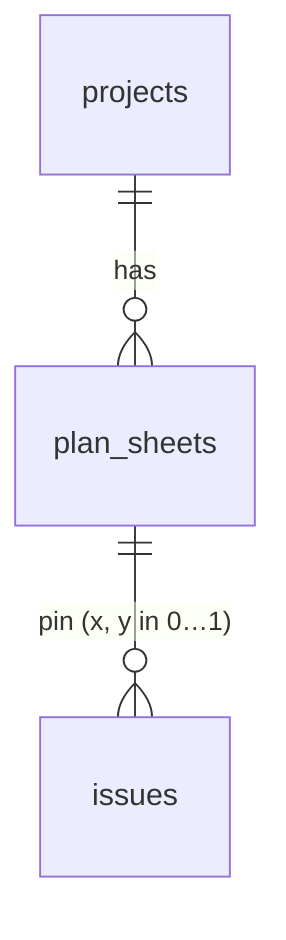

# F11 — Floor plans (backend)

<dl><dd>

- Sprint [S6](README.md) · 2h · plan sheets sync; issues can pin to them; plan files upload under `…/plans/`.
- iOS side: [F11 Plans](https://github.com/DAMHONGDUC/site_log_swift_ui/blob/main/docs/feature-guide/S6-reports-plans/F11-plans.md). Contract: [01-api §6.3, §7.1](../../feature-docs/01-api.md#71-keys).

</dd></dl>

## Contents

<dl><dd>

1. [Overview](#overview)
2. [1. Migration and registry](#1-migration-and-registry)
3. [Tests](#tests)
4. [Feature done](#feature-done)

</dd></dl>

## Overview

<dl><dd>

- **Goal:** `plan_sheets` table; the foreign key `issues.plan_sheet_id` finally checked. Plan keys were already accepted by `keys.ts` since F06.
- **Demo:** begin an upload with `<uid>/<project>/plans/<sheet>.pdf` → `200`; with another uid → `400`.

| Action | File | Holds |
|---|---|---|
| <b class="tag-new">New</b> | `migrations/0008_plan_sheets.sql` | `plan_sheets`; `alter table issues add foreign key (uid, plan_sheet_id)` |
| <b class="tag-edit">Edit</b> | `src/sync/tables.ts` | `plan_sheets` entry |
| <b class="tag-new">New</b> | `test/plans.test.ts` | Plan keys, pin to a real sheet only |



</dd></dl>

## 1. Migration and registry

<dl><dd>

<details open>
<summary><strong>1.1 Migration</strong></summary>
<dl><dd>

<b>File</b> · <b class="tag-new">New</b> · `migrations/0008_plan_sheets.sql`

<b>Think</b>

- `alter table issues add foreign key …` checks every existing issue. On staging, what makes this migration fail, and how would you find the rows? (`select id, plan_sheet_id from issues where plan_sheet_id is not null`.)

<details>
<summary><b>Code</b></summary>

```sql
-- F11: floor plan pages. Issues could name a sheet since F08; now the database checks it.
create table plan_sheets (
    id                uuid primary key,
    uid               text not null,
    rev               bigint not null,
    client_updated_at timestamptz not null,
    deleted_at        timestamptz,
    project_id        uuid not null,
    location_id       uuid,
    name              text not null,
    page_index        integer not null check (page_index >= 0),
    pixel_width       integer not null check (pixel_width > 0),
    pixel_height      integer not null check (pixel_height > 0),
    sha256            char(64) not null check (sha256 ~ '^[0-9a-f]{64}$'),
    remote_key        text,
    unique (uid, id),
    foreign key (uid, project_id) references projects (uid, id) deferrable initially deferred,
    foreign key (uid, location_id) references locations (uid, id) deferrable initially deferred
);
create index plan_sheets_uid_rev on plan_sheets (uid, rev);

alter table issues
    add foreign key (uid, plan_sheet_id) references plan_sheets (uid, id) deferrable initially deferred;
```

</details>

</dd></dl>
</details>

<details open>
<summary><strong>1.2 Registry</strong></summary>
<dl><dd>

<b>File</b> · <b class="tag-edit">Edit</b> · `src/sync/tables.ts`

```diff
@@ -114,2 +114,17 @@
   ),
+  // F11
+  table(
+    'plan_sheets',
+    [
+      'project_id',
+      'location_id',
+      'name',
+      'page_index',
+      'pixel_width',
+      'pixel_height',
+      'sha256',
+      'remote_key',
+    ],
+    { immutable: ['project_id', 'sha256', 'pixel_width', 'pixel_height'] },
+  ),
 ];
```

<details>
<summary><b>Code</b></summary>

```ts
// Every table the app may pull and push. A feature that adds a synced table adds it here.

export interface SyncTable {
  // SQL table name, also the `table` value in a mutation.
  name: string;
  // Business columns (snake_case) the app sends on every upsert, as a full row.
  columns: string[];
  // Kept from the first insert; later values are ignored (evidence must not change).
  immutable: string[];
  // Enum columns that only move forward, whatever the timestamps say.
  monotonic: string[];
  // A second unique key besides id (uid is always part of it). A new row that collides
  // with a live row on it loses: the app adopts the stored row. null = no such key.
  naturalKey: string[] | null;
}

function table(
  name: string,
  columns: string[],
  options: { immutable?: string[]; monotonic?: string[]; naturalKey?: string[] | null } = {},
): SyncTable {
  return {
    name,
    columns,
    immutable: options.immutable ?? [],
    monotonic: options.monotonic ?? [],
    naturalKey: options.naturalKey ?? null,
  };
}

export const syncTables: SyncTable[] = [
  // F03
  table('projects', ['name', 'address', 'client_name', 'created_at'], {
    immutable: ['created_at'],
  }),
  table('locations', ['project_id', 'parent_id', 'code', 'kind', 'sort_index'], {
    immutable: ['project_id'],
  }),
  table('sessions', ['project_id', 'started_at', 'ended_at', 'surveyor_name', 'note', 'state'], {
    immutable: ['project_id', 'started_at'],
    monotonic: ['state'],
  }),
  // F05: evidence columns never change after the first insert.
  table(
    'captures',
    [
      'project_id',
      'session_id',
      'location_id',
      'kind',
      'sha256',
      'byte_size',
      'captured_at',
      'time_confidence',
      'latitude',
      'longitude',
      'horizontal_accuracy',
      'device_model',
      'duration_seconds',
      'device_reading',
      'remote_key',
      'verification_code',
      'excluded_from_report',
    ],
    {
      immutable: [
        'project_id',
        'session_id',
        'kind',
        'sha256',
        'byte_size',
        'captured_at',
        'time_confidence',
        'latitude',
        'longitude',
        'horizontal_accuracy',
        'device_model',
        'duration_seconds',
        'device_reading',
      ],
    },
  ),
  // F08
  table('issues', [
    'project_id',
    'location_id',
    'title',
    'detail',
    'severity',
    'status',
    'due_date',
    'assignee_name',
    'trade',
    'plan_sheet_id',
    'pin_x',
    'pin_y',
    'resolved_by_issue_id',
    'source_checklist_result_id',
  ]),
  table('issue_captures', ['issue_id', 'capture_id'], {
    immutable: ['issue_id', 'capture_id'],
    naturalKey: ['issue_id', 'capture_id'],
  }),
  table('phrases', ['text', 'usage_count'], { immutable: ['text'], naturalKey: ['text'] }),
  // F09
  table('annotations', ['shapes']),
  // F10: one live row per user, so the natural key is uid alone.
  table(
    'report_branding',
    ['company_name', 'logo_key', 'accent_hex', 'client_block', 'footer_text'],
    {
      naturalKey: [],
    },
  ),
  // F11
  table(
    'plan_sheets',
    [
      'project_id',
      'location_id',
      'name',
      'page_index',
      'pixel_width',
      'pixel_height',
      'sha256',
      'remote_key',
    ],
    { immutable: ['project_id', 'sha256', 'pixel_width', 'pixel_height'] },
  ),
];

export function findSyncTable(name: string): SyncTable | undefined {
  return syncTables.find((candidate) => candidate.name === name);
}
```

</details>

```bash
npm run migrate
```

</dd></dl>
</details>

</dd></dl>

## Tests

<dl><dd>

<details open>
<summary><strong>Test file</strong></summary>
<dl><dd>

<b>File</b> · <b class="tag-new">New</b> · `test/plans.test.ts`

<details>
<summary><b>Code</b></summary>

```ts
import { afterAll, beforeAll, beforeEach, describe, expect, it } from 'vitest';
import {
  closeTestContext,
  createTestContext,
  ids,
  resetDatabase,
  sha,
  type TestContext,
} from './helpers.js';
import { pushAs, seedProject } from './sync-helpers.js';
import { beginUpload } from './upload-helpers.js';

const sheetId = '41414141-4141-4141-8141-414141414141';

function sheetMutation() {
  return {
    table: 'plan_sheets',
    id: sheetId,
    op: 'upsert',
    clientUpdatedAt: '2026-11-01T08:00:00.000Z',
    fields: {
      projectId: ids.project,
      locationId: null,
      name: 'Level 2',
      pageIndex: 0,
      pixelWidth: 4000,
      pixelHeight: 3000,
      sha256: sha,
      remoteKey: `alice/${ids.project}/plans/${sheetId}.pdf`,
    },
  };
}

describe('plan sheets', () => {
  let context: TestContext;
  beforeAll(async () => {
    context = await createTestContext();
  });
  afterAll(async () => {
    await closeTestContext(context);
  });
  beforeEach(async () => {
    await resetDatabase(context.pool);
    await seedProject(context);
  });

  it('accepts a plan key under my uid and rejects one under another', async () => {
    const mine = await beginUpload(context, 1000, `alice/${ids.project}/plans/${sheetId}.pdf`);
    expect(mine.statusCode).toBe(200);
    const theirs = await beginUpload(context, 1000, `bob/${ids.project}/plans/${sheetId}.pdf`);
    expect(theirs.statusCode).toBe(400);
  });

  it('lets an issue pin to a sheet of the same user', async () => {
    const result = await pushAs(context, 'alice', [sheetMutation()]);
    expect(result.results[0].status).toBe('applied');
    await context.pool.query(
      `insert into issues (id, uid, rev, client_updated_at, project_id, location_id, title, detail, severity,
                           status, plan_sheet_id, pin_x, pin_y)
       values (gen_random_uuid(), 'alice', 99, now(), $1, $2, 'Leak', '', 'minor', 'open', $3, 0.5, 0.5)`,
      [ids.project, ids.location, sheetId],
    );
    await expect(
      context.pool.query(
        `insert into issues (id, uid, rev, client_updated_at, project_id, location_id, title, detail, severity,
                             status, plan_sheet_id, pin_x, pin_y)
         values (gen_random_uuid(), 'alice', 99, now(), $1, $2, 'Leak', '', 'minor', 'open', gen_random_uuid(), 0.5, 0.5)`,
        [ids.project, ids.location],
      ),
    ).rejects.toThrow('foreign key');
  });
});
```

</details>

```bash
npm test
```

</dd></dl>
</details>

</dd></dl>

## Feature done

<dl><dd>

- [ ] A plan file uploads under `…/plans/`; another uid's plan key is rejected
- [ ] An issue pinned to a sheet that does not exist is rejected
- [ ] `npm test` green (59 tests); staging migrated

</dd></dl>
