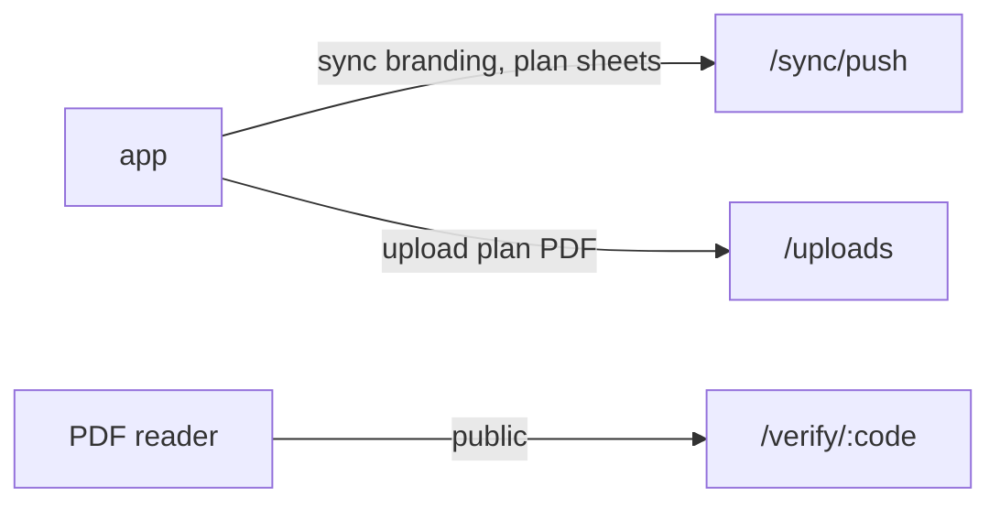

# S6 — Reports and floor plans

<dl><dd>

- Sprint 6 · 2 weeks · backend 6h of the sprint's 58h · [all sprints](../README.md) · iOS side: [S6 iOS](https://github.com/DAMHONGDUC/site_log_swift_ui/blob/main/docs/feature-guide/S6-reports-plans/README.md)

</dd></dl>

## Contents

<dl><dd>

1. [Overview](#overview)
2. [Tasks](#tasks)
3. [Done](#done)
4. [Self-check](#self-check)

</dd></dl>

## Overview

<dl><dd>

- **Goal:** codes printed in reports can be checked by anyone; plans and branding sync.
- **Demo:** export a PDF in the app, read a code under a photo, open `https://api-staging.<domain>/verify/<code>` in Safari.

| Guide | Builds | Hours |
|---|---|---|
| [F10 Reports, verify](F10-reports-verify.md) | `0007_report_branding.sql`, `GET /verify/:code` | 4 |
| [F11 Plans](F11-plans.md) | `0008_plan_sheets.sql`, pin foreign key | 2 |

</dd></dl>

## Tasks

<dl><dd>

| Task | What | Guide | Hours | Status |
|---|---|---|---|---|
| F10.1 | Branding table and entry | [F10 §1](F10-reports-verify.md#1-branding-table) | 1 | not start |
| F10.2 | `GET /verify/:code` | [F10 §2](F10-reports-verify.md#2-verify-endpoint) | 2 | not start |
| F10.3 | Tests | [F10 Tests](F10-reports-verify.md#tests) | 1 | not start |
| F11.1 | `0008_plan_sheets.sql`, entry, tests | [F11](F11-plans.md) | 2 | not start |

</dd></dl>

## Done

<dl><dd>

- [ ] `npm test` green; staging migrated
- [ ] A code from a real PDF resolves on staging

</dd></dl>

## Self-check

<dl><dd>

- Why is `/verify` the only endpoint without a token, and what does it do differently because of that?
- What may a report print for a capture whose upload is still `registered`?

</dd></dl>
