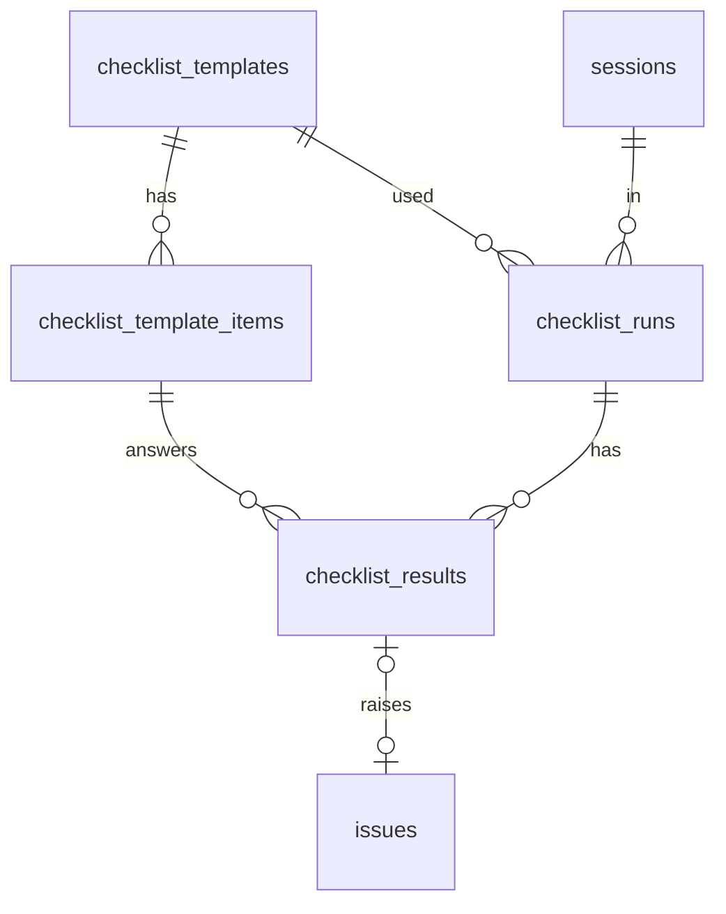

# F12 — Checklists (backend)

<dl><dd>

- Sprint [S7](README.md) · 2h · templates, items, runs and one answer per item sync.
- iOS side: [F12 Checklists](https://github.com/DAMHONGDUC/site_log_swift_ui/blob/main/docs/feature-guide/S7-checklists-devices-diagnostics/F12-checklists.md). Contract: [01-api §6.3](../../feature-docs/01-api.md#63-synced-tables).

</dd></dl>

## Contents

<dl><dd>

1. [Overview](#overview)
2. [1. Migration and registry](#1-migration-and-registry)
3. [Tests](#tests)
4. [Feature done](#feature-done)

</dd></dl>

## Overview

<dl><dd>

- **Goal:** four tables; `checklist_results` keeps one live answer per `(run, item)`; an issue can point back to the answer that raised it.
- **Demo:** two devices answer the same item: the second adopts the first answer; editing the same row later wins by time.

| Action | File | Holds |
|---|---|---|
| <b class="tag-new">New</b> | `migrations/0009_checklists.sql` | Four tables; `alter table issues add foreign key (uid, source_checklist_result_id)` |
| <b class="tag-edit">Edit</b> | `src/sync/tables.ts` | Four entries; results have the natural key `run_id + template_item_id` |
| <b class="tag-new">New</b> | `test/checklists.test.ts` | One answer per item, last write wins on the same row |



</dd></dl>

## 1. Migration and registry

<dl><dd>

<details open>
<summary><strong>1.1 Migration</strong></summary>
<dl><dd>

<b>File</b> · <b class="tag-new">New</b> · `migrations/0009_checklists.sql`

<b>Explain</b> · `issues ↔ checklist_results` point at each other. Deferred foreign keys let both rows arrive in the same push.

<b>Think</b>

- The old spec said template foreign keys are `on delete restrict`. Why is that pointless here? (Rows are tombstoned, not deleted, until the purge — and `restrict` cannot be deferred.)

<details>
<summary><b>Code</b></summary>

```sql
-- F12: templates, their items, a run of a template at a location, and one result per item.
create table checklist_templates (
    id                uuid primary key,
    uid               text not null,
    rev               bigint not null,
    client_updated_at timestamptz not null,
    deleted_at        timestamptz,
    project_id        uuid,
    name              text not null,
    applies_to        text not null,
    is_built_in       boolean not null,
    usage_count       integer not null,
    unique (uid, id),
    foreign key (uid, project_id) references projects (uid, id) deferrable initially deferred
);
create index checklist_templates_uid_rev on checklist_templates (uid, rev);

create table checklist_template_items (
    id                     uuid primary key,
    uid                    text not null,
    rev                    bigint not null,
    client_updated_at      timestamptz not null,
    deleted_at             timestamptz,
    template_id            uuid not null,
    ordinal                integer not null,
    text                   text not null,
    default_severity       text not null check (default_severity in ('critical', 'major', 'minor')),
    requires_photo_on_fail boolean not null,
    unique (uid, id),
    foreign key (uid, template_id) references checklist_templates (uid, id) deferrable initially deferred
);
create index checklist_template_items_uid_rev on checklist_template_items (uid, rev);

create table checklist_runs (
    id                uuid primary key,
    uid               text not null,
    rev               bigint not null,
    client_updated_at timestamptz not null,
    deleted_at        timestamptz,
    template_id       uuid not null,
    session_id        uuid not null,
    location_id       uuid not null,
    started_at        timestamptz not null,
    completed_at      timestamptz,
    unique (uid, id),
    foreign key (uid, template_id) references checklist_templates (uid, id) deferrable initially deferred,
    foreign key (uid, session_id) references sessions (uid, id) deferrable initially deferred,
    foreign key (uid, location_id) references locations (uid, id) deferrable initially deferred
);
create index checklist_runs_uid_rev on checklist_runs (uid, rev);

create table checklist_results (
    id                uuid primary key,
    uid               text not null,
    rev               bigint not null,
    client_updated_at timestamptz not null,
    deleted_at        timestamptz,
    run_id            uuid not null,
    template_item_id  uuid not null,
    outcome           text check (outcome in ('pass', 'fail', 'na')),
    note              text not null,
    issue_id          uuid,
    answered_at       timestamptz,
    unique (uid, id),
    foreign key (uid, run_id) references checklist_runs (uid, id) deferrable initially deferred,
    foreign key (uid, template_item_id) references checklist_template_items (uid, id)
        deferrable initially deferred,
    foreign key (uid, issue_id) references issues (uid, id) deferrable initially deferred
);
create index checklist_results_uid_rev on checklist_results (uid, rev);
create unique index checklist_results_item_live on checklist_results (run_id, template_item_id)
    where deleted_at is null;

alter table issues
    add foreign key (uid, source_checklist_result_id) references checklist_results (uid, id)
        deferrable initially deferred;
```

</details>

</dd></dl>
</details>

<details open>
<summary><strong>1.2 Registry</strong></summary>
<dl><dd>

<b>File</b> · <b class="tag-edit">Edit</b> · `src/sync/tables.ts`

```diff
@@ -129,2 +129,26 @@
   ),
+  // F12
+  table('checklist_templates', ['project_id', 'name', 'applies_to', 'is_built_in', 'usage_count']),
+  table('checklist_template_items', [
+    'template_id',
+    'ordinal',
+    'text',
+    'default_severity',
+    'requires_photo_on_fail',
+  ]),
+  table(
+    'checklist_runs',
+    ['template_id', 'session_id', 'location_id', 'started_at', 'completed_at'],
+    {
+      immutable: ['template_id', 'session_id', 'location_id', 'started_at'],
+    },
+  ),
+  table(
+    'checklist_results',
+    ['run_id', 'template_item_id', 'outcome', 'note', 'issue_id', 'answered_at'],
+    {
+      immutable: ['run_id', 'template_item_id'],
+      naturalKey: ['run_id', 'template_item_id'],
+    },
+  ),
 ];
```

<details>
<summary><b>Code</b></summary>

```ts
// Every table the app may pull and push. A feature that adds a synced table adds it here.

export interface SyncTable {
  // SQL table name, also the `table` value in a mutation.
  name: string;
  // Business columns (snake_case) the app sends on every upsert, as a full row.
  columns: string[];
  // Kept from the first insert; later values are ignored (evidence must not change).
  immutable: string[];
  // Enum columns that only move forward, whatever the timestamps say.
  monotonic: string[];
  // A second unique key besides id (uid is always part of it). A new row that collides
  // with a live row on it loses: the app adopts the stored row. null = no such key.
  naturalKey: string[] | null;
}

function table(
  name: string,
  columns: string[],
  options: { immutable?: string[]; monotonic?: string[]; naturalKey?: string[] | null } = {},
): SyncTable {
  return {
    name,
    columns,
    immutable: options.immutable ?? [],
    monotonic: options.monotonic ?? [],
    naturalKey: options.naturalKey ?? null,
  };
}

export const syncTables: SyncTable[] = [
  // F03
  table('projects', ['name', 'address', 'client_name', 'created_at'], {
    immutable: ['created_at'],
  }),
  table('locations', ['project_id', 'parent_id', 'code', 'kind', 'sort_index'], {
    immutable: ['project_id'],
  }),
  table('sessions', ['project_id', 'started_at', 'ended_at', 'surveyor_name', 'note', 'state'], {
    immutable: ['project_id', 'started_at'],
    monotonic: ['state'],
  }),
  // F05: evidence columns never change after the first insert.
  table(
    'captures',
    [
      'project_id',
      'session_id',
      'location_id',
      'kind',
      'sha256',
      'byte_size',
      'captured_at',
      'time_confidence',
      'latitude',
      'longitude',
      'horizontal_accuracy',
      'device_model',
      'duration_seconds',
      'device_reading',
      'remote_key',
      'verification_code',
      'excluded_from_report',
    ],
    {
      immutable: [
        'project_id',
        'session_id',
        'kind',
        'sha256',
        'byte_size',
        'captured_at',
        'time_confidence',
        'latitude',
        'longitude',
        'horizontal_accuracy',
        'device_model',
        'duration_seconds',
        'device_reading',
      ],
    },
  ),
  // F08
  table('issues', [
    'project_id',
    'location_id',
    'title',
    'detail',
    'severity',
    'status',
    'due_date',
    'assignee_name',
    'trade',
    'plan_sheet_id',
    'pin_x',
    'pin_y',
    'resolved_by_issue_id',
    'source_checklist_result_id',
  ]),
  table('issue_captures', ['issue_id', 'capture_id'], {
    immutable: ['issue_id', 'capture_id'],
    naturalKey: ['issue_id', 'capture_id'],
  }),
  table('phrases', ['text', 'usage_count'], { immutable: ['text'], naturalKey: ['text'] }),
  // F09
  table('annotations', ['shapes']),
  // F10: one live row per user, so the natural key is uid alone.
  table(
    'report_branding',
    ['company_name', 'logo_key', 'accent_hex', 'client_block', 'footer_text'],
    {
      naturalKey: [],
    },
  ),
  // F11
  table(
    'plan_sheets',
    [
      'project_id',
      'location_id',
      'name',
      'page_index',
      'pixel_width',
      'pixel_height',
      'sha256',
      'remote_key',
    ],
    { immutable: ['project_id', 'sha256', 'pixel_width', 'pixel_height'] },
  ),
  // F12
  table('checklist_templates', ['project_id', 'name', 'applies_to', 'is_built_in', 'usage_count']),
  table('checklist_template_items', [
    'template_id',
    'ordinal',
    'text',
    'default_severity',
    'requires_photo_on_fail',
  ]),
  table(
    'checklist_runs',
    ['template_id', 'session_id', 'location_id', 'started_at', 'completed_at'],
    {
      immutable: ['template_id', 'session_id', 'location_id', 'started_at'],
    },
  ),
  table(
    'checklist_results',
    ['run_id', 'template_item_id', 'outcome', 'note', 'issue_id', 'answered_at'],
    {
      immutable: ['run_id', 'template_item_id'],
      naturalKey: ['run_id', 'template_item_id'],
    },
  ),
];

export function findSyncTable(name: string): SyncTable | undefined {
  return syncTables.find((candidate) => candidate.name === name);
}
```

</details>

```bash
npm run migrate
```

</dd></dl>
</details>

</dd></dl>

## Tests

<dl><dd>

<details open>
<summary><strong>Test file</strong></summary>
<dl><dd>

<b>File</b> · <b class="tag-new">New</b> · `test/checklists.test.ts`

<details>
<summary><b>Code</b></summary>

```ts
import { afterAll, beforeAll, beforeEach, describe, expect, it } from 'vitest';
import {
  closeTestContext,
  createTestContext,
  ids,
  resetDatabase,
  type TestContext,
} from './helpers.js';
import { pushAs, seedProject } from './sync-helpers.js';

const templateId = '51515151-5151-4151-8151-515151515151';
const itemId = '52525252-5252-4252-8252-525252525252';
const runId = '53535353-5353-4353-8353-535353535353';
const at = '2026-11-01T09:00:00.000Z';

function resultMutation(id: string, outcome: string, clientUpdatedAt: string = at) {
  return {
    table: 'checklist_results',
    id,
    op: 'upsert',
    clientUpdatedAt,
    fields: {
      runId,
      templateItemId: itemId,
      outcome,
      note: '',
      issueId: null,
      answeredAt: clientUpdatedAt,
    },
  };
}

describe('checklists', () => {
  let context: TestContext;
  beforeAll(async () => {
    context = await createTestContext();
  });
  afterAll(async () => {
    await closeTestContext(context);
  });
  beforeEach(async () => {
    await resetDatabase(context.pool);
    await seedProject(context);
    await pushAs(context, 'alice', [
      {
        table: 'checklist_templates',
        id: templateId,
        op: 'upsert',
        clientUpdatedAt: at,
        fields: {
          projectId: null,
          name: 'Pre-pour',
          appliesTo: 'floor',
          isBuiltIn: true,
          usageCount: 0,
        },
      },
      {
        table: 'checklist_template_items',
        id: itemId,
        op: 'upsert',
        clientUpdatedAt: at,
        fields: {
          templateId,
          ordinal: 1,
          text: 'Rebar spacing',
          defaultSeverity: 'major',
          requiresPhotoOnFail: true,
        },
      },
      {
        table: 'checklist_runs',
        id: runId,
        op: 'upsert',
        clientUpdatedAt: at,
        fields: {
          templateId,
          sessionId: ids.session,
          locationId: ids.location,
          startedAt: at,
          completedAt: null,
        },
      },
    ]);
  });

  it('keeps one answer per item: a second device adopts the stored answer', async () => {
    const first = await pushAs(context, 'alice', [
      resultMutation('54545454-5454-4454-8454-545454545454', 'pass'),
    ]);
    expect(first.results[0].status).toBe('applied');
    const second = await pushAs(context, 'alice', [
      resultMutation('55555555-0000-4000-8000-555555555555', 'fail'),
    ]);
    expect(second.results[0].status).toBe('superseded');
    expect(second.results[0].serverRow.outcome).toBe('pass');
  });

  it('changes an answer through the same row, last write wins', async () => {
    await pushAs(context, 'alice', [
      resultMutation('54545454-5454-4454-8454-545454545454', 'pass'),
    ]);
    const changed = await pushAs(context, 'alice', [
      resultMutation('54545454-5454-4454-8454-545454545454', 'fail', '2026-11-01T10:00:00.000Z'),
    ]);
    expect(changed.results[0].status).toBe('applied');
  });
});
```

</details>

```bash
npm test
```

</dd></dl>
</details>

</dd></dl>

## Feature done

<dl><dd>

- [ ] A second answer for the same item is `superseded` with the first
- [ ] The same answer row edited later is `applied`
- [ ] `npm test` green (61 tests); staging migrated

</dd></dl>
