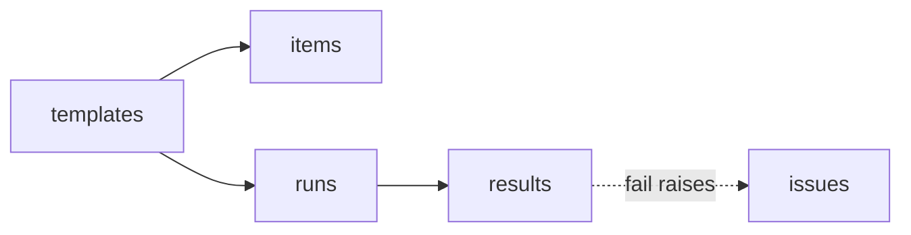

# S7 — Checklists · TestFlight #2

<dl><dd>

- Sprint 7 · 2 weeks · backend 2h of the sprint's 49h · [all sprints](../README.md) · iOS side: [S7 iOS](https://github.com/DAMHONGDUC/site_log_swift_ui/blob/main/docs/feature-guide/S7-checklists-devices-diagnostics/README.md)

</dd></dl>

## Contents

<dl><dd>

1. [Overview](#overview)
2. [Tasks](#tasks)
3. [Done](#done)
4. [Self-check](#self-check)

</dd></dl>

## Overview

<dl><dd>

- **Goal:** checklists sync; every table of the app is now on the server. F13 DeviceLink and F14 Diagnostics have no backend work.
- **Demo:** a checklist run with one failed item that raised an issue, made on the iPhone, appears complete on the iPad.

| Guide | Builds | Hours |
|---|---|---|
| [F12 Checklists](F12-checklists.md) | `0009_checklists.sql`, four entries | 2 |

</dd></dl>

## Tasks

<dl><dd>

| Task | What | Guide | Hours | Status |
|---|---|---|---|---|
| F12.1 | `0009_checklists.sql`, entries, tests | [F12](F12-checklists.md) | 2 | not start |

</dd></dl>

## Done

<dl><dd>

- [ ] `npm test` green; staging migrated
- [ ] TestFlight #2 testers' checklists appear on their second device

</dd></dl>

## Self-check

<dl><dd>

- Count the synced tables now. Where would you look to check that account deletion removes every one of them?

</dd></dl>
