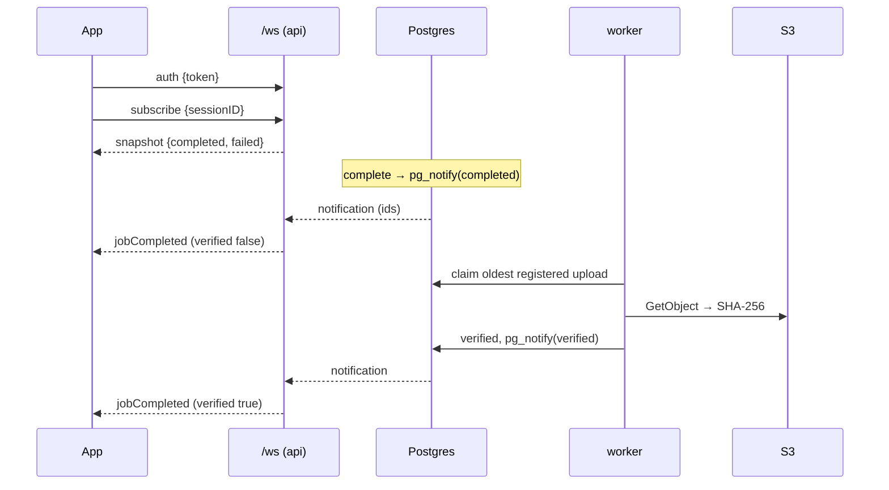
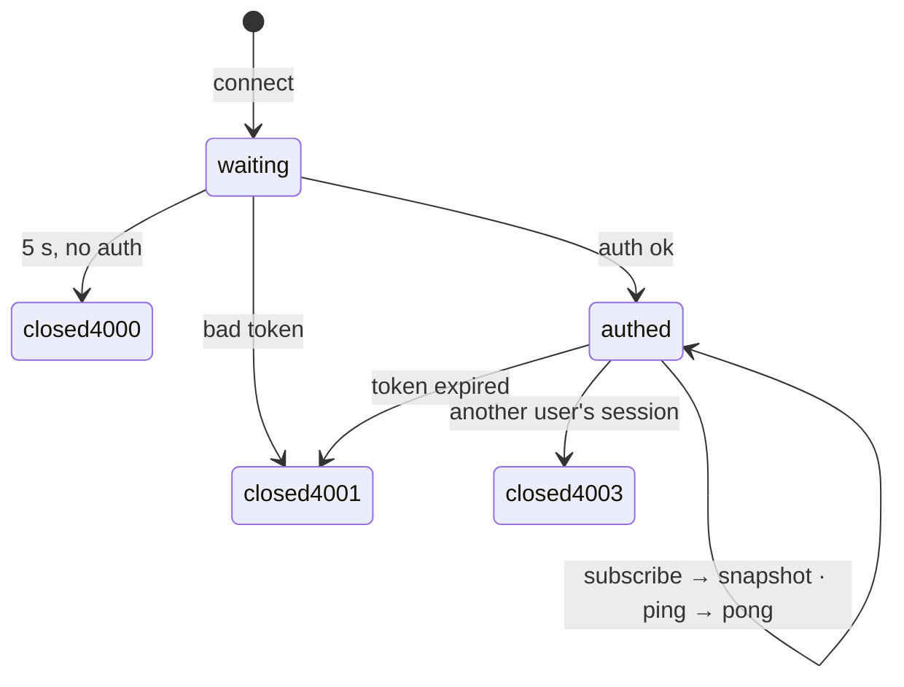
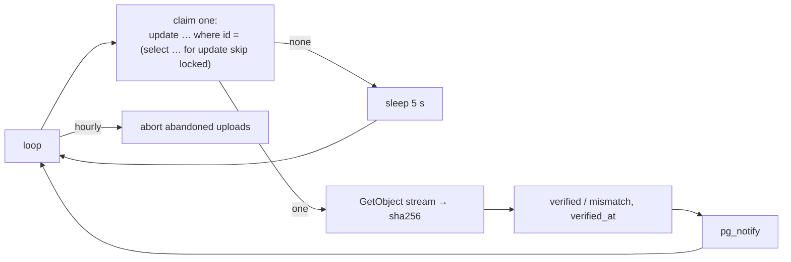

# F15 — Realtime and verification (backend)

<dl><dd>

- Sprint [S8](README.md) · 8h · the app learns upload state over a WebSocket; a worker re-reads every stored file and proves its hash; abandoned uploads are closed.
- iOS side: [F15 Realtime](https://github.com/DAMHONGDUC/site_log_swift_ui/blob/main/docs/feature-guide/S8-realtime-push-quality/F15-realtime.md). Contract: [01-api §11](../../feature-docs/01-api.md#11-websocket). Inside: [03 §3–5](../../feature-docs/03-sync-uploads-realtime.md#3-integrity).

</dd></dl>

## Contents

<dl><dd>

1. [Overview](#overview)
2. [1. Hub](#1-hub)
3. [2. WebSocket route](#2-websocket-route)
4. [3. Worker](#3-worker)
5. [4. Run the worker on the server](#4-run-the-worker-on-the-server)
6. [Tests](#tests)
7. [Feature done](#feature-done)

</dd></dl>

## Overview

<dl><dd>

- **Goal:** `registered` → `verified` (or `mismatch`) without polling; every API process forwards events to its own sockets.
- **Demo:** `npx wscat` connected and subscribed; upload a photo with curl; the socket gets `jobCompleted` (`verified: false`), then a second one with `verified: true` from the worker.

| Step | Hours | Files |
|---|---|---|
| [1](#1-hub) | 2 | `src/realtime/hub.ts` |
| [2](#2-websocket-route) | 2 | `src/realtime/ws.ts`, `src/app.ts`, `src/main.ts` |
| [3](#3-worker) | 2.5 | `migrations/0010_verify_worker.sql`, `src/workers/verify.ts`, `src/workers/abandoned.ts`, `src/worker.ts` |
| [4](#4-run-the-worker-on-the-server) | 0.5 | `deploy/compose.yml` |
| [Tests](#tests) | 1 | `test/helpers.ts`, `test/fixtures.ts`, `test/ws.test.ts`, `test/worker.test.ts` |



```bash
npm install @fastify/websocket && npm install -D @types/ws
```

</dd></dl>

## 1. Hub

<dl><dd>

#### Overview

<dl><dd>

| Action | File | Holds |
|---|---|---|
| <b class="tag-new">New</b> | `src/realtime/hub.ts` | `RealtimeHub`: sockets per uid, one `LISTEN upload_events` connection with reconnect, `uploadMessage(row)` |

</dd></dl>

#### Steps

<dl><dd>

<details open>
<summary><strong>1.1 Hub</strong></summary>
<dl><dd>

<b>File</b> · <b class="tag-new">New</b> · `src/realtime/hub.ts`

<b>Explain</b> · `LISTEN` must stay on one connection, so the hub opens its own `pg.Client` outside the pool. A notification carries ids only; the hub re-reads the row and sends the message to the uid's sockets subscribed to that session.

<b>Think</b>

- The listener connection drops (RDS restart). What does the app miss, and how does it get it back? (Hint: what is always the first answer to `subscribe`?)
- Why must one uid's events never be checked against another uid's sockets?

<details open>
<summary><b>Hint 1 · Idea</b></summary>

- `Map<uid, Set<ClientSocket>>`; `add` refuses past `MAX_SOCKETS_PER_USER`; `remove` cleans empty sets.
- `start(log)` → `connect()`: new client, `on('notification')`, `on('error')` → schedule a reconnect in 5 s, `listen upload_events`.
- `onNotification(payload)`: parse, find sockets, read the row, `uploadMessage(row)`, `send` to subscribed sockets.

</details>

<details open>
<summary><b>Hint 2 · APIs</b></summary>

- `new pg.Client(connectionOptions(config))`, `client.on('notification', (message) => message.payload)`, `await client.query('listen upload_events')`, `socket.readyState === 1`, `socket.send(JSON.stringify(message))`.

</details>

<details>
<summary><b>Code</b></summary>

```ts
import type { FastifyBaseLogger } from 'fastify';
import pg from 'pg';
import type { WebSocket } from 'ws';
import type { Config } from '../config.js';
import { connectionOptions } from '../db.js';
import type { UploadEvent } from './events.js';

export interface ClientSocket {
  socket: WebSocket;
  uid: string;
  sessions: Set<string>;
}

interface UploadRow {
  id: string;
  object_key: string;
  sha256: string;
  state: string;
  verify_state: string | null;
}

// Keeps the open sockets of this process and forwards upload events to them.
// Events reach every process through one LISTEN connection, so it works with 1 or 10 servers.
// Delivery is best effort: on reconnect the app gets a full snapshot.
export class RealtimeHub {
  private readonly config: Config;
  private readonly pool: pg.Pool;
  private readonly sockets = new Map<string, Set<ClientSocket>>();
  private listener: pg.Client | undefined;
  private log: FastifyBaseLogger | undefined;
  private stopped = false;

  constructor(config: Config, pool: pg.Pool) {
    this.config = config;
    this.pool = pool;
  }

  // false when the user already has the maximum number of sockets open.
  add(client: ClientSocket): boolean {
    let set = this.sockets.get(client.uid);
    if (set === undefined) {
      set = new Set();
      this.sockets.set(client.uid, set);
    }
    if (set.size >= this.config.maxSocketsPerUser) {
      return false;
    }
    set.add(client);
    return true;
  }

  remove(client: ClientSocket): void {
    const set = this.sockets.get(client.uid);
    if (set === undefined) {
      return;
    }
    set.delete(client);
    if (set.size === 0) {
      this.sockets.delete(client.uid);
    }
  }

  async start(log: FastifyBaseLogger): Promise<void> {
    this.log = log;
    this.stopped = false;
    await this.connect();
  }

  async stop(): Promise<void> {
    this.stopped = true;
    if (this.listener !== undefined) {
      await this.listener.end();
      this.listener = undefined;
    }
  }

  private async connect(): Promise<void> {
    // A dedicated connection outside the pool: LISTEN must stay on one connection.
    const listener = new pg.Client(connectionOptions(this.config));
    listener.on('notification', (message) => {
      void this.onNotification(message.payload);
    });
    listener.on('error', (error) => {
      this.log?.error({ err: error }, 'realtime: listener connection lost');
      this.listener = undefined;
      void listener.end().catch(() => undefined);
      this.scheduleReconnect();
    });
    await listener.connect();
    await listener.query('listen upload_events');
    this.listener = listener;
    this.log?.info('realtime: listening for upload events');
  }

  private scheduleReconnect(): void {
    if (this.stopped) {
      return;
    }
    setTimeout(() => {
      this.connect().catch((error) => {
        this.log?.error({ err: error }, 'realtime: reconnect failed');
        this.scheduleReconnect();
      });
    }, 5000);
  }

  private async onNotification(payload: string | undefined): Promise<void> {
    if (payload === undefined) {
      return;
    }
    try {
      const event = JSON.parse(payload) as UploadEvent;
      const set = this.sockets.get(event.uid);
      if (set === undefined || event.sessionId === null) {
        return;
      }
      // The payload holds ids only: read the current state of the row.
      const result = await this.pool.query<UploadRow>(
        'select id, object_key, sha256, state, verify_state from uploads where id = $1 and uid = $2',
        [event.uploadId, event.uid],
      );
      const row = result.rows[0];
      if (row === undefined) {
        return;
      }
      const message = uploadMessage(row);
      if (message === undefined) {
        return;
      }
      for (const client of set) {
        if (client.sessions.has(event.sessionId)) {
          send(client.socket, message);
        }
      }
    } catch (error) {
      this.log?.error({ err: error }, 'realtime: could not forward event');
    }
  }
}

export function send(socket: WebSocket, message: object): void {
  // 1 = OPEN
  if (socket.readyState === 1) {
    socket.send(JSON.stringify(message));
  }
}

// The message the app gets for one upload row, or undefined while it is still uploading.
export function uploadMessage(row: UploadRow): object | undefined {
  if (row.state === 'aborted') {
    return { type: 'jobFailed', jobID: row.id, reason: 'aborted' };
  }
  if (row.state !== 'completed') {
    return undefined;
  }
  if (row.verify_state === 'mismatch') {
    return { type: 'jobFailed', jobID: row.id, reason: 'integrity' };
  }
  return {
    type: 'jobCompleted',
    jobID: row.id,
    remoteKey: row.object_key,
    sha256: row.sha256,
    verified: row.verify_state === 'verified',
  };
}
```

</details>

</dd></dl>
</details>

</dd></dl>

</dd></dl>

## 2. WebSocket route

<dl><dd>

#### Overview

<dl><dd>

| Action | File | Holds |
|---|---|---|
| <b class="tag-new">New</b> | `src/realtime/ws.ts` | `/ws`: auth within 5 s, expiry close, subscribe with ownership check and snapshot, ping/pong, messages handled in order |
| <b class="tag-edit">Edit</b> | `src/app.ts` | `hub` in `AppDeps`, the websocket plugin (64 KiB limit), the route |
| <b class="tag-edit">Edit</b> | `src/main.ts` | Creates and starts the hub, stops it on shutdown |



</dd></dl>

#### Steps

<dl><dd>

<details open>
<summary><strong>2.1 Route</strong></summary>
<dl><dd>

<b>File</b> · <b class="tag-new">New</b> · `src/realtime/ws.ts`

<b>Explain</b> · Token verification is asynchronous: without the `queue`, a `subscribe` sent right after `auth` could run before `auth` finished and be refused.

<b>Think</b>

- Why is the token in the first message and never in the URL `wss://…/ws?token=…`? (Where do URLs end up?)
- The ownership check looks in `sessions` **and** `uploads`. Why can a session exist in `uploads` before `sessions`?

<details open>
<summary><b>Hint 3 · Skeleton</b></summary>

```ts
app.get('/ws', { websocket: true }, (socket: WebSocket, request) => {
  let client: ClientSocket | undefined = undefined;
  const authTimer = setTimeout(() => socket.close(4000, 'auth timeout'), 5000);

  async function handle(raw: string): Promise<void> {
    // parse JSON (ignore garbage)
    // not authed: type auth → authenticate(token); anything else → close 4001
    // authed: subscribe → subscribe(client, sessionID); ping → send pong
  }

  let queue: Promise<void> = Promise.resolve();
  socket.on('message', (data) => {
    queue = queue.then(() => handle(data.toString())).catch(/* log */);
  });
  socket.on('close', () => {
    // clear timers, hub.remove(client)
  });
});
```

</details>

<details>
<summary><b>Code</b></summary>

```ts
import type { FastifyInstance } from 'fastify';
import type { WebSocket } from 'ws';
import type { AppDeps } from '../app.js';
import { TokenRejectedError } from '../auth.js';
import { type ClientSocket, send, uploadMessage } from './hub.js';

// Close codes the app understands.
const CLOSE_AUTH_TIMEOUT = 4000;
const CLOSE_TOKEN = 4001; // expired or invalid: refresh the token and reconnect
const CLOSE_FORBIDDEN = 4003;
const CLOSE_TOO_MANY = 4008;
const AUTH_TIMEOUT_MS = 5000;

const UUID = /^[0-9a-fA-F]{8}-[0-9a-fA-F]{4}-[0-9a-fA-F]{4}-[0-9a-fA-F]{4}-[0-9a-fA-F]{12}$/;

interface IncomingMessage {
  type?: unknown;
  token?: unknown;
  sessionID?: unknown;
  at?: unknown;
}

// /ws: an observation channel. The token comes in the first message, never in the URL.
export function websocketRoutes(app: FastifyInstance, deps: AppDeps): void {
  app.get('/ws', { websocket: true }, (socket: WebSocket, request) => {
    let client: ClientSocket | undefined = undefined;
    let expiryTimer: NodeJS.Timeout | undefined = undefined;
    const authTimer = setTimeout(
      () => socket.close(CLOSE_AUTH_TIMEOUT, 'auth timeout'),
      AUTH_TIMEOUT_MS,
    );

    async function authenticate(token: unknown): Promise<void> {
      if (typeof token !== 'string') {
        socket.close(CLOSE_TOKEN, 'missing token');
        return;
      }
      try {
        const verified = await deps.tokens.verify(token);
        clearTimeout(authTimer);
        const candidate: ClientSocket = { socket, uid: verified.uid, sessions: new Set() };
        if (!deps.hub.add(candidate)) {
          socket.close(CLOSE_TOO_MANY, 'too many sockets');
          return;
        }
        client = candidate;
        // Close when the token expires; the app refreshes it and reconnects.
        const msLeft = verified.expiresAt.getTime() - Date.now();
        expiryTimer = setTimeout(
          () => socket.close(CLOSE_TOKEN, 'token expired'),
          Math.max(msLeft, 0),
        );
        request.log.info({ uid: verified.uid }, 'ws: authenticated');
      } catch (error) {
        if (!(error instanceof TokenRejectedError)) {
          request.log.error({ err: error }, 'ws: token check failed');
        }
        socket.close(CLOSE_TOKEN, 'invalid token');
      }
    }

    async function subscribe(current: ClientSocket, sessionID: unknown): Promise<void> {
      if (typeof sessionID !== 'string' || !UUID.test(sessionID)) {
        return;
      }
      const sessionId = sessionID.toLowerCase();
      // Another user's session closes the socket.
      const owners = await deps.pool.query<{ uid: string }>(
        `select uid from sessions where id = $1
         union select uid from uploads where session_id = $1`,
        [sessionId],
      );
      for (const owner of owners.rows) {
        if (owner.uid !== current.uid) {
          request.log.warn({ uid: current.uid }, 'ws: subscribe to a foreign session');
          socket.close(CLOSE_FORBIDDEN, 'forbidden');
          return;
        }
      }
      current.sessions.add(sessionId);

      // The snapshot is always the first answer: it is how the app recovers anything it missed.
      const rows = await deps.pool.query(
        `select id, object_key, sha256, state, verify_state from uploads
          where uid = $1 and session_id = $2 and state in ('completed', 'aborted')`,
        [current.uid, sessionId],
      );
      const completed: object[] = [];
      const failed: object[] = [];
      for (const row of rows.rows) {
        const message = uploadMessage(row) as { type: string; [key: string]: unknown } | undefined;
        if (message === undefined) {
          continue;
        }
        const { type, ...item } = message;
        if (type === 'jobCompleted') {
          completed.push(item);
        } else {
          failed.push(item);
        }
      }
      send(socket, { type: 'snapshot', sessionID: sessionId, completed, failed });
    }

    async function handle(raw: string): Promise<void> {
      let message: IncomingMessage;
      try {
        message = JSON.parse(raw) as IncomingMessage;
      } catch {
        request.log.warn('ws: message is not JSON');
        return;
      }
      if (client === undefined) {
        if (message.type === 'auth') {
          await authenticate(message.token);
        } else {
          socket.close(CLOSE_TOKEN, 'auth first');
        }
        return;
      }
      if (message.type === 'subscribe') {
        await subscribe(client, message.sessionID);
      } else if (message.type === 'ping') {
        send(socket, { type: 'pong', at: message.at });
      }
    }

    // Messages are handled one at a time, in order: a subscribe never overtakes its auth.
    let queue: Promise<void> = Promise.resolve();
    socket.on('message', (data) => {
      queue = queue
        .then(() => handle(data.toString()))
        .catch((error) => request.log.error({ err: error }, 'ws: message failed'));
    });

    socket.on('close', () => {
      clearTimeout(authTimer);
      clearTimeout(expiryTimer);
      if (client !== undefined) {
        deps.hub.remove(client);
      }
    });
  });
}
```

</details>

---

<b>File</b> · <b class="tag-edit">Edit</b> · `src/app.ts`

```diff
@@ -1,2 +1,3 @@
 import rateLimit from '@fastify/rate-limit';
+import websocket from '@fastify/websocket';
 import Fastify, { type FastifyInstance } from 'fastify';
@@ -7,2 +8,4 @@
 import { loggerOptions } from './logger.js';
+import { RealtimeHub } from './realtime/hub.js';
+import { websocketRoutes } from './realtime/ws.js';
 import { accountRoutes } from './routes/account.js';
@@ -21,2 +24,3 @@
   storage: Storage;
+  hub: RealtimeHub;
 }
@@ -36,2 +40,3 @@
   await app.register(rateLimit, { global: false });
+  await app.register(websocket, { options: { maxPayload: 64 * 1024 } });
 
@@ -45,2 +50,3 @@
   verifyRoutes(app, deps);
+  websocketRoutes(app, deps);
 
```

<details>
<summary><b>Code</b></summary>

```ts
import rateLimit from '@fastify/rate-limit';
import websocket from '@fastify/websocket';
import Fastify, { type FastifyInstance } from 'fastify';
import type pg from 'pg';
import { makeRequireUser, type TokenVerifier } from './auth.js';
import type { Config } from './config.js';
import { registerErrorHandler } from './errors.js';
import { loggerOptions } from './logger.js';
import { RealtimeHub } from './realtime/hub.js';
import { websocketRoutes } from './realtime/ws.js';
import { accountRoutes } from './routes/account.js';
import { healthRoutes } from './routes/health.js';
import { mediaRoutes } from './routes/media.js';
import { syncRoutes } from './routes/sync.js';
import { uploadRoutes } from './routes/uploads.js';
import { verifyRoutes } from './routes/verify.js';
import type { Storage } from './storage.js';

// Everything a route needs, passed in so tests can swap Firebase and S3 for fakes.
export interface AppDeps {
  config: Config;
  pool: pg.Pool;
  tokens: TokenVerifier;
  storage: Storage;
  hub: RealtimeHub;
}

export async function buildApp(deps: AppDeps): Promise<FastifyInstance> {
  const app = Fastify({
    logger: loggerOptions(deps.config.logLevel),
    bodyLimit: deps.config.maxRequestBytes,
    // Caddy sits in front: read the client IP from X-Forwarded-For.
    trustProxy: true,
  });

  registerErrorHandler(app);
  app.decorateRequest('uid', '');

  // Off by default: a route opts in with config.rateLimit (POST /uploads, GET /verify).
  await app.register(rateLimit, { global: false });
  await app.register(websocket, { options: { maxPayload: 64 * 1024 } });

  const requireUser = makeRequireUser(deps.tokens);

  healthRoutes(app, deps);
  accountRoutes(app, deps, requireUser);
  syncRoutes(app, deps, requireUser);
  uploadRoutes(app, deps, requireUser);
  mediaRoutes(app, deps, requireUser);
  verifyRoutes(app, deps);
  websocketRoutes(app, deps);

  return app;
}
```

</details>

---

<b>File</b> · <b class="tag-edit">Edit</b> · `src/main.ts`

```diff
@@ -4,5 +4,6 @@
 import { createPool } from './db.js';
+import { RealtimeHub } from './realtime/hub.js';
 import { Storage, createS3Client } from './storage.js';
 
-// Starts the HTTP server.
+// Starts the HTTP + WebSocket server.
 const config = loadConfig();
@@ -19,4 +20,6 @@
 );
-const app = await buildApp({ config, pool, tokens, storage });
+const hub = new RealtimeHub(config, pool);
+const app = await buildApp({ config, pool, tokens, storage, hub });
 
+await hub.start(app.log);
 await app.listen({ host: '0.0.0.0', port: config.port });
@@ -27,2 +30,3 @@
   await app.close();
+  await hub.stop();
   await pool.end();
```

<details>
<summary><b>Code</b></summary>

```ts
import { buildApp } from './app.js';
import { createFirebaseVerifier } from './auth.js';
import { loadConfig } from './config.js';
import { createPool } from './db.js';
import { RealtimeHub } from './realtime/hub.js';
import { Storage, createS3Client } from './storage.js';

// Starts the HTTP + WebSocket server.
const config = loadConfig();
if (config.firebaseServiceAccountBase64 === undefined) {
  throw new Error('Missing environment variable FIREBASE_SERVICE_ACCOUNT_BASE64');
}

const pool = createPool(config);
const tokens = createFirebaseVerifier(config.firebaseServiceAccountBase64);
const storage = new Storage(
  createS3Client(config.awsRegion),
  config.s3Bucket,
  config.presignTtlSeconds,
);
const hub = new RealtimeHub(config, pool);
const app = await buildApp({ config, pool, tokens, storage, hub });

await hub.start(app.log);
await app.listen({ host: '0.0.0.0', port: config.port });

// docker stop sends SIGTERM: finish open requests, then close the database pool.
async function shutdown(signal: string): Promise<void> {
  app.log.info({ signal }, 'shutting down');
  await app.close();
  await hub.stop();
  await pool.end();
}

process.once('SIGTERM', () => void shutdown('SIGTERM'));
process.once('SIGINT', () => void shutdown('SIGINT'));
```

</details>

```bash
npm run dev
```

```bash
npx wscat@6 -c ws://localhost:3000/ws
```

- In wscat, paste one line at a time: `{"type":"auth","token":"<TOKEN>"}`, then `{"type":"subscribe","sessionID":"33333333-3333-4333-8333-333333333333"}` → a `snapshot`. Wait 5 s without `auth` on a new connection → closed `4000`.

</dd></dl>
</details>

</dd></dl>

</dd></dl>

## 3. Worker

<dl><dd>

#### Overview

<dl><dd>

| Action | File | Holds |
|---|---|---|
| <b class="tag-new">New</b> | `migrations/0010_verify_worker.sql` | `uploads.verify_claimed_at`, index of uploads to verify |
| <b class="tag-new">New</b> | `src/workers/verify.ts` | `WorkerDeps`, `verifyNextUpload`: claim, stream, hash, record, notify |
| <b class="tag-new">New</b> | `src/workers/abandoned.ts` | `abortAbandonedUploads`: `created` older than 7 days |
| <b class="tag-new">New</b> | `src/worker.ts` | The worker process: loop, hourly job, `SIGTERM` stops it cleanly |



</dd></dl>

#### Steps

<dl><dd>

<details open>
<summary><strong>3.1 Claim column</strong></summary>
<dl><dd>

<b>File</b> · <b class="tag-new">New</b> · `migrations/0010_verify_worker.sql`

<b>Explain</b> · A claim older than 30 minutes belongs to a worker that died; another worker may take it.

<details>
<summary><b>Code</b></summary>

```sql
-- F15: the verify worker claims one upload at a time; a crashed claim expires and is retried.
alter table uploads add column verify_claimed_at timestamptz;
create index uploads_to_verify on uploads (completed_at)
    where state = 'completed' and verify_state = 'registered';
```

</details>

</dd></dl>
</details>

<details open>
<summary><strong>3.2 Jobs</strong></summary>
<dl><dd>

<b>File</b> · <b class="tag-new">New</b> · `src/workers/verify.ts`

<b>Explain</b> · The file is hashed while it streams: a 2 GB video never sits in memory. The claim is a short statement, not an open transaction, so hashing for minutes holds no lock.

<b>Think</b>

- Two workers run the claim at the same instant. What does `for update skip locked` make each of them get?
- The worker crashes after hashing but before saving. What happens to that upload?

<details open>
<summary><b>Hint 2 · APIs</b></summary>

- `createHash('sha256')`, `for await (const chunk of stream) hash.update(chunk)`, `hash.digest('hex')`, `storage.readStream(key)`.

</details>

<details>
<summary><b>Code</b></summary>

```ts
import { createHash } from 'node:crypto';
import type pg from 'pg';
import type { Logger } from 'pino';
import { notifyUploadEvent } from '../realtime/events.js';
import type { Storage } from '../storage.js';

export interface WorkerDeps {
  pool: pg.Pool;
  storage: Storage;
  log: Logger;
}

interface ClaimedUpload {
  id: string;
  uid: string;
  object_key: string;
  sha256: string;
  session_id: string | null;
}

// A claim older than this belongs to a worker that crashed; another one may take it.
const CLAIM_TIMEOUT = '30 minutes';

// Takes the oldest unverified upload, streams it back from S3 and recomputes SHA-256.
// Returns false when there was nothing to do.
export async function verifyNextUpload(deps: WorkerDeps): Promise<boolean> {
  const claimed = await deps.pool.query<ClaimedUpload>(
    `update uploads set verify_claimed_at = now()
      where id = (
        select id from uploads
         where state = 'completed' and verify_state = 'registered'
           and (verify_claimed_at is null or verify_claimed_at < now() - interval '${CLAIM_TIMEOUT}')
         order by completed_at
         limit 1
         for update skip locked
      )
  returning id, uid, object_key, sha256, session_id`,
  );
  const upload = claimed.rows[0];
  if (upload === undefined) {
    return false;
  }

  const hash = createHash('sha256');
  const stream = await deps.storage.readStream(upload.object_key);
  for await (const chunk of stream) {
    hash.update(chunk as Buffer);
  }
  const actual = hash.digest('hex');

  let state: 'verified' | 'mismatch' = 'verified';
  if (actual !== upload.sha256) {
    state = 'mismatch';
  }
  await deps.pool.query(`update uploads set verify_state = $2, verified_at = now() where id = $1`, [
    upload.id,
    state,
  ]);
  await notifyUploadEvent(deps.pool, {
    uid: upload.uid,
    sessionId: upload.session_id,
    uploadId: upload.id,
    type: state,
  });
  deps.log.info(
    { uid: upload.uid, uploadId: upload.id, key: upload.object_key, state },
    'upload verified',
  );

  return true;
}
```

</details>

---

<b>File</b> · <b class="tag-new">New</b> · `src/workers/abandoned.ts`

<details>
<summary><b>Code</b></summary>

```ts
import { notifyUploadEvent } from '../realtime/events.js';
import type { WorkerDeps } from './verify.js';

// Uploads begun more than 7 days ago and never completed: abort them and free the parts.
// (The S3 lifecycle rule does the same for parts; this also closes the rows.)
export async function abortAbandonedUploads(deps: WorkerDeps): Promise<number> {
  const result = await deps.pool.query<{
    id: string;
    uid: string;
    object_key: string;
    mode: string;
    s3_upload_id: string | null;
    session_id: string | null;
  }>(
    `select id, uid, object_key, mode, s3_upload_id, session_id from uploads
      where state = 'created' and created_at < now() - interval '7 days'
      order by created_at limit 100`,
  );
  let aborted = 0;
  for (const upload of result.rows) {
    try {
      if (upload.mode === 'multipart') {
        await deps.storage.abortMultipart(upload.object_key, upload.s3_upload_id!);
      } else {
        await deps.storage.deleteObject(upload.object_key);
      }
      await deps.pool.query(
        `update uploads set state = 'aborted' where id = $1 and state = 'created'`,
        [upload.id],
      );
      await notifyUploadEvent(deps.pool, {
        uid: upload.uid,
        sessionId: upload.session_id,
        uploadId: upload.id,
        type: 'aborted',
      });
      aborted += 1;
    } catch (error) {
      deps.log.error({ err: error, uploadId: upload.id }, 'abandoned upload: abort failed');
    }
  }
  deps.log.info({ aborted }, 'abandoned uploads checked');
  return aborted;
}
```

</details>

---

<b>File</b> · <b class="tag-new">New</b> · `src/worker.ts`

<b>Explain</b> · Its own process (B07): a slow hash never delays a request. `SIGTERM` lets the current job finish before exit.

<details>
<summary><b>Code</b></summary>

```ts
import { setTimeout as sleep } from 'node:timers/promises';
import { loadConfig } from './config.js';
import { createPool } from './db.js';
import { createLogger } from './logger.js';
import { Storage, createS3Client } from './storage.js';
import { abortAbandonedUploads } from './workers/abandoned.js';
import { verifyNextUpload, type WorkerDeps } from './workers/verify.js';

// Background jobs, in their own container next to the API:
// verify uploads all the time, abort abandoned uploads hourly (F18 adds the daily purge).
const config = loadConfig();
const log = createLogger(config.logLevel);
const pool = createPool(config);
const storage = new Storage(
  createS3Client(config.awsRegion),
  config.s3Bucket,
  config.presignTtlSeconds,
);
const deps: WorkerDeps = { pool, storage, log };

const HOUR = 60 * 60 * 1000;
let running = true;
let lastAbandonedRun = 0;

process.once('SIGTERM', () => {
  running = false;
});
process.once('SIGINT', () => {
  running = false;
});

log.info('worker started');
while (running) {
  let didWork = false;
  try {
    didWork = await verifyNextUpload(deps);
    if (Date.now() - lastAbandonedRun > HOUR) {
      await abortAbandonedUploads(deps);
      lastAbandonedRun = Date.now();
    }
  } catch (error) {
    log.error({ err: error }, 'worker: job failed');
  }
  if (!didWork) {
    await sleep(5000);
  }
}
await pool.end();
log.info('worker stopped');
```

</details>

```bash
npm run migrate && npm run worker:dev
```

- With the API and the wscat session from step 2 still open, upload a photo (F06 §6): two `jobCompleted` messages arrive, the second with `"verified":true`.

</dd></dl>
</details>

</dd></dl>

</dd></dl>

## 4. Run the worker on the server

<dl><dd>

<details open>
<summary><strong>4.1 Compose</strong></summary>
<dl><dd>

<b>File</b> · <b class="tag-edit">Edit</b> · `deploy/compose.yml`

<b>Explain</b> · Same image, another command, its own log group (created in F00c).

```diff
@@ -26,2 +26,15 @@
 
+  worker:
+    image: ${IMAGE}
+    command: ['node', 'dist/worker.js']
+    env_file: [instance.env, secrets.env]
+    environment:
+      DATABASE_SSL_CA_PATH: /app/certs/rds-global-bundle.pem
+    restart: unless-stopped
+    logging:
+      driver: awslogs
+      options:
+        awslogs-region: ${AWS_REGION}
+        awslogs-group: /sitelog/${ENV_NAME}/worker
+
   # HTTPS in front of the API: gets and renews a Let's Encrypt certificate for API_DOMAIN.
```

<details>
<summary><b>Code</b></summary>

```yaml
# Runs on the EC2 server. deploy.sh sets IMAGE and writes secrets.env before `up`.
services:
  api:
    image: ${IMAGE}
    env_file: [instance.env, secrets.env]
    environment:
      PORT: '3000'
      DATABASE_SSL_CA_PATH: /app/certs/rds-global-bundle.pem
    restart: unless-stopped
    healthcheck:
      test:
        [
          'CMD',
          'node',
          '-e',
          "fetch('http://localhost:3000/health').then(r=>process.exit(r.ok?0:1)).catch(()=>process.exit(1))",
        ]
      interval: 10s
      timeout: 5s
      retries: 3
    logging:
      driver: awslogs
      options:
        awslogs-region: ${AWS_REGION}
        awslogs-group: /sitelog/${ENV_NAME}/api

  worker:
    image: ${IMAGE}
    command: ['node', 'dist/worker.js']
    env_file: [instance.env, secrets.env]
    environment:
      DATABASE_SSL_CA_PATH: /app/certs/rds-global-bundle.pem
    restart: unless-stopped
    logging:
      driver: awslogs
      options:
        awslogs-region: ${AWS_REGION}
        awslogs-group: /sitelog/${ENV_NAME}/worker

  # HTTPS in front of the API: gets and renews a Let's Encrypt certificate for API_DOMAIN.
  caddy:
    image: caddy:2.10
    ports: ['80:80', '443:443']
    environment:
      API_DOMAIN: ${API_DOMAIN}
    volumes:
      - ./Caddyfile:/etc/caddy/Caddyfile:ro
      - caddy-data:/data
      - caddy-config:/config
    depends_on: [api]
    restart: unless-stopped
    logging:
      driver: awslogs
      options:
        awslogs-region: ${AWS_REGION}
        awslogs-group: /sitelog/${ENV_NAME}/caddy

volumes:
  caddy-data:
  caddy-config:
```

</details>

</dd></dl>
</details>

</dd></dl>

## Tests

<dl><dd>

<details open>
<summary><strong>Test files</strong></summary>
<dl><dd>

<b>File</b> · <b class="tag-edit">Edit</b> · `test/helpers.ts`

<b>Explain</b> · Each test context gets a hub; `ws.test.ts` starts two to prove events cross processes.

```diff
@@ -7,2 +7,3 @@
 import { loadConfig, type Config } from '../src/config.js';
+import { RealtimeHub } from '../src/realtime/hub.js';
 import { serverTables } from '../src/routes/account.js';
@@ -48,2 +49,3 @@
   tokens: FakeTokens;
+  hub: RealtimeHub;
   storage: Storage;
@@ -66,5 +68,6 @@
   const tokens = new FakeTokens();
-  const app = await buildApp({ config, pool, tokens, storage });
+  const hub = new RealtimeHub(config, pool);
+  const app = await buildApp({ config, pool, tokens, storage, hub });
   await app.ready();
-  return { app, pool, s3, tokens, storage, config };
+  return { app, pool, s3, tokens, hub, storage, config };
 }
@@ -73,2 +76,3 @@
   await context.app.close();
+  await context.hub.stop();
   await context.pool.end();
```

---

<b>File</b> · <b class="tag-edit">Edit</b> · `test/fixtures.ts`

```diff
@@ -1 +1,3 @@
+import { createHash } from 'node:crypto';
+import { Readable } from 'node:stream';
 import type pg from 'pg';
@@ -26 +28,8 @@
 }
+
+// F15: the object body S3 streams back to the verify worker, and its hash.
+export function objectBody(text: string) {
+  return Readable.from([Buffer.from(text)]);
+}
+
+export const contentHash = createHash('sha256').update('photo bytes').digest('hex');
```

---

<b>File</b> · <b class="tag-new">New</b> · `test/ws.test.ts`

<details>
<summary><b>Code</b></summary>

```ts
import { HeadObjectCommand } from '@aws-sdk/client-s3';
import { afterAll, beforeAll, beforeEach, describe, expect, it } from 'vitest';
import type { WebSocket } from 'ws';
import { insertCompletedUpload } from './fixtures.js';
import {
  auth,
  closeTestContext,
  createTestContext,
  ids,
  resetDatabase,
  sha,
  type TestContext,
} from './helpers.js';

// Collects messages and the close code of one test socket.
function watch(socket: WebSocket) {
  const messages: Record<string, unknown>[] = [];
  let closeCode: number | undefined = undefined;
  socket.on('message', (data) => messages.push(JSON.parse(data.toString())));
  socket.on('close', (code) => {
    closeCode = code;
  });
  async function until<T>(read: () => T | undefined, ms = 3000): Promise<T> {
    const deadline = Date.now() + ms;
    while (Date.now() < deadline) {
      const value = read();
      if (value !== undefined) {
        return value;
      }
      await new Promise((resolve) => setTimeout(resolve, 20));
    }
    throw new Error('timed out');
  }
  return {
    next: (type: string) => until(() => messages.find((message) => message.type === type)),
    closed: () => until(() => closeCode),
  };
}

describe('/ws', () => {
  let a: TestContext;
  let b: TestContext;
  beforeAll(async () => {
    a = await createTestContext();
    b = await createTestContext();
    await a.hub.start(a.app.log);
    await b.hub.start(b.app.log);
  });
  afterAll(async () => {
    await closeTestContext(a);
    await closeTestContext(b);
  });
  beforeEach(async () => {
    await resetDatabase(a.pool);
  });

  it('sends a snapshot first, then events from another server instance', async () => {
    const doneId = await insertCompletedUpload(a.pool);
    const socket = await a.app.injectWS('/ws');
    const events = watch(socket);
    socket.send(JSON.stringify({ type: 'auth', token: 'uid:alice' }));
    socket.send(JSON.stringify({ type: 'subscribe', sessionID: ids.session }));

    const snapshot = await events.next('snapshot');
    expect(snapshot.completed).toEqual([
      { jobID: doneId, remoteKey: expect.any(String), sha256: sha, verified: false },
    ]);

    // Complete an upload through instance b: pg_notify carries it to the socket on a.
    b.s3.on(HeadObjectCommand).resolves({ ContentLength: 1000 });
    const begun = await b.app.inject({
      method: 'POST',
      url: '/uploads',
      headers: auth('alice'),
      payload: {
        key: `alice/${ids.project}/${ids.session}/${ids.capture}.jpg`,
        byteSize: 1000,
        contentType: 'image/jpeg',
        sha256: sha,
      },
    });
    await b.app.inject({
      method: 'POST',
      url: `/uploads/${begun.json().uploadId}/complete`,
      headers: auth('alice'),
      payload: {},
    });
    const event = await events.next('jobCompleted');
    expect(event.jobID).toBe(begun.json().uploadId);
    socket.terminate();
  });

  it('answers ping with pong', async () => {
    const socket = await a.app.injectWS('/ws');
    const events = watch(socket);
    socket.send(JSON.stringify({ type: 'auth', token: 'uid:alice' }));
    socket.send(JSON.stringify({ type: 'ping', at: 123 }));
    expect((await events.next('pong')).at).toBe(123);
    socket.terminate();
  });

  it('closes with 4003 on a session of another user', async () => {
    await insertCompletedUpload(a.pool, { uid: 'bob' });
    const socket = await a.app.injectWS('/ws');
    const events = watch(socket);
    socket.send(JSON.stringify({ type: 'auth', token: 'uid:alice' }));
    socket.send(JSON.stringify({ type: 'subscribe', sessionID: ids.session }));
    expect(await events.closed()).toBe(4003);
  });

  it('closes with 4001 on a bad token', async () => {
    const socket = await a.app.injectWS('/ws');
    const events = watch(socket);
    socket.send(JSON.stringify({ type: 'auth', token: 'revoked:alice' }));
    expect(await events.closed()).toBe(4001);
  });

  it('closes with 4000 when no auth arrives within 5 s', async () => {
    const socket = await a.app.injectWS('/ws');
    const events = watch(socket);
    const code = await new Promise((resolve) => {
      const started = Date.now();
      const timer = setInterval(async () => {
        if (Date.now() - started > 6000) {
          clearInterval(timer);
          resolve(undefined);
        }
      }, 100);
      events.closed().catch(() => undefined);
      socket.on('close', (closeCode) => {
        clearInterval(timer);
        resolve(closeCode);
      });
    });
    expect(code).toBe(4000);
  });
});
```

</details>

---

<b>File</b> · <b class="tag-new">New</b> · `test/worker.test.ts`

<details>
<summary><b>Code</b></summary>

```ts
import { GetObjectCommand } from '@aws-sdk/client-s3';
import { afterAll, beforeAll, beforeEach, describe, expect, it } from 'vitest';
import { createLogger } from '../src/logger.js';
import { abortAbandonedUploads } from '../src/workers/abandoned.js';
import { verifyNextUpload, type WorkerDeps } from '../src/workers/verify.js';
import { contentHash, insertCompletedUpload, objectBody } from './fixtures.js';
import {
  closeTestContext,
  createTestContext,
  ids,
  resetDatabase,
  sha,
  type TestContext,
} from './helpers.js';

describe('worker', () => {
  let context: TestContext;
  let deps: WorkerDeps;
  beforeAll(async () => {
    context = await createTestContext();
  });
  afterAll(async () => {
    await closeTestContext(context);
  });
  beforeEach(async () => {
    await resetDatabase(context.pool);
    context.s3.reset();
    deps = {
      pool: context.pool,
      storage: context.storage,
      log: createLogger('silent'),
    };
  });

  it('marks a matching object verified, then has nothing left to do', async () => {
    await insertCompletedUpload(context.pool, { sha256: contentHash });
    context.s3.on(GetObjectCommand).callsFake(() => ({ Body: objectBody('photo bytes') }) as never);

    expect(await verifyNextUpload(deps)).toBe(true);
    const row = await context.pool.query('select verify_state, verified_at from uploads');
    expect(row.rows[0].verify_state).toBe('verified');
    expect(row.rows[0].verified_at).not.toBeNull();
    expect(await verifyNextUpload(deps)).toBe(false);
  });

  it('marks a changed object as a mismatch', async () => {
    await insertCompletedUpload(context.pool, { sha256: contentHash });
    context.s3.on(GetObjectCommand).callsFake(() => ({ Body: objectBody('other bytes') }) as never);
    await verifyNextUpload(deps);
    const row = await context.pool.query('select verify_state from uploads');
    expect(row.rows[0].verify_state).toBe('mismatch');
  });

  it('aborts uploads begun more than 7 days ago', async () => {
    await context.pool.query(
      `insert into uploads (uid, object_key, sha256, byte_size, content_type, mode, created_at)
       values ('alice', $1, $2, 10, 'image/jpeg', 'single', now() - interval '8 days')`,
      [`alice/${ids.project}/${ids.session}/${ids.capture}.jpg`, sha],
    );
    expect(await abortAbandonedUploads(deps)).toBe(1);
    const row = await context.pool.query('select state from uploads');
    expect(row.rows[0].state).toBe('aborted');
  });
});
```

</details>

```bash
npm test
```

</dd></dl>
</details>

</dd></dl>

## Feature done

<dl><dd>

- [ ] wscat: snapshot first, `pong` for `ping`, `4000` without auth, `4003` for another user's session
- [ ] An upload completed through one API process reaches a socket on another (test)
- [ ] The worker flips `registered` → `verified`; a changed object → `mismatch`
- [ ] `npm test` green (69 tests); staging runs three containers (`sudo docker compose ps`)

</dd></dl>
