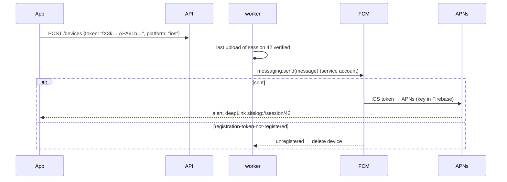

# F16 — Push (backend)

<dl><dd>

- Sprint [S8](README.md) · 3h · each app registers its Firebase Cloud Messaging (FCM) token; when the last upload of a session is verified, the user's phones get one push that opens that session.
- App side: [iOS F16](https://github.com/DAMHONGDUC/site_log_swift_ui/blob/main/docs/feature-guide/S8-realtime-push-quality/F16-push-deeplinks.md) · [Android F16](https://github.com/DAMHONGDUC/site-log-android/blob/main/docs/feature-guide/S8-realtime-push-quality/F16-push-deeplinks.md). Contract: [01-api §10](../../feature-docs/01-api.md#10-devices). Why FCM: [B09](../../feature-docs/00-overview.md#b09--firebase-cloud-messaging-for-push).

</dd></dl>

## Contents

<dl><dd>

1. [Overview](#overview)
2. [1. Firebase setup](#1-firebase-setup)
3. [2. Devices](#2-devices)
4. [3. Sending](#3-sending)
5. [Tests](#tests)
6. [Feature done](#feature-done)

</dd></dl>

## Overview

<dl><dd>

- **Goal:** the worker sends through FCM with the Firebase service account it already has; tokens FCM rejects are forgotten.
- **Demo:** the app registers (iOS Debug or Android); finish a session's uploads; a notification "Uploads verified" opens the session.

| Step | Hours | Files |
|---|---|---|
| [1](#1-firebase-setup) | 0.5 | Firebase console: APNs key for iOS; no new backend secret |
| [2](#2-devices) | 1 | `migrations/0011_devices.sql`, `src/routes/devices.ts`, `src/routes/account.ts`, `src/app.ts` |
| [3](#3-sending) | 1 | `src/push/fcm.ts`, `src/workers/verify.ts`, `src/worker.ts` |
| [Tests](#tests) | 0.5 | `test/worker.test.ts`, `test/devices.test.ts`, `test/push.test.ts` |



- No new package: `firebase-admin` (F02) has `firebase-admin/messaging`.

</dd></dl>

## 1. Firebase setup

<dl><dd>

- Android needs nothing here: FCM is built into its Firebase app.
- iOS: FCM forwards to APNs with an APNs key that lives in Firebase, never on the server.

| # | Where | Do |
|---|---|---|
| 1 | [developer.apple.com](https://developer.apple.com/account/resources/authkeys/list) → **Keys** → **+** | Name `SiteLog APNs`, tick **Apple Push Notifications service (APNs)** |
| 2 | Download | The `.p8` file downloads **once**: save it as `~/secrets/AuthKey_<KEYID>.p8` |
| 3 | Firebase console → `sitelog-dev` → Project settings → **Cloud Messaging** → Apple app `app.dd.site.log` | **APNs Authentication Key** → Upload: the `.p8`, **Key ID**, **Team ID** |
| 4 | Same in `sitelog-prod` | Done in F18, with the same key |

- One APNs key covers sandbox and production; FCM picks the APNs host from the token.
- The service account in `FIREBASE_SERVICE_ACCOUNT_BASE64` (F00a) already has the right to send: no new `.env` line, no new SSM parameter.

</dd></dl>

## 2. Devices

<dl><dd>

#### Overview

<dl><dd>

| Action | File | Holds |
|---|---|---|
| <b class="tag-new">New</b> | `migrations/0011_devices.sql` | `devices (token pk, uid, platform, created_at, updated_at)` |
| <b class="tag-new">New</b> | `src/routes/devices.ts` | `POST /devices` (a token moves to the last user who registered it), `DELETE /devices/:token` |
| <b class="tag-edit">Edit</b> | `src/routes/account.ts` | `devices` joins `serverTables` |
| <b class="tag-edit">Edit</b> | `src/app.ts` | Registers the device routes |

</dd></dl>

#### Steps

<dl><dd>

<details open>
<summary><strong>2.1 Table and routes</strong></summary>
<dl><dd>

<b>File</b> · <b class="tag-new">New</b> · `migrations/0011_devices.sql`

<details>
<summary><b>Code</b></summary>

```sql
-- F16: FCM registration tokens, one row per installed app.
create table devices (
    token       text primary key,
    uid         text not null,
    platform    text not null check (platform in ('ios', 'android')),
    created_at  timestamptz not null default now(),
    updated_at  timestamptz not null default now()
);
create index devices_uid on devices (uid);
```

</details>

---

<b>File</b> · <b class="tag-new">New</b> · `src/routes/devices.ts`

<b>Think</b>

- Alice signs out, Bob signs in on the same phone. Without `on conflict (token) do update set uid`, who would get Bob's pushes?

<details>
<summary><b>Code</b></summary>

```ts
import { Type, type TypeBoxTypeProvider } from '@fastify/type-provider-typebox';
import type { FastifyInstance, preHandlerAsyncHookHandler } from 'fastify';
import type { AppDeps } from '../app.js';

// An FCM token: letters, digits, '_', '-' and ':'.
const TOKEN_PATTERN = '^[A-Za-z0-9_:-]{20,4096}$';

// The app registers its FCM token after sign-in and removes it on sign-out.
export function deviceRoutes(
  app: FastifyInstance,
  deps: AppDeps,
  requireUser: preHandlerAsyncHookHandler,
): void {
  const typed = app.withTypeProvider<TypeBoxTypeProvider>();

  const Body = Type.Object({
    token: Type.String({ pattern: TOKEN_PATTERN }),
    platform: Type.Union([Type.Literal('ios'), Type.Literal('android')]),
  });

  typed.post('/devices', { preHandler: requireUser, schema: { body: Body } }, async (request) => {
    // A token moves to whoever signed in last on that phone.
    await deps.pool.query(
      `insert into devices (token, uid, platform) values ($1, $2, $3)
       on conflict (token) do update set uid = excluded.uid, platform = excluded.platform, updated_at = now()`,
      [request.body.token, request.uid, request.body.platform],
    );
    request.log.info({ uid: request.uid, platform: request.body.platform }, 'device registered');
    return { registered: true };
  });

  const Params = Type.Object({ token: Type.String({ pattern: TOKEN_PATTERN }) });

  typed.delete(
    '/devices/:token',
    { preHandler: requireUser, schema: { params: Params } },
    async (request) => {
      await deps.pool.query('delete from devices where token = $1 and uid = $2', [
        request.params.token,
        request.uid,
      ]);
      request.log.info({ uid: request.uid }, 'device removed');
      return { removed: true };
    },
  );
}
```

</details>

---

<b>File</b> · <b class="tag-edit">Edit</b> · `src/routes/account.ts`

```diff
@@ -6,3 +6,3 @@
 // Server-only tables that also hold the user's rows. A feature that adds one adds it here.
-export const serverTables: string[] = ['uploads', 'sync_state'];
+export const serverTables: string[] = ['uploads', 'devices', 'sync_state'];
 
```

---

<b>File</b> · <b class="tag-edit">Edit</b> · `src/app.ts`

```diff
@@ -11,2 +11,3 @@
 import { accountRoutes } from './routes/account.js';
+import { deviceRoutes } from './routes/devices.js';
 import { healthRoutes } from './routes/health.js';
@@ -50,2 +51,3 @@
   verifyRoutes(app, deps);
+  deviceRoutes(app, deps, requireUser);
   websocketRoutes(app, deps);
```

<details>
<summary><b>Code</b></summary>

```ts
import rateLimit from '@fastify/rate-limit';
import websocket from '@fastify/websocket';
import Fastify, { type FastifyInstance } from 'fastify';
import type pg from 'pg';
import { makeRequireUser, type TokenVerifier } from './auth.js';
import type { Config } from './config.js';
import { registerErrorHandler } from './errors.js';
import { loggerOptions } from './logger.js';
import { RealtimeHub } from './realtime/hub.js';
import { websocketRoutes } from './realtime/ws.js';
import { accountRoutes } from './routes/account.js';
import { deviceRoutes } from './routes/devices.js';
import { healthRoutes } from './routes/health.js';
import { mediaRoutes } from './routes/media.js';
import { syncRoutes } from './routes/sync.js';
import { uploadRoutes } from './routes/uploads.js';
import { verifyRoutes } from './routes/verify.js';
import type { Storage } from './storage.js';

// Everything a route needs, passed in so tests can swap Firebase and S3 for fakes.
export interface AppDeps {
  config: Config;
  pool: pg.Pool;
  tokens: TokenVerifier;
  storage: Storage;
  hub: RealtimeHub;
}

export async function buildApp(deps: AppDeps): Promise<FastifyInstance> {
  const app = Fastify({
    logger: loggerOptions(deps.config.logLevel),
    bodyLimit: deps.config.maxRequestBytes,
    // Caddy sits in front: read the client IP from X-Forwarded-For.
    trustProxy: true,
    // FCM tokens (~160 chars) travel in the path of DELETE /devices/:token; the default limit is 100.
    routerOptions: { maxParamLength: 4096 },
  });

  registerErrorHandler(app);
  app.decorateRequest('uid', '');

  // Off by default: a route opts in with config.rateLimit (POST /uploads, GET /verify).
  await app.register(rateLimit, { global: false });
  await app.register(websocket, { options: { maxPayload: 64 * 1024 } });

  const requireUser = makeRequireUser(deps.tokens);

  healthRoutes(app, deps);
  accountRoutes(app, deps, requireUser);
  syncRoutes(app, deps, requireUser);
  uploadRoutes(app, deps, requireUser);
  mediaRoutes(app, deps, requireUser);
  verifyRoutes(app, deps);
  deviceRoutes(app, deps, requireUser);
  websocketRoutes(app, deps);

  return app;
}
```

</details>

</dd></dl>
</details>

</dd></dl>

</dd></dl>

## 3. Sending

<dl><dd>

#### Overview

<dl><dd>

| Action | File | Holds |
|---|---|---|
| <b class="tag-new">New</b> | `src/push/fcm.ts` | `PushSender` interface, `FcmSender` (`firebase-admin/messaging`), `pushMessage`, `hashedAccount` |
| <b class="tag-edit">Edit</b> | `src/workers/verify.ts` | `push` in `WorkerDeps`; one push when a session has nothing left to verify |
| <b class="tag-edit">Edit</b> | `src/worker.ts` | Builds `FcmSender` when the Firebase service account is set |

| Platform | FCM message | Why |
|---|---|---|
| `ios` | `notification` (title, body) + `data` (`deepLink`, `account`) + `apns.payload.aps.sound` | iOS shows the alert itself, even when the app is closed |
| `android` | `data` only (`deepLink`, `account`, `title`, `body`), `android.priority: "high"` | The app builds the notification, so it can drop a push for another account |

</dd></dl>

#### Steps

<dl><dd>

<details open>
<summary><strong>3.1 FCM</strong></summary>
<dl><dd>

<b>File</b> · <b class="tag-new">New</b> · `src/push/fcm.ts`

<b>Explain</b> · `messaging.send(message)` delivers to one token; for an iOS token FCM calls APNs with the key from step 1. The message carries a destination only — no names, no coordinates.

<b>Think</b>

- Why does the message carry a hash of the uid instead of the uid? (Who can read a notification on a lock screen or in logs?)

<details open>
<summary><b>Hint 2 · APIs</b></summary>

- `import { getMessaging, type Message } from 'firebase-admin/messaging'`, `getMessaging(app).send(message)`.
- `initializeApp({ credential: cert(json) }, 'push')`: a named app, so it never clashes with the default one.
- A rejected token throws an error whose `code` is `messaging/registration-token-not-registered` or `messaging/invalid-registration-token`.

</details>

<details>
<summary><b>Code</b></summary>

```ts
import { createHash } from 'node:crypto';
import { cert, initializeApp } from 'firebase-admin/app';
import { getMessaging, type Message, type Messaging } from 'firebase-admin/messaging';

export type DevicePlatform = 'ios' | 'android';
export type PushOutcome = 'sent' | 'unregistered';

export interface PushMessage {
  title: string;
  body: string;
  deepLink: string;
  uid: string;
}

// Sends one notification. Tests use a fake; production goes through Firebase Cloud Messaging.
export interface PushSender {
  send(token: string, platform: DevicePlatform, message: PushMessage): Promise<PushOutcome>;
}

// The app ignores a push meant for another account signed in earlier on the same phone.
export function hashedAccount(uid: string): string {
  return createHash('sha256').update(uid).digest('hex').slice(0, 16);
}

// Only a destination: no names, no coordinates.
export function pushMessage(
  token: string,
  platform: DevicePlatform,
  message: PushMessage,
): Message {
  const account = hashedAccount(message.uid);
  if (platform === 'ios') {
    return {
      token,
      notification: { title: message.title, body: message.body },
      data: { deepLink: message.deepLink, account },
      apns: { payload: { aps: { sound: 'default' } } },
    };
  }
  return {
    token,
    data: { deepLink: message.deepLink, account, title: message.title, body: message.body },
    android: { priority: 'high' },
  };
}

// FCM answers with these codes when the app was removed or the token is stale.
const UNREGISTERED_CODES = [
  'messaging/registration-token-not-registered',
  'messaging/invalid-registration-token',
];

export class FcmSender implements PushSender {
  private readonly messaging: Messaging;

  constructor(serviceAccountBase64: string) {
    const json = Buffer.from(serviceAccountBase64, 'base64').toString('utf8');
    const serviceAccount = JSON.parse(json);
    const firebaseApp = initializeApp({ credential: cert(serviceAccount) }, 'push');
    this.messaging = getMessaging(firebaseApp);
  }

  async send(
    token: string,
    platform: DevicePlatform,
    message: PushMessage,
  ): Promise<PushOutcome> {
    try {
      await this.messaging.send(pushMessage(token, platform, message));
      return 'sent';
    } catch (error) {
      const code = (error as { code?: string }).code ?? '';
      if (UNREGISTERED_CODES.includes(code)) {
        return 'unregistered';
      }
      // Anything else (quota, network) goes to the caller, which logs it.
      throw error;
    }
  }
}
```

</details>

---

<b>File</b> · <b class="tag-edit">Edit</b> · `src/workers/verify.ts`

<b>Explain</b> · "Session done" = no upload of that session is still `created` or `registered`.

```diff
@@ -3,2 +3,3 @@
 import type { Logger } from 'pino';
+import type { DevicePlatform, PushSender } from '../push/fcm.js';
 import { notifyUploadEvent } from '../realtime/events.js';
@@ -9,2 +10,3 @@
   storage: Storage;
+  push: PushSender | undefined;
   log: Logger;
@@ -69,3 +71,47 @@
 
+  if (state === 'verified' && upload.session_id !== null) {
+    await pushWhenSessionVerified(deps, upload.uid, upload.session_id);
+  }
   return true;
 }
+
+// F16: one push when the last upload of a session is verified.
+async function pushWhenSessionVerified(
+  deps: WorkerDeps,
+  uid: string,
+  sessionId: string,
+): Promise<void> {
+  if (deps.push === undefined) {
+    return;
+  }
+  const pending = await deps.pool.query(
+    `select 1 from uploads
+      where uid = $1 and session_id = $2
+        and (state = 'created' or verify_state = 'registered')
+      limit 1`,
+    [uid, sessionId],
+  );
+  if (pending.rows.length > 0) {
+    return;
+  }
+  const devices = await deps.pool.query<{ token: string; platform: DevicePlatform }>(
+    'select token, platform from devices where uid = $1',
+    [uid],
+  );
+  for (const device of devices.rows) {
+    try {
+      const outcome = await deps.push.send(device.token, device.platform, {
+        title: 'Uploads verified',
+        body: 'Every file in the session is stored and checked.',
+        deepLink: `sitelog://session/${sessionId}`,
+        uid,
+      });
+      if (outcome === 'unregistered') {
+        await deps.pool.query('delete from devices where token = $1', [device.token]);
+      }
+      deps.log.info({ uid, sessionId, platform: device.platform, outcome }, 'push sent');
+    } catch (error) {
+      deps.log.error({ err: error, uid, sessionId, platform: device.platform }, 'push failed');
+    }
+  }
+}
```

<details>
<summary><b>Code</b></summary>

```ts
import { createHash } from 'node:crypto';
import type pg from 'pg';
import type { Logger } from 'pino';
import type { DevicePlatform, PushSender } from '../push/fcm.js';
import { notifyUploadEvent } from '../realtime/events.js';
import type { Storage } from '../storage.js';

export interface WorkerDeps {
  pool: pg.Pool;
  storage: Storage;
  push: PushSender | undefined;
  log: Logger;
}

interface ClaimedUpload {
  id: string;
  uid: string;
  object_key: string;
  sha256: string;
  session_id: string | null;
}

// A claim older than this belongs to a worker that crashed; another one may take it.
const CLAIM_TIMEOUT = '30 minutes';

// Takes the oldest unverified upload, streams it back from S3 and recomputes SHA-256.
// Returns false when there was nothing to do.
export async function verifyNextUpload(deps: WorkerDeps): Promise<boolean> {
  const claimed = await deps.pool.query<ClaimedUpload>(
    `update uploads set verify_claimed_at = now()
      where id = (
        select id from uploads
         where state = 'completed' and verify_state = 'registered'
           and (verify_claimed_at is null or verify_claimed_at < now() - interval '${CLAIM_TIMEOUT}')
         order by completed_at
         limit 1
         for update skip locked
      )
  returning id, uid, object_key, sha256, session_id`,
  );
  const upload = claimed.rows[0];
  if (upload === undefined) {
    return false;
  }

  const hash = createHash('sha256');
  const stream = await deps.storage.readStream(upload.object_key);
  for await (const chunk of stream) {
    hash.update(chunk as Buffer);
  }
  const actual = hash.digest('hex');

  let state: 'verified' | 'mismatch' = 'verified';
  if (actual !== upload.sha256) {
    state = 'mismatch';
  }
  await deps.pool.query(`update uploads set verify_state = $2, verified_at = now() where id = $1`, [
    upload.id,
    state,
  ]);
  await notifyUploadEvent(deps.pool, {
    uid: upload.uid,
    sessionId: upload.session_id,
    uploadId: upload.id,
    type: state,
  });
  deps.log.info(
    { uid: upload.uid, uploadId: upload.id, key: upload.object_key, state },
    'upload verified',
  );

  if (state === 'verified' && upload.session_id !== null) {
    await pushWhenSessionVerified(deps, upload.uid, upload.session_id);
  }
  return true;
}

// F16: one push when the last upload of a session is verified.
async function pushWhenSessionVerified(
  deps: WorkerDeps,
  uid: string,
  sessionId: string,
): Promise<void> {
  if (deps.push === undefined) {
    return;
  }
  const pending = await deps.pool.query(
    `select 1 from uploads
      where uid = $1 and session_id = $2
        and (state = 'created' or verify_state = 'registered')
      limit 1`,
    [uid, sessionId],
  );
  if (pending.rows.length > 0) {
    return;
  }
  const devices = await deps.pool.query<{ token: string; platform: DevicePlatform }>(
    'select token, platform from devices where uid = $1',
    [uid],
  );
  for (const device of devices.rows) {
    try {
      const outcome = await deps.push.send(device.token, device.platform, {
        title: 'Uploads verified',
        body: 'Every file in the session is stored and checked.',
        deepLink: `sitelog://session/${sessionId}`,
        uid,
      });
      if (outcome === 'unregistered') {
        await deps.pool.query('delete from devices where token = $1', [device.token]);
      }
      deps.log.info({ uid, sessionId, platform: device.platform, outcome }, 'push sent');
    } catch (error) {
      deps.log.error({ err: error, uid, sessionId, platform: device.platform }, 'push failed');
    }
  }
}
```

</details>

---

<b>File</b> · <b class="tag-edit">Edit</b> · `src/worker.ts`

```diff
@@ -4,2 +4,3 @@
 import { createLogger } from './logger.js';
+import { FcmSender, type PushSender } from './push/fcm.js';
 import { Storage, createS3Client } from './storage.js';
@@ -18,3 +19,7 @@
 );
-const deps: WorkerDeps = { pool, storage, log };
+let push: PushSender | undefined = undefined;
+if (config.firebaseServiceAccountBase64 !== undefined) {
+  push = new FcmSender(config.firebaseServiceAccountBase64);
+}
+const deps: WorkerDeps = { pool, storage, push, log };
 
```

```bash
npm run migrate && npm run worker:dev
```

<b>Try</b>

- Register a made-up token (`POST /devices` with `{"token": "fake:` + 40 `a`s + `", "platform": "android"}`), finish a session's uploads: the worker logs `outcome: "unregistered"` and the row is gone.

</dd></dl>
</details>

</dd></dl>

</dd></dl>

## Tests

<dl><dd>

<details open>
<summary><strong>Test files</strong></summary>
<dl><dd>

<b>File</b> · <b class="tag-edit">Edit</b> · `test/worker.test.ts`

<b>Explain</b> · `WorkerDeps` now has `push`; these tests pass `undefined`.

```diff
@@ -30,2 +30,3 @@
       storage: context.storage,
+      push: undefined,
       log: createLogger('silent'),
```

---

<b>File</b> · <b class="tag-new">New</b> · `test/devices.test.ts`

<details>
<summary><b>Code</b></summary>

```ts
import { afterAll, beforeAll, beforeEach, describe, expect, it } from 'vitest';
import {
  auth,
  closeTestContext,
  createTestContext,
  resetDatabase,
  type TestContext,
} from './helpers.js';

describe('devices', () => {
  let context: TestContext;
  beforeAll(async () => {
    context = await createTestContext();
  });
  afterAll(async () => {
    await closeTestContext(context);
  });
  beforeEach(async () => {
    await resetDatabase(context.pool);
  });

  const token = 'fX3k:APA91b' + 'a'.repeat(140);

  it('moves a token to whoever registered it last', async () => {
    for (const uid of ['alice', 'bob']) {
      const response = await context.app.inject({
        method: 'POST',
        url: '/devices',
        headers: auth(uid),
        payload: { token, platform: 'ios' },
      });
      expect(response.statusCode).toBe(200);
    }
    const rows = await context.pool.query('select uid from devices');
    expect(rows.rows).toEqual([{ uid: 'bob' }]);
  });

  it('removes a token on sign-out', async () => {
    await context.app.inject({
      method: 'POST',
      url: '/devices',
      headers: auth('alice'),
      payload: { token, platform: 'android' },
    });
    await context.app.inject({
      method: 'DELETE',
      url: `/devices/${token}`,
      headers: auth('alice'),
    });
    const rows = await context.pool.query('select * from devices');
    expect(rows.rows).toHaveLength(0);
  });
});
```

</details>

---

<b>File</b> · <b class="tag-new">New</b> · `test/push.test.ts`

<details>
<summary><b>Code</b></summary>

```ts
import { GetObjectCommand } from '@aws-sdk/client-s3';
import { afterAll, beforeAll, beforeEach, describe, expect, it } from 'vitest';
import { createLogger } from '../src/logger.js';
import {
  pushMessage,
  type DevicePlatform,
  type PushMessage,
  type PushOutcome,
  type PushSender,
} from '../src/push/fcm.js';
import { verifyNextUpload, type WorkerDeps } from '../src/workers/verify.js';
import { contentHash, insertCompletedUpload, objectBody } from './fixtures.js';
import {
  closeTestContext,
  createTestContext,
  ids,
  resetDatabase,
  type TestContext,
} from './helpers.js';

// Records what would go to FCM, and answers with a chosen outcome.
class FakePush implements PushSender {
  sent: PushMessage[] = [];
  outcome: PushOutcome = 'sent';
  async send(_token: string, _platform: DevicePlatform, message: PushMessage) {
    this.sent.push(message);
    return this.outcome;
  }
}

describe('push when a session is verified', () => {
  let context: TestContext;
  let push: FakePush;
  let deps: WorkerDeps;
  beforeAll(async () => {
    context = await createTestContext();
  });
  afterAll(async () => {
    await closeTestContext(context);
  });
  beforeEach(async () => {
    await resetDatabase(context.pool);
    context.s3.reset();
    context.s3.on(GetObjectCommand).callsFake(() => ({ Body: objectBody('photo bytes') }) as never);
    push = new FakePush();
    deps = { pool: context.pool, storage: context.storage, push, log: createLogger('silent') };
    await context.pool.query(
      `insert into devices (token, uid, platform) values ($1, 'alice', 'ios')`,
      ['fX3k:APA91b' + 'a'.repeat(140)],
    );
  });

  it('pushes once, after the last upload of the session', async () => {
    await insertCompletedUpload(context.pool, { sha256: contentHash, code: 'AAAAAAAAA2' });
    await insertCompletedUpload(context.pool, { sha256: contentHash, code: 'AAAAAAAAA3' });
    await verifyNextUpload(deps);
    expect(push.sent).toHaveLength(0);
    await verifyNextUpload(deps);
    expect(push.sent).toHaveLength(1);
    expect(push.sent[0]!.deepLink).toBe(`sitelog://session/${ids.session}`);
  });

  it('forgets a device FCM no longer knows', async () => {
    push.outcome = 'unregistered';
    await insertCompletedUpload(context.pool, { sha256: contentHash });
    await verifyNextUpload(deps);
    const devices = await context.pool.query('select * from devices');
    expect(devices.rows).toHaveLength(0);
  });

  it('sends only a destination and a hashed account, shaped per platform', () => {
    const message: PushMessage = {
      title: 't',
      body: 'b',
      deepLink: 'sitelog://session/1',
      uid: 'alice',
    };
    const ios = pushMessage('token', 'ios', message);
    const android = pushMessage('token', 'android', message);
    expect(JSON.stringify(ios)).not.toContain('alice');
    expect(JSON.stringify(android)).not.toContain('alice');
    expect('notification' in ios).toBe(true);
    expect('notification' in android).toBe(false);
  });
});
```

</details>

```bash
npm test
```

</dd></dl>
</details>

</dd></dl>

## Feature done

<dl><dd>

- [ ] An iPhone (Debug) and an Android phone get "Uploads verified" and open the session
- [ ] A token FCM rejects is deleted
- [ ] `npm test` green (74 tests); the APNs key is uploaded in the `sitelog-dev` Firebase project

</dd></dl>
