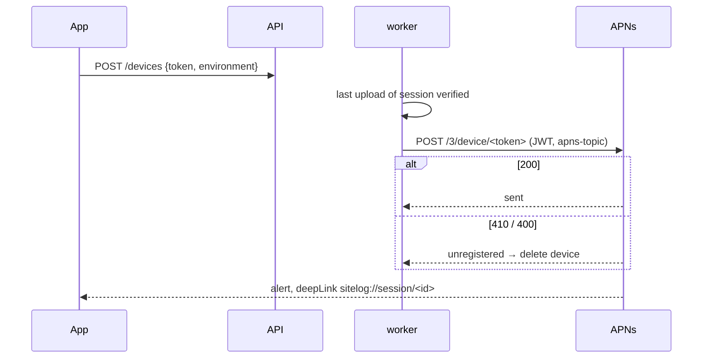

# F16 — Push (backend)

<dl><dd>

- Sprint [S8](README.md) · 3h · the app registers its APNs token; when the last upload of a session is verified, the user's phones get one push that opens that session.
- iOS side: [F16 Push and deep links](https://github.com/DAMHONGDUC/site_log_swift_ui/blob/main/docs/feature-guide/S8-realtime-push-quality/F16-push-deeplinks.md). Contract: [01-api §10](../../feature-docs/01-api.md#10-devices).

</dd></dl>

## Contents

<dl><dd>

1. [Overview](#overview)
2. [1. APNs key](#1-apns-key)
3. [2. Devices](#2-devices)
4. [3. Sending](#3-sending)
5. [Tests](#tests)
6. [Feature done](#feature-done)

</dd></dl>

## Overview

<dl><dd>

- **Goal:** token-based APNs from the worker; tokens Apple rejects are forgotten.
- **Demo:** the app registers on a real iPhone (Debug → `sandbox`); finish a session's uploads; a notification "Uploads verified" opens the session.

| Step | Hours | Files |
|---|---|---|
| [1](#1-apns-key) | 0.5 | Apple Developer key → `.env` and SSM |
| [2](#2-devices) | 1 | `migrations/0011_devices.sql`, `src/routes/devices.ts`, `src/routes/account.ts`, `src/app.ts` |
| [3](#3-sending) | 1 | `src/push/apns.ts`, `src/workers/verify.ts`, `src/worker.ts` |
| [Tests](#tests) | 0.5 | `test/worker.test.ts`, `test/devices.test.ts`, `test/push.test.ts` |



```bash
npm install jose
```

</dd></dl>

## 1. APNs key

<dl><dd>

| # | Where | Do |
|---|---|---|
| 1 | [developer.apple.com](https://developer.apple.com/account/resources/authkeys/list) → **Keys** → **+** | Name `SiteLog APNs`, tick **Apple Push Notifications service (APNs)** |
| 2 | Download | The `.p8` file downloads **once**: save it as `~/secrets/AuthKey_<KEYID>.p8` |
| 3 | Note | **Key ID** (10 characters), **Team ID** (top right of the account page), bundle id `app.dd.site.log` |

- Local `.env`:

```bash
echo "APNS_KEY_P8_BASE64=$(base64 -i ~/secrets/AuthKey_<KEYID>.p8)" >> .env
```

- And set `APNS_KEY_ID`, `APNS_TEAM_ID`, `APNS_BUNDLE_ID` in `.env`. On AWS, one parameter each:

```bash
aws ssm put-parameter --name /sitelog/staging/APNS_KEY_P8_BASE64 --type SecureString --value "$(base64 -i ~/secrets/AuthKey_<KEYID>.p8)"
```

```bash
for n in APNS_KEY_ID:<KEYID> APNS_TEAM_ID:<TEAMID> APNS_BUNDLE_ID:app.dd.site.log; do aws ssm put-parameter --name /sitelog/staging/${n%%:*} --type SecureString --value ${n#*:}; done
```

- One key works for both `sandbox` and `production`; only the host differs.

</dd></dl>

## 2. Devices

<dl><dd>

#### Overview

<dl><dd>

| Action | File | Holds |
|---|---|---|
| <b class="tag-new">New</b> | `migrations/0011_devices.sql` | `devices (token pk, uid, environment, created_at, updated_at)` |
| <b class="tag-new">New</b> | `src/routes/devices.ts` | `POST /devices` (a token moves to the last user who registered it), `DELETE /devices/:token` |
| <b class="tag-edit">Edit</b> | `src/routes/account.ts` | `devices` joins `serverTables` |
| <b class="tag-edit">Edit</b> | `src/app.ts` | Registers the device routes |

</dd></dl>

#### Steps

<dl><dd>

<details open>
<summary><strong>2.1 Table and routes</strong></summary>
<dl><dd>

<b>File</b> · <b class="tag-new">New</b> · `migrations/0011_devices.sql`

<details>
<summary><b>Code</b></summary>

```sql
-- F16: APNs device tokens, one row per installed app.
create table devices (
    token       text primary key,
    uid         text not null,
    environment text not null check (environment in ('sandbox', 'production')),
    created_at  timestamptz not null default now(),
    updated_at  timestamptz not null default now()
);
create index devices_uid on devices (uid);
```

</details>

---

<b>File</b> · <b class="tag-new">New</b> · `src/routes/devices.ts`

<b>Think</b>

- Alice signs out, Bob signs in on the same phone. Without `on conflict (token) do update set uid`, who would get Bob's pushes?

<details>
<summary><b>Code</b></summary>

```ts
import { Type, type TypeBoxTypeProvider } from '@fastify/type-provider-typebox';
import type { FastifyInstance, preHandlerAsyncHookHandler } from 'fastify';
import type { AppDeps } from '../app.js';

// The app registers its APNs token after sign-in and removes it on sign-out.
export function deviceRoutes(
  app: FastifyInstance,
  deps: AppDeps,
  requireUser: preHandlerAsyncHookHandler,
): void {
  const typed = app.withTypeProvider<TypeBoxTypeProvider>();

  const Body = Type.Object({
    token: Type.String({ pattern: '^[0-9a-f]{64,200}$' }),
    environment: Type.Union([Type.Literal('sandbox'), Type.Literal('production')]),
  });

  typed.post('/devices', { preHandler: requireUser, schema: { body: Body } }, async (request) => {
    // A token moves to whoever signed in last on that phone.
    await deps.pool.query(
      `insert into devices (token, uid, environment) values ($1, $2, $3)
       on conflict (token) do update set uid = excluded.uid, environment = excluded.environment, updated_at = now()`,
      [request.body.token, request.uid, request.body.environment],
    );
    request.log.info(
      { uid: request.uid, environment: request.body.environment },
      'device registered',
    );
    return { registered: true };
  });

  const Params = Type.Object({ token: Type.String({ pattern: '^[0-9a-f]{64,200}$' }) });

  typed.delete(
    '/devices/:token',
    { preHandler: requireUser, schema: { params: Params } },
    async (request) => {
      await deps.pool.query('delete from devices where token = $1 and uid = $2', [
        request.params.token,
        request.uid,
      ]);
      request.log.info({ uid: request.uid }, 'device removed');
      return { removed: true };
    },
  );
}
```

</details>

---

<b>File</b> · <b class="tag-edit">Edit</b> · `src/routes/account.ts`

```diff
@@ -6,3 +6,3 @@
 // Server-only tables that also hold the user's rows. A feature that adds one adds it here.
-export const serverTables: string[] = ['uploads', 'sync_state'];
+export const serverTables: string[] = ['uploads', 'devices', 'sync_state'];
 
```

---

<b>File</b> · <b class="tag-edit">Edit</b> · `src/app.ts`

```diff
@@ -11,2 +11,3 @@
 import { accountRoutes } from './routes/account.js';
+import { deviceRoutes } from './routes/devices.js';
 import { healthRoutes } from './routes/health.js';
@@ -50,2 +51,3 @@
   verifyRoutes(app, deps);
+  deviceRoutes(app, deps, requireUser);
   websocketRoutes(app, deps);
```

<details>
<summary><b>Code</b></summary>

```ts
import rateLimit from '@fastify/rate-limit';
import websocket from '@fastify/websocket';
import Fastify, { type FastifyInstance } from 'fastify';
import type pg from 'pg';
import { makeRequireUser, type TokenVerifier } from './auth.js';
import type { Config } from './config.js';
import { registerErrorHandler } from './errors.js';
import { loggerOptions } from './logger.js';
import { RealtimeHub } from './realtime/hub.js';
import { websocketRoutes } from './realtime/ws.js';
import { accountRoutes } from './routes/account.js';
import { deviceRoutes } from './routes/devices.js';
import { healthRoutes } from './routes/health.js';
import { mediaRoutes } from './routes/media.js';
import { syncRoutes } from './routes/sync.js';
import { uploadRoutes } from './routes/uploads.js';
import { verifyRoutes } from './routes/verify.js';
import type { Storage } from './storage.js';

// Everything a route needs, passed in so tests can swap Firebase and S3 for fakes.
export interface AppDeps {
  config: Config;
  pool: pg.Pool;
  tokens: TokenVerifier;
  storage: Storage;
  hub: RealtimeHub;
}

export async function buildApp(deps: AppDeps): Promise<FastifyInstance> {
  const app = Fastify({
    logger: loggerOptions(deps.config.logLevel),
    bodyLimit: deps.config.maxRequestBytes,
    // Caddy sits in front: read the client IP from X-Forwarded-For.
    trustProxy: true,
  });

  registerErrorHandler(app);
  app.decorateRequest('uid', '');

  // Off by default: a route opts in with config.rateLimit (POST /uploads, GET /verify).
  await app.register(rateLimit, { global: false });
  await app.register(websocket, { options: { maxPayload: 64 * 1024 } });

  const requireUser = makeRequireUser(deps.tokens);

  healthRoutes(app, deps);
  accountRoutes(app, deps, requireUser);
  syncRoutes(app, deps, requireUser);
  uploadRoutes(app, deps, requireUser);
  mediaRoutes(app, deps, requireUser);
  verifyRoutes(app, deps);
  deviceRoutes(app, deps, requireUser);
  websocketRoutes(app, deps);

  return app;
}
```

</details>

</dd></dl>
</details>

</dd></dl>

</dd></dl>

## 3. Sending

<dl><dd>

#### Overview

<dl><dd>

| Action | File | Holds |
|---|---|---|
| <b class="tag-new">New</b> | `src/push/apns.ts` | `PushSender` interface, `ApnsSender` (HTTP/2 + ES256 JWT reused 50 min), `pushPayload`, `hashedAccount` |
| <b class="tag-edit">Edit</b> | `src/workers/verify.ts` | `push` in `WorkerDeps`; one push when a session has nothing left to verify |
| <b class="tag-edit">Edit</b> | `src/worker.ts` | Builds `ApnsSender` when the APNs settings exist |

</dd></dl>

#### Steps

<dl><dd>

<details open>
<summary><strong>3.1 APNs</strong></summary>
<dl><dd>

<b>File</b> · <b class="tag-new">New</b> · `src/push/apns.ts`

<b>Explain</b> · Apple accepts a JWT signed with your `.p8` key for up to an hour; signing one per push would be refused as too frequent. The payload carries a destination only — no names, no coordinates.

<b>Think</b>

- Why does the payload carry a hash of the uid instead of the uid? (Who can read a notification on a lock screen or in logs?)

<details open>
<summary><b>Hint 2 · APIs</b></summary>

- `importPKCS8(pem, 'ES256')`, `new SignJWT({}).setProtectedHeader({ alg: 'ES256', kid }).setIssuer(teamId).setIssuedAt().sign(key)`.
- `http2.connect(host)`, `session.request({ ':method': 'POST', ':path': …, authorization, 'apns-topic', 'apns-push-type': 'alert' })`, `request.on('response', headers => headers[':status'])`.

</details>

<details>
<summary><b>Code</b></summary>

```ts
import { createHash } from 'node:crypto';
import http2 from 'node:http2';
import { SignJWT, importPKCS8 } from 'jose';
import type { ApnsConfig } from '../config.js';

export type PushOutcome = 'sent' | 'unregistered' | 'failed';

export interface PushMessage {
  title: string;
  body: string;
  deepLink: string;
  uid: string;
}

// Sends one notification. Tests use a fake; production talks to Apple over HTTP/2.
export interface PushSender {
  send(
    deviceToken: string,
    environment: 'sandbox' | 'production',
    message: PushMessage,
  ): Promise<PushOutcome>;
}

// The app ignores a push meant for another account signed in earlier on the same phone.
export function hashedAccount(uid: string): string {
  return createHash('sha256').update(uid).digest('hex').slice(0, 16);
}

export function pushPayload(message: PushMessage): object {
  // Only a destination: no names, no coordinates.
  return {
    aps: { alert: { title: message.title, body: message.body }, sound: 'default' },
    deepLink: message.deepLink,
    account: hashedAccount(message.uid),
  };
}

const HOSTS = {
  sandbox: 'https://api.sandbox.push.apple.com',
  production: 'https://api.push.apple.com',
};

// Token-based APNs auth: a short JWT signed with the .p8 key, reused for up to an hour.
export class ApnsSender implements PushSender {
  private readonly config: ApnsConfig;
  private cachedJwt: { value: string; createdAt: number } | undefined;

  constructor(config: ApnsConfig) {
    this.config = config;
  }

  private async jwt(): Promise<string> {
    const fiftyMinutes = 50 * 60 * 1000;
    if (this.cachedJwt !== undefined && Date.now() - this.cachedJwt.createdAt < fiftyMinutes) {
      return this.cachedJwt.value;
    }
    const key = await importPKCS8(this.config.keyP8, 'ES256');
    const value = await new SignJWT({})
      .setProtectedHeader({ alg: 'ES256', kid: this.config.keyId })
      .setIssuer(this.config.teamId)
      .setIssuedAt()
      .sign(key);
    this.cachedJwt = { value, createdAt: Date.now() };
    return value;
  }

  async send(
    deviceToken: string,
    environment: 'sandbox' | 'production',
    message: PushMessage,
  ): Promise<PushOutcome> {
    const jwt = await this.jwt();
    const session = http2.connect(HOSTS[environment]);
    try {
      const status = await new Promise<number>((resolve, reject) => {
        const request = session.request({
          ':method': 'POST',
          ':path': `/3/device/${deviceToken}`,
          authorization: `bearer ${jwt}`,
          'apns-topic': this.config.bundleId,
          'apns-push-type': 'alert',
          'apns-priority': '10',
        });
        let code = 0;
        request.on('response', (headers) => {
          code = Number(headers[':status']);
        });
        request.on('error', reject);
        request.on('end', () => resolve(code));
        request.resume();
        request.end(JSON.stringify(pushPayload(message)));
      });
      if (status === 200) {
        return 'sent';
      }
      // 410: the app was removed; 400 is usually a token from the other environment.
      if (status === 410 || status === 400) {
        return 'unregistered';
      }
      return 'failed';
    } finally {
      session.close();
    }
  }
}
```

</details>

---

<b>File</b> · <b class="tag-edit">Edit</b> · `src/workers/verify.ts`

<b>Explain</b> · "Session done" = no upload of that session is still `created` or `registered`.

```diff
@@ -3,2 +3,3 @@
 import type { Logger } from 'pino';
+import type { PushSender } from '../push/apns.js';
 import { notifyUploadEvent } from '../realtime/events.js';
@@ -9,2 +10,3 @@
   storage: Storage;
+  push: PushSender | undefined;
   log: Logger;
@@ -69,3 +71,47 @@
 
+  if (state === 'verified' && upload.session_id !== null) {
+    await pushWhenSessionVerified(deps, upload.uid, upload.session_id);
+  }
   return true;
 }
+
+// F16: one push when the last upload of a session is verified.
+async function pushWhenSessionVerified(
+  deps: WorkerDeps,
+  uid: string,
+  sessionId: string,
+): Promise<void> {
+  if (deps.push === undefined) {
+    return;
+  }
+  const pending = await deps.pool.query(
+    `select 1 from uploads
+      where uid = $1 and session_id = $2
+        and (state = 'created' or verify_state = 'registered')
+      limit 1`,
+    [uid, sessionId],
+  );
+  if (pending.rows.length > 0) {
+    return;
+  }
+  const devices = await deps.pool.query<{ token: string; environment: 'sandbox' | 'production' }>(
+    'select token, environment from devices where uid = $1',
+    [uid],
+  );
+  for (const device of devices.rows) {
+    try {
+      const outcome = await deps.push.send(device.token, device.environment, {
+        title: 'Uploads verified',
+        body: 'Every file in the session is stored and checked.',
+        deepLink: `sitelog://session/${sessionId}`,
+        uid,
+      });
+      if (outcome === 'unregistered') {
+        await deps.pool.query('delete from devices where token = $1', [device.token]);
+      }
+      deps.log.info({ uid, sessionId, outcome }, 'push sent');
+    } catch (error) {
+      deps.log.error({ err: error, uid, sessionId }, 'push failed');
+    }
+  }
+}
```

<details>
<summary><b>Code</b></summary>

```ts
import { createHash } from 'node:crypto';
import type pg from 'pg';
import type { Logger } from 'pino';
import type { PushSender } from '../push/apns.js';
import { notifyUploadEvent } from '../realtime/events.js';
import type { Storage } from '../storage.js';

export interface WorkerDeps {
  pool: pg.Pool;
  storage: Storage;
  push: PushSender | undefined;
  log: Logger;
}

interface ClaimedUpload {
  id: string;
  uid: string;
  object_key: string;
  sha256: string;
  session_id: string | null;
}

// A claim older than this belongs to a worker that crashed; another one may take it.
const CLAIM_TIMEOUT = '30 minutes';

// Takes the oldest unverified upload, streams it back from S3 and recomputes SHA-256.
// Returns false when there was nothing to do.
export async function verifyNextUpload(deps: WorkerDeps): Promise<boolean> {
  const claimed = await deps.pool.query<ClaimedUpload>(
    `update uploads set verify_claimed_at = now()
      where id = (
        select id from uploads
         where state = 'completed' and verify_state = 'registered'
           and (verify_claimed_at is null or verify_claimed_at < now() - interval '${CLAIM_TIMEOUT}')
         order by completed_at
         limit 1
         for update skip locked
      )
  returning id, uid, object_key, sha256, session_id`,
  );
  const upload = claimed.rows[0];
  if (upload === undefined) {
    return false;
  }

  const hash = createHash('sha256');
  const stream = await deps.storage.readStream(upload.object_key);
  for await (const chunk of stream) {
    hash.update(chunk as Buffer);
  }
  const actual = hash.digest('hex');

  let state: 'verified' | 'mismatch' = 'verified';
  if (actual !== upload.sha256) {
    state = 'mismatch';
  }
  await deps.pool.query(`update uploads set verify_state = $2, verified_at = now() where id = $1`, [
    upload.id,
    state,
  ]);
  await notifyUploadEvent(deps.pool, {
    uid: upload.uid,
    sessionId: upload.session_id,
    uploadId: upload.id,
    type: state,
  });
  deps.log.info(
    { uid: upload.uid, uploadId: upload.id, key: upload.object_key, state },
    'upload verified',
  );

  if (state === 'verified' && upload.session_id !== null) {
    await pushWhenSessionVerified(deps, upload.uid, upload.session_id);
  }
  return true;
}

// F16: one push when the last upload of a session is verified.
async function pushWhenSessionVerified(
  deps: WorkerDeps,
  uid: string,
  sessionId: string,
): Promise<void> {
  if (deps.push === undefined) {
    return;
  }
  const pending = await deps.pool.query(
    `select 1 from uploads
      where uid = $1 and session_id = $2
        and (state = 'created' or verify_state = 'registered')
      limit 1`,
    [uid, sessionId],
  );
  if (pending.rows.length > 0) {
    return;
  }
  const devices = await deps.pool.query<{ token: string; environment: 'sandbox' | 'production' }>(
    'select token, environment from devices where uid = $1',
    [uid],
  );
  for (const device of devices.rows) {
    try {
      const outcome = await deps.push.send(device.token, device.environment, {
        title: 'Uploads verified',
        body: 'Every file in the session is stored and checked.',
        deepLink: `sitelog://session/${sessionId}`,
        uid,
      });
      if (outcome === 'unregistered') {
        await deps.pool.query('delete from devices where token = $1', [device.token]);
      }
      deps.log.info({ uid, sessionId, outcome }, 'push sent');
    } catch (error) {
      deps.log.error({ err: error, uid, sessionId }, 'push failed');
    }
  }
}
```

</details>

---

<b>File</b> · <b class="tag-edit">Edit</b> · `src/worker.ts`

```diff
@@ -4,2 +4,3 @@
 import { createLogger } from './logger.js';
+import { ApnsSender, type PushSender } from './push/apns.js';
 import { Storage, createS3Client } from './storage.js';
@@ -18,3 +19,7 @@
 );
-const deps: WorkerDeps = { pool, storage, log };
+let push: PushSender | undefined = undefined;
+if (config.apns !== undefined) {
+  push = new ApnsSender(config.apns);
+}
+const deps: WorkerDeps = { pool, storage, push, log };
 
```

```bash
npm run migrate && npm run worker:dev
```

<b>Try</b>

- Register a made-up token (`POST /devices` with 64 `a`s, `sandbox`), finish a session's uploads: the worker logs `outcome: "unregistered"` and the row is gone.

</dd></dl>
</details>

</dd></dl>

</dd></dl>

## Tests

<dl><dd>

<details open>
<summary><strong>Test files</strong></summary>
<dl><dd>

<b>File</b> · <b class="tag-edit">Edit</b> · `test/worker.test.ts`

<b>Explain</b> · `WorkerDeps` now has `push`; these tests pass `undefined`.

```diff
@@ -30,2 +30,3 @@
       storage: context.storage,
+      push: undefined,
       log: createLogger('silent'),
```

---

<b>File</b> · <b class="tag-new">New</b> · `test/devices.test.ts`

<details>
<summary><b>Code</b></summary>

```ts
import { afterAll, beforeAll, beforeEach, describe, expect, it } from 'vitest';
import {
  auth,
  closeTestContext,
  createTestContext,
  resetDatabase,
  type TestContext,
} from './helpers.js';

describe('devices', () => {
  let context: TestContext;
  beforeAll(async () => {
    context = await createTestContext();
  });
  afterAll(async () => {
    await closeTestContext(context);
  });
  beforeEach(async () => {
    await resetDatabase(context.pool);
  });

  const token = 'ab'.repeat(32);

  it('moves a token to whoever registered it last', async () => {
    for (const uid of ['alice', 'bob']) {
      const response = await context.app.inject({
        method: 'POST',
        url: '/devices',
        headers: auth(uid),
        payload: { token, environment: 'sandbox' },
      });
      expect(response.statusCode).toBe(200);
    }
    const rows = await context.pool.query('select uid from devices');
    expect(rows.rows).toEqual([{ uid: 'bob' }]);
  });

  it('removes a token on sign-out', async () => {
    await context.app.inject({
      method: 'POST',
      url: '/devices',
      headers: auth('alice'),
      payload: { token, environment: 'production' },
    });
    await context.app.inject({
      method: 'DELETE',
      url: `/devices/${token}`,
      headers: auth('alice'),
    });
    const rows = await context.pool.query('select * from devices');
    expect(rows.rows).toHaveLength(0);
  });
});
```

</details>

---

<b>File</b> · <b class="tag-new">New</b> · `test/push.test.ts`

<details>
<summary><b>Code</b></summary>

```ts
import { GetObjectCommand } from '@aws-sdk/client-s3';
import { afterAll, beforeAll, beforeEach, describe, expect, it } from 'vitest';
import { createLogger } from '../src/logger.js';
import {
  pushPayload,
  type PushMessage,
  type PushOutcome,
  type PushSender,
} from '../src/push/apns.js';
import { verifyNextUpload, type WorkerDeps } from '../src/workers/verify.js';
import { contentHash, insertCompletedUpload, objectBody } from './fixtures.js';
import {
  closeTestContext,
  createTestContext,
  ids,
  resetDatabase,
  type TestContext,
} from './helpers.js';

// Records what would go to Apple, and answers with a chosen outcome.
class FakePush implements PushSender {
  sent: PushMessage[] = [];
  outcome: PushOutcome = 'sent';
  async send(_token: string, _environment: 'sandbox' | 'production', message: PushMessage) {
    this.sent.push(message);
    return this.outcome;
  }
}

describe('push when a session is verified', () => {
  let context: TestContext;
  let push: FakePush;
  let deps: WorkerDeps;
  beforeAll(async () => {
    context = await createTestContext();
  });
  afterAll(async () => {
    await closeTestContext(context);
  });
  beforeEach(async () => {
    await resetDatabase(context.pool);
    context.s3.reset();
    context.s3.on(GetObjectCommand).callsFake(() => ({ Body: objectBody('photo bytes') }) as never);
    push = new FakePush();
    deps = { pool: context.pool, storage: context.storage, push, log: createLogger('silent') };
    await context.pool.query(
      `insert into devices (token, uid, environment) values ($1, 'alice', 'sandbox')`,
      ['ab'.repeat(32)],
    );
  });

  it('pushes once, after the last upload of the session', async () => {
    await insertCompletedUpload(context.pool, { sha256: contentHash, code: 'AAAAAAAAA2' });
    await insertCompletedUpload(context.pool, { sha256: contentHash, code: 'AAAAAAAAA3' });
    await verifyNextUpload(deps);
    expect(push.sent).toHaveLength(0);
    await verifyNextUpload(deps);
    expect(push.sent).toHaveLength(1);
    expect(push.sent[0]!.deepLink).toBe(`sitelog://session/${ids.session}`);
  });

  it('forgets a device Apple no longer knows', async () => {
    push.outcome = 'unregistered';
    await insertCompletedUpload(context.pool, { sha256: contentHash });
    await verifyNextUpload(deps);
    const devices = await context.pool.query('select * from devices');
    expect(devices.rows).toHaveLength(0);
  });

  it('sends only a destination and a hashed account', () => {
    const payload = pushPayload({
      title: 't',
      body: 'b',
      deepLink: 'sitelog://session/1',
      uid: 'alice',
    });
    expect(JSON.stringify(payload)).not.toContain('alice');
  });
});
```

</details>

```bash
npm test
```

</dd></dl>
</details>

</dd></dl>

## Feature done

<dl><dd>

- [ ] A real iPhone (Debug) gets "Uploads verified" and opens the session
- [ ] A token Apple rejects is deleted
- [ ] `npm test` green (74 tests); APNs parameters in SSM for staging

</dd></dl>
