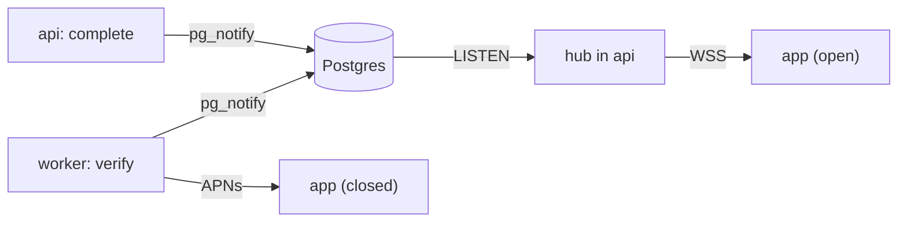

# S8 — Realtime and push

<dl><dd>

- Sprint 8 · 2 weeks · backend 11h of the sprint's 49h · [all sprints](../README.md) · iOS side: [S8 iOS](https://github.com/DAMHONGDUC/site_log_swift_ui/blob/main/docs/feature-guide/S8-realtime-push-quality/README.md)

</dd></dl>

## Contents

<dl><dd>

1. [Overview](#overview)
2. [Tasks](#tasks)
3. [Done](#done)
4. [Self-check](#self-check)

</dd></dl>

## Overview

<dl><dd>

- **Goal:** the server tells the app what it knows first — completed, verified, failed — over a socket and, when the app is closed, a push. F17 has no backend work.
- **Demo:** 50 photos upload; the list turns "verified" live; with the app closed, a notification arrives when the last one is verified.

| Guide | Builds | Hours |
|---|---|---|
| [F15 Realtime](F15-realtime.md) | Hub, `/ws`, verify worker, abandoned uploads, worker container | 8 |
| [F16 Push](F16-push.md) | `devices`, APNs sender, push on session verified | 3 |

</dd></dl>

## Tasks

<dl><dd>

| Task | What | Guide | Hours | Status |
|---|---|---|---|---|
| F15.1 | Hub | [F15 §1](F15-realtime.md#1-hub) | 2 | not start |
| F15.2 | `/ws` route, app, main | [F15 §2](F15-realtime.md#2-websocket-route) | 2 | not start |
| F15.3 | Worker: verify, abandoned (split: claim · hash · loop) | [F15 §3](F15-realtime.md#3-worker) | 2.5 | not start |
| F15.4 | Worker container, tests | [F15 §4](F15-realtime.md#4-run-the-worker-on-the-server) | 1.5 | not start |
| F16.1 | APNs key, devices | [F16 §1–2](F16-push.md#1-apns-key) | 1.5 | not start |
| F16.2 | Sending, tests | [F16 §3](F16-push.md#3-sending) | 1.5 | not start |

</dd></dl>

## Done

<dl><dd>

- [ ] `npm test` green; staging runs `api`, `worker`, `caddy`
- [ ] The iOS F15 demo shows "verified" without polling; the F16 push arrives on a real iPhone

</dd></dl>

## Self-check

<dl><dd>

- The socket was down for 2 minutes. How does the app learn what it missed?
- Why is a push sent per session, not per photo?

</dd></dl>
