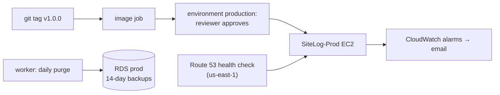

# F18 — Production (backend)

<dl><dd>

- Sprint [S9](README.md) · 6h · a production environment for real users: nightly purge, alarms, uptime check, approved releases, a tested restore.
- iOS side: [F18 UI finish and App Store](https://github.com/DAMHONGDUC/site_log_swift_ui/blob/main/docs/feature-guide/S9-release/F18-ui-finish.md). Operations: [04-aws-operations](../../feature-docs/04-aws-operations.md).

</dd></dl>

## Contents

<dl><dd>

1. [Overview](#overview)
2. [1. Tombstone purge](#1-tombstone-purge)
3. [2. Alarms and uptime](#2-alarms-and-uptime)
4. [3. Production stack](#3-production-stack)
5. [4. Release workflow](#4-release-workflow)
6. [5. Restore test](#5-restore-test)
7. [6. Before App Store review](#6-before-app-store-review)
8. [Feature done](#feature-done)

</dd></dl>

## Overview

<dl><dd>

- **Goal:** the App Store build talks to `https://api.<domain>`, separate from staging, watched and backed up.
- **Demo:** tag `v1.0.0` → a reviewer approves → production deployed; an alarm email arrives when you stop the API container on staging.

| Step | Hours | Files / place |
|---|---|---|
| [1](#1-tombstone-purge) | 1 | `src/workers/purge.ts`, `src/worker.ts`, `test/purge.test.ts` |
| [2](#2-alarms-and-uptime) | 1.5 | `infra/lib/env-stack.ts`, `infra/lib/uptime-stack.ts`, `infra/bin/sitelog.ts` |
| [3](#3-production-stack) | 1.5 | `cdk.json`, Firebase `sitelog-prod`, SSM, DNS |
| [4](#4-release-workflow) | 0.5 | `.github/workflows/deploy.yml`, GitHub environment `production` |
| [5](#5-restore-test) | 1 | RDS point-in-time restore |
| [6](#6-before-app-store-review) | 0.5 | Checklist |



</dd></dl>

## 1. Tombstone purge

<dl><dd>

#### Overview

<dl><dd>

| Action | File | Holds |
|---|---|---|
| <b class="tag-new">New</b> | `src/workers/purge.ts` | Deletes tombstones older than 90 days in one transaction, raises `purged_through_rev` per user |
| <b class="tag-edit">Edit</b> | `src/worker.ts` | Runs it once a day |
| <b class="tag-new">New</b> | `test/purge.test.ts` | Old tombstones and their children go; recent ones stay; resync watermark |

</dd></dl>

#### Steps

<dl><dd>

<details open>
<summary><strong>1.1 Purge</strong></summary>
<dl><dd>

<b>File</b> · <b class="tag-new">New</b> · `src/workers/purge.ts`

<b>Explain</b> · All tables in one transaction, so a purged project and its purged locations leave together and the deferred foreign keys are happy at commit.

<b>Think</b>

- A device was offline 100 days with cursor `since = 120`. After the purge, `purged_through_rev` is 400. What does its next pull answer, and why is that the only safe answer?

<details>
<summary><b>Code</b></summary>

```ts
import type pg from 'pg';
import type { Logger } from 'pino';
import { withTransaction } from '../db.js';
import { syncTables } from '../sync/tables.js';

// Nightly: removes tombstones older than the retention window. Devices whose cursor is older
// than the newest purged rev get `resyncRequired` on their next pull.
export async function purgeTombstones(
  pool: pg.Pool,
  log: Logger,
  retentionDays: number,
): Promise<number> {
  // One transaction for all tables: a purged parent and its purged children leave together.
  return withTransaction(pool, async (client) => {
    const highestPerUser = new Map<string, number>();
    let purged = 0;
    for (const table of syncTables) {
      const result = await client.query<{ uid: string; rev: number }>(
        `delete from ${table.name}
          where deleted_at is not null and deleted_at < now() - make_interval(days => $1)
      returning uid, rev`,
        [retentionDays],
      );
      purged += result.rows.length;
      for (const row of result.rows) {
        const current = highestPerUser.get(row.uid) ?? 0;
        if (row.rev > current) {
          highestPerUser.set(row.uid, row.rev);
        }
      }
    }
    for (const [uid, rev] of highestPerUser) {
      await client.query(
        'update sync_state set purged_through_rev = greatest(purged_through_rev, $2) where uid = $1',
        [uid, rev],
      );
    }
    log.info({ purged, users: highestPerUser.size }, 'tombstones purged');
    return purged;
  });
}
```

</details>

---

<b>File</b> · <b class="tag-edit">Edit</b> · `src/worker.ts`

```diff
@@ -7,2 +7,3 @@
 import { abortAbandonedUploads } from './workers/abandoned.js';
+import { purgeTombstones } from './workers/purge.js';
 import { verifyNextUpload, type WorkerDeps } from './workers/verify.js';
@@ -10,3 +11,3 @@
 // Background jobs, in their own container next to the API:
-// verify uploads all the time, abort abandoned uploads hourly (F18 adds the daily purge).
+// verify uploads all the time, abort abandoned uploads hourly, purge tombstones daily.
 const config = loadConfig();
@@ -26,4 +27,6 @@
 const HOUR = 60 * 60 * 1000;
+const DAY = 24 * HOUR;
 let running = true;
 let lastAbandonedRun = 0;
+let lastPurgeRun = 0;
 
@@ -45,2 +48,6 @@
     }
+    if (Date.now() - lastPurgeRun > DAY) {
+      await purgeTombstones(pool, log, config.tombstoneRetentionDays);
+      lastPurgeRun = Date.now();
+    }
   } catch (error) {
```

<details>
<summary><b>Code</b></summary>

```ts
import { setTimeout as sleep } from 'node:timers/promises';
import { loadConfig } from './config.js';
import { createPool } from './db.js';
import { createLogger } from './logger.js';
import { ApnsSender, type PushSender } from './push/apns.js';
import { Storage, createS3Client } from './storage.js';
import { abortAbandonedUploads } from './workers/abandoned.js';
import { purgeTombstones } from './workers/purge.js';
import { verifyNextUpload, type WorkerDeps } from './workers/verify.js';

// Background jobs, in their own container next to the API:
// verify uploads all the time, abort abandoned uploads hourly, purge tombstones daily.
const config = loadConfig();
const log = createLogger(config.logLevel);
const pool = createPool(config);
const storage = new Storage(
  createS3Client(config.awsRegion),
  config.s3Bucket,
  config.presignTtlSeconds,
);
let push: PushSender | undefined = undefined;
if (config.apns !== undefined) {
  push = new ApnsSender(config.apns);
}
const deps: WorkerDeps = { pool, storage, push, log };

const HOUR = 60 * 60 * 1000;
const DAY = 24 * HOUR;
let running = true;
let lastAbandonedRun = 0;
let lastPurgeRun = 0;

process.once('SIGTERM', () => {
  running = false;
});
process.once('SIGINT', () => {
  running = false;
});

log.info('worker started');
while (running) {
  let didWork = false;
  try {
    didWork = await verifyNextUpload(deps);
    if (Date.now() - lastAbandonedRun > HOUR) {
      await abortAbandonedUploads(deps);
      lastAbandonedRun = Date.now();
    }
    if (Date.now() - lastPurgeRun > DAY) {
      await purgeTombstones(pool, log, config.tombstoneRetentionDays);
      lastPurgeRun = Date.now();
    }
  } catch (error) {
    log.error({ err: error }, 'worker: job failed');
  }
  if (!didWork) {
    await sleep(5000);
  }
}
await pool.end();
log.info('worker stopped');
```

</details>

---

<b>File</b> · <b class="tag-new">New</b> · `test/purge.test.ts`

<details>
<summary><b>Code</b></summary>

```ts
import { afterAll, beforeAll, beforeEach, describe, expect, it } from 'vitest';
import { createLogger } from '../src/logger.js';
import { purgeTombstones } from '../src/workers/purge.js';
import {
  closeTestContext,
  createTestContext,
  ids,
  resetDatabase,
  type TestContext,
} from './helpers.js';
import { locationMutation, projectMutation, pullAs, pushAs } from './sync-helpers.js';

describe('tombstone purge', () => {
  let context: TestContext;
  beforeAll(async () => {
    context = await createTestContext();
  });
  afterAll(async () => {
    await closeTestContext(context);
  });
  beforeEach(async () => {
    await resetDatabase(context.pool);
  });

  it('removes old tombstones with their children and moves the resync watermark', async () => {
    await pushAs(context, 'alice', [
      projectMutation(ids.project, '2026-11-01T08:00:00.000Z', 'Tower A'),
      locationMutation('2026-11-01T08:00:00.000Z', 'L1'),
    ]);
    await context.pool.query(`update projects set deleted_at = now() - interval '100 days'`);
    await context.pool.query(`update locations set deleted_at = now() - interval '100 days'`);

    const purged = await purgeTombstones(context.pool, createLogger('silent'), 90);
    expect(purged).toBe(2);
    const pulled = await pullAs(context, 'alice', 1);
    expect(pulled).toEqual({ resyncRequired: true });
  });

  it('keeps recent tombstones', async () => {
    await pushAs(context, 'alice', [
      projectMutation(ids.project, '2026-11-01T08:00:00.000Z', 'Tower A'),
    ]);
    await context.pool.query(`update projects set deleted_at = now() - interval '10 days'`);
    expect(await purgeTombstones(context.pool, createLogger('silent'), 90)).toBe(0);
  });
});
```

</details>

```bash
npm test
```

</dd></dl>
</details>

</dd></dl>

</dd></dl>

## 2. Alarms and uptime

<dl><dd>

#### Overview

<dl><dd>

| Action | File | Holds |
|---|---|---|
| <b class="tag-edit">Edit</b> | `infra/lib/env-stack.ts` | SNS topic + email, EC2 recover / reboot alarms, RDS storage and CPU, API 5xx from logs |
| <b class="tag-new">New</b> | `infra/lib/uptime-stack.ts` | Route 53 HTTPS health check on `/health` + alarm (us-east-1) |
| <b class="tag-edit">Edit</b> | `infra/bin/sitelog.ts` | `SiteLog-Prod` and `SiteLog-Prod-Uptime` |
| <b class="tag-edit">Edit</b> | `infra/cdk.json` | `alarmEmail` for staging and prod, `prod.apiDomain` |

</dd></dl>

#### Steps

<dl><dd>

<details open>
<summary><strong>2.1 Alarms</strong></summary>
<dl><dd>

<b>File</b> · <b class="tag-edit">Edit</b> · `infra/lib/env-stack.ts`

<b>Explain</b> · `Ec2InstanceAction.RECOVER` moves the instance to healthy hardware, keeping its IP and disk. The 5xx alarm counts JSON log lines whose `res.statusCode` is 500 or more.

<b>Think</b>

- Why `treatMissingData: NOT_BREACHING` for the 5xx alarm, but `BREACHING` for the uptime alarm?

```diff
@@ -1,2 +1,4 @@
 import { Aws, CfnOutput, Duration, RemovalPolicy, Stack, type StackProps, Tags } from 'aws-cdk-lib';
+import * as cloudwatch from 'aws-cdk-lib/aws-cloudwatch';
+import * as actions from 'aws-cdk-lib/aws-cloudwatch-actions';
 import * as ec2 from 'aws-cdk-lib/aws-ec2';
@@ -7,2 +9,4 @@
 import * as s3 from 'aws-cdk-lib/aws-s3';
+import * as sns from 'aws-cdk-lib/aws-sns';
+import * as subscriptions from 'aws-cdk-lib/aws-sns-subscriptions';
 import type { Construct } from 'constructs';
@@ -20,3 +24,3 @@
 
-// One environment: network, database, bucket, one EC2 server running Docker Compose.
+// One environment: network, database, bucket, one EC2 server running Docker Compose, alarms.
 export class EnvStack extends Stack {
@@ -193,2 +197,67 @@
 
+    // Alarms mail the address in cdk.json; EC2 also restarts itself on a hardware fault.
+    const topic = new sns.Topic(this, 'Alarms', { topicName: `sitelog-${envName}-alarms` });
+    if (settings.alarmEmail !== '') {
+      topic.addSubscription(new subscriptions.EmailSubscription(settings.alarmEmail));
+    }
+    const notify = new actions.SnsAction(topic);
+
+    const systemCheck = new cloudwatch.Alarm(this, 'ServerSystemCheck', {
+      metric: new cloudwatch.Metric({
+        namespace: 'AWS/EC2',
+        metricName: 'StatusCheckFailed_System',
+        dimensionsMap: { InstanceId: server.instanceId },
+        period: Duration.minutes(1),
+        statistic: 'Maximum',
+      }),
+      threshold: 1,
+      evaluationPeriods: 2,
+    });
+    systemCheck.addAlarmAction(new actions.Ec2Action(actions.Ec2InstanceAction.RECOVER), notify);
+
+    const instanceCheck = new cloudwatch.Alarm(this, 'ServerInstanceCheck', {
+      metric: new cloudwatch.Metric({
+        namespace: 'AWS/EC2',
+        metricName: 'StatusCheckFailed_Instance',
+        dimensionsMap: { InstanceId: server.instanceId },
+        period: Duration.minutes(1),
+        statistic: 'Maximum',
+      }),
+      threshold: 1,
+      evaluationPeriods: 3,
+    });
+    instanceCheck.addAlarmAction(new actions.Ec2Action(actions.Ec2InstanceAction.REBOOT), notify);
+
+    const lowStorage = new cloudwatch.Alarm(this, 'DatabaseLowStorage', {
+      metric: database.metricFreeStorageSpace({ period: Duration.minutes(5) }),
+      threshold: 2 * 1024 * 1024 * 1024,
+      comparisonOperator: cloudwatch.ComparisonOperator.LESS_THAN_THRESHOLD,
+      evaluationPeriods: 1,
+    });
+    lowStorage.addAlarmAction(notify);
+
+    const busyDatabase = new cloudwatch.Alarm(this, 'DatabaseCpu', {
+      metric: database.metricCPUUtilization({ period: Duration.minutes(5) }),
+      threshold: 80,
+      evaluationPeriods: 3,
+    });
+    busyDatabase.addAlarmAction(notify);
+
+    // Counts 5xx answers in the API's JSON logs.
+    const errors = new logs.MetricFilter(this, 'Api5xx', {
+      logGroup: logGroups[0]!,
+      metricNamespace: 'SiteLog',
+      metricName: `${envName}-api-5xx`,
+      filterPattern: logs.FilterPattern.numberValue('$.res.statusCode', '>=', 500),
+      metricValue: '1',
+      defaultValue: 0,
+    });
+    const serverErrors = new cloudwatch.Alarm(this, 'Api5xxAlarm', {
+      metric: errors.metric({ period: Duration.minutes(5), statistic: 'Sum' }),
+      threshold: 5,
+      evaluationPeriods: 1,
+      treatMissingData: cloudwatch.TreatMissingData.NOT_BREACHING,
+    });
+    serverErrors.addAlarmAction(notify);
+
     new CfnOutput(this, 'PublicIpAddress', {
```

<details>
<summary><b>Code</b></summary>

```ts
import { Aws, CfnOutput, Duration, RemovalPolicy, Stack, type StackProps, Tags } from 'aws-cdk-lib';
import * as cloudwatch from 'aws-cdk-lib/aws-cloudwatch';
import * as actions from 'aws-cdk-lib/aws-cloudwatch-actions';
import * as ec2 from 'aws-cdk-lib/aws-ec2';
import * as ecr from 'aws-cdk-lib/aws-ecr';
import * as iam from 'aws-cdk-lib/aws-iam';
import * as logs from 'aws-cdk-lib/aws-logs';
import * as rds from 'aws-cdk-lib/aws-rds';
import * as s3 from 'aws-cdk-lib/aws-s3';
import * as sns from 'aws-cdk-lib/aws-sns';
import * as subscriptions from 'aws-cdk-lib/aws-sns-subscriptions';
import type { Construct } from 'constructs';

export interface EnvSettings {
  apiDomain: string;
  instanceType: string;
  alarmEmail: string;
}

interface EnvStackProps extends StackProps {
  envName: 'staging' | 'prod';
  settings: EnvSettings;
}

// One environment: network, database, bucket, one EC2 server running Docker Compose, alarms.
export class EnvStack extends Stack {
  constructor(scope: Construct, id: string, props: EnvStackProps) {
    super(scope, id, props);
    const { envName, settings } = props;
    const isProd = envName === 'prod';

    // Public subnets for the server, isolated subnets (no internet at all) for the database.
    // No NAT gateway: it would cost more than the server.
    const vpc = new ec2.Vpc(this, 'Vpc', {
      // Two zones named up front, so `cdk synth` needs no AWS login (RDS needs two zones).
      availabilityZones: [`${this.region}a`, `${this.region}b`],
      natGateways: 0,
      subnetConfiguration: [
        { name: 'public', subnetType: ec2.SubnetType.PUBLIC, cidrMask: 24 },
        { name: 'database', subnetType: ec2.SubnetType.PRIVATE_ISOLATED, cidrMask: 24 },
      ],
    });

    const bucket = new s3.Bucket(this, 'Media', {
      bucketName: `sitelog-${envName}-${Aws.ACCOUNT_ID}`,
      blockPublicAccess: s3.BlockPublicAccess.BLOCK_ALL,
      encryption: s3.BucketEncryption.S3_MANAGED,
      enforceSSL: true,
      // Parts of uploads nobody completed are removed after a week.
      lifecycleRules: [{ abortIncompleteMultipartUploadAfter: Duration.days(7) }],
      removalPolicy: RemovalPolicy.RETAIN,
    });

    const serverSecurityGroup = new ec2.SecurityGroup(this, 'ServerSg', {
      vpc,
      description: 'SiteLog API server: HTTP and HTTPS from anywhere, nothing else',
    });
    serverSecurityGroup.addIngressRule(
      ec2.Peer.anyIpv4(),
      ec2.Port.tcp(80),
      'HTTP for the certificate check',
    );
    serverSecurityGroup.addIngressRule(ec2.Peer.anyIpv4(), ec2.Port.tcp(443), 'HTTPS');

    const databaseSecurityGroup = new ec2.SecurityGroup(this, 'DatabaseSg', {
      vpc,
      description: 'SiteLog Postgres: only from the API server',
    });
    databaseSecurityGroup.addIngressRule(
      serverSecurityGroup,
      ec2.Port.tcp(5432),
      'Postgres from the server',
    );

    // Username sitelog, a generated password kept in Secrets Manager.
    const database = new rds.DatabaseInstance(this, 'Database', {
      engine: rds.DatabaseInstanceEngine.postgres({ version: rds.PostgresEngineVersion.VER_16 }),
      instanceType: ec2.InstanceType.of(ec2.InstanceClass.T4G, ec2.InstanceSize.MICRO),
      vpc,
      vpcSubnets: { subnetType: ec2.SubnetType.PRIVATE_ISOLATED },
      securityGroups: [databaseSecurityGroup],
      credentials: rds.Credentials.fromGeneratedSecret('sitelog'),
      databaseName: 'sitelog',
      allocatedStorage: 20,
      maxAllocatedStorage: 100,
      storageType: rds.StorageType.GP3,
      storageEncrypted: true,
      multiAz: false,
      publiclyAccessible: false,
      backupRetention: Duration.days(isProd ? 14 : 7),
      deletionProtection: isProd,
      removalPolicy: isProd ? RemovalPolicy.SNAPSHOT : RemovalPolicy.DESTROY,
    });

    const logGroups: logs.LogGroup[] = [];
    for (const service of ['api', 'worker', 'caddy']) {
      logGroups.push(
        new logs.LogGroup(this, `Logs-${service}`, {
          logGroupName: `/sitelog/${envName}/${service}`,
          retention: logs.RetentionDays.ONE_MONTH,
          removalPolicy: RemovalPolicy.DESTROY,
        }),
      );
    }

    // Created by SiteLog-Shared; found by name so the stacks stay independent.
    const repository = ecr.Repository.fromRepositoryName(this, 'Api', 'sitelog-api');

    // What the server may do: pull the image, read its secrets, use its bucket, write logs.
    const role = new iam.Role(this, 'ServerRole', {
      assumedBy: new iam.ServicePrincipal('ec2.amazonaws.com'),
      managedPolicies: [
        // Session Manager: shell access and deploy commands without SSH or open port 22.
        iam.ManagedPolicy.fromAwsManagedPolicyName('AmazonSSMManagedInstanceCore'),
      ],
    });
    repository.grantPull(role);
    bucket.grantReadWrite(role);
    database.secret!.grantRead(role);
    for (const group of logGroups) {
      group.grantWrite(role);
    }
    role.addToPolicy(
      new iam.PolicyStatement({
        actions: ['ssm:GetParametersByPath'],
        resources: [`arn:aws:ssm:${this.region}:${this.account}:parameter/sitelog/${envName}`],
      }),
    );

    // Settings that are not secret, written once on the server; the deploy script reads them.
    const instanceEnv = [
      `ENV_NAME=${envName}`,
      `AWS_REGION=${this.region}`,
      `S3_BUCKET=${bucket.bucketName}`,
      `API_DOMAIN=${settings.apiDomain}`,
      `ECR_REPOSITORY=${repository.repositoryUri}`,
      `DB_SECRET_ARN=${database.secret!.secretArn}`,
    ].join('\n');

    const userData = ec2.UserData.forLinux();
    userData.addCommands(
      'set -euo pipefail',
      'dnf install -y docker jq',
      'systemctl enable --now docker',
      // Docker Compose v2 as a docker plugin (Amazon Linux has no package for it).
      'mkdir -p /usr/local/lib/docker/cli-plugins',
      'curl -fsSL https://github.com/docker/compose/releases/download/v2.29.7/docker-compose-linux-aarch64 -o /usr/local/lib/docker/cli-plugins/docker-compose',
      'chmod +x /usr/local/lib/docker/cli-plugins/docker-compose',
      'mkdir -p /opt/sitelog',
      `cat > /opt/sitelog/instance.env <<'ENVEOF'\n${instanceEnv}\nENVEOF`,
      // sitelog-deploy <tag>: pull the image, copy deploy/ out of it, run its deploy.sh.
      `cat > /usr/local/bin/sitelog-deploy <<'SCRIPTEOF'
#!/usr/bin/env bash
set -euo pipefail
TAG="$1"
source /opt/sitelog/instance.env
REGISTRY="\${ECR_REPOSITORY%%/*}"
aws ecr get-login-password --region "$AWS_REGION" | docker login --username AWS --password-stdin "$REGISTRY"
docker pull "$ECR_REPOSITORY:$TAG"
CONTAINER=$(docker create "$ECR_REPOSITORY:$TAG")
docker cp "$CONTAINER:/app/deploy/." /opt/sitelog/
docker rm "$CONTAINER" > /dev/null
exec bash /opt/sitelog/deploy.sh "$TAG"
SCRIPTEOF`,
      'chmod +x /usr/local/bin/sitelog-deploy',
    );

    const server = new ec2.Instance(this, 'Server', {
      vpc,
      vpcSubnets: { subnetType: ec2.SubnetType.PUBLIC },
      instanceType: new ec2.InstanceType(settings.instanceType),
      machineImage: ec2.MachineImage.latestAmazonLinux2023({
        cpuType: ec2.AmazonLinuxCpuType.ARM_64,
      }),
      securityGroup: serverSecurityGroup,
      role,
      userData,
      requireImdsv2: true,
      blockDevices: [
        {
          deviceName: '/dev/xvda',
          volume: ec2.BlockDeviceVolume.ebs(20, {
            volumeType: ec2.EbsDeviceVolumeType.GP3,
            encrypted: true,
          }),
        },
      ],
    });
    Tags.of(server).add('sitelog:env', envName);

    // A fixed public IP for the DNS record.
    const ip = new ec2.CfnEIP(this, 'PublicIp', { domain: 'vpc' });
    new ec2.CfnEIPAssociation(this, 'PublicIpAssociation', {
      allocationId: ip.attrAllocationId,
      instanceId: server.instanceId,
    });

    // Alarms mail the address in cdk.json; EC2 also restarts itself on a hardware fault.
    const topic = new sns.Topic(this, 'Alarms', { topicName: `sitelog-${envName}-alarms` });
    if (settings.alarmEmail !== '') {
      topic.addSubscription(new subscriptions.EmailSubscription(settings.alarmEmail));
    }
    const notify = new actions.SnsAction(topic);

    const systemCheck = new cloudwatch.Alarm(this, 'ServerSystemCheck', {
      metric: new cloudwatch.Metric({
        namespace: 'AWS/EC2',
        metricName: 'StatusCheckFailed_System',
        dimensionsMap: { InstanceId: server.instanceId },
        period: Duration.minutes(1),
        statistic: 'Maximum',
      }),
      threshold: 1,
      evaluationPeriods: 2,
    });
    systemCheck.addAlarmAction(new actions.Ec2Action(actions.Ec2InstanceAction.RECOVER), notify);

    const instanceCheck = new cloudwatch.Alarm(this, 'ServerInstanceCheck', {
      metric: new cloudwatch.Metric({
        namespace: 'AWS/EC2',
        metricName: 'StatusCheckFailed_Instance',
        dimensionsMap: { InstanceId: server.instanceId },
        period: Duration.minutes(1),
        statistic: 'Maximum',
      }),
      threshold: 1,
      evaluationPeriods: 3,
    });
    instanceCheck.addAlarmAction(new actions.Ec2Action(actions.Ec2InstanceAction.REBOOT), notify);

    const lowStorage = new cloudwatch.Alarm(this, 'DatabaseLowStorage', {
      metric: database.metricFreeStorageSpace({ period: Duration.minutes(5) }),
      threshold: 2 * 1024 * 1024 * 1024,
      comparisonOperator: cloudwatch.ComparisonOperator.LESS_THAN_THRESHOLD,
      evaluationPeriods: 1,
    });
    lowStorage.addAlarmAction(notify);

    const busyDatabase = new cloudwatch.Alarm(this, 'DatabaseCpu', {
      metric: database.metricCPUUtilization({ period: Duration.minutes(5) }),
      threshold: 80,
      evaluationPeriods: 3,
    });
    busyDatabase.addAlarmAction(notify);

    // Counts 5xx answers in the API's JSON logs.
    const errors = new logs.MetricFilter(this, 'Api5xx', {
      logGroup: logGroups[0]!,
      metricNamespace: 'SiteLog',
      metricName: `${envName}-api-5xx`,
      filterPattern: logs.FilterPattern.numberValue('$.res.statusCode', '>=', 500),
      metricValue: '1',
      defaultValue: 0,
    });
    const serverErrors = new cloudwatch.Alarm(this, 'Api5xxAlarm', {
      metric: errors.metric({ period: Duration.minutes(5), statistic: 'Sum' }),
      threshold: 5,
      evaluationPeriods: 1,
      treatMissingData: cloudwatch.TreatMissingData.NOT_BREACHING,
    });
    serverErrors.addAlarmAction(notify);

    new CfnOutput(this, 'PublicIpAddress', {
      value: ip.ref,
      description: `A record for ${settings.apiDomain}`,
    });
    new CfnOutput(this, 'InstanceId', { value: server.instanceId });
    new CfnOutput(this, 'BucketName', { value: bucket.bucketName });
    new CfnOutput(this, 'DatabaseEndpoint', { value: database.dbInstanceEndpointAddress });
    new CfnOutput(this, 'DatabaseSecretArn', { value: database.secret!.secretArn });
  }
}
```

</details>

---

<b>File</b> · <b class="tag-new">New</b> · `infra/lib/uptime-stack.ts`

<b>Explain</b> · Route 53 checkers in several regions fetch `https://api.<domain>/health` every 30 s and look for `"ok"`. Their metric exists only in us-east-1, so this small stack lives there.

<details>
<summary><b>Code</b></summary>

```ts
import { CfnOutput, Duration, Stack, type StackProps } from 'aws-cdk-lib';
import * as cloudwatch from 'aws-cdk-lib/aws-cloudwatch';
import * as actions from 'aws-cdk-lib/aws-cloudwatch-actions';
import * as route53 from 'aws-cdk-lib/aws-route53';
import * as sns from 'aws-cdk-lib/aws-sns';
import * as subscriptions from 'aws-cdk-lib/aws-sns-subscriptions';
import type { Construct } from 'constructs';

interface UptimeStackProps extends StackProps {
  apiDomain: string;
  alarmEmail: string;
}

// Checks https://<domain>/health from several places in the world every 30 s.
export class UptimeStack extends Stack {
  constructor(scope: Construct, id: string, props: UptimeStackProps) {
    super(scope, id, props);

    const check = new route53.CfnHealthCheck(this, 'Health', {
      healthCheckConfig: {
        type: 'HTTPS_STR_MATCH',
        fullyQualifiedDomainName: props.apiDomain,
        port: 443,
        resourcePath: '/health',
        searchString: '"ok"',
        requestInterval: 30,
        failureThreshold: 3,
      },
    });

    const topic = new sns.Topic(this, 'Alarms', { topicName: 'sitelog-prod-uptime' });
    if (props.alarmEmail !== '') {
      topic.addSubscription(new subscriptions.EmailSubscription(props.alarmEmail));
    }

    const down = new cloudwatch.Alarm(this, 'ApiDown', {
      metric: new cloudwatch.Metric({
        namespace: 'AWS/Route53',
        metricName: 'HealthCheckStatus',
        dimensionsMap: { HealthCheckId: check.attrHealthCheckId },
        period: Duration.minutes(1),
        statistic: 'Minimum',
      }),
      threshold: 1,
      comparisonOperator: cloudwatch.ComparisonOperator.LESS_THAN_THRESHOLD,
      evaluationPeriods: 2,
      treatMissingData: cloudwatch.TreatMissingData.BREACHING,
    });
    down.addAlarmAction(new actions.SnsAction(topic));

    new CfnOutput(this, 'HealthCheckId', { value: check.attrHealthCheckId });
  }
}
```

</details>

---

<b>File</b> · <b class="tag-edit">Edit</b> · `infra/bin/sitelog.ts`

```diff
@@ -4,2 +4,3 @@
 import { SharedStack } from '../lib/shared-stack.js';
+import { UptimeStack } from '../lib/uptime-stack.js';
 
@@ -14,2 +15,3 @@
 const staging = app.node.getContext('staging') as EnvSettings;
+const prod = app.node.getContext('prod') as EnvSettings;
 
@@ -22 +24,9 @@
 new EnvStack(app, 'SiteLog-Staging', { env, envName: 'staging', settings: staging });
+new EnvStack(app, 'SiteLog-Prod', { env, envName: 'prod', settings: prod });
+
+// Route 53 health checks only report to us-east-1, so the uptime alarm lives there.
+new UptimeStack(app, 'SiteLog-Prod-Uptime', {
+  env: { account, region: 'us-east-1' },
+  apiDomain: prod.apiDomain,
+  alarmEmail: prod.alarmEmail,
+});
```

- In `infra/cdk.json`: set `staging.alarmEmail`, `prod.alarmEmail` and `prod.apiDomain`.

```bash
cd infra && npx cdk deploy SiteLog-Staging
```

- Confirm the "AWS Notification - Subscription Confirmation" email.

<b>Try</b>

- On staging: `sudo docker compose stop api` for 6 minutes while curling `/health`: Caddy answers `502`. The 5xx alarm counts the **API's** log lines — a stopped API writes none, so it stays quiet. Which alarm catches a dead API in production? (The uptime check.) `sudo docker compose start api`.

</dd></dl>
</details>

</dd></dl>

</dd></dl>

## 3. Production stack

<dl><dd>

| # | Do | Command / place |
|---|---|---|
| 1 | Firebase project `sitelog-prod` (F00a §3 again); the iOS Release build uses its `GoogleService-Info.plist` | console.firebase.google.com |
| 2 | Deploy the stacks (~15 min) | `npx cdk deploy SiteLog-Prod SiteLog-Prod-Uptime` |
| 3 | DNS `A` record `api` → `SiteLog-Prod.PublicIpAddress` | registrar |
| 4 | Secrets | the four `put-parameter` commands of F00c §5 and F16 §1, with `/sitelog/prod/` and the **prod** Firebase key |
| 5 | Confirm both alarm emails | inbox |

```bash
aws ssm put-parameter --name /sitelog/prod/FIREBASE_SERVICE_ACCOUNT_BASE64 --type SecureString --value "$(base64 -i ~/secrets/sitelog-prod-service-account.json)"
```

- The prod database has deletion protection: `cdk destroy` cannot delete it by accident.

</dd></dl>

## 4. Release workflow

<dl><dd>

#### Overview

<dl><dd>

| Action | File / place | Holds |
|---|---|---|
| <b class="tag-edit">Edit</b> | `.github/workflows/deploy.yml` | `tags: ['v*']` trigger, `production` job |
| GitHub | **Settings** → **Environments** → **New environment** `production` | **Required reviewers**: you; **Deployment branches and tags**: tags `v*`; variable `API_DOMAIN` = `api.<domain>` |

</dd></dl>

#### Steps

<dl><dd>

<details open>
<summary><strong>4.1 Workflow</strong></summary>
<dl><dd>

<b>File</b> · <b class="tag-edit">Edit</b> · `.github/workflows/deploy.yml`

```diff
@@ -1,2 +1,2 @@
-# main → staging (production joins in F18).
+# main → staging. A v* tag → production, after a reviewer approves the `production` environment.
 name: Deploy
@@ -6,2 +6,3 @@
     branches: [main]
+    tags: ['v*']
 
@@ -51 +52,15 @@
       - run: curl --fail --silent --show-error "https://${{ vars.API_DOMAIN }}/health"
+
+  production:
+    needs: image
+    if: startsWith(github.ref, 'refs/tags/v')
+    runs-on: ubuntu-24.04
+    environment: production
+    steps:
+      - uses: actions/checkout@v5
+      - uses: aws-actions/configure-aws-credentials@v5
+        with:
+          role-to-assume: ${{ vars.AWS_DEPLOY_ROLE_ARN }}
+          aws-region: ${{ vars.AWS_REGION }}
+      - run: bash .github/scripts/ssm-deploy.sh prod "${{ github.sha }}"
+      - run: curl --fail --silent --show-error "https://${{ vars.API_DOMAIN }}/health"
```

<details>
<summary><b>Code</b></summary>

```yaml
# main → staging. A v* tag → production, after a reviewer approves the `production` environment.
name: Deploy

on:
  push:
    branches: [main]
    tags: ['v*']

permissions:
  id-token: write # lets the job log in to AWS with a short-lived OIDC token
  contents: read

concurrency:
  group: deploy-${{ github.ref }}
  cancel-in-progress: false

jobs:
  image:
    runs-on: ubuntu-24.04
    steps:
      - uses: actions/checkout@v5
      - uses: aws-actions/configure-aws-credentials@v5
        with:
          role-to-assume: ${{ vars.AWS_DEPLOY_ROLE_ARN }}
          aws-region: ${{ vars.AWS_REGION }}
      - id: ecr
        uses: aws-actions/amazon-ecr-login@v2
      # The server is ARM (t4g): build an arm64 image on the x86 runner.
      - uses: docker/setup-qemu-action@v3
      - uses: docker/setup-buildx-action@v3
      - uses: docker/build-push-action@v6
        with:
          context: .
          platforms: linux/arm64
          push: true
          tags: ${{ steps.ecr.outputs.registry }}/sitelog-api:${{ github.sha }}
          cache-from: type=gha
          cache-to: type=gha,mode=max

  staging:
    needs: image
    if: github.ref == 'refs/heads/main'
    runs-on: ubuntu-24.04
    environment: staging
    steps:
      - uses: actions/checkout@v5
      - uses: aws-actions/configure-aws-credentials@v5
        with:
          role-to-assume: ${{ vars.AWS_DEPLOY_ROLE_ARN }}
          aws-region: ${{ vars.AWS_REGION }}
      - run: bash .github/scripts/ssm-deploy.sh staging "${{ github.sha }}"
      - run: curl --fail --silent --show-error "https://${{ vars.API_DOMAIN }}/health"

  production:
    needs: image
    if: startsWith(github.ref, 'refs/tags/v')
    runs-on: ubuntu-24.04
    environment: production
    steps:
      - uses: actions/checkout@v5
      - uses: aws-actions/configure-aws-credentials@v5
        with:
          role-to-assume: ${{ vars.AWS_DEPLOY_ROLE_ARN }}
          aws-region: ${{ vars.AWS_REGION }}
      - run: bash .github/scripts/ssm-deploy.sh prod "${{ github.sha }}"
      - run: curl --fail --silent --show-error "https://${{ vars.API_DOMAIN }}/health"
```

</details>

```bash
git tag v1.0.0 && git push origin v1.0.0
```

- **Actions** → `Deploy` → `production` waits → **Review deployments** → approve → `https://api.<domain>/health`.

</dd></dl>
</details>

</dd></dl>

</dd></dl>

## 5. Restore test

<dl><dd>

- Once per release: prove last night's database can be brought back. Use your production instance id from `aws rds describe-db-instances --query 'DBInstances[].DBInstanceIdentifier'`.

```bash
SRC=<prod db instance id> && aws rds describe-db-instances --db-instance-identifier $SRC --query 'DBInstances[0].[DBSubnetGroup.DBSubnetGroupName, VpcSecurityGroups[0].VpcSecurityGroupId]' --output text
```

```bash
aws rds restore-db-instance-to-point-in-time --source-db-instance-identifier $SRC --target-db-instance-identifier sitelog-restore-test --use-latest-restorable-time --db-instance-class db.t4g.micro --db-subnet-group-name <subnet group> --vpc-security-group-ids <security group> --no-publicly-accessible
```

```bash
aws rds wait db-instance-available --db-instance-identifier sitelog-restore-test
```

- From a Session Manager shell on the prod server (only it may reach the database security group): copy `DATABASE_URL` from `/opt/sitelog/secrets.env` and put the restore endpoint (`aws rds describe-db-instances --db-instance-identifier sitelog-restore-test --query 'DBInstances[0].Endpoint.Address'`) in place of the host:

```bash
sudo docker run --rm postgres:16 psql "postgres://sitelog:<url-encoded password>@<restore endpoint>:5432/sitelog?sslmode=require" -c 'select count(*) from projects'
```

```bash
aws rds delete-db-instance --db-instance-identifier sitelog-restore-test --skip-final-snapshot
```

- Write the date and the row count in the sprint's Done list.

</dd></dl>

## 6. Before App Store review

<dl><dd>

| Check | Why |
|---|---|
| `DELETE /account` works from the prod app and removes the Firebase user | App Store rule 5.1.1(v): in-app account deletion |
| The Release build points at `https://api.<domain>` and the prod Firebase project | Testers' staging data never mixes with users' |
| `/verify/<code>` from a real PDF answers on prod | Reports printed for clients must resolve |
| APNs parameters in `/sitelog/prod/`; Release registers `production` tokens | Sandbox tokens are rejected by the production host |
| Budget alert raised to the expected monthly cost | No surprise bill |
| OS updates scheduled: first Monday each month, `sudo dnf upgrade -y && sudo reboot` | You own the server (B02) |

</dd></dl>

## Feature done

<dl><dd>

- [ ] Purge runs nightly (`tombstones purged` in `/sitelog/prod/worker`)
- [ ] Alarm emails confirmed for staging and prod; uptime check green
- [ ] `v1.0.0` deployed to prod through an approval
- [ ] Restore test done and written down
- [ ] `npm test` green (76 tests)

</dd></dl>
