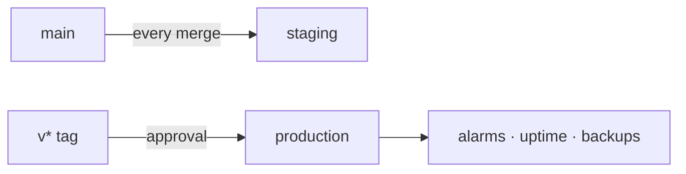

# S9 — Production · App Store

<dl><dd>

- Sprint 9 · 2 weeks · backend 6h of the sprint's 54h · [all sprints](../README.md) · iOS side: [S9 iOS](https://github.com/DAMHONGDUC/site_log_swift_ui/blob/main/docs/feature-guide/S9-release/README.md)

</dd></dl>

## Contents

<dl><dd>

1. [Overview](#overview)
2. [Tasks](#tasks)
3. [Done](#done)
4. [Self-check](#self-check)

</dd></dl>

## Overview

<dl><dd>

- **Goal:** production ready for real users before the App Store build is submitted.
- **Demo:** the App Store build signs in, syncs and uploads against `https://api.<domain>`; staging and prod data stay apart.

| Guide | Builds | Hours |
|---|---|---|
| [F18 Production](F18-production.md) | Purge, alarms, uptime, prod stack, release workflow, restore test | 6 |

</dd></dl>

## Tasks

<dl><dd>

| Task | What | Guide | Hours | Status |
|---|---|---|---|---|
| F18.1 | Tombstone purge | [F18 §1](F18-production.md#1-tombstone-purge) | 1 | not start |
| F18.2 | Alarms and uptime | [F18 §2](F18-production.md#2-alarms-and-uptime) | 1.5 | not start |
| F18.3 | Production stack, secrets, DNS | [F18 §3](F18-production.md#3-production-stack) | 1.5 | not start |
| F18.4 | Release workflow, `v1.0.0` | [F18 §4](F18-production.md#4-release-workflow) | 0.5 | not start |
| F18.5 | Restore test, review checklist | [F18 §5–6](F18-production.md#5-restore-test) | 1.5 | not start |

</dd></dl>

## Done

<dl><dd>

- [ ] Production deployed through an approved tag; alarms and uptime green
- [ ] Restore test done: date ____, `projects` rows ____
- [ ] The App Store review checklist in F18 §6 is all ticked

</dd></dl>

## Self-check

<dl><dd>

- A bad release breaks uploads. Which command puts the previous version back, and what must be true of the migrations for that to work?
- Which two things in AWS cost money even when nobody uses the app?

</dd></dl>
